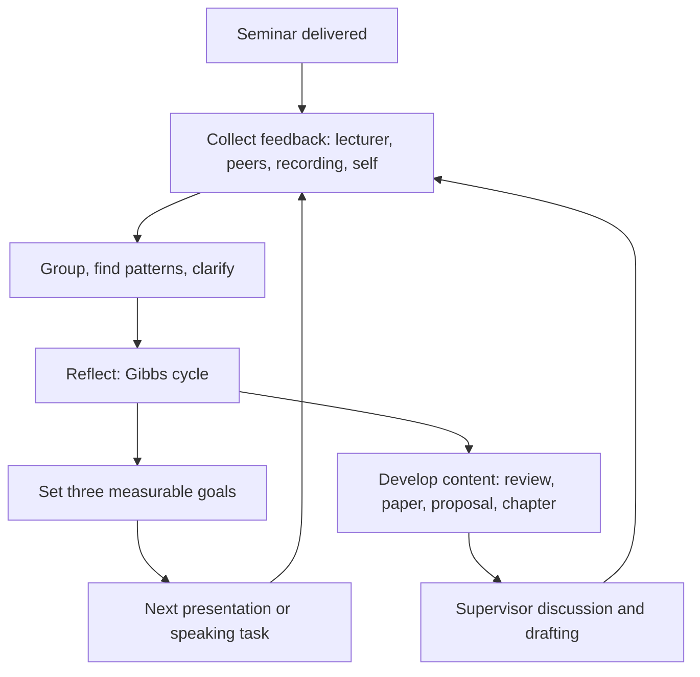

## Introduction

A seminar does not end when the last slide is closed. The most valuable learning often comes afterwards, when you gather the feedback you received, compare it with your own impressions and decide what to change. Students who treat the seminar as a one-off performance miss this opportunity, while those who treat it as a stage in a longer process of developing a piece of research gain skills and material they can use again.

This lesson covers how to seek, interpret and act on feedback, how to reflect in a structured way, and how to develop seminar work into written research such as a literature review, a paper or the first chapters of a dissertation. It also considers how to use the seminar to build professional skills that employers and supervisors value. Your department determines the form of feedback and any assessment you receive; GradPath does not set marks, criteria or deadlines, and this lesson offers general guidance only.

## Learning Objectives

- Explain the purpose of feedback and distinguish its main forms and sources.
- Apply a structured method to interpret, prioritise and act on feedback.
- Use a reflective model to analyse a seminar experience and set specific improvement goals.
- Plan the development of seminar material into a written paper, review or dissertation component.
- Evaluate how seminar learning supports later research and professional practice.

## Prerequisite Knowledge

- Experience of preparing or delivering a seminar presentation, or of rehearsing one.
- Familiarity with the structure of academic writing from earlier study.
- None beyond this: no prior experience of reflective writing is assumed.

## Key Terminology

- **Feedback**: Information about performance that helps the recipient understand the gap between current and desired performance.
- **Feedforward**: Feedback focused on what to do next rather than only judging what was done.
- **Formative feedback**: Comments intended to support improvement, usually before or alongside final assessment.
- **Summative feedback**: Evaluation of a final outcome, often accompanied by a mark.
- **Reflective practice**: The habit of examining experience deliberately in order to learn from it.
- **Reflective cycle**: A structured sequence of questions, such as description, feelings, evaluation, analysis, conclusion and action plan, for analysing an experience.
- **Action plan**: A short list of specific, time-bound steps for improvement.
- **Peer feedback**: Comments from fellow students, usually based on shared criteria.
- **Research pipeline**: The path from seminar topic to a conference-style paper, literature review or dissertation chapter.

## Detailed Explanation

### What feedback is for

Hattie and Timperley (2007) reviewed evidence on feedback and argued that it is most effective when it helps learners answer three questions: Where am I going? How am I going? Where to next? Feedback that only says whether work was good or bad, or that comments on the person, tends to help little. Feedback about the task, the process used and the learner's self-regulation can improve later performance.

In a seminar, useful feedback tells you whether your central claim was clear, whether the evidence supported it, whether the delivery helped or hindered and what you should do next.

### Sources of feedback

- **Lecturer or assessor comments**, written or spoken, which usually reflect the criteria applied.
- **Peer comments**, which show how the talk landed for people in a similar position.
- **Questions from the audience**, which reveal what was unclear or contested.
- **Your own recording or notes**, which show things you cannot see while speaking.
- **Supervisor or mentor discussion**, if you are developing the work further.
- **Behavioural signals**, such as which slides prompted puzzled faces, which are indirect but informative.

Each source has strengths and blind spots. Peers may be polite, lecturers may focus on content, and recordings capture delivery but not audience reaction. Triangulating several sources gives a more reliable picture.

### Seeking useful feedback

Vague requests such as "Any comments?" tend to produce vague answers. Ask specific questions: "Was my central claim clear by the end of the first two minutes?", "Which slide did you find hardest to follow?" or "Did my answer to the question about sampling convince you?" Provide peers with a short form listing two or three focus areas so that their feedback addresses your development goals. Where feedback is delayed, write down your own impressions straight after the talk, before memory fades.

### Receiving and interpreting feedback

Strong reactions to feedback are normal. Stone and Heen (2014) explain that feedback can trigger responses to the truth of the comment, to the person giving it, or to what it implies about you. A practical response is to separate the stages:

1. **Receive**: read or listen without arguing, and thank the giver.
2. **Understand**: ask for examples or clarification if a comment is unclear. "Needs more depth" is hard to act on, while "the methods slide did not say how participants were chosen" is concrete.
3. **Evaluate**: decide whether the comment is accurate, partly accurate or based on a different expectation. Look for patterns: a point made by three people deserves more weight than one made by one.
4. **Prioritise**: choose the few changes that would make the greatest difference, rather than attempting everything.
5. **Act**: turn each into a specific task.

Feedback can conflict. One person may praise your detailed methods slide while another finds it too dense. In such cases, return to your purpose and audience and decide, and if the conflict concerns assessment requirements, check with your lecturer.

### Reflection

Reflection moves beyond "what happened" to "what does it mean and what will I do?" Schon (1983) wrote of the reflective practitioner who thinks about practice while doing it and afterwards. Gibbs (1988) offered a widely used cycle of six prompts, which is helpful for structured reflection:

| Stage | Question |
|---|---|
| Description | What happened? |
| Feelings | What was I thinking and feeling? |
| Evaluation | What was good and bad about the experience? |
| Analysis | Why did things go as they did? What makes sense of it? |
| Conclusion | What else could I have done? What did I learn? |
| Action plan | What will I do next time, and how? |

Strong reflection is specific, evidence-based and honest. "I was nervous and it went badly" is description. "I rushed the second block because I had not rehearsed the transition, which meant the audience lost the link between the problem and the evidence; next time I will script the transition and time that section" is analysis leading to action.

Reflection may be assessed in some programmes, for example through a reflective log, and your department will specify the format. Whatever the format, avoid generic statements and support claims with examples from the experience.

### Setting improvement goals

Convert feedback and reflection into a small number of goals that are specific, measurable and time-bound. Instead of "improve my delivery", write "reduce filler words by recording two rehearsals and counting them before the next presentation" or "add a limitations slide to the structure of every presentation". Review the goals after your next speaking opportunity.

### From seminar to written research

A seminar presentation is often a stepping stone to written work. The central claim, the literature you assembled and the critical argument you built are raw material for:

- **A literature review** or a section of one, expanding the evidence and the synthesis.
- **A short academic paper**, where the seminar argument becomes the thesis and the structure is adapted for reading.
- **A research proposal**, where the gap you identified becomes the problem statement.
- **A dissertation chapter**, if the seminar topic relates to your research area.
- **A conference abstract or poster**, if opportunities arise.

The move from talk to text involves changes. A reader needs fuller definitions, more detailed methodology, explicit reasoning and complete citations, but does not need the repeated signposts and shortened claims a listener needs. Questions raised in the seminar often point directly to the weak parts of the argument, so they are useful guides to revision.

### Checking integrity when you reuse material

If you reuse seminar material in later assessed work, check whether your programme requires you to acknowledge the earlier submission, to avoid self-plagiarism. Discuss with your supervisor or lecturer how seminar work may be developed, and keep the references and notes organised so that the move to writing is accurate.

## Theories, Frameworks and Models

### Feedback levels

Hattie and Timperley (2007) distinguish feedback about the task (is it correct?), the process (how was it done?), self-regulation (how did you monitor your work?) and the self as a person (praise). They argue that the first three are most useful, and personal praise adds little. Apply this by asking for feedback at the task and process levels.

### Experiential learning

Kolb (1984) describes learning as a cycle of concrete experience, reflective observation, abstract conceptualisation and active experimentation. A seminar is the concrete experience; reflection and feedback provide the observation; identifying principles gives the conceptualisation; and the next presentation is the experiment. The model reminds you that learning completes only when you try again with changes.

### Gibbs' reflective cycle

Gibbs' (1988) model provides the six-stage structure above. It is helpful for beginners because its prompts make you describe, evaluate and plan rather than only narrate.

## Step-by-Step Guide

1. **Collect all feedback** within a few days: written comments, peer forms, your recording and your own notes.
2. **Group the comments** into themes such as argument, evidence, structure, slides, delivery and discussion.
3. **Note patterns**, strengths to keep and issues that appear more than once.
4. **Check unclear comments** by asking the giver for an example or clarification.
5. **Write a reflection** using a model such as Gibbs' cycle, with specific examples.
6. **Choose three goals** and write them as measurable actions with dates.
7. **Decide the next step for the content**: archive, develop into a review, turn into a proposal, or discuss with a supervisor.
8. **Make a revision plan** that lists the sections to expand, the evidence to add and the questions to answer.
9. **Review your goals** after your next presentation and update them.

## Worked Example

**Illustrative scenario.** Naa presented a seminar on data privacy practices in small online retailers. Her feedback included: from her lecturer, "clear structure, but the evidence for the central claim was thin and the argument relied on a few sources"; from a peer, "I got lost in the middle section"; and from her recording, many filler words and a rushed ending.

**Step 1: Group the comments.** Argument/evidence: thin evidence, few sources. Structure: middle section unclear. Delivery: filler words and rushed ending.

**Step 2: Find patterns.** The unclear middle section and the rushed ending both point to timing and transitions, which she had not rehearsed.

**Step 3: Reflect (Gibbs).** Description: the middle section had four slides on legal obligations. Feelings: anxious about time. Evaluation: strong opening, weak middle. Analysis: she added content late and cut rehearsal. Conclusion: she should have cut one slide and scripted the transitions. Action: below.

**Step 4: Goals.** (1) By next Friday, add at least four additional peer-reviewed or official sources to her notes and check how they support or complicate her claim. (2) In the next presentation, plan a timing table with a buffer and script every transition. (3) Record one rehearsal and count filler words, aiming to halve them.

**Step 5: Development plan.** Naa decides to expand the seminar into a literature review section: she turns the central claim into a thesis statement, builds a source matrix from the new readings, and drafts a first section, using the questions from the audience to check for gaps. She notes that she must cite carefully and check her department's rule on reusing seminar material in assessed work.

## Ghanaian Business Application

Feedback is part of professional life in Ghana as elsewhere. Performance appraisals, project reviews and client comments require the same ability to receive critique, extract what is useful and act on it. Respect for seniority in many Ghanaian workplaces can make junior staff reluctant to ask for specific or critical feedback, while senior staff may hesitate to be direct. The practices in this lesson, such as asking specific questions and thanking the giver, offer a respectful way to obtain honest and useful comments.

Seminar work can also develop into outputs with local value. A literature-based seminar on digital payments, e-government, data protection or SME technology adoption in Ghana might become a short paper, a policy brief for a professional body, or the background of a dissertation proposal. Check with your supervisor which options are appropriate, and cite the local publications and datasets that you rely on. Networking at departmental events, discussing your work with lecturers and joining relevant professional associations extend the benefit, though participation in any such body is a personal choice and GradPath does not recommend specific organisations.

## International Case Study

### Hattie and Timperley's review of feedback

John Hattie and Helen Timperley (2007) published a widely cited review in the journal *Review of Educational Research* on the power of feedback in education. Drawing on a large body of previous studies, they argued that feedback is among the influences that most strongly affect achievement, but that its effects vary considerably, and that some forms of feedback can even reduce performance. They proposed a model in which effective feedback answers three questions (Where am I going? How am I going? Where to next?) and operates at four levels: task, process, self-regulation and self.

For a seminar student the review supports several habits. Ask for feedback that links to the goal of the task, not only to a judgement. Prefer comments about how you carried out the task and monitored your own work to general praise or criticism of ability. Treat the "where to next" question seriously by finishing every round of feedback with a concrete plan. The review also shows why vague comments are frustrating: they say how you are going but not where to next. Their findings are about education generally, not seminars specifically, so use them as a framework for your own judgement rather than as a rule.

## Diagram

Both loops return to feedback: skills improve through repeated speaking and the research improves through drafting and comment.

## Common Misconceptions

- **Misconception:** Feedback is only useful when it is positive. **Correction:** Specific critical feedback is often the most useful, provided it is accompanied by a way forward.
- **Misconception:** Reflection means describing what happened. **Correction:** Reflection requires analysis of why, evaluation and a plan for action.
- **Misconception:** Once the seminar is over, the work has no further use. **Correction:** Seminar research and argument are valuable raw material for later written work.
- **Misconception:** You must act on every comment. **Correction:** Evaluate and prioritise; some comments reflect different preferences, and you should focus on the changes that matter most.
- **Misconception:** Feelings should be left out of reflection. **Correction:** Acknowledging feelings, then analysing them, helps explain behaviour; it does not make reflection less academic.

## Common Examination Mistakes

- Writing reflections that only narrate events.
- Responding to feedback defensively or dismissing it without evaluation.
- Setting vague goals such as "do better next time".
- Failing to link feedback to evidence from the actual presentation.
- Reusing seminar text in later submissions without checking acknowledgement rules.
- Treating the seminar slides as the finished written work instead of rewriting for a reader.

## Critical Thinking Questions

1. How should you weigh feedback from a peer with less experience against that from an assessor? What makes one source more reliable than another for a specific purpose?
2. Does structured reflection risk becoming a formulaic exercise? How can it remain genuine?
3. What are the advantages and risks of building a dissertation around a topic first explored in a seminar?

## Practical Exercises

1. **Feedback analysis.** Gather all the feedback you have received on a presentation, sort it into themes and mark patterns. *Expected output:* a table of themes, supporting comments and your judgement about each.
2. **Gibbs reflection.** Write a reflection of 400-500 words on a presentation or rehearsal using the six stages, including at least two specific examples. *Expected output:* a completed reflection ending in an action plan.
3. **Goal setting.** Write three goals, each specific, measurable and dated, and decide how you will check them. *Expected output:* three goals with success criteria.

## Key Takeaways

- Feedback is most useful when specific, task- and process-focused and linked to next steps.
- Seek feedback from several sources and ask specific questions.
- Receive, understand, evaluate, prioritise and act, rather than reacting defensively.
- Reflection needs description, analysis and a concrete action plan.
- Seminar material can be developed into written research, with attention to integrity and reader needs.
- Seminar skills transfer to professional life.

## Further Reading

- Derby, E., & Larsen, D. (2006). *Agile retrospectives: Making good teams great*. Pragmatic Bookshelf.
- Gibbs, G. (1988). *Learning by doing: A guide to teaching and learning methods*. Further Education Unit.
- Hattie, J., & Timperley, H. (2007). The power of feedback. *Review of Educational Research, 77*(1), 81-112.
- Kolb, D. A. (1984). *Experiential learning: Experience as the source of learning and development*. Prentice Hall.
- Schon, D. A. (1983). *The reflective practitioner: How professionals think in action*. Basic Books.
- Stone, D., & Heen, S. (2014). *Thanks for the feedback: The science and art of receiving feedback well*. Viking.

## Video Resources

- [Three Minute Thesis](https://threeminutethesis.uq.edu.au/): The University of Queensland. Official site with examples of research communication that can prompt reflection on your own work.
- [APA Style](https://apastyle.apa.org/): American Psychological Association. Official site with guidance on writing and citation when developing seminar work into papers.

## Revision Summary

Feedback and reflection turn a single seminar into lasting improvement. Gather feedback from several sources, interpret and prioritise it, reflect using a structured model, set measurable goals and decide how to develop the content into written research with correct acknowledgement. The skills gained transfer to professional practice.

- Feedback answers: where am I going, how am I going, where to next.
- Receive, understand, evaluate, prioritise, act.
- Gibbs: description, feelings, evaluation, analysis, conclusion, action plan.
- Goals: specific, measurable, dated.
- Pipeline: seminar to review, paper, proposal or chapter.
- Check rules on reusing submitted material.
