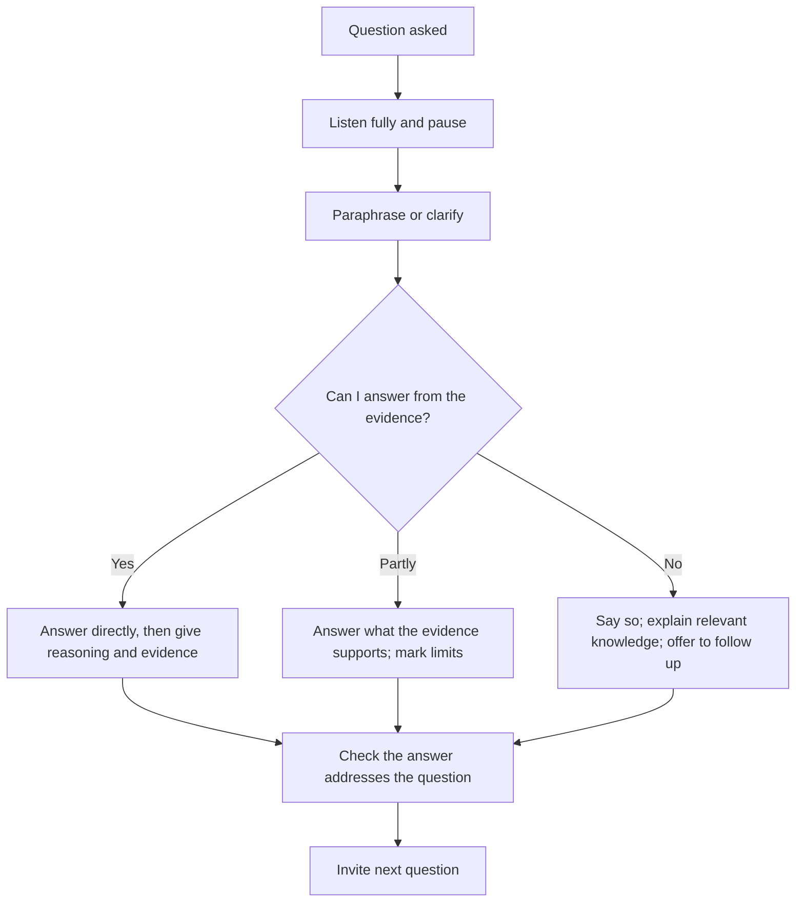

## Introduction

For many students the question session is the most feared part of a seminar, because it cannot be scripted. Yet questions are also where understanding becomes visible. A presenter who answers a challenge by returning to the evidence, admitting what the study cannot show and thinking aloud about alternatives demonstrates the intellectual qualities that postgraduate study aims to build. Questions are not an attack on the presenter; they are the audience's way of engaging with the argument.

Discussion is a two-way skill. When you are in the audience you are expected to ask questions and contribute, and the quality of your questions shows how well you have understood the work of others. This lesson covers how to anticipate questions, how to listen and respond in a structured way, how to deal with difficult, hostile or off-topic questions, how to respond to criticism, and how to take part in discussion respectfully. The expected format of your seminar discussion is set by your department; this lesson describes general good practice.

## Learning Objectives

- Classify the common types of question asked in academic seminars and explain their purposes.
- Apply a structured method to listening to, clarifying and answering questions.
- Prepare responses to anticipated questions using evidence from the study and the literature.
- Evaluate strategies for handling difficult, hostile and unanswerable questions professionally.
- Formulate constructive questions and comments as an audience member.

## Prerequisite Knowledge

- A completed or well-developed seminar argument supported by literature.
- Familiarity with professional conduct in seminars (see the first module of this course).
- None beyond this: experience of public speaking is helpful but not required.

## Key Terminology

- **Clarification question**: A question asking the speaker to explain something that was unclear.
- **Probing question**: A question that tests the reasoning, evidence or assumptions behind a claim.
- **Challenge**: A question or comment that disputes a claim, offering a counter-argument or counter-evidence.
- **Extension question**: A question that asks how the argument applies to another context or what comes next.
- **Paraphrasing**: Restating a question in your own words to check understanding and help the audience hear it.
- **Bridging**: Linking a question to a point you have already made or can make from the evidence.
- **Scope**: The boundaries of what a study or argument claims to cover.
- **Ad hominem**: An attack on the person rather than the argument; not acceptable in academic discussion.
- **Backup slide**: A slide prepared in advance to answer an expected question, shown only if needed.

## Detailed Explanation

### Why questions are asked

Understanding why a question is asked changes how it feels. Questioners usually want one of the following:

- **To understand**: they missed or did not follow something.
- **To test**: they want to see whether the claim holds under pressure.
- **To extend**: they see a connection to another area.
- **To contribute**: they have relevant knowledge or experience to add.
- **To assess**: examiners need evidence of understanding that the talk alone cannot show.

Rarely is the main purpose to humiliate. Even a sharp question usually reflects interest in the topic. Assuming good faith, unless clear evidence suggests otherwise, helps you stay calm and respond to the substance.

### Types of question and typical responses

| Type | Example | Response approach |
|---|---|---|
| Clarification | "What did you mean by trust?" | Define briefly, then link to the evidence |
| Methodological | "Why did you choose a survey?" | State the reasoning and acknowledge trade-offs |
| Evidence | "What is the basis for that claim?" | Cite the source and its strength, or admit the limit |
| Scope | "Does this apply outside Accra?" | State what the evidence covers; mark inference as inference |
| Alternative | "Have you considered X?" | Acknowledge, compare, explain why you did or did not use it |
| Challenge | "Your conclusion ignores Y." | Concede valid points, defend with evidence, or note disagreement |
| Practical | "What should firms do?" | Give a qualified recommendation tied to findings |
| Off-topic | A question about an unrelated area | Acknowledge, give a brief answer or offer to discuss afterwards |

### A step-by-step method for answering

1. **Listen completely.** Do not interrupt or begin forming your reply before the questioner finishes. Note key words if the question is long.
2. **Pause.** A two-second pause shows that you are thinking, and it protects you from answering a different question from the one asked.
3. **Clarify or paraphrase.** "If I understand correctly, you are asking whether..." confirms the question, helps everyone hear it, and gives you time. If a question has several parts, ask which the questioner would like first or answer them in order.
4. **Answer directly.** Give the answer in the first sentence, then the reasoning and evidence. Avoid long background that delays the point.
5. **Be honest about limits.** If you do not know, say so, explain what you do know that is relevant and how you could find out. A confident "I do not know, but here is how I would find out" is better than a guess.
6. **Check.** "Does that address your question?" lets the questioner redirect and ends the exchange politely.
7. **Be concise.** Answers of around a minute are usually enough. Longer answers invite follow-up and use up time for other questions.

### Preparing for questions

Preparation is the main protection against panic.

- **List likely questions**: on definitions, method, sample and sources, claims and scope, limitations, contribution and practice. Ask peers for the hardest questions they can think of.
- **Draft short answers** with the evidence you would cite, in your own words.
- **Prepare backup slides** for detailed data, methods or alternative interpretations.
- **Know your weakest point** and decide how you will describe it honestly before anyone raises it. Naming limitations in the talk often removes the sting from a challenge.
- **Know the literature around your claim**, including the strongest opposing view.

### Handling difficult situations

**A question you cannot answer.** Do not bluff. Say what you do not know, what the evidence does show and what would be needed to answer fully. Offer to follow up if appropriate.

**A hostile or dismissive tone.** Respond to the content, not the tone. Remain courteous, restate the substantive question, and answer it. If the exchange becomes unprofessional, the chair or lecturer has the responsibility to intervene, and you can say "I would be glad to continue this discussion after the session."

**A long statement instead of a question.** Find the implied question: "Is your question whether the pattern also holds in rural settings?" Then answer that.

**A question that exposes a real mistake.** Acknowledge it plainly ("You are right, that figure is wrong; thank you for catching it"), explain how it affects the conclusion, and correct it. Correcting an error openly raises credibility.

**Repeated challenges from the same person.** Acknowledge their point, state that you may see it differently, and suggest continuing the discussion later so that others can contribute.

**A silent room.** Have a seed question ready: "A question I am often asked is...". This can start discussion without asking you to invent a question on the spot.

**A leading or loaded question.** Notice the assumption and restate the question without it: "Your question assumes that X; the evidence I have shows Y."

### Responding to criticism

A challenge can be valid, partly valid or mistaken. Respond by assessing it:

- **Valid**: concede the point, state its effect on your conclusions and what you would do differently.
- **Partly valid**: acknowledge the part that holds and explain why the rest does not, with evidence.
- **Mistaken**: explain respectfully and offer the evidence that addresses it.
- **A difference of interpretation**: state that reasonable scholars read this evidence differently, and say why you prefer your reading.

Defensive responses tend to harm a presenter's credibility more than the original criticism did. Stone and Heen (2014) point out that people often respond to feedback defensively because of how it makes them feel, and that separating the feeling from the content helps you learn from it.

### Participating in discussion as an audience member

Good participation is part of seminar conduct and is often valued by assessors. To contribute well:

- **Listen actively** and take notes on points you may wish to raise.
- **Ask one question at a time**, specific and linked to the speaker's content ("On slide 6, you reported... how did you handle...?").
- **Be constructive**: question the argument, not the person, and acknowledge what was strong before raising a concern.
- **Avoid showing off**: a question should seek understanding or advance the discussion, not display your knowledge.
- **Link to others' points**: "Building on what was said earlier..." shows listening.
- **Respect time**: be brief so that others can speak.
- **Accept answers graciously**, including when they do not satisfy you; you can note disagreement and move on.

## Theories, Frameworks and Models

### Argumentation: claim, grounds, warrant, rebuttal

Toulmin's model of argument describes a claim supported by grounds (evidence) and a warrant (the reasoning connecting them), qualified where appropriate and open to rebuttal. It is useful in a question session because most challenges target one part: the evidence is weak, the reasoning does not follow, or exceptions exist. Identifying which part is being questioned helps you respond precisely.

### The principle of charity

In philosophy and debate, the principle of charity asks you to interpret an opponent's argument in its strongest reasonable form before responding. Applied to questions, it means restating a challenge fairly, even improving it, before answering. It models intellectual honesty and often defuses tension.

### Blameless review in technology practice

The software industry's practice of blameless post-incident reviews, described in the Google site reliability engineering literature (Beyer et al., 2016), focuses on understanding what happened and what to change rather than on blaming individuals. It offers a useful attitude for academic criticism: treat a flaw as information about the work.

## Worked Example

**Illustrative scenario.** Akosua presents a literature-based seminar arguing that trust in providers is a stronger driver of mobile money use among small traders than transaction cost. During questions:

**Question 1 (clarification).** "What do you mean by trust here?" She answers directly: "I am using trust to mean a trader's belief that the provider will keep funds safe and execute transactions correctly, as most of the studies I reviewed define it," and then adds that a few studies use narrower definitions.

**Question 2 (challenge).** "Your sources are mostly from other countries, so how can you say anything about Ghana?" Akosua pauses, then replies: "That is a fair limitation. The evidence I reviewed from Ghana is limited, so my claim is that the pattern is consistent with the international findings, and I flag the Ghanaian gap as a research need. I would not claim it is established locally." She concedes the valid part and keeps her claim proportionate.

**Question 3 (long statement).** A participant speaks for two minutes on regulation. Akosua responds: "If I understand, you are asking whether regulation could change the balance between trust and cost?" The participant agrees. She answers briefly: the studies she reviewed did not examine this, so she would treat it as a promising extension.

**Question 4 (unknown).** "Which study first measured trust this way?" She does not remember. She says, "I do not recall the original source; I can check my notes and send it to you after the session."

**Question 5 (hostile).** "This is just a summary of other people's work." She stays calm: "The synthesis is the contribution: I compared how the studies measured trust and found that few measured it consistently, which is what my argument rests on. I am glad to discuss alternative approaches afterwards."

## Ghanaian Business Application

In Ghanaian professional and academic settings, courtesy and respect for seniority are part of the culture of discussion. Addressing assessors and senior colleagues respectfully, thanking questioners and avoiding a combative tone are expected in many settings. Respectful does not mean uncritical: well-framed, evidence-based disagreement is welcome in academic and professional life, and the techniques here help you disagree politely.

In workplace presentations, questions often come from managers who want to know cost, risk and practical consequences rather than methodological detail. Prepare short, business-oriented answers: what is the benefit, what is the risk, what is the evidence, and what would you recommend? Similarly, when you question a colleague's proposal, linking your concern to the organisation's goals ("How would this affect customer onboarding time?") is more effective than abstract criticism. In group or multilingual settings, rephrase questions slowly, invite clarification and check understanding, so that no participant is excluded by language.

## International Case Study

### Agile retrospectives and blameless post-incident reviews

In software development, many teams use retrospectives, structured meetings at the end of an iteration where the team examines what went well, what did not and what to change. Derby and Larsen (2006) describe a framework for running them, in which participants set the stage, gather data, generate insights, decide what to do and close the meeting. The emphasis is on learning rather than blame. Similarly, Beyer et al. (2016) describe a practice in Google's site reliability engineering of conducting post-incident reviews that focus on systems and processes and do not seek to blame individuals, because blame discourages people from reporting problems honestly.

The link to seminar discussion is the attitude to criticism. A technology team that treats an outage as information about the system learns faster than one that looks for a culprit. A presenter who treats a challenge as information about the work, and a questioner who frames a challenge as an attempt to improve it, create a similar environment. The case also shows that constructive critique has structure: it starts from evidence, identifies specific causes and ends with a decision about what to change, which is a good template for both answering and asking questions.

## Diagram

All three routes end with a check, which keeps the exchange two-way and tells the audience that you value the questioner.

## Common Misconceptions

- **Misconception:** A good presenter can answer every question. **Correction:** No one can; a proportionate, honest "I do not know" is a strength.
- **Misconception:** A critical question means the talk went badly. **Correction:** Challenging questions usually signal engagement with the argument.
- **Misconception:** You must defend your position whatever the objection. **Correction:** Conceding a valid point and adjusting your claim is good scholarship.
- **Misconception:** Longer answers show greater knowledge. **Correction:** Concise, direct answers with evidence are more convincing and leave time for others.
- **Misconception:** Audience members who ask hard questions are being rude. **Correction:** Constructive challenge is normal in academic discussion; rudeness lies in tone and personal attacks, not in disagreement.

## Common Examination Mistakes

- Interrupting the questioner or answering a different question.
- Bluffing instead of admitting that something is not known.
- Becoming defensive, sarcastic or dismissive.
- Giving long, rambling answers that do not state a position.
- Failing to link answers to the evidence from the study or literature.
- As an audience member, asking multi-part questions, making speeches or attacking the speaker personally.
- Not preparing backup slides or answers on obvious weaknesses.

## Critical Thinking Questions

1. When is it better to concede a criticism immediately and when should you defend your position?
2. How can a chair or lecturer design a question session so that quieter students and those with less confident English contribute?
3. Is it fair for assessors to use questions to test whether work is the student's own? What makes such questioning legitimate?
4. How should a presenter respond to a question that rests on a factual mistake by the questioner?

## Practical Exercises

1. **Question bank.** Write twelve questions your audience might ask, covering definitions, method, evidence, scope, limitations and practice, and draft a 60-second answer to each. *Expected output:* a document of twelve questions and answers, with the weakest answers marked for revision.
2. **Mock panel.** Ask two peers to question you for ten minutes after a rehearsal, including one deliberately difficult question. Record the session. *Expected output:* the recording or notes and a self-assessment using the step-by-step method.
3. **Reframing.** Take three blunt or hostile questions (invented or from experience) and rewrite each as a neutral question, then write a courteous answer. *Expected output:* three paired rewrites and answers.

## Key Takeaways

- Questions are an opportunity to show understanding, not a test of perfection.
- Listen fully, pause, paraphrase, answer directly, give evidence and check.
- Prepare likely questions, backup slides and an honest account of your weakest point.
- Concede valid criticism, defend with evidence where warranted, and never bluff.
- Stay courteous with hostile or unclear questions, and answer the substance.
- As an audience member, ask specific, constructive questions aimed at the argument.

## Further Reading

- Beyer, B., Jones, C., Petoff, J., & Murphy, N. R. (Eds.). (2016). *Site reliability engineering: How Google runs production systems*. O'Reilly Media.
- Derby, E., & Larsen, D. (2006). *Agile retrospectives: Making good teams great*. Pragmatic Bookshelf.
- Stone, D., & Heen, S. (2014). *Thanks for the feedback: The science and art of receiving feedback well*. Viking.
- Toulmin, S. E. (2003). *The uses of argument* (Updated ed.). Cambridge University Press.

## Video Resources

- [TED](https://www.ted.com/): TED Conferences. Official site with talks and Q&A sessions for studying how speakers respond to audiences.
- [Three Minute Thesis](https://threeminutethesis.uq.edu.au/): The University of Queensland. Official site with examples of concise research communication.

## Revision Summary

Questions test and extend an argument. Listen fully, pause, paraphrase, answer directly with evidence and check that you have answered. Prepare likely questions and backup slides, be honest about limits, concede valid criticism and stay courteous when challenged. As a participant, ask specific, constructive questions about the argument.

- Types: clarification, methodological, evidence, scope, alternative, challenge, practical, off-topic.
- Method: listen, pause, paraphrase, answer, evidence, check.
- Never bluff; say what you know and how you would find out.
- Respond to substance, not tone.
- Ask one specific, constructive question at a time.
- Follow your department's discussion format.
