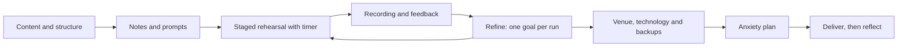

## Introduction

Excellent content can be lost in poor delivery, and modest content can be made clear by good delivery. Delivery is the set of choices a speaker makes about voice, pace, movement, eye contact, use of notes and handling of the room. These choices are learnable skills, not talents some people are born with, and most confident speakers have simply rehearsed more and learned what to do when things go wrong.

Delivery also matters for a reason particular to research: your audience judges how well you understand your work partly by how you talk about it. A presenter who can explain a method without reading from the slide shows command of it. This lesson covers the practical skills of research communication, including preparing for the room, using voice and body, using notes, dealing with technical failure, and managing the anxiety that most speakers feel. It does not set any official criteria for your seminar; those come from your department.

## Learning Objectives

- Explain the elements of effective spoken delivery in an academic setting.
- Apply techniques for voice, pace, pausing, eye contact and posture in a rehearsed presentation.
- Select and use notes in a way that supports rather than replaces natural speech.
- Develop a rehearsal and contingency plan covering timing, equipment and venue.
- Evaluate strategies for managing presentation anxiety and choose ones suited to your own experience.

## Prerequisite Knowledge

- A structured presentation and prepared slides (see the earlier lessons in this module).
- Awareness of the format and time limit of your seminar.
- None beyond this: no previous public speaking experience is assumed.

## Key Terminology

- **Delivery**: The way a presentation is spoken and physically performed, as distinct from its content and slides.
- **Pace**: The speed at which words are spoken, usually judged against the audience's ability to follow.
- **Pause**: A deliberate silence used for emphasis, for thought or to let the audience absorb a point.
- **Vocal variety**: Variation in pitch, volume and tempo that keeps speech clear and engaging.
- **Filler words**: Sounds or words such as "um", "like" and "you know" used to fill silence.
- **Eye contact**: Looking at individual audience members for the length of a thought, rather than scanning rapidly or fixing on slides.
- **Rehearsal**: Deliberate practice of the full presentation aloud, ideally with timing and feedback.
- **Presentation anxiety**: The nervousness, physical arousal and worry many people feel before and during speaking.
- **Contingency plan**: A prepared response to foreseeable problems such as equipment failure or reduced time.

## Detailed Explanation

### The audience's point of view

Delivery is for the listener. Ask what the audience needs: to hear every word, to know where you are in the argument, to see that you are engaged with them and to trust your command of the material. Each technique in this lesson serves one of those needs, and the right choice depends on the room, the size of the audience and the formality of the occasion.

### Voice

- **Volume.** Speak so that the back of the room hears without strain. Nerves often make voices quieter, so aim a little louder than feels natural. If a microphone is available, test it in advance and hold it at a steady distance.
- **Pace.** Nervous speakers speed up. Slow down on key claims, numbers and technical terms, and speed up slightly on familiar background. A pace that feels slow to you is often just right for listeners who are meeting the ideas for the first time.
- **Pauses.** A pause before and after an important point gives it weight. Pausing also replaces filler words: silence feels long to the speaker but natural to the audience.
- **Variety.** A flat tone makes even strong content hard to follow. Vary pitch and emphasis to mark the difference between a main point and an aside.
- **Clarity.** Pronounce technical terms, acronyms and names deliberately, and expand acronyms on first use. In a multilingual setting, clear articulation and a measured pace help everyone, including listeners for whom English is an additional language.

### Body and presence

Body language supports meaning and signals confidence. Stand with feet steady and shoulders relaxed, face the audience rather than the screen, and use open hand gestures that match your words. Avoid pacing, rocking or fiddling with a pen or clicker. Move purposefully, for example to a different position when you change section, rather than constantly.

A frequently quoted claim says that most communication is nonverbal, based on a misreading of experiments by Albert Mehrabian on feelings and attitudes in very specific conditions. Mehrabian himself has said that the figures do not apply to communication in general. The sensible conclusion is more modest: content matters, and so do voice and presence, because they affect how credible and clear the content seems.

### Eye contact and engagement

Look at one person at a time for a sentence or thought, then move to another part of the room. This feels more natural to the audience than sweeping glances and helps you notice whether people are following. If looking at faces makes you anxious, look at foreheads or at friendly faces at the edges of the group. Avoid reading from the screen, because turning your back to the audience weakens your voice and eye contact. Glance at the slide to check, then return to the audience.

### Notes and scripts

There are three common approaches.

| Approach | Strengths | Risks |
|---|---|---|
| Full script read aloud | Accuracy, precise timing | Flat delivery, little eye contact, lost place if interrupted |
| Key-word notes or speaker notes | Natural speech, flexibility | Rambling if poorly prepared |
| Memorised delivery without notes | Fluent and engaged | Collapse if memory fails; rigid |

For most seminars, key-word notes or short prompts per slide give the best balance. A useful hybrid is to script and learn your opening and closing sentences exactly, since these are the most pressured moments, and speak from prompts in between. If your department requires a script or handout, follow that.

### Rehearsal

Rehearsal is the most reliable method of improving delivery. Effective rehearsal has stages:

1. **Silent run-through** to check the logic.
2. **Aloud with a timer**, noting where time is lost.
3. **Standing, with slides, as in the real event**, using the remote or clicker.
4. **Recorded** on a phone, so you can see filler words, pace and posture.
5. **In front of one or two peers** who give specific feedback.
6. **Final dress rehearsal** in the venue if possible.

Rehearse the transitions and the answers to likely questions, not only the main content. Stop rehearsing in the final hours; rest and a short warm-up (reading aloud, breathing) are more useful than another run-through.

### The venue and the technology

Reduce uncertainty by preparing the environment.

- Arrive early and test the projector, display, adapter, microphone and clicker.
- Carry the slides in more than one form: on a USB drive, in cloud storage and as a PDF.
- Check fonts and embedded media on the venue computer if it is not yours.
- Know where the lights, power sockets and exits are, and check that the room allows you to see the screen and the audience.
- Prepare a no-slides fallback: you should be able to state your central claim, three main points and conclusion without any slide.

### Managing presentation anxiety

Nervousness before speaking is normal and common, and it is not a sign of incompetence. The body's response to perceived threat, a fast heartbeat, dry mouth and shaking hands, is similar to the response to excitement. Strategies that many speakers find helpful fall into three groups.

**Before the event.**
- Prepare thoroughly: uncertainty about content is the largest controllable source of anxiety.
- Rehearse in conditions that resemble the real event.
- Visualise the opening going well and plan your first sentences.
- Look after basics: sleep, food and water, and avoiding excess caffeine.

**Just before and at the start.**
- Slow breathing, such as breathing out for longer than breathing in, can reduce physical tension.
- Use a short physical release, such as relaxing the shoulders, before you stand.
- Start with the learned opening sentences, since the first 30 seconds are often the hardest.

**During.**
- Pause and breathe if you lose your place; the silence is shorter for the audience than for you.
- Reframe nerves as energy.
- Focus on the message and the audience's needs rather than on how you appear.
- If you make a mistake, correct it briefly and continue.

For people whose anxiety is severe or interferes with study, university counselling and support services are the right resource, and requests for reasonable adjustments should go through your institution's official procedures. GradPath cannot grant adjustments or give clinical advice.

## Theories, Frameworks and Models

### The communication triangle

Classic rhetoric, associated with Aristotle, describes persuasion through *ethos* (the speaker's credibility), *logos* (the logic of the argument) and *pathos* (the emotional connection). An academic seminar relies mainly on logos, supported by ethos, which is built by accurate content, honest limitations and professional delivery. Used responsibly, a measure of pathos, such as a relevant example, helps an audience care about the question without manipulating them.

### Deliberate practice

The concept of deliberate practice describes improvement through focused, repeated work on specific weaknesses with feedback. Applied to delivery, this means isolating one thing per rehearsal, such as reducing filler words or slowing the opening, rather than repeating the whole talk without a goal.

### The performance anxiety curve

A long-standing idea in psychology, often called the Yerkes-Dodson relationship, holds that moderate arousal can help performance while very high arousal harms it. The practical use is as a way of thinking: some tension sharpens focus, and the aim of anxiety management is to keep it at a useful level, not to remove it.

## Step-by-Step Guide

1. **Define your audience and venue**: size, knowledge, language, equipment.
2. **Choose your notes system** and prepare prompts, with the opening and closing learned exactly.
3. **Rehearse in stages**: silent, aloud with timer, standing with slides, recorded, then in front of peers.
4. **Review the recording** for pace, filler words, eye contact and posture, picking one improvement for the next run.
5. **Prepare the technology and backups**, including a PDF and a no-slides version.
6. **Plan your anxiety strategy**: breathing, warm-up, opening lines.
7. **On the day**, arrive early, test equipment, and take a moment before starting.
8. **During the talk**, pause at transitions, look at people, and protect the conclusion if time is short.
9. **After the talk**, write down what went well and what to change.

## Worked Example

**Illustrative scenario.** Yaw rehearses a ten-minute seminar on the adoption of electronic health records. In his first recorded run he speaks for 8 minutes, reads most of his slides, uses "you know" frequently, faces the screen when describing charts and has a trembling voice in the opening.

**Step 1: Diagnose.** The pace is too fast, the notes are too detailed, the filler words are habitual, the posture hides his face, and the opening is unrehearsed.

**Step 2: Set one goal per run.** Run 2: replace full-sentence slides with key-word prompts, and speak from them. Run 3: pause at each transition for two seconds, which also cuts filler words. Run 4: stand facing the audience and use a glance at the screen then return. 

**Step 3: Fix the opening.** Yaw writes the first three sentences and learns them exactly, along with the closing two sentences.

**Step 4: Prepare for problems.** He saves a PDF to a USB drive and cloud storage, and writes a one-paragraph version of the talk that he can deliver without slides.

**Step 5: Anxiety plan.** Before the talk he takes five slow breaths, drinks water and checks the first slide; when his voice shakes in the first lines, he pauses once, breathes and continues.

**Result.** His final timed rehearsal takes 9 minutes 20 seconds in a ten-minute slot, and a peer reports that the explanations sounded natural and that he looked at the audience for most of the talk.

## Ghanaian Business Application

Presenting skills are valued in Ghanaian workplaces, where analysts and IT staff present to managers, boards, clients and community stakeholders. Audiences are often multilingual, and speakers may switch between English and local languages in informal settings. In an academic or formal professional setting, a clear, measured pace, plain vocabulary for technical terms and brief definitions of acronyms help everyone follow. Greeting the audience courteously and acknowledging those present is a customary part of formal presentations in many Ghanaian settings, and a respectful tone toward senior colleagues and assessors is expected. Follow the conventions of your own department or organisation.

Practical conditions deserve planning: power interruptions, variable connectivity and equipment differences can affect a presentation. Do not depend on live internet access for a demonstration; use screenshots or recorded clips as a fallback, carry slides in several formats, and have a plan to continue without slides. Preparing for these conditions reduces anxiety because the worst cases already have an answer.

## International Case Study

### Hans Rosling and the communication of data

Hans Rosling (1948-2017), a Swedish physician and professor of international health, became widely known for presentations about global development data, notably his 2006 talk at the TED conference. He used animated bubble charts, produced with software developed through the Gapminder Foundation that he co-founded, to show how health and income changed across countries over decades. His presentations are often cited for the way voice, movement and data worked together: he narrated changes as the bubbles moved, drew attention to specific countries, paused for effect and used simple language for complex material.

The lesson for a seminar speaker is not to imitate his style, which was distinctive and energetic, but to notice the principles behind it. He explained a visual while it was in motion rather than leaving it unexplained, used pace and emphasis to direct attention, kept technical vocabulary light, and spoke with evident interest in the question. His example also shows that delivery is compatible with rigorous content: the talks succeeded because the data were sound and the delivery made them accessible.

## Diagram

The loop between feedback, refinement and rehearsal is the engine of improvement; the later steps prepare the conditions in which the practised talk is delivered.

## Common Misconceptions

- **Misconception:** Confident speakers do not feel nervous. **Correction:** Many experienced speakers feel nervous; they have strategies for using and managing the energy.
- **Misconception:** Memorising a script word for word is the safest approach. **Correction:** A memorised script can collapse after one slip and often sounds flat; prompts plus a learned opening and closing are safer.
- **Misconception:** Pausing makes you look unprepared. **Correction:** Deliberate pauses signal control and give the audience time to think.
- **Misconception:** Speaking quickly shows command of the material. **Correction:** Speed usually reduces comprehension; clarity shows command.
- **Misconception:** Body language contributes 55 per cent of every message. **Correction:** This is a misreading of narrow experiments on feelings and does not describe communication in general.

## Common Examination Mistakes

- Reading slides or a script aloud with minimal eye contact.
- Speaking too fast and running out of time before reaching the conclusion.
- Not rehearsing with a timer or a listener.
- Relying on a live internet connection or a single copy of the slides.
- Using unexplained acronyms and technical terms.
- Apologising repeatedly ("sorry, this is not very good"), which undermines credibility.
- Ignoring the audience when pointing at visuals.

## Critical Thinking Questions

1. Is it ethical to use persuasive delivery techniques to make a weak argument sound strong? Where is the line between clear and manipulative?
2. How should delivery adapt when presenting online, where eye contact, gestures and audience feedback are limited?
3. In what circumstances is reading a prepared script justified, and how can its weaknesses be minimised?
4. How can a department make seminar assessments fair for students with high anxiety or speech differences?

## Practical Exercises

1. **Recorded run.** Record a five-minute section of your seminar and note pace, filler words, eye contact and posture. *Expected output:* a short self-assessment listing three strengths and two priorities for improvement.
2. **Opening and closing.** Write and learn the first three sentences and the last two sentences of your talk, and deliver them to a peer from memory. *Expected output:* the written sentences and peer feedback on clarity and confidence.
3. **Contingency plan.** Prepare a one-page plan for equipment failure, reduced time and an unexpected interruption. *Expected output:* a plan listing the problem, your response and what you will carry.

## Key Takeaways

- Delivery is a set of learnable skills: voice, pace, pauses, eye contact, posture and use of notes.
- Prompts with a learned opening and closing work better than full scripts for most speakers.
- Staged, timed and recorded rehearsal with one goal per run is the most effective preparation.
- Prepare the venue, the technology and a no-slides fallback.
- Nervousness is normal; preparation, breathing and reframing help manage it.
- Seek institutional support if anxiety is severe.

## Further Reading

- Alley, M. (2013). *The craft of scientific presentations* (2nd ed.). Springer.
- Anderson, C. (2016). *TED talks: The official TED guide to public speaking*. Houghton Mifflin Harcourt.
- Reynolds, G. (2019). *Presentation Zen: Simple ideas on presentation design and delivery* (3rd ed.). New Riders.

## Video Resources

- [Gapminder](https://www.gapminder.org/): Gapminder Foundation. Official site with tools and talks that show data communication in practice.
- [TED](https://www.ted.com/): TED Conferences. Official site with recorded talks for studying delivery styles.

## Revision Summary

Good delivery makes research clear and credible. Control voice, pace and pauses, look at the audience, use key-word prompts with a learned opening and closing, rehearse in stages with a timer and recording, prepare the venue and backups, and manage nerves with preparation, breathing and reframing.

- Slow down; pause rather than use filler words.
- Look at individuals for a full thought.
- Key-word notes plus learned opening and closing.
- Rehearse aloud, timed, recorded, with peers.
- Backups: USB, cloud, PDF, no-slides version.
- Nerves are normal; use support services if severe.
