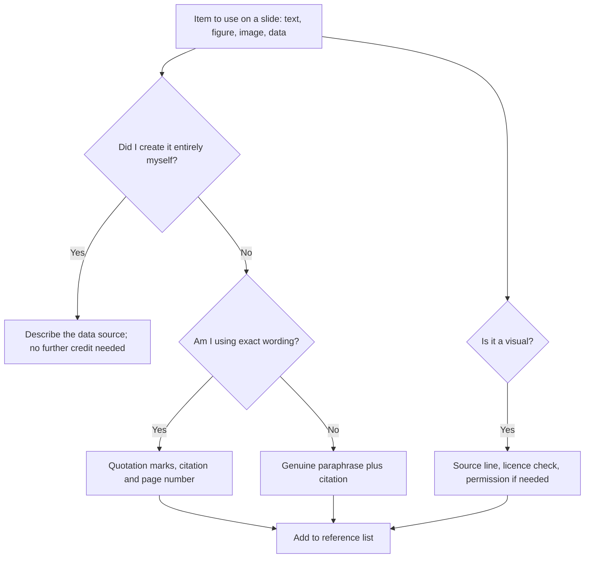

## Introduction

Referencing is often treated as a task for the end of a written assignment, but a presentation raises the same obligations in a different form. When you state a finding, show a figure, reuse a diagram or paraphrase an argument, you owe the audience credit to the original source and a route to find it. Slides make this harder than prose because space is limited and speech has no footnotes, so presenters sometimes drop citations altogether, which is a common route to unintentional plagiarism.

This lesson explains what academic integrity requires in a presentation, how to cite in APA 7 style on slides and in a reference list, how to credit images, data and diagrams, and how to speak about sources naturally. It also covers wider integrity issues, such as reporting evidence fairly, using generative AI tools responsibly and respecting copyright. Your department or university decides which referencing style, policies on AI tools and penalties apply; this lesson explains principles and APA 7 conventions and does not replace your institution's rules.

## Learning Objectives

- Explain why presentations require attribution and distinguish plagiarism, poor citation and misrepresentation.
- Apply APA 7 in-text citation and reference-list conventions to slides.
- Credit images, charts, diagrams and data with accurate captions and source lines.
- Integrate sources into spoken delivery using clear attribution phrases.
- Evaluate a draft presentation for integrity risks, including paraphrasing too closely and the unacknowledged use of AI tools.

## Prerequisite Knowledge

- Familiarity with the basics of APA referencing from earlier study (for example the research methods courses).
- A working source list for your seminar topic.
- None beyond this: reference-management software is helpful but not required.

## Key Terminology

- **Plagiarism**: Presenting someone else's words, ideas, data or images as your own, whether deliberately or through careless citation.
- **Paraphrase**: Restating an idea in your own words and sentence structure while still citing the source.
- **Direct quotation**: Words reproduced exactly, shown in quotation marks with a citation and a page or slide number where available.
- **In-text citation**: A short reference in the body of the work, in APA 7 giving author and year, that points to the full entry in the reference list.
- **Reference list**: An alphabetical list of the full details of every source cited, placed at the end of the presentation.
- **Secondary citation**: Citing a source that you have not read directly but found cited in another work.
- **Licence**: The terms under which a creator permits others to reuse a work, such as a Creative Commons licence.
- **Self-plagiarism**: Reusing your own previous submitted work without acknowledgement.
- **Fabrication**: Inventing or altering data, sources or quotations.

## Detailed Explanation

### Why attribution matters in a presentation

Attribution has four purposes. It acknowledges the intellectual work of others, it lets the audience check your claims, it shows how your argument relates to existing knowledge, and it demonstrates that you can distinguish what is established from what is your own contribution. In a seminar, the examiner or lecturer also uses citations as evidence that you have read and understood the literature, which is an important part of the task.

Plagiarism in a presentation can take familiar forms: copying text from a paper onto slides without quotation marks, presenting a published figure as if it were your own, adapting a classmate's slides, or using another author's structure and examples without acknowledgement. It can also be unintentional, for example when notes taken without citations are later turned into slides and the source is forgotten. Because lack of intent does not necessarily remove the consequence, the safest approach is to record sources at the note-taking stage.

### Beyond plagiarism: integrity in presenting evidence

Integrity covers more than avoiding copying. Responsible presenters also:

- **Represent sources fairly**, without quoting selectively to reverse an author's meaning or overstating a finding. If a study found a tentative association, do not present it as proof.
- **Report your own data honestly**, including results that did not support your expectations and the limitations of the sample.
- **Avoid fabrication or falsification** of data, quotations or sources, including "plausible" statistics that you cannot trace.
- **Distinguish clearly** between what the sources say, what you infer and what you recommend.
- **Respect confidentiality**, so that information from workplaces or interviews is anonymised unless you have permission.

### APA 7 in-text citation on slides

The Publication Manual of the American Psychological Association (American Psychological Association [APA], 2020) sets the conventions. On slides, the in-text forms are the same as in a paper but are usually kept short.

| Situation | Format | Example |
|---|---|---|
| One author | (Author, year) | (Davis, 1989) |
| Two authors | (Author & Author, year) | (Venkatesh & Davis, 2000) |
| Three or more authors | (First author et al., year) | (Venkatesh et al., 2003) |
| Narrative citation | Author (year) | Davis (1989) argued that... |
| Group author | (Organisation, year) | (World Wide Web Consortium, 2023) |
| Direct quotation | (Author, year, p. x) | (Author, 2020, p. 14) |
| Secondary source | (Original, as cited in Secondary, year) | (Rogers, 1962, as cited in Author, 2019) |

Use the form shown only for works that exist and that you have read; the examples above show format, not recommended reading. If a page number is not available, as in a video or an unpaginated web page, give a section heading, paragraph number or timestamp where the style allows.

### The reference slide and the reference list

A presentation should end with a **references slide** (or several) listing every source cited, in APA 7 format, in alphabetical order by first author. Entries have a standard pattern:

- **Book**: Author, A. A. (Year). *Title in sentence case and italics* (edition). Publisher.
- **Journal article**: Author, A. A., & Author, B. B. (Year). Title of article in sentence case. *Journal Name in Title Case, volume*(issue), pages. DOI or URL
- **Web page or report from an organisation**: Organisation. (Year). *Title of report*. URL

Include a DOI or URL only where it is real and accurate; never construct one.

### Source lines for figures, tables and images

Every visual not wholly created by you needs a source. A source line beneath the visual should say how it relates to the original:

- **Reproduced unchanged**: "Source: Author (Year), Figure 2." Check the licence or obtain permission if required.
- **Adapted**: "Adapted from Author (Year)." Explain what you changed in your speech or notes.
- **Your own work from published data**: "Data from Organisation (Year); author's analysis."
- **Your own work from your own data**: "Source: author's survey data (n = ...)."

For images, check the licence. Creative Commons offers a family of licences whose conditions vary, such as requirements to credit the creator, to use the work only non-commercially, or to share adaptations under the same terms (Creative Commons, n.d.). An image found through a search engine is not automatically free to use. Prefer sources that state the licence clearly, and record the creator, title, source and licence for each.

### Speaking about sources

Citations on slides should be matched by attribution in speech. Short phrases do this without breaking flow: "According to Davis...", "The World Wide Web Consortium's guidelines state...", "A review by ... found that...". Use reporting verbs that reflect the strength of the claim: "suggests", "demonstrates", "argues", "reports" and "claims" carry different meanings. Avoid reading out full references; saying "the full reference is on the final slide" is enough.

### Paraphrase, quotation and slide text

Short phrases on slides frequently drift close to the original wording of a source. If you copy a distinctive phrase, sentence or list structure, use quotation marks and cite it, or rewrite it genuinely in your own words and still cite the source. Changing a few words in a sentence while keeping its structure (sometimes called patchwriting) remains too close. The most reliable approach is to understand the source, close it, explain it from memory, and then check the accuracy of what you wrote.

### Generative AI tools and integrity

Many students now use generative AI tools for tasks such as summarising, brainstorming and editing. Policies on this differ between universities and between courses, so you must follow the rules given to you. Principles that apply in most settings are:

- **Do not submit generated text or images as your own** where the rules prohibit it.
- **Disclose use** where the rules require it.
- **Never cite a source you have not checked**, because such tools can produce references that look genuine but do not exist.
- **Verify every claim and figure** against the original source before it appears on a slide.
- **Remain accountable**: you are responsible for the content you present, whatever tool helped produce it.

## Theories, Frameworks and Models

### The attribution test

A practical framework is to ask four questions about every element on a slide: Who created this? Where did I find it? What did I change? What do I need to show so that the audience can find it? If you cannot answer the first two questions, the item is not ready to use.

## Step-by-Step Guide

1. **Record sources as you read.** Capture author, year, title, publication details and page numbers in a reference manager or a table.
2. **Mark quotations and paraphrases differently in your notes** so you never confuse them later.
3. **Cite as you build slides.** Add the in-text citation when you write the slide, not afterwards.
4. **Add a source line to every visual** that is not wholly yours.
5. **Check image licences** and record creator, source and licence.
6. **Build the reference list** in APA 7 style, in alphabetical order, and cross-check that every citation appears in it and vice versa.
7. **Verify** every statistic, quotation and reference against the original.
8. **Script attribution phrases** for the key sources you will mention aloud.
9. **Review any AI use** against the rules you have been given and disclose if required.
10. **Run a final integrity check** by asking a peer to try to trace three claims to their sources using only your slides.

## Worked Example

**Illustrative scenario.** Efua has a slide titled "Barriers to e-government adoption". It contains four bullet points copied from a journal article's abstract, a figure taken from a website, and a statistic about internet users that she remembers reading but cannot locate.

**Step 1: Diagnose the bullets.** The bullets use the abstract's phrasing. Efua rewrites them in her own words after reading the full article, adds the in-text citation, and puts a short direct quotation in quotation marks with a page number.

**Step 2: Deal with the figure.** She finds that the website took the figure from a published report. She locates the report, confirms the figure and its licence conditions, and cites the original source with a line reading "Source: Organisation (Year), Figure 3. Reproduced with permission" only if permission has been confirmed; otherwise she redraws the chart from the underlying data and writes "Data from Organisation (Year); author's own chart."

**Step 3: Handle the statistic.** She cannot trace the statistic, so she removes it. An unsourced number is a risk to credibility and integrity, and a qualitative statement that she can support is better.

**Step 4: Check the reference list.** Efua discovers two in-text citations that are missing from her list and one entry in the list that is never cited. She corrects all three.

**Step 5: Speak about the sources.** In her talk she says, "Venkatesh and colleagues argue that..." rather than presenting the idea as her own, and she refers the audience to the final slide for full details.

## Ghanaian Business Application

In professional life in Ghana, attribution is also valued. Consultants, analysts and public servants who reuse another organisation's report, a vendor's diagram or a competitor's data without credit risk reputational damage and, in some cases, legal issues around copyright and confidentiality. The habits developed here, such as naming sources on a slide and keeping a traceable record, transfer to board papers, policy briefs and client reports.

When your seminar draws on Ghanaian data, such as national statistics, regulator publications, central bank reports or industry studies, cite the issuing organisation, the exact title and the year, and use the figures in the form the source supports. Local, unpublished or informal sources, such as a company's internal report or an interview, need permission and anonymisation where appropriate; the Data Protection Act, 2012 (Act 843) sets obligations around personal data, so do not display identifying details without authority. Where you are unsure whether a local source is reliable or may be used, ask your supervisor or lecturer rather than guessing. Your university's own policies on plagiarism and AI use are the final authority; GradPath does not set them.

## International Case Study

### Creative Commons and the culture of open attribution

Creative Commons is a nonprofit organisation, founded in the early 2000s, that publishes a set of standard copyright licences allowing creators to grant permission for reuse in advance (Creative Commons, n.d.). Its best-known licence family lets creators require attribution, restrict commercial use, forbid adaptations, or require that derivative works carry the same licence. Millions of works, including images, articles and datasets, are shared in this way, and many academic publishers and universities use these licences for open-access publication.

The relevance to a seminar presenter is practical. A Creative Commons licence makes reuse easier, but it does not remove the duty to attribute; most of its licences require you to name the creator, give the title, link to the source and licence, and indicate changes. A short caption such as "Photo by [creator], [title], licensed under [licence name], source: [link]" satisfies this. The case shows that attribution is not only a university rule but a feature of how knowledge-sharing communities work: creators are willing to share because users credit them. It also shows that "found online" and "free to use" are different statuses, and that checking a licence takes seconds and prevents an integrity or copyright problem.

## Diagram

Every route that involves someone else's work ends in the reference list, which is the audience's route back to the original.

## Common Misconceptions

- **Misconception:** Citations are only needed for direct quotations. **Correction:** Paraphrased ideas, data, figures and structures from other authors all need attribution.
- **Misconception:** If it is on a public website, it is free to use. **Correction:** Public availability is not permission; check the licence and the original source.
- **Misconception:** Spoken presentations are less strictly assessed for plagiarism than written work. **Correction:** The same standards apply, and slides, notes and recordings can all be checked.
- **Misconception:** Changing a few words makes copied text acceptable. **Correction:** Close paraphrase of structure and wording still requires quotation marks or genuine rewriting, plus citation.
- **Misconception:** A reference generated by a tool must be correct. **Correction:** Tools can produce non-existent or inaccurate references; always verify against the real source.

## Common Examination Mistakes

- Omitting a reference slide or including a list that does not match the in-text citations.
- Copying text and figures onto slides without attribution.
- Using unsourced statistics or "facts" remembered from social media.
- Using images without checking licence conditions.
- Presenting a fabricated or unverifiable reference.

## Critical Thinking Questions

1. Where is the line between a common-knowledge statement that does not need a citation and a claim that does?
2. How should a presenter treat a source they disagree with so that they represent it fairly while still criticising it?
3. What are the integrity implications of using AI tools to summarise a paper that you then present as your own reading?

## Practical Exercises

1. **Citation audit.** Select five slides from your draft and check each claim, figure and image for a citation and a matching reference-list entry. *Expected output:* a table listing each item, its source and any corrections made.
2. **Paraphrase check.** Choose three sentences from a source, paraphrase them without looking, then compare with the original. *Expected output:* the original, your paraphrase, an assessment of whether it is too close and a corrected version where needed.
3. **Reference list.** Create an APA 7 reference list for at least eight sources used in your seminar, including at least one book, one journal article and one organisational report. *Expected output:* an alphabetical list with consistent formatting, with every URL or DOI verified.

## Key Takeaways

- Presentations carry the same attribution duties as written work, in a more compact form.
- Integrity includes fair representation, honest reporting and verified sources, not only avoiding copying.
- Use APA 7 in-text citations on slides, a source line on every borrowed visual and a complete reference list.
- Check image licences; availability online is not permission.
- Attribute in speech as well as on slides.
- Follow your institution's rules on AI tools and never cite what you have not verified.

## Further Reading

- American Psychological Association. (2020). *Publication manual of the American Psychological Association* (7th ed.). American Psychological Association.
- Creative Commons. (n.d.). *About the licenses*. <https://creativecommons.org/share-your-work/cclicenses/>
- Swales, J. M., & Feak, C. B. (2012). *Academic writing for graduate students: Essential tasks and skills* (3rd ed.). University of Michigan Press.

## Video Resources

- [APA Style](https://apastyle.apa.org/): American Psychological Association. Official site with guidance, tutorials and examples for APA 7 references and citations.
- [Creative Commons](https://creativecommons.org/): Creative Commons. Official site explaining the licences and how to attribute licensed works.

## Revision Summary

Presentations must credit all sources used in text, figures, images and data, and must represent evidence fairly. Use APA 7 in-text citations on slides, a source line for each borrowed visual, a complete and verified reference list, spoken attribution, and careful handling of image licences and AI tools. Follow your institution's own integrity policies.

- Record sources at note-taking stage.
- Quotation marks plus page for exact words; genuine paraphrase plus citation otherwise.
- Source line beneath every figure not wholly yours.
- Reference list matches in-text citations exactly.
- Verify every reference and statistic; never invent either.
- Check your institution's rules on AI use.
