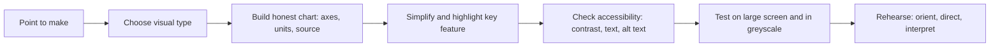

## Introduction

Slides are a support for the speaker, not a substitute for one. When slides carry the whole argument in dense paragraphs, the audience reads instead of listening, the speaker reads along with them, and neither the speech nor the slide does its job. When slides are well designed, they show what words cannot easily convey: a trend, a comparison, a process or a relationship, and they leave the explanation to the speaker.

For an IT for Business student, visual evidence deserves particular care. Seminars often draw on survey results, adoption trends, architecture diagrams, process models and system screenshots. Each of these can clarify an argument or mislead an audience, sometimes by accident. This lesson covers layout and text principles, how to choose and construct charts and tables honestly, how to design for accessibility, and how to present a visual so that the audience understands what it shows and why it matters. Your department may prescribe a slide template, a maximum number of slides or a file format; follow those instructions over any general advice here.

## Learning Objectives

- Explain the role of slides as a support for a spoken argument rather than a script.
- Apply layout, typography and colour principles to design clear, consistent slides.
- Select an appropriate chart, table or diagram for a given type of evidence.
- Evaluate a visual for misleading design choices such as truncated axes or cluttered labelling.
- Design slides that meet basic accessibility requirements for contrast, text size, alternatives and colour use.
- Present a visual using a "what it shows, what to notice, why it matters" sequence.

## Prerequisite Knowledge

- A structured presentation plan with a central claim (see the previous lesson).
- Basic familiarity with presentation software such as PowerPoint, Google Slides or LibreOffice Impress.
- Basic understanding of descriptive statistics and common chart types.

## Key Terminology

- **Slide hierarchy**: The visual ordering of elements on a slide so that the audience sees the most important item first.
- **Data-ink**: Tufte's term for the ink in a graphic that represents data rather than decoration.
- **Chartjunk**: Decorative elements in a graphic that add no information and may obscure it.
- **Truncated axis**: A value axis that does not start at zero, which can exaggerate differences, particularly in bar charts.
- **Contrast ratio**: The measured difference in luminance between text and its background; the Web Content Accessibility Guidelines set minimum ratios.
- **Alternative text**: A short text description of a visual for people who cannot see it, such as screen reader users.
- **Annotation**: A label or callout placed on a visual to direct attention to the key feature.
- **Speaker notes**: Text attached to a slide that only the presenter sees, useful for prompts but not a script to read aloud.

## Detailed Explanation

### What slides are for

A useful test: if the audience could understand the talk from the slides alone, the slides are probably doing too much, and if they cannot follow the talk when the slides are on screen, they are doing too little. Slides should carry what is hard to say and easy to show (figures, diagrams, structure, key terms) and leave to speech what is easy to say (reasoning, qualification, interpretation).

Reynolds (2019) popularised the idea that slides should have a single focus and ample empty space. Duarte (2008) emphasises that a slide should communicate one idea at a glance. These are design philosophies rather than rules, and academic audiences sometimes need more detail than a keynote-style talk, but the underlying principle of one idea per slide is widely applicable.

### Text and layout

- **One message per slide.** Write slide titles as short sentences that state the point ("Owner trust predicts adoption more than cost") rather than topic labels ("Results").
- **Limit words.** Use short phrases rather than sentences, and keep bullet lists brief. If you are tempted to read a paragraph, the paragraph belongs in the speaker notes or the paper.
- **Use a readable size.** Many guides suggest body text of 24 points or larger, and a projected slide should be legible from the back of the room. Test it on a projector or a large screen rather than your own laptop.
- **Choose plain fonts.** A sans-serif font used consistently is usually clearer on screen. Limit yourself to one or two typefaces.
- **Be consistent.** Use the same template, heading style, colours and positioning on every slide so that the audience does not have to relearn the layout.
- **Use whitespace.** Empty space is not wasted; it directs attention and reduces load.
- **Reveal gradually when helpful.** Building a list point by point can keep the audience with you, but excessive animation distracts. Avoid decorative transitions.

### Colour and contrast

Use a restrained palette with a clear distinction between background and text. Dark text on a light background or light text on a dark background both work if the contrast is strong. Avoid pale grey text, busy background images and red-green combinations as the only way to distinguish categories. The Web Content Accessibility Guidelines (W3C, 2023) set minimum contrast ratios for text, with a ratio of at least 4.5 to 1 for normal text at the AA level and 3 to 1 for large text. Free contrast checkers can test your colour pairs.

### Choosing the right visual

Match the visual to the question the audience needs answered.

| Evidence | Suitable visual | Watch out for |
|---|---|---|
| Comparison of categories | Bar chart with labelled axis starting at zero | Truncated axis, too many bars |
| Change over time | Line chart | Too many lines, inconsistent intervals |
| Parts of a whole | Stacked bar or a simple table | Pie charts with many slices |
| Relationship between two variables | Scatter plot | Implying causation from correlation |
| Distribution | Histogram or box plot | Audience unfamiliar with box plots |
| Exact values matter | Table | Overloading with rows and columns |
| Process or system | Flowchart or architecture diagram | Too many boxes and crossing arrows |
| Sequence of tasks | Timeline | Unlabelled phases |

Few (2012) argues that tables are better when readers need exact values and graphs are better when they need patterns, which is a useful starting point for choosing between them.

### Building honest charts

Visual evidence is persuasive, which is why it must be honest. Tufte (2001) describes the principle of graphical integrity: the visual representation of numbers should be proportional to the numbers themselves. Common problems include:

- **Truncated or manipulated axes** that make a small difference look dramatic.
- **Three-dimensional effects** that distort the apparent size of bars or slices.
- **Cherry-picked time windows** that show only the favourable portion of a trend.
- **Missing denominators**, such as showing counts when proportions are needed to compare groups of different sizes.
- **Unlabelled axes, units or sources.**
- **Over-precise labels** that suggest accuracy the data do not have.

Cairo (2016) stresses that charts can lie by omission as well as distortion, so state sample size, time period and any exclusions. A short source line beneath each visual, giving the origin of the data, is both good practice and an academic integrity requirement.

### Presenting a visual to an audience

A visual does not explain itself. Use a three-step sequence:

1. **Orient**: say what the visual shows ("This chart compares adoption intention across three firm sizes").
2. **Direct**: point to the feature that matters ("Notice that the gap closes for the largest firms").
3. **Interpret**: say why it matters for your argument ("This suggests that size alone does not explain adoption").

Annotate the visual so the audience's eyes go to the right place: use one highlight colour, a bold line or a callout rather than expecting them to find the pattern. Give people a few seconds of silence to absorb a complex figure before you start talking about it.

### Accessibility

Accessible slides help everyone, including people with visual impairments, colour vision deficiency, dyslexia and those in a badly lit room or at the back of a large venue. Good practice includes:

- Meeting contrast guidelines and using large, plain text.
- Not relying on colour alone: add labels, patterns or shapes to distinguish categories.
- Adding alternative text to images and charts in the file you distribute.
- Using real slide titles and the layout placeholders in the software so that screen readers can navigate.
- Describing visuals aloud ("the line rises steeply from 2018") for those who cannot see them clearly.
- Avoiding flashing content and autoplaying media.

If you share your slides afterwards, check that the file can be opened on common devices and that a PDF copy is available.

## Theories, Frameworks and Models

### Data-ink and graphical integrity

Tufte's (2001) principles are a practical check on any chart: maximise the share of ink devoted to data, remove decoration, and make sure that visual sizes match numerical sizes. They are not absolute, because labels and annotations are useful non-data elements, but they discipline the designer to ask whether each element earns its place.

## Step-by-Step Guide

1. **Start with the structure plan.** List the single point each slide must make.
2. **Choose a template** with plain layouts, adequate contrast and consistent positioning. Use your department's template if one is required.
3. **Write action titles**: short sentences stating the point.
4. **Select the visual for each point** using the table above, and prepare it from your data with labelled axes, units and a source line.
5. **Simplify**: remove gridlines, legends or decorations that are not needed, and apply one highlight colour to the key feature.
6. **Check accessibility**: contrast, text size, colour-independent coding, alternative text.
7. **Add annotation** directing attention to the key feature.
8. **Move detail to notes or backup slides.**
9. **Test on a large screen** from a distance, and in greyscale, to check legibility.
10. **Rehearse the orient, direct, interpret sequence** for every visual.

## Worked Example

**Illustrative scenario.** Kofi presents survey results on the intention of small retailers to accept digital payments. His draft slide has a title reading "Results", a 3D pie chart with seven slices in similar shades, a legend in small print, and a paragraph of explanation beneath.

**Step 1: Diagnose.** The title does not state a point. The 3D pie distorts slice sizes, seven slices are hard to compare, similar shades are hard to tell apart (and impossible in greyscale), and the paragraph invites the audience to read instead of listen.

**Step 2: Redesign.** Kofi's point is that perceived cost is the most commonly cited barrier. He replaces the pie with a horizontal bar chart of the seven barriers sorted from highest to lowest, using a single colour for all bars except cost, which is highlighted. Bars are labelled directly, which removes the legend. The axis starts at zero and shows percentage of respondents, with the sample size ("n = 120, illustrative") in a source line.

**Step 3: New title.** "Cost is the most frequently cited barrier".

**Step 4: Speak to the visual.** Orient: "This chart shows the barriers retailers named, as a share of respondents." Direct: "Cost is cited most often, well ahead of the next barrier." Interpret: "That supports my argument that fee structures matter more than technical readiness."

**Step 5: Check accessibility.** Contrast passes; the highlight differs by colour and by bold label so it survives greyscale; alternative text states the finding. The paragraph moves to speaker notes.

## Ghanaian Business Application

Students in Ghana often present to audiences in rooms where projectors vary in brightness and resolution, where slides may be viewed on a phone after a meeting, and where files may be shared by messaging apps. Designing with high contrast, large text and simple layouts therefore has a practical rationale, not just an aesthetic one. A PDF copy is usually the safest format for sharing, and it should be small enough to send over a limited mobile data connection.

When visuals draw on local data, such as mobile money usage, SME surveys or sector reports, cite the original organisation or publication and state the year. Take care when presenting screenshots from workplaces or customer systems: personal data should be removed, and the Data Protection Act, 2012 (Act 843) establishes obligations for handling personal information in Ghana, so do not display identifiable customer details on a slide without proper authority. In professional settings, a one-page visual summary that a manager can read in a minute is often more valuable than a long deck.

## International Case Study

### PowerPoint and the Columbia accident investigation

In 2003 the Columbia Accident Investigation Board (CAIB) examined the loss of the Space Shuttle Columbia. Its report (CAIB, 2003) discussed how engineering assessments of the foam strike during launch had been communicated in presentation slides, and criticised the way key information was condensed into bullet-point hierarchies, with important caveats buried in lower levels and in small type. Edward Tufte (2006) used this material in an essay arguing that the default structure of presentation software encourages fragmented, over-condensed communication of technical reasoning.

This case is widely cited in discussions of slide design, and it should be used carefully. The causes of the Columbia accident were organisational and technical, not slide software alone, and the CAIB did not blame a single tool. The lesson relevant to a seminar is narrower: when an important qualification or an uncertainty is reduced to a fragment on a crowded slide, an audience may miss it. Where evidence is uncertain, the uncertainty belongs in the title, the annotation or the spoken explanation, not in a footnote the audience cannot read.

## Diagram

Each step guards against a different failure: the first against clutter, the middle steps against distortion and exclusion, the last against an unexplained visual.

## Common Misconceptions

- **Misconception:** More detail on a slide shows more rigour. **Correction:** Rigour is shown in the quality of the argument and the care taken over evidence, not by the density of text.
- **Misconception:** Bullet points are the standard way to present academic content. **Correction:** Short phrases are fine, but a figure, table or diagram often communicates relationships far better than a list.
- **Misconception:** A chart is objective because it is made from data. **Correction:** Choices of axis, time window, grouping and colour all shape what the viewer concludes.
- **Misconception:** Accessibility only matters if you know someone in the audience has a disability. **Correction:** Many needs are not visible in advance, and accessible design also helps in poor viewing conditions.

## Common Examination Mistakes

- Using topic labels as slide titles instead of stating the point.
- Reading slides aloud word for word.
- Including charts without axis labels, units, sample size or source.
- Using truncated bar-chart axes or three-dimensional effects.
- Presenting a complex figure without orienting the audience or pointing to the key feature.
- Distinguishing categories by colour alone or using low-contrast text.
- Including screenshots with personal data.

## Critical Thinking Questions

1. When might a text-heavy slide be justified in an academic setting, and how would you reduce its drawbacks?
2. A truncated axis is sometimes used in line charts where changes are small but important. Under what conditions is this honest, and how should it be signalled?
3. How should a presenter handle a visual they did not create and cannot alter, such as a figure from a published paper?

## Practical Exercises

1. **Slide makeover.** Take one dense slide from a past presentation and redesign it so that it states one point, uses a suitable visual and removes unneeded text. *Expected output:* before and after versions and a brief note explaining each change.
2. **Chart audit.** Find three charts in news or business reports and assess each for axis integrity, labelling, source and colour use. *Expected output:* a table with one row per chart and a verdict on each criterion.
3. **Accessibility check.** Run your seminar slides through a contrast checker, view them in greyscale, and add alternative text to each image. *Expected output:* a list of issues found and fixed.

## Key Takeaways

- Slides support the speaker; they should carry what is easy to show and leave reasoning to speech.
- One message per slide, written as an action title, with minimal text.
- Choose the visual to match the question; use tables when exact values matter.
- Build honest charts: proportional scales, labelled axes, units, sample size and source.
- Design for accessibility: contrast, size, colour-independent coding and alternative text.
- Always orient, direct and interpret when presenting a visual.

## Further Reading

- Cairo, A. (2016). *The truthful art: Data, charts, and maps for communication*. New Riders.
- Columbia Accident Investigation Board. (2003). *Report* (Vol. 1). U.S. Government Printing Office.
- Duarte, N. (2008). *slide:ology: The art and science of creating great presentations*. O'Reilly Media.
- Few, S. (2012). *Show me the numbers: Designing tables and graphs to enlighten* (2nd ed.). Analytics Press.
- Knaflic, C. N. (2015). *Storytelling with data: A data visualization guide for business professionals*. Wiley.
- Reynolds, G. (2019). *Presentation Zen: Simple ideas on presentation design and delivery* (3rd ed.). New Riders.
- Tufte, E. R. (2001). *The visual display of quantitative information* (2nd ed.). Graphics Press.
- Tufte, E. R. (2006). *The cognitive style of PowerPoint: Pitching out corrupts within* (2nd ed.). Graphics Press.
- World Wide Web Consortium. (2023). *Web Content Accessibility Guidelines (WCAG) 2.2*. <https://www.w3.org/TR/WCAG22/>

## Video Resources

- [Web Accessibility Initiative](https://www.w3.org/WAI/): W3C. Official introduction to accessibility principles and guidelines, including contrast and alternative text.
- [Gapminder](https://www.gapminder.org/): Gapminder Foundation. Official site with data visualisations and teaching resources that show how charts can communicate trends.

## Revision Summary

Slides should support a spoken argument, not replace it. Use one message per slide, action titles, little text and a visual matched to the evidence. Build charts honestly with proportional axes, labels, units and sources, design for accessibility, and always orient, direct and interpret each visual for the audience.

- One idea per slide; action titles; minimal text.
- Match the visual to the question; tables for exact values.
- Honest charts: zero baseline for bars, labels, units, n, source.
- Accessibility: contrast, size, not colour alone, alternative text.
- Remove personal data from screenshots.
- Orient, direct, interpret.
