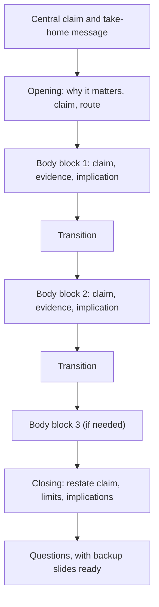

## Introduction

A seminar presentation is not a short version of a written paper. A reader can pause, re-read and skip ahead, but a listener hears each sentence once, at the speaker's pace, and cannot see the structure unless the speaker makes it visible. A talk that works well on the page can therefore fail in the room: the audience loses the thread after the second minute, and the questions at the end show that the central claim never landed.

This lesson shows how to convert an argument you have already built into a presentation structure. You will learn how to decide what to include and what to leave out, how to allocate time, how to use signposting so that listeners always know where they are, and how to rehearse against the clock. Formats, time limits and assessment criteria for your seminar are set by your department, so treat every timing in this lesson as illustrative and check the official instructions you have been given.

## Learning Objectives

- Explain why spoken presentations need a different structure from written papers.
- Design an opening, body and closing that foreground one central claim.
- Allocate a fixed time limit across sections and slides using a justified timing plan.
- Apply signposting language and transitions to guide an audience through an argument.
- Evaluate a draft presentation outline for focus, coherence and realistic timing.

## Prerequisite Knowledge

- A chosen seminar topic framed as a question or argument (see the earlier modules of this course).
- Familiarity with how to build a critical, evidence-based argument from the literature.
- None beyond this: no presentation software skills are assumed.

## Key Terminology

- **Central claim**: The single sentence that states what the presentation argues or concludes; everything else in the talk exists to support or qualify it.
- **Signposting**: Spoken or visual cues that tell the audience where the talk has been and where it is going.
- **Transition**: A short bridge that links one section to the next and shows how they relate logically.
- **Timing plan**: A written allocation of minutes to each section, with a rehearsed total that sits safely inside the limit.
- **Take-home message**: What the audience should be able to restate after the talk, usually one or two sentences.
- **Agenda slide**: A slide that previews the sections of the talk; useful in longer talks but unnecessary in very short ones.
- **Cognitive load**: The demand placed on working memory by the information an audience must process at one time.
- **Rule of three**: The habit of grouping points into threes because small groups are easy to hold in mind; a convenience, not a law.

## Detailed Explanation

### Why listening is different from reading

Working memory is limited. A listener must decode the words, relate them to what has already been said, and anticipate what comes next, all in real time. Research on multimedia learning, summarised by Mayer (2009), suggests that people learn better when a presentation avoids unnecessary load, so a speaker who adds extra points, tangents and decorative detail is working against the audience. The practical consequence is that a presentation must be shorter, more repetitive in its key points, and more explicit about its structure than the paper it draws on.

Repetition, which is a flaw in a written essay, is a strength in a talk. You state the claim in the opening, develop it in the body, and restate it in the closing. This is not padding: each pass gives a listener who drifted off a chance to rejoin.

### Start from the central claim, not the outline

Many students begin by listing the headings from their notes and filling each with everything they know. A better method is to write the central claim first, in one sentence, and then ask of every candidate section: does this help the audience believe, understand or evaluate that claim? If not, cut it or move it to a backup slide for the question session.

A usable central claim is specific and arguable. "Mobile money is important in Ghana" is a topic, not a claim. "Interoperability between mobile money platforms reduces transaction friction, but the evidence on small-trader welfare remains thin" is a claim an audience can agree with, resist or probe. If your claim is a question, as in "To what extent does X affect Y?", your talk should still close with a qualified answer.

### The basic shape: opening, body, closing

Most academic presentations follow a three-part shape.

**Opening (roughly 10 to 15 per cent of the time).** Establish why the topic matters, state the question or claim, and preview the route. A good opening answers three silent questions the audience is asking: why should I care, what exactly are you going to argue, and how will you get there.

**Body (roughly 65 to 75 per cent).** Develop the argument in a small number of blocks, commonly two to four. Each block should have a single job, such as establishing the problem, comparing the main scholarly positions, presenting evidence, or evaluating a framework. Within a block, state the point first and then give the evidence, so listeners know what the evidence is for.

**Closing (roughly 10 to 15 per cent).** Restate the claim in the light of the evidence, state limitations honestly, draw out implications, and end with the take-home message and an invitation for questions. Do not introduce new material in the closing, and do not end on an apology or a slide reading only "Thank you".

### Structures for different kinds of seminar

The generic shape adapts to purpose. A literature review seminar may be organised thematically or around competing positions. A problem-focused seminar may follow problem, causes, options, evaluation, recommendation. A seminar that applies a framework to a case may follow framework, case, analysis, lessons. Whatever pattern you choose, say what it is in the opening so that the audience can place each part.

### Signposting and transitions

Signposting is the main tool for making structure audible. Useful forms include:

- **Preview**: "I will make three points: what the literature agrees on, where it disagrees, and what that means for small firms."
- **Marker**: "That was the first position. The second takes the opposite view."
- **Summary**: "So far I have shown that adoption is driven mostly by perceived usefulness."
- **Link**: "Given that gap, the next question is how researchers have tried to measure trust."

A transition should do logical work, not just announce a topic change. "Next slide" tells the audience nothing; "That evidence raises a problem, which is that most of the studies are from other regions" tells them why the next section exists.

### Timing

Timing is part of structure, not an afterthought. A typical speaking pace for a prepared academic talk is often quoted as around 120 to 150 words per minute, and many presenters find that one content slide takes between one and two minutes. Treat these as rough planning figures and test them with your own voice. Overrunning is the most common structural failure, and it forces speakers to rush the conclusion, which is the part the audience most needs.

Build a **timing plan** with a buffer. If your limit is 15 minutes, plan for 12 to 13 minutes of content so that nerves, a technical hiccup or a brief clarifying question does not push you over. Identify in advance which section you would shorten if you were running late, and which slide is the safe place to stop.

## Theories, Frameworks and Models

### Problem, evidence, implication

A simple model for structuring any block is **claim, evidence, implication**. State what you want the audience to accept, show the support, and say why it matters for the overall argument. It mirrors the point-evidence-analysis structure used in good academic paragraphs, and it makes the logic of a talk easy to audit.

### The situation-complication-resolution arc

Narrative models help listeners care. In the situation-complication-resolution arc, you set out what is known (situation), introduce what is unresolved or contradictory (complication) and present your analysis as a response (resolution). This arc suits seminars because the gap in the literature is, in effect, the complication.

### Cognitive load and the limits of the audience

Mayer's (2009) multimedia principles, including coherence (remove extraneous material) and signalling (highlight the organisation of the content), give theoretical backing to disciplined structure. You do not need to cite Mayer in your talk, but you can use the principles as a test: if a slide or section does not serve the central claim, it adds load without adding learning.

### Duarte's story shape

Duarte (2010) describes effective presentations as moving between "what is" and "what could be", contrasting the current situation with a better one. In an academic seminar that contrast might be between current understanding and the improved understanding your analysis offers. Treat this as one useful lens rather than a mandatory template.

## Step-by-Step Guide

1. **Write the central claim** in one sentence, then a one-sentence take-home message.
2. **List candidate content** and sort it into must-have, useful and backup. Only the first group is certain to enter the main talk.
3. **Choose a pattern** (thematic, problem-solution, framework-case) and sketch two to four body blocks.
4. **Draft the opening and closing first**, because they carry the claim and the message.
5. **Create a timing plan** with minutes per section and a buffer of at least 10 per cent.
6. **Write the transitions** between blocks as full sentences and place them in your notes.
7. **Map slides to the plan**, aiming for a manageable number of content slides for the time available.
8. **Rehearse aloud with a timer**, record where you ran over, and cut content rather than speaking faster.
9. **Prepare backup slides** for likely questions, kept after the final slide.

## Worked Example

**Illustrative scenario.** Abena has a 15-minute slot to present a literature-based seminar on the adoption of cloud accounting software by small firms. Her first outline has nine headings, including the history of cloud computing, five adoption theories and a long list of country studies. A trial run takes 24 minutes.

**Step 1: Write the claim.** After reviewing her notes she writes: "Small-firm adoption of cloud accounting is explained better by owner capability and trust in providers than by the technical features the vendors promote, but few studies measure either well."

**Step 2: Cut by relevance.** The history of cloud computing is not needed to support the claim and moves to a backup slide. The five theories are reduced to two that her argument uses.

**Step 3: Build blocks.** Block 1: what the literature says drives adoption (technical features, cost). Block 2: the evidence on owner capability and trust. Block 3: the measurement gap.

**Step 4: Timing plan.**

| Section | Planned minutes | Notes |
|---|---|---|
| Opening: problem, claim, route | 2 | State claim in the first minute |
| Block 1: technical and cost drivers | 3 | Two slides |
| Block 2: capability and trust | 4 | Core of the argument, three slides |
| Block 3: measurement gap | 2 | One slide |
| Closing: implications, limits, take-home | 2 | Restate claim |
| Buffer | 2 | Unallocated |

**Step 5: Rehearse.** The next run takes 13 minutes, inside the limit. Abena notices she spent too long on Block 1 and trims a slide, which creates a larger buffer.

## Ghanaian Business Application

Many MSc IT for Business students will present to mixed audiences in practice: managers, technical staff, regulators and clients, all with different levels of technical knowledge. The structure in this lesson transfers directly to a board paper summary, a project steering meeting or a proposal to a client. Busy professional audiences value a clear opening statement of the decision or finding, followed by the supporting reasons, which is the same claim-first logic.

Practical conditions also affect structure. Meetings may start late, agenda items may be cut, and equipment or power supply may not behave as planned. A talk that has a clear priority order, with the central claim and recommendation reachable in the first minutes, survives interruptions better than one that saves its conclusion for the end. Similarly, presenters who know in advance which slides can be dropped can finish confidently when time is cut.

## International Case Study

### TED's time limit and the discipline of focus

TED, the nonprofit organisation behind the widely watched conference talks, has long limited most main-stage talks to a maximum of 18 minutes. Its curator, Chris Anderson (2016), explains in his guide to public speaking that the constraint is deliberate: a talk should be built around one idea, which he calls a "through-line", that the speaker can convey fully in the time available. Anderson argues that speakers who try to cover too much fail to communicate any of it, and that cutting content is usually the best way to improve a draft.

The lesson for an academic seminar is not that you should copy TED style, which is built for a general audience and often relies on personal story. It is that a fixed time limit forces the choice of one idea, supported by a limited number of points. In a seminar the through-line is your central claim. Students who test every section against it, as in the worked example above, usually find that the talk becomes both shorter and more persuasive.

## Diagram

The claim sits at the top because every later element is tested against it. Transitions are drawn as separate steps to remind you to plan them.

## Common Misconceptions

- **Misconception:** A good presentation covers everything in the paper. **Correction:** A good presentation communicates one argument well; the rest belongs in the paper or on backup slides.
- **Misconception:** Repeating the main point makes a talk boring. **Correction:** Repetition at the opening, in the body and at the close helps listeners who lost attention rejoin the argument.
- **Misconception:** An agenda slide is enough signposting. **Correction:** Spoken previews, markers and transitions throughout the talk do far more work than one slide at the start.
- **Misconception:** If you are running late, speaking faster solves the problem. **Correction:** Speed reduces comprehension; the remedy is to cut planned content and protect the conclusion.
- **Misconception:** The conclusion can be improvised because the content has been covered. **Correction:** The conclusion carries the take-home message and deserves its own rehearsal.

## Common Examination Mistakes

- Presenting a list of topics without a stated claim or question.
- Spending most of the time on background and rushing the analysis.
- Failing to rehearse with a timer, resulting in overrun or an unfinished conclusion.
- Using transitions that only announce the next slide without linking ideas.
- Ending with new material or without restating the main message.
- Treating timings in a guidance document as fixed when the official instructions differ; always check the actual requirements.

## Critical Thinking Questions

1. If the central claim of a talk is accurate but dull, how should the structure be adapted so that it is still communicated effectively without exaggerating?
2. Which is the greater risk in a 15-minute seminar: leaving out an important qualification or including too many? Justify your view.
3. How might the structure of a talk change if the audience is composed mainly of practitioners rather than academics?
4. What are the ethical implications of cutting a section containing evidence that weakens your claim in order to save time?

## Practical Exercises

1. **Claim and message.** Write your central claim in one sentence and your take-home message in two sentences. Share them with a peer and ask them to restate your argument. *Expected output:* the two written statements and a note on whether your peer's restatement matched your intention.
2. **Timing plan.** Using the time limit you have been given (or an assumed 15 minutes), produce a table of sections with minutes, slide counts and a buffer. *Expected output:* a completed timing table totalling less than the limit.
3. **Transition script.** Write the exact sentences you will say between each body block, ensuring that each states a logical relationship. *Expected output:* a list of at least three transition sentences.
4. **Timed rehearsal.** Deliver the talk aloud twice with a timer, once to an empty room and once to a peer, and record your times. *Expected output:* two recorded durations and a list of what you cut or changed as a result.

## Key Takeaways

- A spoken presentation needs a clearer, more repetitive and more explicit structure than a written paper.
- Start from one central claim and test every section against it.
- Use an opening, a body of two to four blocks and a closing that restates the claim.
- Signposting and logical transitions let the audience follow the argument.
- Build a timing plan with a buffer, rehearse with a timer and cut content rather than speaking faster.

## Further Reading

- Anderson, C. (2016). *TED talks: The official TED guide to public speaking*. Houghton Mifflin Harcourt.
- Alley, M. (2013). *The craft of scientific presentations* (2nd ed.). Springer.
- Duarte, N. (2010). *Resonate: Present visual stories that transform audiences*. Wiley.
- Mayer, R. E. (2009). *Multimedia learning* (2nd ed.). Cambridge University Press.

## Video Resources

- [TED](https://www.ted.com/): TED Conferences. Official site with recorded talks that illustrate focused, time-limited presentation structures.
- [Three Minute Thesis](https://threeminutethesis.uq.edu.au/): The University of Queensland. Official site describing the three-minute research presentation format.

## Revision Summary

A seminar presentation must be built for listeners, who hear each sentence once. Begin with a single central claim, organise the talk into an opening, a small number of body blocks and a closing, signpost throughout, and plan time with a buffer. Rehearse against a timer and cut content rather than speaking faster.

- Write the central claim and take-home message first.
- Opening, body (two to four blocks), closing; restate the claim at the end.
- Signposting: preview, marker, summary, link.
- Timing plan with at least 10 per cent buffer.
- Backup slides handle detail that does not fit.
- Check the official format and time limit for your own seminar.
