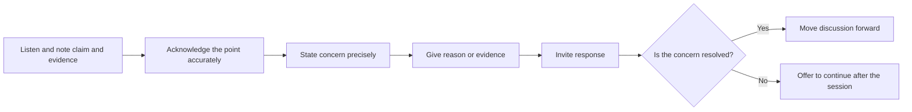

## Introduction

Most students think of a seminar as the presenter's performance. In reality, a seminar succeeds or fails on the quality of everyone's participation. A presenter with a strong argument will still leave the room having learned little if the audience is silent or hostile, and a modest presentation can become a valuable session when peers ask precise, generous questions. Participation is therefore a skill to be practised, and in many programmes it is also observed and judged.

This lesson covers three connected topics: how to take part productively when you are not presenting, how to disagree and challenge ideas without damaging relationships, and how to maintain professional and ethical standards before, during and after a seminar. These standards include honest use of sources, fair credit for group work, respect for confidentiality and appropriate behaviour online and in person. As elsewhere in this course, the official rules on attendance, participation marks and academic misconduct belong to your department and the university; you should read them directly rather than rely on this supplementary material.

## Learning Objectives

- Describe the roles of audience member, discussant and presenter and the responsibilities attached to each.
- Formulate questions and comments that are specific, evidence-focused and respectful.
- Apply a structure for disagreeing constructively with a claim without attacking the person.
- Identify behaviours that breach professional academic conduct, including plagiarism, misrepresentation of data and unfair credit in group work.
- Evaluate a seminar contribution against criteria of relevance, clarity, evidence and courtesy.

## Prerequisite Knowledge

- Completion of the lesson on the purpose, formats and expectations of the academic seminar, or equivalent understanding.
- Basic awareness of plagiarism and the need to cite sources.

## Key Terminology

- **Participation**: Active, informed contribution to a seminar through listening, questioning, commenting and responding.
- **Academic conduct**: The standards of honesty, fairness and respect expected of students and researchers.
- **Academic integrity**: The commitment to honesty in learning, research and communication, including accurate acknowledgement of sources.
- **Respectful debate**: Disagreement that targets arguments and evidence rather than the character of the speaker.
- **Clarifying question**: A question asking the speaker to explain or define something that was unclear.
- **Probing question**: A question that tests the strength of evidence, reasoning or assumptions.
- **Ad hominem**: An attack on the person making a claim rather than on the claim itself.
- **Collusion**: Unauthorised cooperation that results in work being presented as independent when it is not.

## Detailed Explanation

### Three roles, three responsibilities

**The audience member** has a duty to prepare. If the topic or reading is circulated in advance, read it. Arrive on time, switch off distractions and listen for the main argument. A good audience member makes brief notes of the claim, the evidence offered and any point where the reasoning seems weak. Behaviour that signals disrespect, such as private conversations, repeated phone use or leaving noisily, damages the atmosphere for everyone.

**The discussant**, where the format includes one, is not an opponent but a critical friend. A discussant summarises the argument fairly, identifies its strengths, raises two or three substantive issues and suggests how the work might be improved. The order matters: a fair summary shows that you understood before you criticised.

**The presenter** has a duty to be honest about the strength of the evidence, to credit every source, to keep to time and to treat questions as contributions. A presenter who becomes defensive teaches the audience not to ask.

### The anatomy of a good question

Poor questions are long statements disguised as questions, requests for the presenter to repeat what they said, or attempts to show off the questioner's knowledge. Good questions are short, specific and tied to the content. They usually fall into recognisable types.

| Question type | Purpose | Example stem |
|---|---|---|
| Clarifying | Remove ambiguity | "When you say adoption, do you mean intention or actual use?" |
| Probing evidence | Test support for a claim | "What evidence suggests the effect applies beyond the studies you reviewed?" |
| Probing assumption | Expose hidden premises | "Does your argument assume that firms have reliable internet access?" |
| Extending | Move the idea forward | "How might the argument change for very small firms?" |
| Connecting | Link to other work | "How does this relate to the literature on trust that we discussed earlier?" |

Before asking, decide whether the question is something the whole room benefits from. If it concerns a personal interest or requires a long answer, it may be better asked after the session.

### Disagreeing without damage

Academic life depends on disagreement, because claims improve when they are challenged. The skill is to challenge the claim and not the person. A useful four-step structure is:

1. **Acknowledge** the point accurately: "You argue that cost is the main barrier."
2. **State the disagreement or concern precisely:** "I am not yet convinced, because two of the studies you cited surveyed only large firms."
3. **Give the reason or evidence** for your concern.
4. **Invite a response:** "How would you respond to that limitation?"

Contrast this with remarks such as "That is obviously wrong" or "Anyone who has worked in industry knows that is nonsense". These offer no reasoning and signal contempt. An *ad hominem* remark about the presenter's competence, background or accent has no place in a seminar.

### Professional academic conduct

Conduct expectations apply well beyond the seminar room.

- **Honesty with sources.** Every idea, figure and quotation that is not yours must be acknowledged. Presenting another person's slides, paraphrase or diagram as your own is plagiarism even if it is spoken rather than written.
- **Honesty with data.** Do not fabricate, selectively report or alter figures to make an argument look stronger. If you adapt a chart from a source, say so.
- **Fair credit in group work.** If a seminar is delivered by a team, each member's contribution must be genuine and the division of work should be agreed openly. Allowing a colleague to carry the work, or taking credit for it, is unfair and may breach university rules.
- **Collusion.** Sharing slides or answers where independent work is required is misconduct. Collaboration is acceptable only when the assignment permits it.
- **Confidentiality.** If a peer shares an unpublished idea or a company shares sensitive information with you, do not disclose it beyond the permitted setting. Do not name individuals or organisations in ways that could harm them.
- **Respect and inclusion.** Listen to colleagues with different accents, languages, experience and confidence levels. Avoid interrupting, and give quieter participants space.
- **Digital conduct.** Do not record a seminar without permission. Keep online chat on topic and courteous.
- **Use of AI tools.** Whether and how tools that generate text may be used in preparation is a matter of institutional policy. Ask your department, and where use is permitted, disclose it in the way it requires. You remain fully responsible for the accuracy of anything you present.

## Theories, Frameworks and Models

### The ladder of inference

The ladder of inference, associated with Chris Argyris and popularised in organisational learning writing, describes how people move from observable data to selected data, meanings, assumptions, conclusions and actions, often so quickly that they confuse their conclusion with fact. In a seminar, it explains why disagreements stall: each side is climbing a different ladder. A productive response is to climb down and ask, "What data are you using, and how did you interpret them?"

### Charitable interpretation (the principle of charity)

The principle of charity asks you to interpret an argument in its strongest reasonable form before criticising it. It protects you from attacking a weak version that the speaker did not mean, and it makes your criticism more credible. If you can restate the presenter's position so that they say "Yes, that is what I mean", your challenge will be taken seriously.

### Psychological safety

Research on teams commonly describes psychological safety as a shared belief that people can speak up without being humiliated. Seminars work best in such an environment. Tone, body language and the way errors are treated either build or erode it, and every participant contributes.

## Step-by-Step Guide: Contributing to a seminar you are attending

1. **Prepare.** Read any circulated material and write down two questions beforehand.
2. **Listen for structure.** Note the claim, the evidence and the conclusion.
3. **Mark uncertainty.** Place a question mark beside any claim that seems unsupported.
4. **Choose your question.** Select the single most useful clarifying or probing question.
5. **Frame it briefly.** Use one sentence of context and one question.
6. **Listen to the answer.** Do not prepare your next point while the speaker is replying.
7. **Follow up only if needed.** Avoid turning the exchange into a debate that excludes others.
8. **Thank and reflect.** Afterwards, note what you learned and what you would ask differently.

## Worked Example

Illustrative scenario. A presenter argues that mobile banking adoption among small traders is mainly limited by distrust of providers. A peer feels the evidence is thin.

An unhelpful contribution: "I do not agree. Everyone knows trust is not the problem. You clearly have not spoken to real traders."

A constructive contribution using the four steps: "You argue that distrust is the main barrier, and you cite three studies for this (acknowledge). I am not yet convinced, because two of those studies appear to measure intention rather than actual use (concern). Intention often differs from behaviour, so the studies may not show that distrust prevents adoption in practice (reason). Do you have evidence that links distrust to actual non-use?" (invite response).

The second version is longer, but it is specific, fair and answerable, and it improves the argument. The presenter can respond with additional evidence or concede a limitation, and both responses advance the discussion.

## Ghanaian Business Application

Ghanaian professional culture often places high value on courtesy, seniority and community, and these are real strengths in a discussion setting. They also create a particular challenge: junior colleagues may hesitate to question a senior person, and polite silence can be mistaken for agreement. The skills in this lesson help to reconcile respect with rigour. Framing a challenge as a question ("May I ask what evidence supports this?"), acknowledging the speaker's point first and keeping a courteous tone are all consistent with respectful norms while still allowing a claim to be tested.

These skills matter in practical business settings. In a project meeting where a vendor proposes a costly system, a manager who can ask a clear, respectful probing question about assumptions may prevent an expensive mistake. In a professional forum, accurate crediting of other people's work protects reputations and builds trust. Observe the specific conduct rules of your university, which govern plagiarism and group assessment in your own programme; this lesson can help you understand the reasons behind them but does not state them.

## International Case Study

Illustrative scenario. A research team at an overseas university presents preliminary findings at an internal seminar. A senior professor challenges one analysis forcefully, and a doctoral student on the team becomes defensive. A visiting colleague intervenes: "Could you tell us what result would change your mind?" The question moves the exchange from personalities to evidence. The team agrees to run an additional check, and the finding is later revised in their draft.

The scenario illustrates two points that apply in any setting. First, a well-chosen question can convert conflict into collaboration by making the criteria for being convinced explicit. Second, a seminar is a place where being wrong early is cheaper than being wrong in publication. Departments with strong seminar cultures tend to treat challenge as a service to the presenter. Students who take the same stance learn faster, because they treat each question as free expert feedback.

## Diagram

## Common Misconceptions

- **"Respect means never disagreeing."** Respect is shown by engaging seriously with an argument, which includes testing it. Silence is not always respect.
- **"A tough question is an attack."** A precise challenge is usually a sign that the questioner took the work seriously.
- **"Plagiarism only happens in written work."** Presenting another person's ideas, slides or analysis as your own in speech is also plagiarism.
- **"Group work means I can rely on others."** Each member remains responsible for the integrity of the whole submission and for a genuine contribution.
- **"If I paraphrase, I do not need to cite."** Paraphrased ideas must still be attributed to their source.

## Common Examination Mistakes

- Asking a long statement instead of a focused question.
- Criticising the presenter personally rather than the argument or evidence.
- Failing to prepare, then asking a question already answered in the presentation.
- Using a source's slides or diagram without acknowledgement.
- Ignoring the department's stated rules on group contribution and collusion.
- Becoming defensive when challenged instead of treating the question as information.

## Critical Thinking Questions

1. When does challenging a senior colleague's claim become professionally necessary, and how can you do so while preserving respect?
2. Is a question that you already know the answer to ever legitimate in a seminar? Justify your view.
3. How can a seminar group distinguish between a vigorous but fair debate and an exchange that has become personal?
4. What responsibilities do you have if you notice that a peer has presented a source's work as their own?

## Practical Exercises

1. **Question rewrite.** Take five poor questions (for example, "Why did you not cover blockchain?") and rewrite each as a specific, answerable clarifying or probing question. Expected output: five original and five improved questions.
2. **Four-step disagreement.** Choose a claim from a journal article abstract and write a four-step respectful disagreement with it. Expected output: a short paragraph that acknowledges, states a concern, gives a reason and invites a response.
3. **Conduct audit.** Read your university's published academic integrity guidance and list five behaviours it prohibits that could arise in a seminar. Expected output: a list with the source of each rule, noting only what the policy actually says.
4. **Peer observation.** Observe a recorded public talk or an authorised live session and note the types of question asked and how the speaker responded. Expected output: a table of questions by type with a short evaluation of each.

## Key Takeaways

- Participation is an academic skill involving preparation, careful listening and well-formed questions.
- Challenge the argument, not the person; acknowledge before you criticise.
- Good questions are short, specific and answerable.
- Professional conduct includes honest use of sources and data, fair credit in group work, confidentiality and inclusive behaviour.
- Follow your institution's actual rules on integrity, group work and the use of AI tools.
- Treating questions as feedback accelerates learning.

## Further Reading

- American Psychological Association. (2020). *Publication manual of the American Psychological Association* (7th ed.). American Psychological Association.
- Cottrell, S. (2017). *Critical thinking skills: Effective analysis, argument and reflection* (3rd ed.). Palgrave Macmillan.
- Booth, W. C., Colomb, G. G., & Williams, J. M. (2008). *The craft of research* (3rd ed.). University of Chicago Press.

## Video Resources

- [Purdue Online Writing Lab](https://owl.purdue.edu/): Purdue University. Official writing resource portal including guidance on avoiding plagiarism and acknowledging sources.
- [APA Style](https://apastyle.apa.org/): American Psychological Association. Official APA Style site with guidance on citing sources and ethical writing.

## Revision Summary

Seminar participation involves preparation, careful listening and short, specific questions of the clarifying, probing, extending or connecting kind. Disagreement is healthy when it targets claims and evidence, follows a structure of acknowledging, stating a concern, giving a reason and inviting a response, and avoids personal attacks. Professional conduct covers honest use of sources and data, fair credit in group work, confidentiality, inclusion and responsible digital behaviour. Official rules are set by your institution.

- Prepare, listen and ask one good question.
- Acknowledge before you challenge.
- Attack arguments, never people.
- Cite spoken as well as written borrowing.
- Share credit fairly in group work.
- Follow your university's integrity rules.
