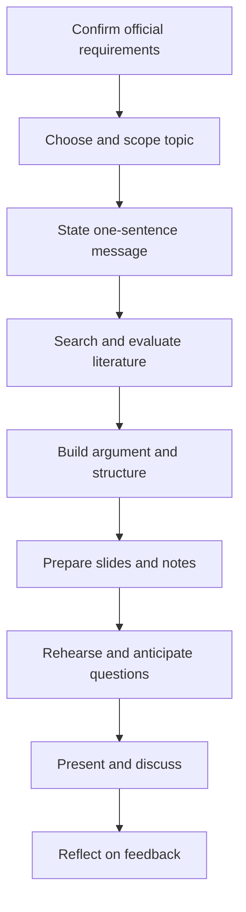

## Introduction

A postgraduate seminar is different from a lecture and different from a conference talk. In a lecture, an expert transmits established knowledge to a largely silent audience. In a seminar, a student presents a piece of reasoned work, usually a topic investigated through the literature, and the audience is expected to question it, test it and help improve it. The seminar is therefore a rehearsal for the professional life of a researcher or a senior practitioner: you defend a position in front of informed people who are entitled to disagree with you.

This lesson explains why academic seminars exist, the formats they commonly take, and the expectations that usually surround them. It also shows you how to turn vague expectations into a personal preparation plan. A word of caution runs through the whole course: GradPath is supplementary study material. The official seminar format, topic allocation, presentation dates and assessment criteria for CSIT 610 are set by your department, and you must confirm them with your course coordinator or supervisor. Nothing here replaces those instructions.

## Learning Objectives

- Explain the educational purposes of a postgraduate academic seminar.
- Compare common seminar formats, including individual presentations, panel sessions, journal-club style discussions and work-in-progress seminars.
- Distinguish a seminar presentation from a lecture, a business pitch and a written report.
- Identify the questions to ask your department so that you prepare against official rather than assumed requirements.
- Construct a personal seminar preparation timeline that works backwards from a confirmed presentation date.

## Prerequisite Knowledge

- None beyond general familiarity with postgraduate study and academic reading.
- Helpful: some experience of reading journal articles, as covered in earlier research methods material.

## Key Terminology

- **Academic seminar**: A structured session in which a presenter shares reasoned, evidence-based work and the audience engages in questioning and discussion.
- **Work-in-progress seminar**: A seminar where unfinished research is presented specifically to receive critical feedback before completion.
- **Journal club**: A format in which participants read and critically discuss a published paper together.
- **Discussant**: A person assigned to respond critically and constructively to a presentation.
- **Assessment criteria**: The published standards against which a presentation is judged, set by the institution rather than by the student.
- **Learning outcome**: A statement of what a student should be able to do after completing a learning activity.
- **Audience analysis**: Deciding what the listeners already know, what they need and what they are likely to ask.

## Detailed Explanation

### Why seminars exist

Universities use seminars because several important academic abilities cannot be developed by reading and writing alone. A seminar develops at least five.

1. **Synthesis under pressure.** You must reduce a body of reading to a message that can be understood in a fixed time. This forces you to decide what matters.
2. **Oral argument.** Many professional settings, such as board meetings, client reviews and project steering groups, reward the ability to defend a claim aloud. A seminar is a safe place to practise.
3. **Critical listening.** Seminar audiences are not passive. Listening for weak evidence, hidden assumptions and unsupported leaps is itself a research skill.
4. **Scholarly community.** Research is a collective activity. Seminars expose you to the questions peers ask, which often reveal gaps you have not noticed.
5. **Preparation for the dissertation.** A seminar is often an early opportunity to test an idea that later becomes a proposal or dissertation chapter.

### Seminar versus lecture, pitch and report

Students often misjudge the genre. A **lecture** presents settled knowledge; a seminar presents an argument that remains open to challenge. A **business pitch** aims to persuade an audience to buy or fund something and may legitimately minimise doubt; an academic seminar is rewarded for acknowledging limitations. A **written report** can be read at the reader's pace and can contain detail; a seminar must be understood in real time, so it needs fewer points, clearer signposting and deliberate repetition of the key message.

### Common formats

Departments vary, so treat the following as a map of possibilities rather than a description of what you will be asked to do.

| Format | Typical features | What it tests |
|---|---|---|
| Individual presentation | One presenter, fixed time, questions afterwards | Structure, evidence, clarity, composure |
| Group or panel session | Several presenters on a shared theme | Coordination, distinct contributions, consistency |
| Journal-club style | Everyone reads a paper; one person leads discussion | Critical reading, evaluation of methods and claims |
| Work-in-progress seminar | Presenter shares unfinished research | Openness to feedback, clear statement of problems |
| Poster or lightning talk | Very short or visual summary | Prioritisation and concision |

Whatever the format, an examiner or lecturer is usually looking for a recognisable set of qualities: a clear question or argument, evidence from credible sources, logical structure, accurate referencing, professional delivery and the ability to respond to questions. You should confirm the exact weighting and any marking guide with your department.

### What audiences expect

Peers expect to learn something and to be treated respectfully. Lecturers expect evidence that you have read widely, understood what you read and can evaluate it rather than only summarise it. Everyone expects you to keep to time. Overrunning is usually interpreted as poor planning, and it consumes the discussion time that makes a seminar worthwhile.

## Theories, Frameworks and Models

### Bloom's taxonomy as a guide to ambition

Bloom's revised taxonomy, which orders cognitive tasks from remembering and understanding through applying, analysing, evaluating and creating, is a useful way to judge the level of a seminar. A presentation that only describes sources sits at the lower levels. A presentation that compares sources, judges their quality and constructs a reasoned position operates at the higher levels. Postgraduate seminars are expected to reach analysis and evaluation.

### The audience-purpose-message triangle

A simple planning model asks three linked questions: who is the audience, what is the purpose of the session, and what single message should they leave with? If you cannot state the message in one sentence, the presentation is probably a tour of the literature rather than an argument. Each choice you make later, such as which studies to include or which figure to show, can then be tested against that sentence.

### Backward planning

Backward planning starts from the confirmed presentation date and allocates time to reading, drafting, slide preparation, rehearsal and revision. It is an application of ordinary project management, which MSc IT for Business students already understand, to an academic deliverable.

## Step-by-Step Guide: Building your seminar preparation plan

1. **Confirm the official requirements.** Ask your coordinator or department for the seminar format, duration, topic allocation process, date, assessment criteria and any submission requirements such as slides or a written summary. Record the answers and the date you received them.
2. **Clarify what is fixed and what is your choice.** Find out whether you choose your own topic, are assigned one or select from a list.
3. **Write your one-sentence message.** Even a provisional one anchors your reading.
4. **Work backwards from the date.** Allocate time to topic selection, literature search, analysis, drafting, slides, at least two rehearsals and a buffer.
5. **Identify your audience.** Note what they probably know about your topic and which terms need defining.
6. **Prepare for questions early.** List five questions a sceptical peer might ask and note where your evidence is thin.
7. **Review against the criteria.** Before the seminar, check your draft against whatever criteria your department supplied.

## Worked Example

Illustrative scenario. A student is told that her seminar will take place in eight weeks, with a fifteen-minute presentation followed by questions. She works backwards.

| Week | Task | Output |
|---|---|---|
| 1 | Confirm format and criteria; shortlist topics | Written requirements note; three candidate topics |
| 2 | Select and scope topic; draft question | One-sentence message |
| 3-4 | Search and read; annotate sources | Source table with 10-15 evaluated sources |
| 5 | Build argument; draft structure | Outline with evidence per point |
| 6 | Prepare slides; draft speaking notes | First complete draft |
| 7 | Rehearse twice with a peer; time it | Revised slides; list of likely questions |
| 8 | Final rehearsal and logistics check | Ready, with buffer |

The plan shows a principle worth remembering: reading and thinking occupy most of the time, and slides occupy less than students expect.

## Ghanaian Business Application

Seminars are not confined to universities. In Ghanaian professional life, IT and business graduates routinely present to audiences who can challenge them: an internal technology steering committee deciding whether to adopt a new system, a professional association meeting, an industry forum or a project review with a client. The habits built in an academic seminar transfer directly. A manager who has learned to state a clear message, support it with credible evidence, acknowledge limitations and answer questions calmly is more persuasive in a boardroom than one who simply asserts conclusions.

For an MSc IT for Business student in Ghana, the same discipline applies to local topics. If you present on digital payments, for example, the audience will expect you to separate well-documented developments from impressions, to say where your sources come from, and to acknowledge that evidence about Ghana may be thinner than evidence from larger markets. Remember also that your own department sets the rules for your seminar. Treat the guidance in this lesson as preparation, and the department's instructions as the authority.

## International Case Study

Illustrative scenario. Two students at an overseas university are given the same topic, the adoption of cloud computing by small firms, and the same ten minutes. The first student presents twenty slides summarising the findings of nine studies in the order she read them. When a peer asks, "So what should a small firm owner conclude?", she cannot answer, because no argument was ever stated. The second student opens with a single claim: "Cost savings are the most cited benefit, but the evidence suggests that skills shortages, not cost, decide whether adoption succeeds." He uses five slides, each tied to that claim, states that two of his sources rely on self-reported data, and answers the peer's question directly.

The comparison is instructive. Both students read widely. The difference lies in genre awareness. The first treated the seminar as a report delivered aloud; the second treated it as an argument offered for testing. Examiners and peers in almost any university system are likely to credit the second approach, because it demonstrates analysis, evaluation and honesty about limitations rather than only coverage.

## Diagram

## Common Misconceptions

- **"A seminar is a short lecture."** A lecture transmits settled knowledge; a seminar offers an argument for discussion and challenge.
- **"Covering more sources is always better."** Coverage without an argument is description. Fewer, well-evaluated sources organised around a claim are stronger.
- **"Questions from the audience mean I did badly."** Questions are the purpose of the format. They usually signal engagement.
- **"I can find the requirements out later."** Format, timing and criteria shape every decision, so they should be confirmed first.
- **"Slides are the main work."** Reading, thinking and structuring the argument are the main work; slides support them.

## Common Examination Mistakes

- Assuming the format, duration or criteria instead of confirming them with the department.
- Presenting a list of summaries with no central question or argument.
- Overrunning the allocated time and leaving no room for discussion.
- Treating limitations as embarrassing and omitting them.
- Confusing the genre with a sales pitch and overstating certainty.
- Neglecting to prepare for obvious questions about method, evidence and relevance.

## Critical Thinking Questions

1. Why might a seminar be a better assessment of some academic abilities than an examination or an essay, and what might it measure less well?
2. How would you adapt the same topic for a seminar of peers, for a panel of lecturers and for an industry forum?
3. In what situations might a presenter legitimately be less certain in a seminar than in a business pitch, and why is that acceptable?
4. If you could state only one sentence of your seminar, what would it be, and what does your answer reveal about how clear your argument is?

## Practical Exercises

1. **Requirements checklist.** Draft a list of at least eight questions to ask your department about the CSIT 610 seminar (format, duration, topic allocation, date, criteria, submission, language of delivery, support available). Expected output: a one-page checklist you can send or take to a meeting.
2. **Genre comparison.** Take one journal article and write three opening sentences for it: one as a lecture, one as a business pitch and one as a seminar argument. Expected output: three sentences and a short note on how they differ.
3. **Backward plan.** Using a real or hypothetical date eight weeks away, build a weekly preparation plan. Expected output: a table similar to the worked example, with a buffer week identified.
4. **Question forecast.** For a topic that interests you, write five hard questions a peer might ask and one sentence on how you would prepare to answer each. Expected output: a list of five questions with preparation notes.

## Key Takeaways

- A seminar presents a reasoned argument for discussion, not settled knowledge for transmission.
- Seminars build synthesis, oral argument, critical listening and readiness for the dissertation.
- Formats vary; always confirm the official format, timing and criteria with your department.
- Audience, purpose and a one-sentence message should guide every content decision.
- Backward planning turns a fixed date into a realistic preparation timeline.
- Acknowledging limitations signals academic maturity.

## Further Reading

- American Psychological Association. (2020). *Publication manual of the American Psychological Association* (7th ed.). American Psychological Association.
- Booth, W. C., Colomb, G. G., & Williams, J. M. (2008). *The craft of research* (3rd ed.). University of Chicago Press.
- Cottrell, S. (2017). *Critical thinking skills: Effective analysis, argument and reflection* (3rd ed.). Palgrave Macmillan.

## Video Resources

- [Purdue Online Writing Lab](https://owl.purdue.edu/): Purdue University. Official writing resource portal with guidance on research writing, presentations and academic communication.
- [APA Style](https://apastyle.apa.org/): American Psychological Association. Official APA Style site with guidance on writing and referencing.

## Revision Summary

An academic seminar is a structured occasion for presenting reasoned work and having it questioned, which develops synthesis, oral argument, critical listening and readiness for dissertation work. It differs from a lecture, a business pitch and a written report. Formats vary, so the official requirements for CSIT 610 must be confirmed with the department rather than assumed. Good preparation starts from a one-sentence message, considers the audience and works backwards from the confirmed date.

- A seminar offers an argument for testing, not settled facts.
- Confirm format, timing and criteria first.
- State your message in one sentence.
- Plan backwards from the date.
- Prepare for questions early.
- Admit limitations honestly.
