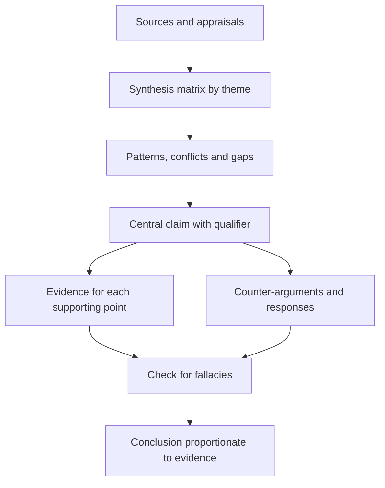

## Introduction

By this stage you have a focused question and a set of credible sources. The remaining challenge is the one that most distinguishes postgraduate work from undergraduate summary: turning sources into an argument. A seminar that lists what Author A found, then what Author B found, then what Author C found, shows reading but not thinking. A seminar that asks which findings are most trustworthy, why they differ, what they jointly imply and what remains uncertain shows analysis, and that is what audiences and assessors reward.

This lesson explains what critical analysis is and is not, how to appraise the reasoning and evidence in a source, how to synthesise across sources, and how to build and test an argument. It introduces practical tools including the Toulmin model of argument, a synthesis matrix and a checklist of common reasoning fallacies. The goal is not cynicism about sources but disciplined judgement: being fair, specific and proportionate.

## Learning Objectives

- Explain what critical analysis means and distinguish it from criticism and from description.
- Appraise the claim, evidence, method and reasoning of a source.
- Construct a synthesis matrix and use it to compare studies thematically.
- Build an argument using claim, evidence, warrant and qualification, and anticipate counter-arguments.
- Identify common reasoning fallacies in sources and in your own work.
- Evaluate the strength of a conclusion and state it with proportionate confidence.

## Prerequisite Knowledge

- A seminar question and a set of appraised sources (see the previous lessons in this module).
- Awareness of the difference between correlation and causation.

## Key Terminology

- **Critical analysis**: The systematic examination of claims, evidence and reasoning to judge their strength and limits.
- **Argument**: A claim supported by reasons and evidence, intended to justify a conclusion.
- **Claim**: A statement that you ask the audience to accept.
- **Warrant**: The reasoning that links evidence to a claim.
- **Synthesis**: Combining ideas from several sources to create a new, organised understanding, rather than reporting each in turn.
- **Counter-argument**: A reasonable opposing view or piece of evidence that challenges your claim.
- **Fallacy**: A flaw in reasoning that makes an argument appear stronger than it is.
- **Qualification**: A statement of the conditions or limits under which a claim holds.

## Detailed Explanation

### What critical analysis is

"Critical" in the academic sense does not mean negative. It means examining something carefully to decide how far to trust it. A critical reader asks: What is being claimed? What is the evidence? Does the method justify the conclusion? What else could explain the result? What is missing? How does this compare with other work? Strengths are as important as weaknesses, and a good critical judgement is balanced and specific.

Three levels of engagement can be distinguished.

| Level | Typical sentence | Assessment |
|---|---|---|
| Description | "Author X surveyed 250 firms and found a positive link." | Necessary but not enough |
| Evaluation | "The survey is large, but performance was self-reported, which may inflate the link." | Judges quality |
| Synthesis and argument | "Across three studies the link appears consistently, but all rely on self-reported data, so the case for a causal effect remains weak." | Builds a position |

### Questions for appraising a source

Appraise the logic and evidence, not only the credentials of the author.

- **Claim and question**: What exactly is claimed, and does it answer a question relevant to yours?
- **Design and method**: Is the design appropriate? A cross-sectional survey can show association but struggles to show cause.
- **Sample and context**: Who was studied, how were they selected and does the context resemble yours?
- **Measures**: Are the constructs measured validly and reliably?
- **Analysis and inference**: Do the conclusions follow from the results, or do they overreach?
- **Alternative explanations**: What other factors, such as confounders, selection effects or timing, could explain the findings?
- **Limitations and bias**: Does the author acknowledge limitations? Are there conflicts of interest?
- **Contribution**: What does it add to the field?

### Synthesis: moving from sources to themes

Synthesis organises ideas by theme, not by source. A **synthesis matrix** is a simple table with sources down one side and themes or questions across the top. Filling it in reveals patterns: where studies agree, where they conflict, which contexts are covered and where evidence is missing.

| Source | Finding on benefits | Method | Context | Main limitation |
|---|---|---|---|---|
| Study A | Positive | Survey | Large firms | Self-report |
| Study B | Mixed | Case study | SMEs | Single case |
| Study C | Positive | Survey | SMEs | Cross-sectional |

From such a matrix you can write synthesis sentences: "Two of three studies report positive effects, but only Study C focuses on SMEs and it relies on cross-sectional data." Notice that the sentence compares, qualifies and points to a gap.

### Explaining disagreement

When studies disagree, resist the temptation to pick a side silently. Possible explanations include different definitions, different populations, different methods, different time periods and different measures. A strong seminar says: "The conflict may be explained by..." and then examines which explanation the evidence supports. Disagreement in the literature is not a problem to hide but often the most interesting part of the argument.

### Common fallacies to watch for

- **Correlation presented as causation**: assuming that because two things move together, one causes the other.
- **Hasty generalisation**: drawing a broad conclusion from a few or unrepresentative cases.
- **Appeal to authority**: accepting a claim because of who said it rather than the evidence.
- **Cherry-picking**: selecting only evidence that supports the preferred view.
- **False dichotomy**: presenting two options when more exist.
- **Straw man**: misrepresenting an opposing view so that it is easy to attack.
- **Appeal to popularity**: assuming that a widespread belief or practice is therefore correct.

Check your own arguments for these, not only other people's.

## Theories, Frameworks and Models

### The Toulmin model of argument

Stephen Toulmin's model, set out in *The Uses of Argument*, breaks an argument into parts that make its structure visible.

- **Claim**: what you want the audience to accept.
- **Grounds (evidence)**: the facts or data offered in support.
- **Warrant**: the principle that connects the grounds to the claim.
- **Backing**: support for the warrant itself.
- **Qualifier**: words that indicate strength, such as "probably" or "in most cases".
- **Rebuttal**: the conditions under which the claim would not hold, or the strongest objection.

For example: *Claim*: Small firms should pilot analytics before full adoption. *Grounds*: Several studies report that benefits depended on staff skills. *Warrant*: Where benefits depend on skills, firms without skills risk waste. *Qualifier*: This probably applies most to firms with limited technical staff. *Rebuttal*: Firms that can hire expertise cheaply may not need a pilot.

### Booth, Colomb and Williams on argument

In *The Craft of Research*, Booth, Colomb and Williams present argument as a conversation with the reader: you state a claim, give reasons, support them with evidence, acknowledge and respond to alternatives, and explain the principle connecting evidence to claim. This view is useful for seminars because it reminds you that you are answering the audience's likely objections, not just proving yourself right.

### Evidence hierarchy and proportionate confidence

Not all evidence is equally strong. Broadly, systematic reviews and well-designed studies with strong controls offer more reliable bases for causal claims than single case studies, expert opinion or vendor reports. The hierarchy should be applied with judgement, since a rich qualitative study may be the best evidence for questions about experience and meaning. The key principle is proportion: the strength of the language in your conclusion should match the strength of the evidence.

## Step-by-Step Guide: Building an argument from sources

1. **Restate your question** and working thesis.
2. **Build a synthesis matrix** with sources and themes.
3. **Identify patterns**: agreement, disagreement, gaps, and context differences.
4. **Appraise the strongest and weakest evidence** and note why.
5. **Draft your central claim** in one sentence, with a qualifier.
6. **List supporting points**, each with specific evidence.
7. **Anticipate counter-arguments** and decide how to respond.
8. **Check for fallacies** such as overgeneralisation and cherry-picking.
9. **State limitations and gaps** openly.
10. **Revise the thesis** if the evidence requires it.
11. **Write a conclusion** that is no stronger than the evidence.

## Worked Example

Illustrative scenario. A student's question is: *How strong is the evidence that mandatory cybersecurity awareness training reduces phishing incidents?*

Her matrix contains five illustrative studies. Three report fewer incidents after training, one reports a short-lived effect that faded after several months, and one finds no effect. Three of the five rely on employees' self-reports; two use logged click rates from simulated phishing exercises.

**Appraisal.** The logged-data studies are stronger on measurement. The study showing fading effects suggests that duration matters. The study finding no effect involved a single short session.

**Pattern and explanation.** Training seems to help in the short term, with effects depending on duration and reinforcement.

**Argument (Toulmin form).**
- Claim: Mandatory training probably reduces phishing risk in the short term, but the evidence for lasting effects is limited.
- Grounds: Three studies show reductions, two using logged data; one shows fading; one shows none.
- Warrant: Behaviour change that is not reinforced tends to decay, so durable effects require repeated activity.
- Qualifier: "Probably", "in the short term".
- Rebuttal: Self-reported results may overstate effects, and simulated phishing differs from real attacks.

**Conclusion.** Training is worth including, but organisations should not rely on it alone and should measure outcomes over time.

The student avoided two common errors: she did not claim that training "works", and she did not dismiss the contrary study without explanation. She also noted the gap that none of the studies was conducted in a Ghanaian organisation, so applicability must be argued rather than assumed.

## Ghanaian Business Application

In Ghanaian organisations, decisions about technology are often made with limited local evidence and under pressure to follow what has worked elsewhere. Critical analysis helps managers and analysts avoid two opposite mistakes: copying a foreign solution without checking whether its conditions hold locally, and rejecting useful evidence because it comes from elsewhere. A careful analyst asks: How similar are the contexts in terms of infrastructure, regulation, skills and customer behaviour? What does the evidence actually show, and what is only assumed?

The same discipline is valuable when you read consultancy reports, vendor claims or news summaries that circulate in business settings. Check how the figures were produced, who produced them and whether they are used beyond what the evidence supports. In a seminar on a Ghanaian topic, show the audience which of your claims rest on local evidence, which on international evidence and which on reasoning by analogy, and be clear about the strength of each. This transparency is a mark of academic honesty and builds credibility.

## International Case Study

In 2010, the economists Carmen Reinhart and Kenneth Rogoff published a paper on public debt and economic growth, which was widely cited in public debate about government debt and austerity. In 2013, Thomas Herndon, Michael Ash and Robert Pollin, at the University of Massachusetts Amherst, published a critique after attempting to replicate the results. They reported that the original analysis had omitted some available data through a spreadsheet coding error, had used particular choices about weighting countries and years, and had selected data in ways that affected the headline result. Reinhart and Rogoff acknowledged the coding error, while defending parts of their broader conclusion. The episode is well documented in the economics literature and in the press.

For a student, the case offers several lessons about critical analysis. First, a prominent, widely cited source can contain errors, so authority alone is not enough. Second, replication and transparency of data and method allow others to test claims. Third, reasonable people can agree that an error occurred while still debating how much it changes the conclusion, so critical judgement should be proportionate rather than all-or-nothing. Finally, it shows why you should check how conclusions follow from data and, where possible, from the method description, instead of trusting a summary of the headline finding.

## Diagram

## Common Misconceptions

- **"Being critical means finding fault."** It means judging strength and limits, including recognising strengths.
- **"A summary of several sources is a synthesis."** Synthesis organises by theme and compares; a summary reports each source separately.
- **"If experts disagree, I cannot reach a conclusion."** You can reach a reasoned, qualified conclusion by explaining the disagreement.
- **"A strong argument ignores opposing views."** Strong arguments address the best opposing evidence.
- **"Famous papers are beyond criticism."** Famous papers can contain errors and limitations.

## Common Examination Mistakes

- Describing each source in turn rather than organising by theme.
- Presenting correlation from a survey as proof of cause.
- Ignoring conflicting evidence, or mentioning it without explanation.
- Using strong language ("proves", "clearly shows") for modest evidence.
- Criticising sources vaguely ("this study is weak") without saying why.
- Omitting the limitations of your own argument.

## Critical Thinking Questions

1. How would you respond if the best-designed study in your sample contradicts your working thesis?
2. When is it reasonable to rely on a lower-quality source, and how should you signal that to the audience?
3. How can a student without data of their own still make an original contribution to a seminar?
4. What is the difference between a qualified claim and a vague one?

## Practical Exercises

1. **Source appraisal sentences.** For three sources, write one sentence of description, one of evaluation and one of synthesis connecting it to another source. Expected output: nine sentences labelled by level.
2. **Synthesis matrix.** Build a matrix for at least five sources with columns for finding, method, context and limitation, and write a three-sentence synthesis paragraph. Expected output: a completed matrix and paragraph.
3. **Toulmin map.** Write your seminar argument in Toulmin form, including a qualifier and rebuttal. Expected output: a one-page map with labelled components.
4. **Fallacy hunt.** Find an opinion article or a vendor report on a technology topic and identify at least three reasoning weaknesses, naming each fallacy. Expected output: a list of excerpts with a name and a brief explanation for each.

## Key Takeaways

- Critical analysis is a balanced, specific judgement of strength and limits, not fault-finding.
- Appraise claim, method, sample, measures, inference and alternative explanations.
- Synthesise by theme using a matrix, and explain disagreements.
- Structure arguments with claim, grounds, warrant, qualifier and rebuttal.
- Anticipate counter-arguments and check for fallacies.
- Match the strength of your language to the strength of your evidence.

## Further Reading

- Toulmin, S. E. (2003). *The uses of argument* (Updated ed.). Cambridge University Press.
- Booth, W. C., Colomb, G. G., & Williams, J. M. (2008). *The craft of research* (3rd ed.). University of Chicago Press.
- Cottrell, S. (2017). *Critical thinking skills: Effective analysis, argument and reflection* (3rd ed.). Palgrave Macmillan.
- Ridley, D. (2012). *The literature review: A step-by-step guide for students* (2nd ed.). SAGE.

## Video Resources

- [Purdue Online Writing Lab](https://owl.purdue.edu/): Purdue University. Official writing resource portal with guidance on argument, evidence and synthesis.
- [APA Style](https://apastyle.apa.org/): American Psychological Association. Official APA Style site with guidance on clear, evidence-based writing.

## Revision Summary

Critical analysis judges the strength and limits of claims, evidence and reasoning in a balanced, specific way. A synthesis matrix lets you compare sources by theme and explain agreement, conflict and gaps. Arguments are built from a claim, supporting evidence, a warrant linking them, a qualifier and a response to counter-arguments, as in the Toulmin model. Checking for fallacies and matching the strength of language to the strength of evidence keeps conclusions credible.

- Critical means judging, not condemning.
- Synthesise by theme, not source by source.
- Explain why studies disagree.
- Use claim, grounds, warrant, qualifier and rebuttal.
- Beware correlation presented as cause.
- Keep conclusions proportionate to evidence.
