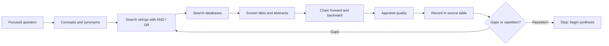

## Introduction

A seminar is only as credible as the sources behind it. Yet students commonly stop at the first page of search results, rely on summaries written by other people, or collect so many articles that they cannot say what any of them contributed. Effective literature exploration is neither random browsing nor exhaustive reading. It is a planned process of searching, screening, evaluating and recording, designed to give you enough high-quality evidence to support a clear argument.

This lesson focuses on the specific needs of a seminar: limited time, a focused question and an audience that may ask where your evidence comes from. You will learn how to turn a question into search terms, use scholarly databases and citation chaining, distinguish credible from questionable sources, and keep notes that make writing and referencing straightforward. It builds on, and does not replace, any fuller instruction you have received on literature reviews in research methods.

## Learning Objectives

- Convert a seminar question into search terms using synonyms, Boolean operators and filters.
- Use scholarly databases, citation chaining and library resources to locate relevant literature.
- Evaluate sources for authority, accuracy, currency, purpose and methodological quality.
- Distinguish primary, secondary and grey literature and decide when each is appropriate.
- Construct a source table and annotated notes that support later synthesis and APA 7 referencing.

## Prerequisite Knowledge

- A focused seminar question or working thesis (see the lesson on selecting and refining a seminar topic).
- Basic understanding of what journal articles, books and reports are.

## Key Terminology

- **Primary source**: A source reporting original research or first-hand data.
- **Secondary source**: A source that analyses or summarises primary sources, such as a review article or textbook.
- **Grey literature**: Material not published through commercial academic channels, such as reports from organisations, regulators and think tanks.
- **Peer review**: A process in which independent experts evaluate a manuscript before publication.
- **Boolean operators**: The words AND, OR and NOT used to combine search terms.
- **Citation chaining**: Finding further sources by following a paper's reference list (backward) or the works that cite it (forward).
- **Predatory publisher**: A publisher that charges fees without providing genuine editorial and peer-review services.
- **Source table**: A structured record of sources with key details, findings and quality notes.

## Detailed Explanation

### Planning the search

Before typing anything, break your question into concepts. Suppose the question is: *How strong is the evidence that mobile money acceptance improves small retailers' sales?* The core concepts are mobile money, small retailers and sales performance. For each concept, list alternative terms. Mobile money may also appear as mobile payments, mobile wallets or digital financial services. Small retailers may be small businesses, micro-enterprises or SMEs. Sales performance may be turnover, revenue or business performance.

Combine the terms with Boolean operators. OR joins synonyms within a concept; AND joins different concepts:

`("mobile money" OR "mobile payments" OR "mobile wallet") AND (retailers OR "small businesses" OR SMEs) AND (sales OR revenue OR performance)`

Quotation marks keep phrases together. A truncation symbol, often an asterisk, finds word variants (retail* finds retail, retailer and retailing), though symbols differ between databases. Run the search, scan titles, and refine. Poor results usually mean that your terms are too narrow, too broad or not the words authors use.

### Where to search

| Source type | Examples | Strengths | Cautions |
|---|---|---|---|
| General scholarly search | Google Scholar | Broad, quick, shows citation counts | Includes uneven quality; check each source |
| Subject databases | Those subscribed to by your library | Better filters and quality control | Access depends on your institution |
| Open access directories | DOAJ, CORE | Free full text | Quality varies; check journal standing |
| Books and textbooks | Library catalogue | Good for theory and definitions | Can be dated |
| Grey literature | Regulators, international bodies, central banks | Policy and local data | Not peer reviewed; consider purpose and bias |

Your library's staff can often advise on databases and access arrangements. Use them early, and check what your institution actually provides rather than assuming.

### Citation chaining

Once you find one strong, relevant paper, use it as a map. **Backward chaining** examines its reference list for foundational work. **Forward chaining** uses a tool such as the "Cited by" link in Google Scholar to find later papers that built on or challenged it. Review articles are particularly useful starting points because they summarise a field, but you should still read key primary studies yourself before relying on a reviewer's description.

### Evaluating sources

Not every source deserves equal weight. A practical set of questions is the following.

- **Authority**: Who wrote it, and what are their credentials and affiliation? Is the publisher or journal reputable?
- **Accuracy and method**: Are claims supported by evidence? Is the method described clearly enough to judge it? What are the sample size and sampling approach? Are limitations acknowledged?
- **Currency**: Is the information still valid? In fast-moving areas such as technology, older studies may be outdated, though foundational theory can remain relevant.
- **Relevance**: Does the source address your question, population and context?
- **Purpose and bias**: Why was it produced? A vendor white paper may have a commercial purpose; an advocacy report may select evidence selectively.
- **Peer review and standing of the venue**: Peer review does not guarantee quality, but it is a useful signal. Be cautious with journals you cannot verify.

A source that is poor on one dimension may still be useful if you treat it properly, for example citing a company report as evidence of the company's position rather than as neutral proof.

### Primary, secondary and grey sources

Use **primary sources** when you need to evaluate evidence yourself. Use **secondary sources** for overviews, definitions and connections between studies. Use **grey literature** for regulation, policy, official statistics and industry practice, noting its status. Be wary of relying on blogs, news articles and generated summaries for factual claims, and always trace a statistic to its original source rather than repeating what someone else said about it. If you cannot trace it, do not use it.

### Making useful notes

Poor notes lead to accidental plagiarism and wasted time. For each source record:

1. Full reference details in APA 7 format.
2. The research question or purpose.
3. Method, sample and context.
4. Key findings, in your own words.
5. Strengths and limitations.
6. How it relates to your argument, and a note of any direct quotation with its page number.

A reference manager such as Zotero can store references and generate citations, but you still need to check each reference for accuracy.

## Theories, Frameworks and Models

### The search-screen-appraise-record cycle

A manageable model for seminars is a cycle of four stages. **Search** with planned terms. **Screen** titles and abstracts against simple inclusion criteria (for example, published within a given period, addresses small businesses, reports evidence). **Appraise** the shortlisted sources for quality. **Record** details and notes in a source table. If gaps appear, return to searching with revised terms. This is a lighter version of the systematic approach used in formal review methods.

### The CRAAP test

Librarians commonly teach the CRAAP checklist: Currency, Relevance, Authority, Accuracy and Purpose. It is a convenient prompt for quick evaluation, though it is a screening aid and not a substitute for judging the quality of the method in an empirical paper.

### Saturation as a stopping rule

You will never read everything. A practical sign that you have done enough for a seminar is saturation: new searches begin to return mainly the same authors, studies and arguments you already have, and you can answer the question "What do we know, what is disputed and what is missing?" with confidence.

## Step-by-Step Guide: A seminar literature search in two to three weeks

1. **List concepts and synonyms** from your question.
2. **Build search strings** using AND, OR and quotation marks.
3. **Search at least two sources**, for example Google Scholar and a library database.
4. **Screen** by title and abstract using written inclusion criteria.
5. **Chain** forwards and backwards from the two or three best papers.
6. **Appraise** each shortlisted source and record strengths and limitations.
7. **Build a source table** with 10-15 core sources, including at least a few primary studies.
8. **Check for gaps**, such as missing perspectives or no evidence from your context, and search again.
9. **Stop** when new results mostly repeat what you already have.

## Worked Example

Illustrative scenario. A student asks: *How strong is the evidence that data analytics adoption improves SME performance?*

Her first search, "data analytics SME", returns a large and mixed set. Refining to `("data analytics" OR "business analytics" OR "big data") AND ("small and medium" OR SME*) AND performance` improves relevance. After scanning abstracts, she shortlists twelve sources and builds a source table.

| Source (illustrative labels) | Type | Method | Finding | Limitation |
|---|---|---|---|---|
| Study A | Journal article | Survey of firms in one country | Positive association with performance | Cross-sectional; self-reported performance |
| Study B | Journal article | Interviews with managers | Skills shortage limits benefit | Small sample |
| Report C | Consultancy white paper | Opinion and examples | Claims large gains | Commercial interest; method unclear |
| Review D | Review article | Synthesis of studies | Mixed evidence | Depends on included studies |

From the table she can already state an argument: evidence for a positive association exists but mostly rests on self-reported cross-sectional data, and commercially produced claims should be treated cautiously. She notes that Report C should be used only as evidence of what vendors claim. The gaps she identifies, such as limited evidence from West Africa, become something she can acknowledge honestly.

## Ghanaian Business Application

A student researching Ghanaian IT and business topics will often find that scholarly evidence is uneven. Some areas, such as mobile financial services, have a growing body of research; others have little. Official and institutional sources, such as publications from regulators, the central bank and statistical agencies, can be valuable for context, but you should cite the originating document and date, and check whether it is still current. Where you cannot find a Ghana-specific source for a claim, say so and use international evidence with an explicit caveat.

Local libraries and university repositories may hold theses and reports not found in international databases. These can be useful starting points, but treat their quality like any other source. Be sceptical of statistics circulated on social media or in news summaries; trace them to the original organisation and release. Finally, if you obtain information from a company or an interview, ensure you have permission to use it and follow your institution's ethical rules.

## International Case Study

In the years after 2010, Jeffrey Beall, a librarian at the University of Colorado Denver, compiled and publicised a list of publishers and journals he considered potentially predatory, meaning that they charged authors fees while offering little or no genuine peer review. The list attracted both support and criticism, and it was taken offline in January 2017. The episode is well documented in the scholarly publishing press and illustrates two things relevant to seminar preparation.

First, the existence of a journal and of a polished article layout is not evidence of quality. Researchers and students need their own criteria for assessing a venue, such as checking editorial boards, indexing in recognised directories, transparency about peer review and the reputation of the publisher. Second, no single list or label should replace judgement. Lists can be incomplete or contested, and a journal's quality can change. A student building a source table should therefore record why each source was trusted, so that if challenged in the seminar ("How do you know this journal is credible?") the answer rests on reasoning rather than on appearance.

## Diagram

## Common Misconceptions

- **"The first page of results is the best evidence."** Search ranking reflects relevance signals and popularity, not necessarily quality.
- **"Peer-reviewed means correct."** Peer review improves quality control but does not guarantee accuracy.
- **"Newer is always better."** Recent work is important in fast-moving fields, but foundational theory and methods papers may be older.
- **"Reading abstracts is enough."** Abstracts can omit limitations. Read the method and findings of key sources.
- **"A statistic quoted in several places must be true."** Repetition is not verification; trace it to the original source.

## Common Examination Mistakes

- Citing a source you have not read, relying on someone else's summary of it.
- Using a single database or only the first page of results.
- Treating vendor reports and blog posts as neutral evidence.
- Failing to record reference details at the time of reading, then guessing later.
- Presenting a list of sources without comparing their quality or findings.
- Quoting precise statistics with no traceable original source.

## Critical Thinking Questions

1. When might a non-peer-reviewed source such as a regulator's report be more appropriate than a journal article?
2. How would you decide whether to trust a study whose sample is small but whose method is carefully described?
3. What are the risks of relying on a single review article for a whole seminar?
4. How can you tell that you have read enough, and what could make that judgement wrong?

## Practical Exercises

1. **Search string design.** Take your seminar question, identify three concepts, list at least three synonyms for each and write a Boolean search string. Expected output: a table of concepts and synonyms plus a final search string.
2. **Source appraisal.** Choose three sources on one topic, including at least one that is not a journal article, and appraise each using authority, accuracy, currency, relevance and purpose. Expected output: a short appraisal table with a recommendation on how each should be used.
3. **Citation chaining.** Starting from one strong paper, find three sources through its reference list and three through "Cited by". Expected output: a list of six sources with a note on what each adds.
4. **Source table.** Build a table of at least eight sources with reference, method, findings, limitations and relevance. Expected output: a completed table with APA 7 references and a one-sentence statement of the gap you can see.

## Key Takeaways

- A literature search should be planned from concepts, synonyms and Boolean logic.
- Use more than one search source and follow citation chains in both directions.
- Evaluate authority, method, currency, relevance and purpose, not just the venue.
- Distinguish primary, secondary and grey literature and use each appropriately.
- Record notes and full references as you read.
- Stop when searches saturate, and be honest about gaps in the evidence.

## Further Reading

- Ridley, D. (2012). *The literature review: A step-by-step guide for students* (2nd ed.). SAGE.
- Booth, W. C., Colomb, G. G., & Williams, J. M. (2008). *The craft of research* (3rd ed.). University of Chicago Press.
- American Psychological Association. (2020). *Publication manual of the American Psychological Association* (7th ed.). American Psychological Association.

## Video Resources

- [Google Scholar](https://scholar.google.com/): Google. Scholarly search engine with "Cited by" links for forward citation chaining.
- [Directory of Open Access Journals](https://doaj.org/): DOAJ. Directory of open access journals, useful for checking journal standing.
- [Purdue Online Writing Lab](https://owl.purdue.edu/): Purdue University. Official writing resource portal with guidance on research and source evaluation.

## Revision Summary

Exploring the literature for a seminar means planning searches from concepts and synonyms, combining terms with Boolean operators, searching more than one source and following citation chains. Sources are evaluated for authority, accuracy, currency, relevance and purpose, and primary, secondary and grey literature serve different roles. Good notes and a source table, with full references recorded as you read, make later synthesis and referencing straightforward. Stopping when results saturate and admitting gaps honestly keeps the argument credible.

- Plan searches from concepts and synonyms.
- Use AND to combine and OR to widen.
- Chain citations forward and backward.
- Appraise quality, not just relevance.
- Trace statistics to their original source.
- Record references as you read.
