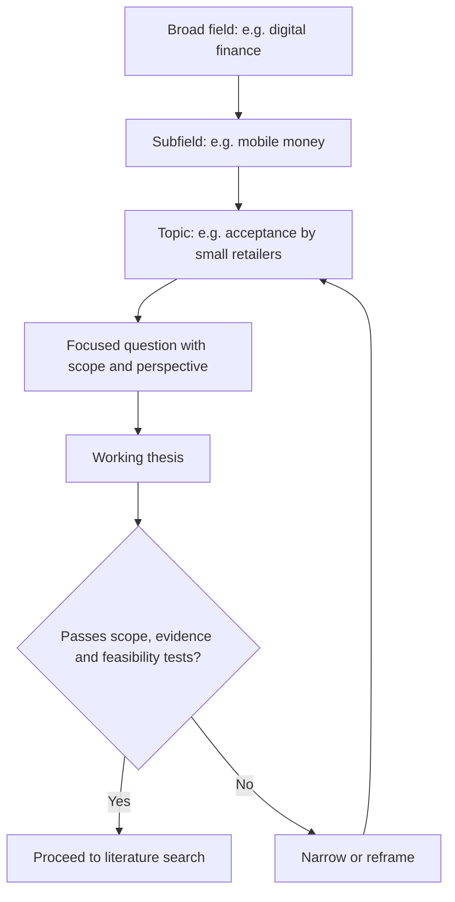

## Introduction

Many weak seminars fail before the first slide is made, because the topic was too broad, too trivial, too vague or impossible to research in the time available. "Artificial intelligence in business" cannot be treated in fifteen minutes; neither can "Is technology good for Ghana?". A strong topic is narrow enough to be examined with real evidence, wide enough to contain a genuine question, and interesting enough to sustain weeks of reading.

This lesson teaches a disciplined route from a vague interest to a focused, defensible seminar question. You will learn how to generate candidate topics, test them against practical criteria, narrow them systematically, and express the result as a question or argument that guides all later work. Your department may allocate topics, offer a list or leave the choice to you. Where the topic is assigned, the same skills apply to scoping and framing it. Confirm the official arrangements before investing effort.

## Learning Objectives

- Generate candidate seminar topics from course content, professional experience and current developments.
- Evaluate candidate topics using criteria of scope, significance, feasibility, evidence availability and interest.
- Narrow a broad topic using dimensions such as population, setting, technology, time and perspective.
- Formulate a focused seminar question and a provisional argument.
- Justify the choice and scope of a topic in a short rationale.

## Prerequisite Knowledge

- Understanding of the purpose and expectations of a seminar (earlier lessons in this course).
- Basic familiarity with academic search tools such as Google Scholar.

## Key Terminology

- **Topic**: A general area of interest, such as digital payments in small retail.
- **Research question**: A focused, answerable question that drives an investigation.
- **Scope**: The boundaries of what a study or presentation will and will not cover.
- **Feasibility**: Whether a topic can be completed with the time, access and skills available.
- **Gap**: An aspect of a subject that existing literature has not adequately addressed or resolved.
- **Working title**: A provisional title that is expected to change as understanding develops.
- **Rationale**: A short justification of why the topic matters and why it was chosen.
- **Delimitation**: A deliberate choice to exclude certain areas to keep the work manageable.

## Detailed Explanation

### From interest to topic

Topics rarely arrive fully formed. Productive sources include:

- **Your programme**: a concept from a lecture that you found puzzling, or a debate your lecturers mentioned.
- **Your work experience**: a problem you have seen in an organisation, such as low adoption of a new system.
- **Current developments**: new regulation, technology or a high-profile failure. Be careful here: a topic that is too recent may have little reliable scholarly literature.
- **Literature itself**: the "future research" sections of review articles often suggest unanswered questions.

A useful habit is to write down five to ten candidate topics without judging them, then test them.

### Testing a candidate topic

Five tests help to separate promising topics from problematic ones.

| Test | Question to ask | Warning sign |
|---|---|---|
| Scope | Can this be treated well in the time available? | Topic is a whole field ("e-commerce") |
| Significance | Does it matter to theory, practice or policy? | You cannot say who would care |
| Evidence | Is there enough credible literature and data? | Only blogs and press releases exist |
| Feasibility | Can I complete it with my access and skills? | Needs confidential company data you cannot obtain |
| Interest | Will it sustain my attention? | You chose it only because it seemed easy |

A topic does not need to pass every test perfectly, but a clear failure on scope or evidence should lead you to revise it.

### Narrowing a topic

Broad topics are narrowed by adding constraints. Common dimensions include:

- **Who**: a specific population (for example, microfinance clients, bank managers, small retailers).
- **Where**: a country, region, sector or type of organisation.
- **What aspect**: adoption, security, cost, trust, governance, performance.
- **Which technology or concept**: mobile money, cloud services, enterprise resource planning, data analytics.
- **When**: a time period or stage of maturity.
- **Which perspective**: customer, employee, regulator, investor.

Starting with "digital payments", for example, one might narrow to "factors influencing small retailers' acceptance of mobile money payments in urban Ghana". Each added constraint makes the topic more focused, but be cautious: too many constraints can leave too little literature.

### From topic to question

A topic names an area; a question demands an answer. Compare:

- Topic: *Cybersecurity in banks.*
- Descriptive question: *What cybersecurity measures do banks use?*
- Analytical question: *To what extent do employee awareness programmes reduce phishing-related incidents in financial institutions, according to the available evidence?*
- Evaluative question: *How convincing is the evidence that mandatory security training reduces phishing risk?*

Seminars at postgraduate level should usually pose analytical or evaluative questions because they invite argument and judgement rather than only description. Good questions are specific, answerable using available literature, and open to more than one reasonable answer.

### Arguments and provisional answers

Once you have a question, write a provisional answer, sometimes called a working thesis. For example: "Awareness training reduces phishing incidents only when combined with technical controls and management follow-up." This may turn out to be wrong, and that is acceptable. Its value is that it directs your reading and gives you something to confirm, qualify or reject.

## Theories, Frameworks and Models

### The funnel model of narrowing

Picture a funnel. At the top is a broad field, then a subfield, then a topic, then a focused question. The narrowing continues until the question is answerable with a defined body of evidence. This model prevents two common errors: staying too high (a survey of everything) and dropping too low too early (a question for which no sources exist).

### PICO-style framing adapted for IT and business

Healthcare researchers use PICO (population, intervention, comparison, outcome) to frame answerable questions. A similar structure helps in IT and business: *In [population or setting], what is the effect of [technology or practice], compared with [alternative], on [outcome]?* For example: "Among small retailers in Accra, how does accepting mobile money affect customer volume compared with accepting cash only?" You will not always have a comparison, but thinking in these terms exposes missing elements.

### SMART-style feasibility check

Project managers use SMART criteria for objectives. Adapted to topics, ask whether the question is Specific, Measurable in terms of evidence, Achievable, Relevant and Time-bound. A topic that cannot pass a feasibility check on time should be narrowed before you commit.

## Step-by-Step Guide: Refining a topic

1. **Confirm constraints.** Check the department's rules on topic allocation, approval and length.
2. **Brainstorm.** List at least eight candidate topics.
3. **Do a quick scan.** For each, spend ten minutes on Google Scholar or a library database and note how many credible sources exist.
4. **Apply the five tests.** Score each topic and eliminate weak ones.
5. **Narrow the strongest.** Add constraints using the who, where, what, when and perspective dimensions.
6. **Write the question.** Draft one analytical or evaluative question.
7. **Draft a working thesis.** State a provisional answer.
8. **Write a rationale.** In three to five sentences, explain why the topic matters and why it is feasible.
9. **Seek feedback.** Share the question with a peer or lecturer and revise.

## Worked Example

Illustrative scenario. A student working in a bank is interested in "AI in banking".

**Step 1: Scan.** A quick search shows thousands of results across fraud, credit scoring, chatbots, compliance and ethics. The topic is far too broad.

**Step 2: Narrow.** She chooses an aspect (credit scoring), a perspective (fairness), and a context (emerging markets). Working title: *Algorithmic credit scoring and fairness in emerging markets*.

**Step 3: Check evidence.** She finds academic and policy literature on algorithmic bias and on alternative data in lending, though evidence specific to Ghana appears limited. She decides to include Ghana only as an illustration and to say openly that local evidence is thin.

**Step 4: Question.** *How strong is the evidence that algorithmic credit scoring using alternative data improves access to credit without introducing unfair bias in emerging markets?*

**Step 5: Working thesis.** *Alternative-data scoring can widen access, but the evidence on fairness is weaker than the evidence on access, and safeguards are needed.*

**Step 6: Rationale.** "The topic is relevant to financial inclusion and to the governance of automated decisions. Sufficient peer-reviewed and policy literature exists to support an evaluative argument, and the scope is limited to one application."

Notice how each step reduced the scope while increasing the intellectual content. Notice also that she modified the Ghana focus when the evidence did not support it, which is better than overclaiming.

## Ghanaian Business Application

Ghana offers many promising seminar topics for MSc IT for Business students, such as digital financial services, e-government and public sector digitalisation, the adoption of cloud and analytics tools by small and medium-sized enterprises, cybersecurity in organisations, data protection compliance under the Data Protection Act, 2012 (Act 843), health information systems and digital skills. The important practical question is the evidence available. Local topics have the advantage of relevance and your own contextual knowledge, but published scholarly material specific to Ghana may be limited, and some official statistics may not be accessible or recent.

A good approach is to combine strengths. You might frame an international question, for example about trust in mobile financial services, and then ask how far the findings plausibly apply in Ghana, stating clearly which claims are supported by Ghanaian evidence and which are extrapolated. Avoid assuming that a practice that is widespread is also well documented, and avoid quoting precise figures you cannot trace to an official source. If your topic touches an employer's data or processes, check confidentiality rules before using any such material.

## International Case Study

Illustrative scenario. Two students at an overseas university choose the topic "social media and business". The first keeps the topic as stated and finds hundreds of sources, gives up on selecting among them and produces a general overview. The second, after consulting her supervisor, narrows to: "What does empirical research suggest about the effect of customer reviews on purchase decisions for low-cost software services?" and writes a provisional thesis that the effect is moderated by the perceived credibility of reviewers.

The second student could define search terms, set inclusion criteria and identify a small number of studies with conflicting results. Her seminar became a reasoned comparison of evidence. The first student's seminar could only describe. The lesson is not that narrow topics are always better, but that a topic must be small enough to be mastered. A question that can be answered with a defined body of evidence converts reading into argument.

## Diagram

## Common Misconceptions

- **"A broad topic gives me more to say."** A broad topic usually leads to superficial coverage. Depth comes from focus.
- **"The topic must be completely original."** A seminar topic does not need to be new; it needs a clear, well-supported question.
- **"A topic and a research question are the same."** A topic is an area; a question demands a specific answer.
- **"Local topics are always easier."** They may be more relevant, but evidence can be harder to find.
- **"My working thesis must be correct."** It is a provisional position that reading may revise.

## Common Examination Mistakes

- Choosing a topic that is a whole field and cannot be treated in the time available.
- Selecting a topic without checking that credible sources exist.
- Writing a descriptive question when the task calls for analysis or evaluation.
- Changing the topic late without updating the argument and slides.
- Including local claims without local evidence, or quoting unverified statistics.
- Failing to state delimitations, so that the audience expects coverage you will not provide.

## Critical Thinking Questions

1. Is it better to choose a topic you are passionate about or one for which evidence is abundant? What risks does each choice carry?
2. How would you judge whether a topic is too recent to support a scholarly seminar?
3. Why might a narrowly scoped question produce a stronger argument than a broad one, and when might narrowing go too far?
4. How would your topic and question differ if the audience were industry practitioners rather than academics?

## Practical Exercises

1. **Topic brainstorm and test.** List eight candidate topics from your programme and work experience. Score each on scope, significance, evidence, feasibility and interest (1-5). Expected output: a table with totals and a justified shortlist of two.
2. **Narrowing ladder.** Take one broad topic and narrow it in five steps, writing the revised topic at each step. Expected output: a five-row ladder ending in a focused topic.
3. **Question upgrade.** Convert a descriptive question into an analytical and an evaluative question on the same topic. Expected output: three questions labelled by type.
4. **Rationale paragraph.** Write a 100-word rationale for your chosen topic, covering significance, feasibility and scope. Expected output: one paragraph that states delimitations explicitly.

## Key Takeaways

- A good seminar topic is narrow enough to master and significant enough to matter.
- Test candidate topics for scope, significance, evidence, feasibility and interest.
- Narrow topics by population, setting, aspect, technology, time and perspective.
- Convert the topic into an analytical or evaluative question and draft a working thesis.
- State your delimitations openly and be honest about gaps in the evidence.
- Confirm your department's topic arrangements before starting.

## Further Reading

- Booth, W. C., Colomb, G. G., & Williams, J. M. (2008). *The craft of research* (3rd ed.). University of Chicago Press.
- Ridley, D. (2012). *The literature review: A step-by-step guide for students* (2nd ed.). SAGE.
- Saunders, M., Lewis, P., & Thornhill, A. (2019). *Research methods for business students* (8th ed.). Pearson.

## Video Resources

- [Purdue Online Writing Lab](https://owl.purdue.edu/): Purdue University. Official writing resource portal with guidance on developing and narrowing a research topic.
- [Google Scholar](https://scholar.google.com/): Google. Search tool useful for scanning how much scholarly literature exists on a candidate topic.

## Revision Summary

Selecting a seminar topic means moving from a broad interest to a focused, answerable and feasible question. Candidate topics should be tested for scope, significance, evidence availability, feasibility and interest, then narrowed by population, setting, aspect, technology, time and perspective. Analytical or evaluative questions are preferred to descriptive ones, and a working thesis gives direction to reading. Rationale and delimitations make the choice transparent.

- Test topics before committing.
- Narrow until the question is answerable.
- Prefer analytical or evaluative questions.
- Draft a working thesis and expect to revise it.
- Check that credible evidence exists.
- Confirm department rules on topic allocation.
