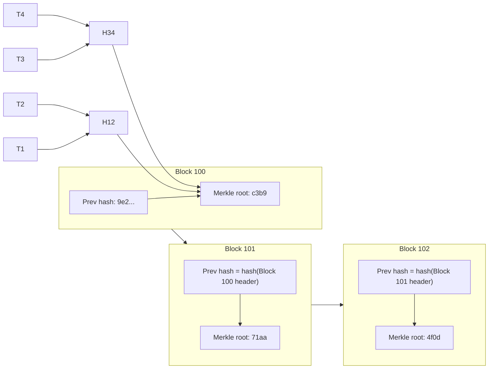

## Introduction

Traditional finance depends on trusted intermediaries. Each bank keeps its own ledger, and a central party such as a clearing house or central bank reconciles them. This model works, but it requires participants to trust the intermediary and to spend considerable effort reconciling separate records. In 2008 a paper published under the name Satoshi Nakamoto proposed a different approach: a ledger replicated across many independent computers, kept consistent by cryptography and a consensus protocol rather than by a central authority. That design, implemented as Bitcoin, became the template for what is now called **blockchain** and, more broadly, **distributed ledger technology (DLT)**.

For business students the important question is not whether blockchain is fashionable, but how it works and when its particular combination of properties is worth its costs. This lesson explains the building blocks (cryptographic hashes, Merkle trees, linked blocks and consensus) and then applies a structured decision framework. It is educational and does not constitute investment advice.

## Learning Objectives

- Explain the properties of cryptographic hash functions and how they make a chain of blocks tamper-evident.
- Construct a Merkle root for a small set of transactions and explain how a Merkle proof verifies inclusion.
- Compare proof of work, proof of stake and Byzantine fault-tolerant consensus in terms of security, finality and energy use.
- Distinguish public permissionless blockchains from permissioned distributed ledgers.
- Evaluate whether a blockchain is an appropriate solution for a given business problem.

## Prerequisite Knowledge

- Understanding of ledgers, reconciliation and the role of intermediaries in payments from earlier modules.
- Basic awareness of public-key cryptography (private and public keys) is helpful but is revisited here.

## Key Terminology

- **Distributed ledger**: A database replicated across multiple participants who maintain a shared record without relying on a single central copy.
- **Blockchain**: A type of distributed ledger that groups transactions into blocks, each linked to the previous block by its cryptographic hash.
- **Cryptographic hash function**: A function that maps any input to a fixed-length output such that small input changes produce unpredictable output changes and it is infeasible to find the input from the output or two inputs with the same output.
- **Merkle tree**: A tree of hashes in which each parent node is the hash of its children, summarising many transactions in a single root hash.
- **Consensus mechanism**: The protocol by which participants agree on the next valid state of the ledger.
- **Proof of work (PoW)**: Consensus in which participants compete to find a value whose hash meets a difficulty target, expending computation.
- **Proof of stake (PoS)**: Consensus in which validators are selected to propose and attest blocks in proportion to the cryptocurrency they lock up as stake.
- **Double spending**: Spending the same digital unit more than once, the central problem a digital cash ledger must prevent.
- **Finality**: The point at which a transaction can no longer be reversed or reorganised out of the ledger.
- **Permissioned ledger**: A distributed ledger in which only approved, identified participants may validate transactions.

## Detailed Explanation

### Hash functions: the foundation

A cryptographic hash function such as SHA-256 takes an input of any length and produces a fixed-length digest (256 bits for SHA-256). Four properties matter:

1. **Deterministic**: the same input always gives the same output.
2. **Pre-image resistance**: given a hash, it is computationally infeasible to find an input that produces it.
3. **Collision resistance**: it is infeasible to find two different inputs with the same hash.
4. **Avalanche effect**: changing a single character of the input changes the output unpredictably.

These properties make a hash a compact **fingerprint** of data. If anyone alters a record, its fingerprint changes and the alteration is detectable.

### Blocks and the chain

A block contains a **header** and a list of transactions. The header includes a timestamp, the root hash of the block's transactions (the Merkle root) and, crucially, the **hash of the previous block's header**. Because each block commits to its predecessor, altering any historical transaction changes that block's Merkle root, which changes its header hash, which breaks the link stored in the next block, and so on to the present. The chain is therefore **tamper-evident**: changes are not impossible, but they cannot be made silently. Making the chain **tamper-resistant** requires a consensus mechanism that makes rewriting history expensive or requires agreement from many independent parties.

### Merkle trees

Instead of hashing all transactions as one blob, blockchains arrange them in a Merkle tree, named after Ralph Merkle. Transactions are hashed individually, the hashes are paired and hashed together, and the process repeats until one **Merkle root** remains. This allows a lightweight client to verify that a transaction is included in a block by checking only a short **Merkle proof**: the sibling hashes along the path to the root, rather than downloading every transaction. For a block with *n* transactions the proof needs roughly log2(*n*) hashes, so verifying inclusion among about a thousand transactions needs only about ten hashes.

### Consensus

In a distributed system, participants may be offline, slow or dishonest. The classic statement of this challenge is the **Byzantine Generals Problem** described by Lamport, Shostak and Pease (1982): how can loyal parties agree on a plan when some participants may send conflicting messages? Blockchains answer this in different ways.

- **Proof of work** asks miners to search for a number (a nonce) that makes the block header's hash fall below a target. Finding it is costly; checking it is cheap. The honest chain is the one with the most accumulated work, so rewriting history requires out-computing the rest of the network: the so-called **51% attack**. Finality is **probabilistic**: each additional block makes reversal less likely. The cost is significant energy consumption.
- **Proof of stake** selects validators according to locked stake and penalises misbehaviour by destroying part of it ("slashing"). It uses far less energy than proof of work. Ethereum moved from proof of work to proof of stake in 2022, an event known as "the Merge".
- **Byzantine fault-tolerant (BFT) protocols**, such as Practical Byzantine Fault Tolerance (Castro & Liskov, 1999), use rounds of voting among a known set of validators. They provide fast, **deterministic finality** and tolerate fewer than one-third faulty validators, but they scale to fewer participants and therefore suit permissioned ledgers.

### Public versus permissioned ledgers

| Dimension | Public permissionless (e.g. Bitcoin) | Permissioned (e.g. consortium ledgers) |
|---|---|---|
| Who can validate | Anyone | Approved, identified members |
| Typical consensus | Proof of work or proof of stake | BFT-style voting |
| Transparency | All transactions publicly visible | Visible to members, often with privacy controls |
| Throughput and finality | Lower throughput; probabilistic or epoch-based finality | Higher throughput; fast deterministic finality |
| Trust model | Trust in protocol and economic incentives | Trust in a known group plus governance agreements |
| Typical uses | Cryptocurrencies, open applications | Trade finance, supply chains, interbank settlement pilots |

A permissioned ledger sacrifices open participation in exchange for performance, privacy and legal accountability. Critics note that, with only a few known validators, a permissioned ledger may offer modest advantages over a well-governed shared database.

## Theories, Frameworks and Models

### Do you need a blockchain?

Wüst and Gervais (2018) proposed a widely cited decision framework. A simplified version asks:

1. Do you need to store state (a shared record)? If not, no ledger is needed.
2. Are there multiple parties who write to the record? If only one, use a database.
3. Can you rely on an always-available trusted third party? If yes, let that party run a database.
4. Are all writers known? If not, a public permissionless blockchain may be warranted.
5. Are all writers trusted? If yes, a shared database is sufficient.
6. Is public verifiability required? This distinguishes a public permissioned from a private permissioned ledger.

The framework encourages a sober conclusion: many proposed blockchain projects fail at question 3, because a trusted intermediary already exists and works acceptably.

## Worked Example

### Building a Merkle root and detecting tampering

Consider a block with four transactions, T1 to T4. Hash values are shown in abbreviated, **illustrative** form (real SHA-256 outputs are 64 hexadecimal characters).

1. Hash each transaction: H1 = H(T1) = `a41f`, H2 = H(T2) = `9c07`, H3 = H(T3) = `2be8`, H4 = H(T4) = `71d3`.
2. Pair and hash: H12 = H(H1 + H2) = `e5a0`; H34 = H(H3 + H4) = `0f6c`.
3. Root: R = H(H12 + H34) = `c3b9`. The block header stores `c3b9`.

**Merkle proof.** A mobile wallet wants to confirm T3 is in the block. It needs T3, the sibling H4 and the sibling H12. It computes H(T3) = H3, then H(H3 + H4) = H34, then H(H12 + H34). If the result equals `c3b9`, T3 is included. Only two hashes were supplied, matching log2(4) = 2.

**Tampering.** Suppose an insider changes the amount in T2. Then H2 changes (say to `5d1e`), so H12 changes, so the Merkle root no longer equals `c3b9`. The block header hash changes, and the next block, which stored the old header hash as its "previous hash", no longer links correctly. Every node that holds a copy detects the discrepancy instantly. To succeed, the attacker would need to recompute this block and all later blocks and persuade the network to accept the rewritten chain: prohibitively costly under proof of work, and requiring collusion among validators under BFT or proof of stake.

## Ghanaian Business Application

**Illustrative scenario:** a hypothetical consortium of Ghanaian cocoa exporters, licensed buying companies and a certification body considers a permissioned ledger to record bean lots from farm-gate purchase to export, so that buyers abroad can verify origin and sustainability claims. Applying the decision framework: there are multiple writers (buyers, warehouses, certifiers); they do not fully trust each other; and no single party is accepted by all as the record-keeper. These conditions favour a permissioned ledger. However, the analysis must also confront the "garbage in, garbage out" problem: the ledger guarantees that records are not altered after entry, not that they were true when entered. Physical controls such as sealed bags, field audits and digital identity for farmers remain essential.

Ghanaian finance offers a contrasting case. Mobile money interoperability is coordinated by Ghana Interbank Payment and Settlement Systems (GhIPSS), a trusted central operator. Under question 3 of the framework, a central switch is a reasonable design, and replacing it with a blockchain would add complexity without clear benefit. The lesson for analysts is to start with the trust problem, not the technology.

## International Case Study

### Bitcoin and the Australian Securities Exchange's CHESS replacement

**Bitcoin**, launched in 2009 following Nakamoto (2008), demonstrated that a public, permissionless ledger secured by proof of work could operate continuously without a central operator. It solved double spending for a purely digital asset among parties who do not know or trust each other. It also exposed the costs: limited transaction throughput, probabilistic finality, high energy consumption and price volatility.

The **Australian Securities Exchange (ASX)** illustrates the challenges of enterprise DLT. ASX planned to replace CHESS, its system for clearing and settling equity trades, with a platform using distributed ledger technology. After repeated delays, an independent review identified significant design and delivery problems, and in November 2022 ASX announced it was pausing the project and writing off much of the investment. Commentators drew a broader lesson: in a market with a trusted central infrastructure operator, the benefits of DLT were hard to realise, and conventional technology delivery risks still applied. Together, the two cases show that blockchain's value depends on the trust structure of the problem.

## Diagram

## Common Misconceptions

- "Data on a blockchain is guaranteed to be true." A blockchain prevents undetected alteration after recording; it cannot verify that inputs were accurate in the first place.
- "Blockchain and Bitcoin are the same thing." Bitcoin is one application; blockchain is a data structure and DLT is a broader family that includes permissioned ledgers.
- "Blockchains cannot be changed under any circumstances." With enough computational power, stake or validator collusion, history can be rewritten, and communities have chosen to fork chains.
- "All blockchains waste energy." Energy-intensive mining is characteristic of proof of work; proof of stake and BFT consensus use far less.
- "A permissioned ledger is always better than a database." If participants trust a central operator, a conventional database is usually simpler and cheaper.

## Common Examination Mistakes

- Describing hashing as encryption; hashes are one-way and are not designed to be decrypted.
- Claiming blockchains are "unhackable" rather than explaining tamper-evidence and the cost of rewriting history.
- Listing consensus mechanisms without comparing finality, fault tolerance and energy use.
- Recommending blockchain for a business problem without applying a decision framework or considering a database alternative.
- Omitting the off-chain data quality problem in supply-chain applications.

## Critical Thinking Questions

1. Why does proof of work provide only probabilistic finality, and what practical risk does this create for a merchant accepting a cryptocurrency payment?
2. If a permissioned ledger has five validators who all belong to the same industry association, in what sense is it "decentralised"?
3. How would you design physical and digital controls so that a cocoa traceability ledger records accurate data at the point of entry?
4. What lessons does the ASX CHESS case offer to a Ghanaian bank considering DLT for interbank reconciliation?

## Practical Exercises

1. **Hashing experiment.** Using a reputable online SHA-256 tool or a command-line utility on your own computer, hash the text "Pay Ama GHS 100" and then "Pay Ama GHS 101". *Expected output:* both hashes recorded and a short note on the avalanche effect.
2. **Merkle tree construction.** For eight invented transactions, draw the Merkle tree using abbreviated labels and identify the proof needed to verify transaction T6. *Expected output:* a labelled tree and a list of the three sibling hashes required.
3. **Decision framework application.** Apply the six-question framework to (a) a land registry, (b) a university transcript verification service and (c) a loyalty points scheme run by one supermarket. *Expected output:* a table with an answer for each question and a reasoned recommendation.

## Key Takeaways

- Hash functions create fingerprints whose properties make linked blocks tamper-evident.
- Merkle trees summarise many transactions in one root and enable efficient proofs of inclusion.
- Consensus mechanisms (proof of work, proof of stake and BFT) trade off openness, finality, throughput and energy.
- Permissioned ledgers offer performance and privacy among known parties but must justify themselves against shared databases.
- Blockchain is appropriate only when multiple mutually distrusting writers need a shared record and no trusted intermediary is available or acceptable.

## Further Reading

- Nakamoto, S. (2008). *Bitcoin: A peer-to-peer electronic cash system*. <https://bitcoin.org/bitcoin.pdf>
- Narayanan, A., Bonneau, J., Felten, E., Miller, A., & Goldfeder, S. (2016). *Bitcoin and cryptocurrency technologies: A comprehensive introduction*. Princeton University Press.
- Lamport, L., Shostak, R., & Pease, M. (1982). The Byzantine generals problem. *ACM Transactions on Programming Languages and Systems, 4*(3), 382-401.
- Castro, M., & Liskov, B. (1999). Practical Byzantine fault tolerance. In *Proceedings of the Third Symposium on Operating Systems Design and Implementation (OSDI '99)*. USENIX Association.
- Wüst, K., & Gervais, A. (2018). Do you need a blockchain? In *2018 Crypto Valley Conference on Blockchain Technology (CVCBT)*. IEEE.

## Video Resources

- [Bitcoin and Cryptocurrency Technologies](https://www.coursera.org/learn/cryptocurrency): Princeton University on Coursera. Lecture course by the authors of the textbook covering hashing, consensus and Bitcoin mechanics.
- [Blockchain and Money](https://ocw.mit.edu/courses/15-s12-blockchain-and-money-fall-2018/): MIT OpenCourseWare. Recorded lectures examining blockchain technology and its implications for finance and policy.
- [Ethereum developer documentation](https://ethereum.org/en/developers/docs/): ethereum.org. Official explanations of blocks, consensus and proof of stake.

## Revision Summary

A blockchain is a distributed ledger whose blocks are linked by hashes. Hash properties (determinism, pre-image and collision resistance, avalanche effect) make any alteration detectable; Merkle trees summarise transactions in a root and allow short inclusion proofs. Consensus makes rewriting history costly: proof of work through computation with probabilistic finality, proof of stake through locked capital, and BFT voting among known validators with deterministic finality. Public and permissioned ledgers serve different trust settings, and decision frameworks show that a database is often enough.

- Tamper-evident, not tamper-proof; garbage in, garbage out.
- Merkle proof ≈ log2(n) hashes.
- PoW = probabilistic finality; BFT = deterministic finality.
- Trusted intermediary available? Use a database.
- Bitcoin succeeded where trust is absent; ASX CHESS shows enterprise DLT risk.
