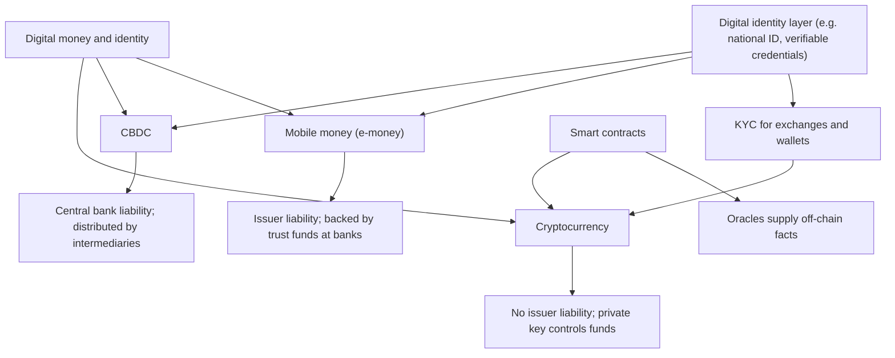

## Introduction

The previous lesson explained how a distributed ledger stays consistent. This lesson asks what can be built on such ledgers and on the wider digital finance infrastructure. Three ideas dominate current debate. **Cryptocurrencies** use ledgers to create digital assets that can be transferred without a bank. **Smart contracts** turn ledgers into platforms for programmable agreements. **Digital identity** and **central bank digital currencies (CBDCs)** show how public institutions are responding, by building trusted identity infrastructure and by exploring digital forms of sovereign money.

These topics attract hype and loss in equal measure. Students should therefore approach them analytically: understand the mechanism, identify who bears which risk and judge claims against evidence. Nothing in this lesson is financial, investment or regulatory advice; crypto-assets are highly volatile and can result in total loss.

## Learning Objectives

- Explain the roles of private keys, public keys, addresses and wallets in cryptocurrency transactions.
- Compare custodial and non-custodial wallets and the main types of stablecoin.
- Analyse how smart contracts execute and evaluate the risks posed by code defects and oracles.
- Compare centralised, federated and self-sovereign digital identity models, with reference to national ID systems such as the Ghana Card.
- Distinguish CBDCs from cryptocurrencies, commercial bank money and mobile money, and evaluate their design choices.

## Prerequisite Knowledge

- The previous lesson on blockchain fundamentals, hashes and consensus.
- The Digital Finance module's treatment of mobile money and electronic money.

## Key Terminology

- **Private key**: A secret number that authorises spending from a cryptocurrency address; whoever holds it controls the funds.
- **Public key and address**: The public counterpart of a private key, from which a shareable address for receiving funds is derived.
- **Custodial wallet**: A wallet in which a third party, such as an exchange, holds the private keys on the user's behalf.
- **Stablecoin**: A crypto-asset designed to maintain a stable value relative to a reference, usually a fiat currency.
- **Smart contract**: A program stored on a blockchain that executes automatically and deterministically when its conditions are met.
- **Oracle**: A service that supplies external, off-chain data such as prices or delivery confirmations to a smart contract.
- **Digital identity**: The set of attributes and credentials by which a person or organisation is recognised and authenticated in digital interactions.
- **Self-sovereign identity (SSI)**: An identity model in which individuals hold verifiable credentials in their own wallets and choose what to disclose.
- **Central bank digital currency (CBDC)**: A digital form of a country's currency that is a direct liability of the central bank.
- **Know Your Customer (KYC)**: Procedures for verifying the identity of customers before providing financial services.

## Detailed Explanation

### Cryptocurrency concepts

A cryptocurrency transaction is a message stating "move these units from this address to that address", **digitally signed** with the sender's private key. Nodes verify the signature with the public key, check the sender has enough unspent value, and include the transaction in a block. Bitcoin tracks value as **unspent transaction outputs (UTXOs)**, like individual notes and coins; Ethereum uses an **account model** with balances, closer to a bank account.

The critical practical point is **key custody**. With a **non-custodial wallet**, the user holds the private key, often backed up as a recovery phrase. Losing it means losing the funds permanently; revealing it means anyone can take them. With a **custodial wallet**, an exchange holds keys, which is convenient but reintroduces counterparty risk: if the exchange fails or is hacked, customers may lose assets. The collapse of the FTX exchange in 2022 is a widely reported example of custodial failure.

**Stablecoins** attempt to remove volatility. Three designs exist:

| Type | Mechanism | Main risk |
|---|---|---|
| Fiat-collateralised | Issuer holds reserves of cash and short-term assets | Quality and transparency of reserves; issuer failure |
| Crypto-collateralised | Over-collateralised by other crypto-assets locked in smart contracts | Sharp falls in collateral value; liquidation cascades |
| Algorithmic | Supply adjusted by algorithm and arbitrage incentives | Loss of confidence leading to collapse, as with TerraUSD in May 2022 |

### Smart contracts

Nick Szabo (1997) described smart contracts as computerised protocols that execute the terms of a contract. Ethereum, proposed in Vitalik Buterin's 2014 white paper, implemented this idea as a general-purpose platform. A smart contract is code deployed to the blockchain; every validating node executes it identically, and users pay a fee (**gas**) for computation. Because execution is deterministic and the code and state are on a shared ledger, parties can rely on outcomes without trusting each other.

Three limitations are crucial.

1. **Code is law, including its bugs.** Deployed contracts are hard to change; a defect can be exploited by anyone. Upgradeable patterns exist but reintroduce trust in whoever controls upgrades.
2. **The oracle problem.** A contract cannot observe the real world. If payment depends on "goods delivered", some oracle must report delivery, and the contract is only as trustworthy as that oracle.
3. **Legal status.** Code may not capture the full meaning of an agreement, and its enforceability varies by jurisdiction.

### Digital identity

Every payment system depends on identity: KYC at account opening, authentication at each transaction and accountability when things go wrong. Three models can be distinguished.

- **Centralised identity**: one authority issues and verifies identity, as with a national ID register.
- **Federated identity**: a trusted identity provider authenticates users for many services, as with "sign in with" services or a national ID verification service used by banks.
- **Self-sovereign identity**: individuals hold digitally signed credentials (for example, "over 18" or "holds a degree") and present them selectively. The W3C has published standards for Verifiable Credentials and Decentralized Identifiers (DIDs) that support this model. Ledgers are sometimes used to publish issuers' public keys, but personal data should not be stored on-chain.

The World Bank's Identification for Development (ID4D) initiative promotes principles for inclusive, robust and privacy-protecting identification systems, recognising that lack of identity documents is a barrier to financial inclusion.

### Central bank digital currencies

A CBDC is **central bank money in digital form**. This distinguishes it from three neighbours: commercial bank deposits (a liability of a bank), mobile money (e-money issued by a licensed issuer and backed by funds held in trust at banks) and cryptocurrencies (typically not anyone's liability). Key design choices include:

- **Retail or wholesale**: for the public or only for financial institutions' settlement.
- **Account-based or token-based**: verification of the holder's identity versus verification of the token itself, with implications for privacy and offline use.
- **Direct or intermediated**: most designs use a two-tier model in which banks and payment providers distribute the CBDC and handle customers.
- **Offline capability, privacy and holding limits**: limits can reduce the risk that deposits flow out of banks rapidly in a crisis.

## Theories, Frameworks and Models

### A risk-allocation lens

A useful analytical framework asks, for any digital money or contract: *whose liability is it, who holds the keys, who can reverse a transaction, and who resolves disputes?*

| Instrument | Whose liability | Who controls access | Reversibility and disputes |
|---|---|---|---|
| Cash | Central bank | Bearer | None; physical possession |
| Bank deposit | Commercial bank | Bank, via customer authentication | Bank procedures and regulation |
| Mobile money | E-money issuer, backed by trust funds | Issuer, via PIN and SIM | Issuer procedures under regulation |
| CBDC | Central bank | Intermediary or holder, depending on design | Defined by central bank rules |
| Cryptocurrency (non-custodial) | Usually no one | Private key holder | Generally irreversible |

The lens shows why "decentralisation" is double-edged: removing intermediaries removes their fees and censorship power, but also removes the party who can fix mistakes.

## Worked Example

### A delivery escrow smart contract

**Illustrative scenario:** a hypothetical Tema importer wants to pay an overseas supplier only when goods arrive. The parties consider a smart contract escrow.

```text
contract DeliveryEscrow
  buyer, seller, oracle, amount, deadline
  state = AWAITING_PAYMENT

  deposit():            only buyer, value == amount
                        state = AWAITING_DELIVERY
  confirmDelivery():    only oracle, state == AWAITING_DELIVERY
                        transfer amount to seller; state = COMPLETE
  refund():             only buyer, state == AWAITING_DELIVERY, now > deadline
                        transfer amount to buyer; state = REFUNDED
```

**Step-by-step analysis.**

1. *Trust removed:* neither party holds the other's money; the contract does, and its logic is visible.
2. *Trust relocated:* the oracle decides whether delivery occurred. If the oracle is the shipping agent, the buyer must trust that agent; if it is compromised, the seller can be paid without delivery.
3. *Edge cases:* what if goods arrive damaged? The contract has no "partially delivered" state, so disputes move off-chain to traditional legal processes.
4. *Asset risk:* if the escrow is denominated in a volatile cryptocurrency, the value may change substantially before release; a stablecoin reduces but does not eliminate this risk.
5. *Regulation:* cross-border payments involve foreign exchange and anti-money-laundering rules, which the parties must observe through licensed channels.

The conclusion is typical of smart-contract analysis: automation is valuable for simple, objectively verifiable conditions, but real commercial agreements often need human judgement.

## Ghanaian Business Application

The **Ghana Card**, issued by the National Identification Authority, is a biometric national identity card that has become central to digital finance. It is used for KYC when opening bank and mobile money accounts, was linked to SIM cards in the national SIM re-registration exercise, and serves as a reference for tax identification. For businesses, this creates an opportunity to verify customers digitally through authorised verification services, and an obligation to handle identity data lawfully under the Data Protection Act, 2012 (Act 843).

The Bank of Ghana has publicly described an **eCedi** pilot, exploring a digital form of the cedi with attention to financial inclusion and offline use for areas with weak connectivity. It should be understood as an exploratory pilot whose final design and timetable are matters for the Bank of Ghana; students should consult official publications for current status. The Bank of Ghana has also issued public notices cautioning the public about the risks of cryptocurrencies, and its approach to regulating virtual assets has been evolving, so any business considering crypto-related activities must check the current legal position.

## International Case Study

### The DAO, the Ethereum fork and early CBDCs

In 2016, **The DAO**, an investment fund implemented as an Ethereum smart contract, raised a large amount of ether. An attacker exploited a re-entrancy flaw, repeatedly withdrawing funds before the contract updated its balance. The Ethereum community controversially implemented a hard fork to reverse the effects; a minority rejected the change and continued the original chain as Ethereum Classic. The episode showed that smart-contract code can be flawed, that "immutability" ultimately depends on social consensus and that governance matters as much as cryptography.

CBDCs provide a contrasting, institution-led story. The Central Bank of The Bahamas launched the **Sand Dollar** in 2020, widely described as one of the first nationwide retail CBDCs, and the Central Bank of Nigeria launched the **eNaira** in 2021. Public commentary on both has noted that uptake was slower than hoped, suggesting that a CBDC must offer clear advantages over existing options, such as mobile money, to win users.

## Diagram



## Common Misconceptions

- "Cryptocurrency transactions are anonymous." Most public blockchains are pseudonymous; every transaction is visible and can often be linked to identities through analysis and exchange KYC.
- "Stablecoins cannot lose value." Their stability depends on reserves or mechanisms that can fail, as algorithmic designs have shown.
- "Smart contracts are legally binding contracts." They are code; legal enforceability depends on jurisdiction and on whether the code reflects an agreement.
- "A CBDC is just a government cryptocurrency." A CBDC is a central bank liability and need not use a blockchain at all.
- "Storing identity data on a blockchain improves privacy." Personal data on an immutable public ledger cannot be erased and conflicts with data protection principles.

## Common Examination Mistakes

- Failing to distinguish custodial from non-custodial wallets when discussing crypto-asset risk.
- Describing smart contracts without explaining the oracle problem.
- Confusing mobile money (e-money) with CBDC or claiming mobile money is central bank money.
- Stating speculative details about the eCedi as fact instead of describing it as a pilot.
- Presenting crypto-assets as investment recommendations rather than analysing risks.

## Critical Thinking Questions

1. If a CBDC were widely adopted in Ghana, how might the business models of mobile money issuers and banks change?
2. Is "code is law" a desirable principle for commercial contracts? Use The DAO case in your answer.
3. What safeguards should accompany the use of a national biometric ID for financial services to protect privacy and prevent exclusion?
4. Why might a retail CBDC with offline capability be attractive for financial inclusion, and what risks does offline operation introduce?

## Practical Exercises

1. **Risk-allocation table.** Extend the table in this lesson to include a stablecoin held on an exchange and a prepaid card. *Expected output:* a completed table and a 150-word comparison.
2. **Smart contract critique.** Modify the escrow pseudocode to handle partial delivery and a dispute window. *Expected output:* revised pseudocode and a list of new trust assumptions introduced.
3. **CBDC design brief.** Draft a one-page design brief for a hypothetical retail CBDC choosing between account- and token-based, direct and intermediated, and online-only or offline-capable. *Expected output:* each choice justified with one benefit and one risk.

## Key Takeaways

- Control of a cryptocurrency depends on control of the private key; custodial wallets add counterparty risk.
- Stablecoins differ in mechanism and risk; stability is never guaranteed.
- Smart contracts automate objective conditions but depend on code quality, oracles and governance.
- Digital identity underpins KYC and inclusion; Ghana Card illustrates centralised identity used across finance.
- CBDCs are central bank liabilities whose design choices determine privacy, inclusion and effects on banks.

## Further Reading

- Narayanan, A., Bonneau, J., Felten, E., Miller, A., & Goldfeder, S. (2016). *Bitcoin and cryptocurrency technologies: A comprehensive introduction*. Princeton University Press.
- Buterin, V. (2014). *Ethereum: A next-generation smart contract and decentralized application platform* [White paper]. <https://ethereum.org/en/whitepaper/>
- Szabo, N. (1997). Formalizing and securing relationships on public networks. *First Monday, 2*(9).
- Nakamoto, S. (2008). *Bitcoin: A peer-to-peer electronic cash system*. <https://bitcoin.org/bitcoin.pdf>
- World Bank. (n.d.). *Identification for Development (ID4D)*. <https://id4d.worldbank.org/>

## Video Resources

- [Smart contracts introduction](https://ethereum.org/en/developers/docs/smart-contracts/) — ethereum.org. Official documentation explaining how smart contracts work on Ethereum.
- [Bitcoin and Cryptocurrency Technologies](https://www.coursera.org/learn/cryptocurrency) — Princeton University on Coursera. Lectures covering keys, wallets, transactions and the limits of cryptocurrency.
- [Bank for International Settlements](https://www.bis.org/) — BIS. Official site with research, speeches and videos on central bank digital currencies.

## Revision Summary

Cryptocurrency transactions are signed with private keys and verified by nodes; custody of keys determines control and risk. Stablecoins seek price stability through fiat reserves, crypto collateral or algorithms, each with distinct failure modes. Smart contracts execute deterministically on-chain but inherit code defects, oracle dependence and governance questions, as The DAO showed. Digital identity, including national systems such as the Ghana Card, supports KYC and inclusion but demands strong privacy protection. CBDCs are central bank money in digital form, and pilots such as the eCedi explore inclusion and offline use.

- Not your keys, not your coins — but self-custody means self-responsibility.
- Oracle problem: contracts cannot see the real world.
- Ask: whose liability, who controls, who can reverse?
- Mobile money ≠ CBDC ≠ cryptocurrency.
- eCedi: a pilot — check official sources for status.
