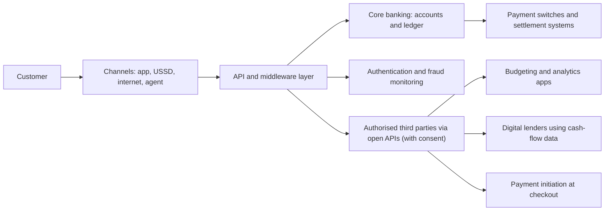

## Introduction

Financial services have always depended on information: who owns what, who owes whom, and whether a borrower can be trusted. Because finance is so information-intensive, it has been reshaped repeatedly by technology, from the telegraph to the automated teller machine. The current wave, usually called **FinTech**, combines mobile devices, cloud computing, application programming interfaces (APIs), data analytics and new business models to deliver payments, credit, savings, insurance and investment in new ways and often by new kinds of firms.

In Ghana, the effect is visible in everyday life: people pay bills by mobile money, check balances through USSD codes, open accounts on mobile apps and receive small loans to their phones. This lesson explains what FinTech is, maps its main categories, examines how digital banking works and evaluates the risks that accompany innovation. It is the foundation for the following lessons on mobile money and payment gateways. The content is educational and is not financial, investment or regulatory advice.

## Learning Objectives

- Define FinTech and explain why finance is especially open to digital innovation.
- Classify FinTech activities into payments, lending, savings and investment, insurance, regulatory technology and infrastructure.
- Describe digital banking channels, including internet banking, mobile apps, USSD and agency banking.
- Explain open banking and the role of APIs in bank-FinTech collaboration.
- Evaluate the opportunities and risks of FinTech for customers, incumbents and regulators.

## Prerequisite Knowledge

- The platform and network effect concepts from Module 2.
- General awareness of how bank accounts, loans and payments work.

## Key Terminology

- **FinTech**: Technology-enabled innovation in financial services that may produce new business models, applications, processes or products.
- **Digital banking**: The provision of banking services through digital channels such as internet banking, mobile apps and USSD, potentially including fully digital account opening and lending.
- **Neobank (digital-only bank)**: A bank or banking service that operates primarily through digital channels without a traditional branch network.
- **USSD (Unstructured Supplementary Service Data)**: A mobile network protocol that provides menu-based interactive sessions on basic phones without internet access.
- **Agency banking**: Delivery of selected banking services through third-party agents, such as shops, on behalf of a licensed institution.
- **Open banking**: A framework in which banks, with customer consent, share account data or initiate payments through secure APIs to authorised third parties.
- **Regulatory sandbox**: A controlled environment in which a regulator allows firms to test innovative products with real customers under specified conditions and safeguards.
- **RegTech**: Technology used to make regulatory compliance and supervision more efficient, for example automated transaction monitoring.

## Detailed Explanation

### What makes FinTech different

Arner, Barberis and Buckley (2016) describe FinTech as the latest stage in a long history of interaction between finance and technology, distinguished by the speed of change and by the entry of non-bank firms, including technology companies and start-ups, into activities once dominated by banks. Philippon (2016) argued that financial intermediation had remained costly despite earlier technological advances, and that FinTech had the potential to lower costs and widen access.

Three features explain why finance is so open to digital innovation. First, financial products are largely **information**, so they can be created and delivered digitally. Second, **network effects** are strong in payments: a payment method is more valuable the more people and merchants use it. Third, **data** about transactions allows new ways of assessing risk, such as using mobile money histories to estimate creditworthiness.

### Categories of FinTech

| Category | What it does | Examples of activity |
|---|---|---|
| Payments and transfers | Moving money between people, businesses and governments | Mobile money, payment gateways, remittance apps, QR payments |
| Digital lending | Credit decisions and disbursement through digital channels | Mobile micro-loans, buy-now-pay-later, SME invoice finance, peer-to-peer lending |
| Savings and investment (WealthTech) | Digital savings, investment and asset management | Mobile savings products, robo-advisers, digital access to treasury bills |
| InsurTech | Digital distribution, pricing and claims in insurance | Micro-insurance sold via mobile phones, usage-based insurance |
| RegTech and SupTech | Technology for compliance and supervision | Automated anti-money-laundering monitoring, digital regulatory reporting |
| Infrastructure | Underlying systems used by other providers | Core banking in the cloud, APIs, identity verification, switches |
| Digital assets | Cryptocurrencies, tokenisation and distributed ledgers | Covered in Module 6 |

Categories overlap. A mobile money service starts in payments, then adds savings, loans and insurance through partnerships, becoming a financial platform.

### Digital banking channels

Banks deliver digital services through several channels, each suited to different customers:

1. **Internet banking**: browser-based access, common for business customers handling bulk payments and statements.
2. **Mobile banking apps**: smartphone apps offering balance checks, transfers, bill payments, card controls and sometimes account opening with identity verification.
3. **USSD banking**: menu sessions accessed by dialling a short code, working on basic phones without data; widely used in Ghana for its accessibility, although sessions are short and the interface limited.
4. **Agency banking**: agents provide cash deposits and withdrawals on behalf of a bank, extending reach without branches.
5. **ATMs, cards and point-of-sale**: still important, increasingly integrated with mobile channels.

Behind these channels sit the **core banking system** (accounts and ledgers), **middleware and APIs** that expose services to channels and partners, and **security systems** for authentication and fraud monitoring.

### Incumbents, challengers and partnerships

FinTech is sometimes described as a contest between banks and start-ups, but collaboration is more common. Banks hold licences, deposits, customer trust and compliance expertise; FinTechs bring speed, design skills and new data-driven models. Typical arrangements include FinTechs using a bank's licence and accounts ("banking as a service"), banks partnering with mobile money operators to offer savings and loans to wallet holders, and banks acquiring or investing in FinTechs. Large technology firms, sometimes called *BigTech*, enter finance through payments embedded in their platforms, raising new questions about competition and data.

## Theories, Frameworks and Models

### Open banking

Open banking rests on the idea that customers own their financial data and may authorise third parties to use it. Banks expose two main kinds of API: **account information** (reading balances and transactions, with consent) and **payment initiation** (instructing a payment from the customer's account). This lets third parties build budgeting tools, lending products that analyse real cash flows, or checkout options that pay directly from a bank account. The framework depends on standards, strong customer authentication, consent management and clear liability rules.

### Risk framework for FinTech

A structured way to evaluate FinTech is to consider risks to four groups:

| Stakeholder | Opportunities | Risks |
|---|---|---|
| Customers | Lower cost, convenience, access for the unbanked | Fraud, over-indebtedness from easy credit, data misuse, unclear redress |
| Incumbent banks | Efficiency, new channels, partnerships | Loss of customer relationship, margin pressure |
| FinTech firms | Rapid growth, new markets | Funding dependence, regulatory uncertainty, cyber attack |
| Regulators and the system | Inclusion, competition, efficiency | Consumer harm, money laundering, operational and concentration risk |

Regulators commonly respond with **activity-based** licensing (regulating what a firm does rather than what it is called), **regulatory sandboxes**, and supervision supported by RegTech and SupTech.

## Diagram

## Worked Example

**Illustrative scenario.** *QuickCedi* is a hypothetical digital lender in Ghana, partnered with a licensed institution, offering 30-day micro-loans to mobile money users. It is considering offering GHS 500 loans with a fee of 6 per cent. This example teaches risk-based reasoning; it is not lending or pricing advice, and real lending is subject to regulation and consumer protection rules.

**Step 1: Understand expected loss.** Lenders estimate expected loss with the formula `Expected loss = PD × LGD × EAD`, where PD is the probability of default, LGD the loss given default (share not recovered) and EAD the exposure at default.

**Step 2: Apply initial estimates.** Using a simple scoring model, QuickCedi estimates PD = 8 per cent, LGD = 90 per cent and EAD = GHS 500. Expected loss per loan = `0.08 × 0.90 × 500 = GHS 36`.

**Step 3: Estimate expected fee income.** Only non-defaulting borrowers pay the fee: `0.92 × (500 × 0.06) = 0.92 × 30 = GHS 27.60`.

**Step 4: Compare.** Expected contribution before operating costs = `27.60 − 36 = −GHS 8.40` per loan. The product loses money even before costs.

**Step 5: Consider responses.**
- *Better data and scoring*: if transaction-history data reduce PD to 4 per cent for approved applicants, expected loss = `0.04 × 0.90 × 500 = GHS 18`, and fee income = `0.96 × 30 = GHS 28.80`, giving a contribution of `+GHS 10.80`.
- *Smaller first loans*: starting customers at lower limits and increasing them after on-time repayment reduces exposure while data accumulates.
- *Raising fees*: may appear to fix the numbers but can increase over-indebtedness and attract riskier borrowers (adverse selection), and can raise consumer protection concerns.

**Step 6: Evaluate.** The example shows why data is central to FinTech lending: the business model works only if digital data genuinely improve risk assessment. It also shows the ethical dimension: profitable lending should not rely on borrowers falling into repeated debt.

## Ghanaian Business Application

Ghana's financial system shows a strong FinTech presence. **Mobile money** is widely used for transfers, bill payments and merchant payments, and operators have partnered with regulated financial institutions to offer savings and micro-credit products to wallet holders. **Banks** offer mobile apps and USSD banking, and many use agents to extend cash services. **Payment service providers** such as Paystack and Hubtel provide merchants with integrations that accept cards, mobile money and other methods.

The regulatory framework is led by the **Bank of Ghana**. The Payment Systems and Services Act, 2019 (Act 987) provides for the licensing and regulation of payment systems, electronic money issuers and payment service providers. The Bank of Ghana has also engaged with innovation through measures such as a regulatory sandbox framework for testing new products, and the Ghana Interbank Payment and Settlement Systems (GhIPSS), a subsidiary of the Bank of Ghana, operates national payment infrastructure including interoperability services discussed in the next lesson. Students analysing a Ghanaian FinTech should therefore consider licensing category, partnerships with banks or operators, consumer protection, data protection under the Data Protection Act, 2012 (Act 843) and cyber security. For specific compliance questions, the official texts and qualified advisers must be consulted.

## International Case Study

### Open banking in the United Kingdom

In the United Kingdom, the Competition and Markets Authority concluded a market investigation into retail banking in 2016 and required the largest banks to implement open banking. Common API standards were developed by an implementation entity set up for the purpose, and open banking went live in January 2018. Alongside this, the European Union's revised Payment Services Directive (PSD2) required banks to give authorised third parties access to payment accounts with customer consent.

The case illustrates several points. First, open banking was introduced primarily as a **competition** measure: by allowing customers to share data, it aimed to reduce the advantage incumbents gained from holding exclusive customer information. Second, it required **standards and governance**: without common API standards, security requirements and dispute rules, third parties would face a different integration for every bank. Third, it created new products, such as budgeting apps and account-to-account payments, but adoption depended on customer trust in sharing data. For Ghana and other emerging markets, the lesson is that APIs alone do not create an open ecosystem; regulation, standards, consent management and trust are equally important.

## Common Misconceptions

- **Misconception:** FinTech means start-ups replacing banks. **Correction:** Most FinTech involves partnership between banks, operators and technology firms, and incumbents are major FinTech adopters.
- **Misconception:** Digital banking is just a mobile app. **Correction:** It includes USSD, internet banking and agency banking, supported by core systems, APIs and security controls.
- **Misconception:** Open banking means banks publish customer data. **Correction:** Data are shared only with authorised third parties and only with the customer's consent.
- **Misconception:** Easy digital credit always promotes inclusion. **Correction:** Poorly designed digital credit can cause over-indebtedness; responsible lending and transparency are essential.
- **Misconception:** Regulators either ban or ignore FinTech. **Correction:** Many use activity-based licensing, sandboxes and supervisory technology to balance innovation and protection.

## Common Examination Mistakes

- Defining FinTech vaguely without classifying its categories or giving examples.
- Ignoring USSD and agency banking when discussing digital banking in Ghana.
- Describing open banking without mentioning consent, APIs and standards.
- Evaluating FinTech only in terms of benefits, without risks to consumers and the financial system.
- Stating regulatory details that are not certain; refer to the Bank of Ghana and Act 987 in general terms unless you know the specifics.

## Critical Thinking Questions

1. Does FinTech increase or reduce competition in Ghana's financial services market? Consider network effects and partnerships.
2. Should digital lenders be allowed to use mobile money transaction data and phone metadata for credit scoring? What safeguards would you require?
3. Would open banking APIs be valuable in Ghana given the importance of mobile money wallets alongside bank accounts?
4. How should regulators balance financial inclusion goals against consumer protection when approving new digital credit products?

## Practical Exercises

1. **Category mapping.** Identify eight financial services available on a Ghanaian smartphone or basic phone and classify each into a FinTech category. *Expected output:* an eight-row table with category, provider type (bank, operator, FinTech, partnership) and channel.
2. **Expected loss calculation.** For a GHS 1,000 loan with PD 6 per cent and LGD 80 per cent, calculate expected loss, and the fee rate needed for expected fee income from non-defaulters to cover it. *Expected output:* expected loss of GHS 48 and a required fee of about 5.1 per cent (`48 ÷ (0.94 × 1,000)`), with a comment on operating costs and fairness.
3. **Risk assessment.** Choose a FinTech product used in Ghana and complete the four-stakeholder risk framework. *Expected output:* a completed table and a 200-word evaluation.

## Key Takeaways

- FinTech is technology-enabled innovation in financial services, spanning payments, lending, savings, insurance, RegTech and infrastructure.
- Finance is information-intensive and network-driven, which makes it especially open to digital innovation.
- Digital banking includes apps, USSD, internet banking and agency banking, built on core systems and APIs.
- Open banking allows consented data sharing and payment initiation through standardised APIs.
- FinTech creates opportunities for inclusion and efficiency but also risks of fraud, over-indebtedness and systemic concentration.
- This lesson is educational and not financial, investment or regulatory advice.

## Further Reading

- Arner, D. W., Barberis, J., & Buckley, R. P. (2016). The evolution of FinTech: A new post-crisis paradigm? *Georgetown Journal of International Law, 47*(4), 1271-1319.
- Philippon, T. (2016). *The FinTech opportunity* (NBER Working Paper No. 22476). National Bureau of Economic Research.
- Demirgüç-Kunt, A., Klapper, L., Singer, D., & Ansar, S. (2022). *The Global Findex Database 2021: Financial inclusion, digital payments, and resilience in the age of COVID-19*. World Bank. <https://www.worldbank.org/en/publication/globalfindex>
- Bank of Ghana. Official website. <https://www.bog.gov.gh/>

## Video Resources

- [World Bank Global Findex](https://www.worldbank.org/en/publication/globalfindex): World Bank. Official page for the Global Findex database and related material on financial inclusion and digital payments.
- [Bank of Ghana](https://www.bog.gov.gh/): Bank of Ghana. Official central bank website with publications on payment systems and financial technology.

## Revision Summary

FinTech is technology-enabled innovation in financial services that brings new firms, channels and business models into payments, lending, savings, insurance and compliance. Digital banking delivers services through apps, USSD, internet banking and agents, supported by core systems and APIs. Open banking allows customers to share data and initiate payments through authorised third parties. FinTech offers inclusion and efficiency but creates consumer, operational and systemic risks that regulators address with licensing, sandboxes and supervision.

- Categories: payments, lending, WealthTech, InsurTech, RegTech/SupTech, infrastructure, digital assets.
- Channels: app, USSD, internet, agency, cards and ATMs.
- Open banking: consent + APIs (account information, payment initiation) + standards.
- Expected loss = PD × LGD × EAD; data quality makes digital lending viable.
- Ghana: Bank of Ghana, Act 987, GhIPSS, mobile money partnerships, Act 843.
