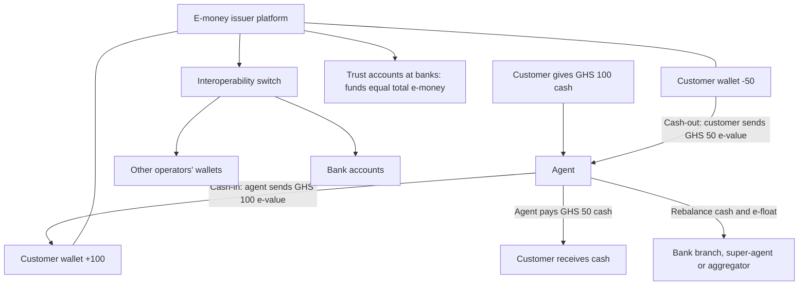

## Introduction

For many people in Ghana, the first digital financial service they used was not a bank account or a credit card but a mobile money wallet. With a basic phone, a SIM card and an identity document, a customer can receive money from relatives, pay for electricity, buy airtime, pay a trader and save small amounts, all without visiting a bank branch. Behind this apparent simplicity sits a carefully designed system of electronic money, trust accounts, agent networks and settlement arrangements.

This lesson opens that system up. You will learn how mobile money creates and backs electronic value, how agents convert cash into digital value and back again, why agent **float** management is a daily operational challenge, how digital wallets differ, and why **interoperability** between operators and banks matters. The lesson draws on Ghana's experience and on the well-documented case of M-Pesa in Kenya. It is educational and not financial or regulatory advice.

## Learning Objectives

- Explain how mobile money e-value is issued and backed by funds held in trust or custodial accounts.
- Describe the roles of customers, agents, merchants, operators and banks in a mobile money ecosystem.
- Apply the concepts of cash-in, cash-out and float to analyse an agent's liquidity position.
- Compare stored-value, bank-linked and pass-through digital wallets.
- Evaluate the benefits and challenges of mobile money interoperability, with reference to Ghana.

## Prerequisite Knowledge

- The FinTech categories and digital banking channels in the previous lesson.
- The concept of network effects from Module 2.

## Key Terminology

- **Mobile money**: A service that lets users store electronic value in an account linked to a mobile phone number and use it to send, receive and pay, typically accessible through USSD menus or apps.
- **Electronic money (e-money)**: Monetary value stored electronically, issued on receipt of funds and accepted as a means of payment, redeemable for cash.
- **Trust (custodial) account**: A bank account in which the issuer holds funds equal to the outstanding e-money, protecting customers' value.
- **Agent**: A registered business, often a small shop or kiosk, that performs cash-in and cash-out and registers customers on behalf of a mobile money provider, earning commissions.
- **Float (e-float)**: The electronic value an agent holds in their agent wallet to serve cash-in transactions; agents also need physical cash to serve cash-out.
- **Cash-in / cash-out**: Converting physical cash to e-money (cash-in) and e-money to physical cash (cash-out).
- **Interoperability**: The ability of customers of different providers or systems to transact with one another, for example sending money from one operator's wallet to another's or to a bank account.
- **KYC (know your customer)**: Procedures to verify customer identity, often applied in tiers that link transaction limits to the level of verification.

## Detailed Explanation

### How e-money is created and backed

Mobile money does not create new money in the way a bank does when it lends. When a customer gives an agent GHS 100 in cash and receives GHS 100 of e-value, the system has simply converted cash into an electronic claim. The provider (an electronic money issuer, frequently a subsidiary of a mobile network operator) holds funds equivalent to all outstanding e-money in **trust or custodial accounts** at one or more banks. The total e-value in all wallets should equal the funds held in these accounts. This 1:1 backing is what makes e-money safe for users, and regulators typically specify how the funds must be held and reconciled.

### The ecosystem and its participants

- **Customers** register, often with a national identity card, and use a PIN to authorise transactions.
- **Agents** provide the human interface: registering customers, accepting cash-in, paying cash-out and explaining services. They are the cash network that makes mobile money usable where cash dominates.
- **Merchants** accept payments into merchant wallets, sometimes by entering a merchant code or scanning a QR code.
- **The operator / e-money issuer** runs the platform, sets prices and commissions, manages risk and complies with regulation.
- **Banks** hold trust funds and increasingly connect wallets to bank accounts for transfers, savings and loans.
- **The regulator**, in Ghana the Bank of Ghana, licenses issuers and oversees consumer protection, anti-money-laundering controls and system stability.

### Agent mechanics: cash-in, cash-out and float

An agent must hold two forms of liquidity: **physical cash** and **e-float**.

- In a **cash-in**, the customer gives cash to the agent and the agent transfers e-value from the agent's wallet to the customer's wallet. The agent's cash *rises* and e-float *falls*.
- In a **cash-out**, the customer transfers e-value to the agent and receives cash. The agent's e-float *rises* and cash *falls*.

The agent's total liquidity (cash plus e-float) changes only by commissions earned, but its *composition* shifts with every transaction. If an agent in a busy market receives many cash-ins, its e-float runs out and it must turn customers away; if a rural agent mainly serves cash-out (for example recipients of remittances), it runs out of cash. **Rebalancing** means converting cash into e-float or e-float into cash, typically by visiting a bank branch, a super-agent or an aggregator that manages liquidity for groups of agents. Poor liquidity management is one of the most common reasons for failed transactions and customer frustration.

### Types of digital wallets

| Wallet type | How value is held | Example | Key feature |
|---|---|---|---|
| Stored-value (e-money) wallet | Value held by the wallet provider as e-money, backed by trust funds | Mobile money wallets such as MTN MoMo | Works without a bank account; agent network for cash |
| Bank-linked wallet | Wallet is an interface to a bank account | A bank's own mobile wallet | Funds stay in a bank deposit |
| Pass-through (tokenised card) wallet | Stores a token representing a card; payment is charged to the card | Smartphone wallets such as Apple Pay or Google Pay | Security through tokenisation; requires a card |
| Closed-loop wallet | Value usable only within one merchant or platform | Store or ride-hailing credit | Limited acceptance |

Distinguishing these types matters for analysis: a stored-value wallet raises questions about trust funds and agents; a pass-through wallet raises questions about card networks and tokenisation (Module 5).

### Interoperability

Without interoperability, mobile money networks are **closed loops**: a customer on one network cannot easily send money to a customer on another, and moving value between a wallet and a bank account is cumbersome. Users may hold several SIM cards and wallets, and the largest network enjoys a strong advantage from network effects. **Interoperability** connects the loops so that a transaction can flow between wallets of different operators and between wallets and bank accounts. It typically requires a central **switch** that routes messages between participants, common rules and technical standards, agreed fees, and a **settlement** mechanism in which participants' net obligations are settled through their accounts at the settlement bank or central bank.

## Theories, Frameworks and Models

### Network effects and interoperability

Mobile money displays strong **cross-side network effects**: customers value a wallet more when more merchants and recipients accept it, and merchants value acceptance more when more customers hold wallets. In a closed-loop market, these effects favour the largest provider. Interoperability changes the economics. It increases the value of the *whole system* to users, because anyone can pay anyone, but it reduces the exclusive network advantage of the largest provider. This explains why interoperability is often promoted by regulators, and why providers may differ in their enthusiasm for it. Competition then shifts towards price, reliability, agent quality and additional services.

### Risk-based (tiered) KYC

Financial inclusion depends on letting people with limited documentation open accounts, while anti-money-laundering rules require identity verification. A widely used approach is **tiered KYC**: basic accounts with minimal verification have low balance and transaction limits, while fuller verification unlocks higher limits. The approach reflects risk-based regulation endorsed internationally by bodies such as the Financial Action Task Force.

## Diagram

## Worked Example

**Illustrative scenario.** *Esi's Shop* is a hypothetical mobile money agent in a busy Kumasi market. She starts Monday with GHS 5,000 in cash and GHS 5,000 in e-float (total liquidity GHS 10,000). Commissions are ignored for simplicity.

**Step 1: Morning transactions.** Traders deposit their takings before travelling to buy stock: cash-ins total GHS 4,200, and cash-outs total GHS 800.
- Cash = `5,000 + 4,200 − 800 = GHS 8,400`
- E-float = `5,000 − 4,200 + 800 = GHS 1,600`
- Total liquidity = `8,400 + 1,600 = GHS 10,000` (unchanged, as expected).

**Step 2: A problem appears.** At midday a trader wants to deposit GHS 2,500. Esi has only GHS 1,600 e-float, so she can serve only part of the deposit or must turn the customer away. Her cash is plentiful but cannot be used for a cash-in.

**Step 3: Rebalance.** Esi takes GHS 4,000 cash to a nearby bank branch or super-agent and converts it to e-float. Now cash = `8,400 − 4,000 = GHS 4,400` and e-float = `1,600 + 4,000 = GHS 5,600`. She can serve the GHS 2,500 cash-in.

**Step 4: Analyse the pattern.** Esi's location produces a predictable *cash-in-heavy* morning. She can plan by starting the day with more e-float and less cash, or arrange a scheduled midday rebalance. A rural agent serving remittance recipients would face the opposite pattern and need more cash.

**Step 5: Consider risks.** Holding GHS 8,400 in cash creates theft risk; rebalancing trips cost time and transport; and agents must guard against fraud such as fake "reversal" calls asking them to send e-value back. Liquidity management therefore combines forecasting, security and fraud awareness.
## Ghanaian Business Application

Mobile money is a central part of Ghana's payments landscape. MTN Mobile Money (MTN MoMo) is the most widely known service, and other mobile network operators offer competing services, such as Telecel Cash (formerly Vodafone Cash). Customers use mobile money for person-to-person transfers, airtime and data, utility bills, school fees, merchant payments and, through partnerships with financial institutions, savings and small loans. A large agent network provides cash-in and cash-out across cities, towns and rural areas.

The regulatory basis is provided by the **Bank of Ghana**, and the Payment Systems and Services Act, 2019 (Act 987) provides for licensing of electronic money issuers and payment service providers. A key milestone was **mobile money interoperability**, introduced in 2018 through the Ghana Interbank Payment and Settlement Systems (GhIPSS), a subsidiary of the Bank of Ghana. GhIPSS provides the switching platform that allows customers to send money between wallets on different mobile money networks and between mobile money wallets and bank accounts. In terms of this lesson's theory, interoperability connected closed loops into a national system, increased the value of mobile money for all users and shifted competition towards service quality and price.

For SMEs, the practical implications are significant. A shop with a merchant wallet can be paid by customers of different networks; payment service providers such as Paystack and Hubtel allow online merchants to accept mobile money from multiple networks through one integration; and businesses can pay suppliers and staff in bulk. Remaining challenges include fraud and social engineering scams targeting users and agents, agent liquidity constraints, transaction charges and levies that affect usage, and the need for financial literacy. Fees, limits and rules change, so check the Bank of Ghana and provider websites for current information.

## International Case Study

### M-Pesa in Kenya

M-Pesa was launched in Kenya in 2007 by Safaricom, a mobile network operator in which Vodafone held a stake. It allowed users to store value on their phones and send it to others by SMS-based menus, with a network of agents providing cash-in and cash-out. Adoption grew rapidly, and M-Pesa became one of the most studied examples of mobile money worldwide.

Research by economists William Jack and Tavneet Suri has been particularly influential. Jack and Suri (2014), in the *American Economic Review*, found that households with access to M-Pesa were better able to cope with negative shocks such as illness or crop failure, because the service made it cheaper and faster to receive support from relatives and friends across distances. In other words, mobile money reduced transaction costs and improved **risk sharing**. A later study by Suri and Jack (2016) in *Science* found evidence that access to mobile money was associated with reduced poverty, with notable effects for female-headed households.

The M-Pesa case highlights several lessons relevant to Ghana. First, the **agent network** was as important as the technology: without reliable cash-in and cash-out, e-money is of limited use. Second, **regulatory openness** allowed a non-bank to offer payments, with safeguards such as holding customer funds in trust accounts at banks. Third, strong **network effects** helped a single provider achieve a dominant position in Kenya, which illustrates why regulators in other markets have emphasised interoperability. A critical analysis should avoid assuming that M-Pesa's results transfer automatically to other countries, because market structure, regulation and social networks differ.

## Common Misconceptions

- **Misconception:** Mobile money operators create money when customers deposit. **Correction:** E-money is issued in exchange for funds that are held in trust or custodial accounts; it converts cash into an electronic claim rather than creating new money through lending.
- **Misconception:** An agent with plenty of cash can serve any customer. **Correction:** Cash-in requires e-float; an agent rich in cash but short of e-float cannot accept deposits.
- **Misconception:** All digital wallets work like mobile money. **Correction:** Pass-through wallets store card tokens, bank-linked wallets front bank accounts, and closed-loop wallets work only within one platform.
- **Misconception:** Interoperability only benefits smaller operators. **Correction:** It raises the value of the whole system for users and merchants, although it reduces the largest provider's exclusive network advantage.
- **Misconception:** Mobile money replaces the need for banks. **Correction:** Banks hold trust funds, provide settlement and increasingly partner with operators for savings and credit.

## Common Examination Mistakes

- Describing cash-in and cash-out without explaining their opposite effects on agent cash and e-float.
- Failing to mention trust or custodial accounts when explaining why e-money is safe.
- Treating interoperability as purely technical, without discussing switching, rules, fees and settlement.
- Citing M-Pesa research inaccurately or exaggerating its findings; describe Jack and Suri's results carefully.
- Inventing specific Ghanaian statistics, fees or limits rather than using qualitative statements.

## Critical Thinking Questions

1. Interoperability reduces the network advantage of the largest operator. Why might regulators still favour it, and what might operators do in response?
2. How do transaction charges and taxes on electronic transfers influence the balance between mobile money and cash usage?
3. Should mobile money providers be permitted to pay interest on wallet balances? What risks and benefits arise?
4. To what extent can M-Pesa's impact in Kenya be expected in Ghana, given differences in market structure and regulation?

## Practical Exercises

1. **Agent liquidity simulation.** An illustrative agent starts with GHS 3,000 cash and GHS 2,000 e-float. Transactions: cash-in 1,500; cash-out 700; cash-in 900; cash-out 300. Calculate cash and e-float after each transaction and identify any transaction that could not be completed. *Expected output:* a running table ending with cash GHS 4,400 and e-float GHS 600, and a note that the third transaction would have reduced e-float to GHS 300 safely, so all transactions succeed, with a rebalancing recommendation.
2. **Wallet comparison.** Compare a stored-value mobile money wallet with a pass-through smartphone wallet on how value is held, security, acceptance and suitability for unbanked users. *Expected output:* a comparison table and a 150-word conclusion.
3. **Interoperability flow.** Draw the flow of a transfer from a customer on one Ghanaian mobile money network to a bank account at another institution through an interoperability switch. *Expected output:* a labelled diagram showing authorisation, switching, crediting and settlement.

## Key Takeaways

- Mobile money e-value is issued against funds held in trust or custodial accounts, so total e-money should equal backing funds.
- Agents convert cash to e-value and back; cash-in consumes e-float and cash-out consumes cash, so rebalancing is essential.
- Digital wallets differ: stored-value, bank-linked, pass-through and closed-loop.
- Interoperability connects closed loops through switching, rules and settlement, raising system value and changing competition.
- Ghana introduced mobile money interoperability through GhIPSS in 2018; M-Pesa research shows mobile money can improve risk sharing.
- This lesson is educational and not financial or regulatory advice.

## Further Reading

- Jack, W., & Suri, T. (2014). Risk sharing and transactions costs: Evidence from Kenya's mobile money revolution. *American Economic Review, 104*(1), 183-223. <https://doi.org/10.1257/aer.104.1.183>
- Suri, T., & Jack, W. (2016). The long-run poverty and gender impacts of mobile money. *Science, 354*(6317), 1288-1292. <https://doi.org/10.1126/science.aah5309>
- Demirgüç-Kunt, A., Klapper, L., Singer, D., & Ansar, S. (2022). *The Global Findex Database 2021: Financial inclusion, digital payments, and resilience in the age of COVID-19*. World Bank. <https://www.worldbank.org/en/publication/globalfindex>
- GSMA. Mobile money resources. <https://www.gsma.com/>
- Ghana Interbank Payment and Settlement Systems (GhIPSS). <https://ghipss.net/>

## Video Resources

- [GSMA](https://www.gsma.com/): GSMA. Official site of the mobile industry association, with research and programmes on mobile money.
- [GhIPSS](https://ghipss.net/): Ghana Interbank Payment and Settlement Systems. Official site describing Ghana's national payment infrastructure, including interoperability services.

## Revision Summary

Mobile money stores electronic value against funds held in trust accounts and relies on agents to convert cash to e-value and back. Cash-in consumes an agent's e-float while cash-out consumes cash, so agents must rebalance liquidity. Wallets may be stored-value, bank-linked, pass-through or closed-loop. Interoperability, introduced in Ghana through GhIPSS in 2018, connects networks and banks, increasing the system's value and shifting competition. M-Pesa research by Jack and Suri shows mobile money can reduce transaction costs and improve risk sharing.

- E-money = cash converted into a backed electronic claim, not new credit.
- Agent liquidity: cash + e-float constant (ignoring commissions); composition shifts.
- Tiered KYC balances inclusion and anti-money-laundering.
- Interoperability needs a switch, rules, fees and settlement.
