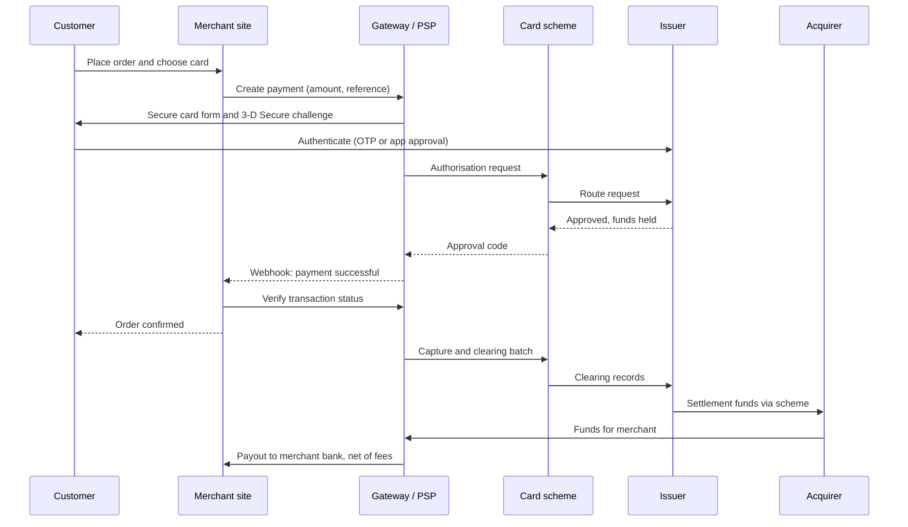

## Introduction

When a customer taps "Pay" on an online shop, the confirmation appears within seconds. Yet in those seconds, messages travel between the merchant's website, a payment gateway, a processor, a card network or mobile money operator, and the customer's bank or wallet provider. Funds do not actually move at that moment: the money usually reaches the merchant later, through clearing and settlement processes that run in batches. Understanding this gap between *approval* and *money in the bank* is essential for anyone designing, managing or auditing digital commerce.

This lesson explains the architecture and lifecycle of electronic payment transactions. You will learn who the parties are, the difference between authentication, authorisation, capture, clearing and settlement, how card and mobile money flows differ, how a merchant's system integrates with a gateway through APIs and webhooks, and what happens when things go wrong. Ghanaian payment service providers and international practice illustrate the concepts. The lesson is educational and is not financial, legal or regulatory advice.

## Learning Objectives

- Identify the parties in card and mobile money transactions and explain their roles.
- Distinguish authentication, authorisation, capture, clearing and settlement.
- Describe how a payment gateway integrates with a merchant's checkout using APIs, redirects, callbacks and webhooks.
- Compare the lifecycle of a card payment with that of a mobile money payment.
- Evaluate merchant costs, failure scenarios, refunds, chargebacks and reconciliation controls.

## Prerequisite Knowledge

- Mobile money mechanics and digital wallets (previous lesson).
- The checkout and order lifecycle from Module 3.

## Key Terminology

- **Payment gateway**: A service that securely captures payment details from a merchant's checkout and transmits transaction requests to processors and networks, returning the result.
- **Payment service provider (PSP)**: A firm that provides merchants with the ability to accept electronic payments, often combining gateway, processing, multiple payment methods and settlement services.
- **Acquirer (acquiring bank)**: The financial institution that contracts with merchants to accept card payments and receives funds on their behalf through the card network.
- **Issuer (issuing bank)**: The financial institution that issues the customer's card and approves or declines transactions against the cardholder's account.
- **Card scheme (network)**: An organisation such as Visa or Mastercard that sets rules and operates the network connecting issuers and acquirers.
- **Authorisation**: The issuer's or wallet provider's approval of a transaction, confirming available funds and placing a hold or debit.
- **Capture**: The merchant's instruction to finalise an authorised card transaction so that it is submitted for clearing and settlement.
- **Settlement**: The transfer of funds between financial institutions, and ultimately to the merchant, to discharge payment obligations.
- **Chargeback**: A reversal of a card transaction initiated through the issuer when a cardholder disputes it, under card scheme rules.
- **Webhook**: An automated HTTP message sent by a payment provider to a merchant's server to report an event such as a successful payment.

## Detailed Explanation

### The parties in a card transaction

The card system is often called a **four-party model**: the **cardholder**, the **merchant**, the **acquirer** and the **issuer**, connected by a **card scheme** that sets rules and routes messages. In e-commerce, further intermediaries sit between the merchant and the acquirer: a **payment gateway** to capture payment details securely and a **processor** to handle message routing. Many merchants deal with a single **PSP** that bundles gateway, processing, acquiring relationships and settlement, so they never deal with acquirers directly. This is how providers such as Paystack serve online merchants.

### Five stages that are often confused

1. **Authentication** – verifying that the person paying is the legitimate cardholder or wallet owner. For cards online this commonly uses 3-D Secure, where the issuer may challenge the customer with a one-time password or app approval. For mobile money it is the customer's PIN entry on their own phone.
2. **Authorisation** – the issuer checks that the card is valid and funds or credit are available and returns an approval code, placing a **hold** on the funds. The money has not yet moved.
3. **Capture** – the merchant confirms that it wants to collect the authorised amount. Many online merchants capture automatically at authorisation ("sale" transactions); others authorise first and capture later, for example when goods are shipped or a hotel stay ends. Uncaptured authorisations expire after a period set by scheme rules.
4. **Clearing** – the exchange of transaction details between acquirer and issuer through the scheme, calculating what each party owes, usually in batches.
5. **Settlement** – the actual movement of funds: the issuer pays the scheme or acquirer, and the acquirer or PSP pays the merchant, net of fees, according to an agreed schedule.

The gap between authorisation (seconds) and settlement (often one or more business days later) explains why merchants must reconcile what their system *recorded as paid* with what *actually arrived* in their bank account.

### The mobile money transaction lifecycle

A mobile money payment through a PSP follows a different pattern:

1. The customer selects mobile money at checkout and enters their wallet number.
2. The merchant's server asks the PSP to initiate a charge.
3. The PSP sends a debit request to the mobile money operator.
4. The customer receives a prompt on their phone (for example a USSD pop-up) and approves by entering their PIN. Some flows instead ask the customer to generate a voucher or approve via an app.
5. The operator debits the wallet and credits the PSP's collection wallet, then informs the PSP.
6. The PSP notifies the merchant by **webhook** and updates the transaction status; the merchant should **verify** the status with the PSP before fulfilling the order.
7. The PSP later **settles** collected funds to the merchant's bank account or wallet, net of fees.

Compared with cards, mobile money payments are typically *pull requests approved by the customer on a separate device*, are usually completed as a single debit rather than an authorisation hold followed by capture, and rely on the operator's wallet ledger rather than an issuer–acquirer network. A distinctive failure mode is the **pending** state: the customer may not see or respond to the prompt, the session may time out, or network delays may leave the status uncertain for a while.

### Gateway integration patterns

| Pattern | How it works | Merchant responsibility | Typical use |
|---|---|---|---|
| Hosted payment page / redirect | Customer is sent to the PSP's page to pay, then returned | Lowest; card data never touches merchant servers | SMEs, quick integrations |
| Embedded (inline) checkout | PSP's script displays a payment form within the merchant page | Low to moderate | Better user experience while limiting data exposure |
| Direct API integration | Merchant collects details and calls the PSP's API | Highest; may bring the merchant fully into card security compliance scope | Large merchants with security capacity |
| Payment links and invoices | PSP generates a link the merchant sends by chat, SMS or email | Minimal | Social commerce, invoices |

Whatever the pattern, robust integrations follow common principles: create a unique **transaction reference** for each attempt; never trust the browser's redirect alone as proof of payment; confirm via **webhook** and a server-side **verification** call; make webhook handling **idempotent** so that duplicate notifications do not create duplicate orders; and log every event for reconciliation. Security standards for card data, including PCI DSS, are covered in Module 5.

### Refunds, reversals and chargebacks

A **void** cancels an authorisation before capture. A **refund** returns funds after settlement, initiated by the merchant. A **chargeback** is initiated by the cardholder through the issuer, for reasons such as fraud or goods not received, and the merchant may contest it with evidence. Mobile money reversals follow operator and PSP rules. Merchants need clear policies and records for each.

## Theories, Frameworks and Models

### The economics of card acceptance

The merchant pays a **merchant discount rate (MDR)** or PSP fee on each transaction. In card systems, part of this typically goes to the issuer as an **interchange fee**, part to the scheme as scheme fees, and the remainder to the acquirer or PSP. This is a direct application of two-sided market theory (Rochet and Tirole, 2003, discussed in Module 2): cardholders often pay little or nothing per transaction, and may even earn rewards, while merchants pay fees, because the platform charges the side that values access to the other more and is less price-sensitive. Mobile money pricing similarly balances fees between senders, receivers and merchants.

### Authorisation is not settlement: a control perspective

From an internal control perspective, the key principle is **three-way agreement**: the merchant's order records, the PSP's transaction reports and the bank's settlement statements should agree. Differences arise from fees, refunds, chargebacks, timing (transactions near the end of the day settling the next day), failed or pending transactions and errors. Systematic **reconciliation** is therefore a core payment process, developed further in Module 5.

## Diagram

The sequence diagram below shows an online card payment through a PSP, from authentication and authorisation to capture and later settlement.

## Worked Example

**Illustrative scenario.** *AccraTech Gadgets* is a hypothetical online shop that uses a PSP to accept cards and mobile money. On one day it records the following. All fees and figures are invented for practice and do not represent any provider's actual pricing.

- 40 successful mobile money payments totalling GHS 12,000; PSP fee 1.5 per cent.
- 10 successful card payments totalling GHS 8,000; PSP fee 2.5 per cent.
- 1 card refund of GHS 600 processed today for an order from last week.
- 3 mobile money payments of GHS 900 in total that remained **pending** at day end and later failed.
- The order system wrongly marked the 3 pending mobile money orders as paid because it trusted the browser redirect.

**Step 1 – Expected gross collections.** Successful payments = `12,000 + 8,000 = GHS 20,000`.

**Step 2 – Fees.** Mobile money: `12,000 × 0.015 = GHS 180`. Cards: `8,000 × 0.025 = GHS 200`. Total fees = `GHS 380`.

**Step 3 – Expected net settlement.** `20,000 − 380 − 600 (refund deducted) = GHS 19,020`.

**Step 4 – Compare with the order system.** The order system shows paid orders of `20,000 + 900 = GHS 20,900`, because it counted the pending orders. The difference between the order system and the PSP's successful total is GHS 900, exactly the failed pending payments.

**Step 5 – Diagnose and fix.** The root cause is integration design: the system treated the redirect as proof of payment. The fix is to mark orders as paid only after a verified webhook or server-side verification call returns success, to hold pending orders in a "payment pending" state with a timeout, and to notify customers to retry. Had the shop shipped the three orders, it would have lost GHS 900 of goods.

**Step 6 – Reconcile settlement.** When the PSP pays out GHS 19,020 to the bank account (according to its settlement schedule), the finance team matches the payout to the PSP report (successful transactions minus fees and refunds) and the PSP report to the order system. Any remaining difference is investigated.

## Ghanaian Business Application

In Ghana, merchants commonly accept payments through PSPs that aggregate several methods in one integration. **Paystack**, founded in Nigeria and acquired by Stripe in 2020, operates in Ghana and provides online checkout supporting cards and mobile money, with developer documentation describing APIs and webhooks. **Hubtel**, a Ghanaian company, offers payment collection, checkout and business messaging services to merchants. Both illustrate the PSP model: a merchant integrates once and gains access to multiple payment methods, consolidated reporting and settlement to its account.

Mobile money is especially important for Ghanaian e-commerce because many customers prefer it to cards. Merchants should design for its specific behaviour: clear instructions telling customers to approve the prompt on their phone, a visible pending state, automatic status checks and a retry option. Because customers may be on any network, interoperability through GhIPSS and PSP integrations with multiple operators allows a single checkout to serve customers across networks.

Regulation sits with the **Bank of Ghana**, and the Payment Systems and Services Act, 2019 (Act 987) provides the framework for licensing payment service providers and electronic money issuers. Merchants should choose licensed providers, read their terms on fees, settlement schedules, refunds and disputes, and keep transaction records for reconciliation and tax purposes. Current fees and requirements should be checked directly with providers and the regulator.

## International Case Study

### Stripe: developer-first payment integration

Stripe was founded in 2010 by brothers Patrick and John Collison and became known for making online payment acceptance simpler for developers. Before such services, accepting cards online often required a merchant account with an acquirer, a separate gateway contract and complex integration. Stripe offered a single account, well-documented APIs and client libraries, allowing a developer to accept payments with relatively little code. It later expanded internationally and, in 2020, acquired Paystack, extending its reach into African markets.

The case illustrates key concepts of this lesson. Stripe's model **abstracts the four-party system**: merchants interact with one PSP that manages relationships with acquirers and schemes. Its documentation emphasises practices such as using webhooks to receive asynchronous events, verifying events and making request handling idempotent, which reflect the integration principles discussed above. It also shows how **payment infrastructure becomes a platform**, with additional services such as billing, fraud screening and marketplace payouts built on top. A critical view notes that convenience increases merchants' dependence on a single provider, so merchants should understand settlement terms, dispute processes and data portability.

## Common Misconceptions

- **Misconception:** When a payment is approved, the money is in the merchant's account. **Correction:** Authorisation only approves and holds funds; settlement to the merchant happens later, net of fees.
- **Misconception:** Authentication and authorisation are the same. **Correction:** Authentication verifies the payer's identity; authorisation is the issuer's approval of the transaction.
- **Misconception:** The customer being redirected to the success page proves payment. **Correction:** Redirects can be interrupted or manipulated; merchants should rely on verified webhooks and server-side checks.
- **Misconception:** Refunds and chargebacks are the same thing. **Correction:** A refund is merchant-initiated; a chargeback is a cardholder dispute processed through the issuer under scheme rules.
- **Misconception:** Mobile money payments follow the card authorisation-and-capture model. **Correction:** They are typically customer-approved wallet debits with distinctive pending and timeout states.

## Common Examination Mistakes

- Listing transaction stages in the wrong order or treating clearing and settlement as identical.
- Omitting the issuer, acquirer or scheme when describing a card transaction.
- Describing mobile money payments without the customer approval prompt, webhook and settlement steps.
- Ignoring failure scenarios (pending, timeout, duplicate notifications) and reconciliation.
- Quoting specific provider fees or regulatory limits without a verified source.

## Critical Thinking Questions

1. Why might a merchant choose separate authorisation and capture rather than immediate capture? What risks arise?
2. Merchants usually pay card fees while cardholders pay little. Is this fair, and how does two-sided market theory explain it?
3. How should an online merchant in Ghana balance the user experience of mobile money payments against the risk of pending and failed transactions?
4. What are the risks of a market in which a small number of PSPs process most online payments?

## Practical Exercises

1. **Lifecycle mapping.** Draw the lifecycle of a mobile money payment through a PSP from checkout to settlement, including a timeout path. *Expected output:* a diagram with at least eight steps and a labelled failure branch.
2. **Settlement calculation.** An illustrative merchant has card sales of GHS 15,000 (fee 2.5 per cent), mobile money sales of GHS 25,000 (fee 1.5 per cent) and refunds of GHS 1,200. Calculate expected net settlement. *Expected output:* fees of GHS 375 and GHS 375, net settlement of GHS 38,050, with steps shown.
3. **Integration review.** Using the official Paystack documentation, identify how a merchant should confirm that a transaction succeeded. *Expected output:* a short note (200 words) explaining webhooks, verification and why the redirect alone is insufficient, with references to the relevant documentation pages.

## Key Takeaways

- Card payments involve cardholder, merchant, acquirer, issuer and scheme, with gateways and PSPs as intermediaries.
- Authentication, authorisation, capture, clearing and settlement are distinct stages; approval is not settlement.
- Mobile money payments are customer-approved wallet debits with pending and timeout states, notified by webhook and settled later.
- Robust integrations use unique references, verified webhooks, idempotent processing and reconciliation.
- Merchant fees reflect two-sided market pricing; refunds, chargebacks and reversals require clear policies.
- This lesson is educational and not financial, legal or regulatory advice.

## Further Reading

- Rochet, J.-C., & Tirole, J. (2003). Platform competition in two-sided markets. *Journal of the European Economic Association, 1*(4), 990–1029. <https://doi.org/10.1162/154247603322493212>
- Laudon, K. C., & Traver, C. G. *E-commerce: Business, technology, society*. Pearson. (Consult the most recent edition available in your library.)
- Paystack. Paystack documentation. <https://paystack.com/docs/>
- Stripe. Stripe documentation. <https://docs.stripe.com/>
- Bank of Ghana. Official website. <https://www.bog.gov.gh/>

## Video Resources

- [Paystack Documentation](https://paystack.com/docs/) — Paystack. Official developer documentation explaining payment initiation, verification and webhooks for cards and mobile money.
- [Stripe Documentation](https://docs.stripe.com/) — Stripe. Official documentation describing online payment flows, webhooks and idempotent requests.

## Revision Summary

Electronic payments involve several parties and stages. In card payments, the gateway or PSP passes the merchant's request through the scheme to the issuer, which authenticates the cardholder (for example through 3-D Secure) and authorises the transaction by holding funds; capture, clearing and settlement follow later, and the merchant receives funds net of fees. Mobile money payments are customer-approved wallet debits confirmed by webhook and settled later. Robust integrations verify payments server-side and reconcile order records, PSP reports and bank settlements.

- Order: authenticate → authorise → capture → clear → settle.
- Four-party model: cardholder, merchant, acquirer, issuer, plus scheme.
- Never trust the redirect alone; verify via webhook and API.
- Idempotent webhook handling prevents duplicate orders.
- Refund (merchant) ≠ chargeback (cardholder dispute via issuer).
