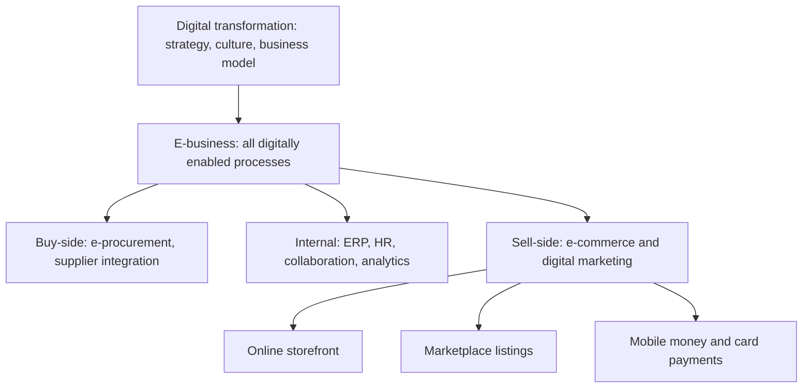

## Introduction

Almost every organisation in Ghana now touches digital technology somewhere in its operations. A trader in Kumasi's Kejetia market accepts mobile money, a pharmacy chain in Accra takes orders on WhatsApp, a bank onboards customers through an app, and a cocoa exporter exchanges documents with overseas buyers by email and electronic platforms. Yet these activities are not all the same thing. Some are *e-commerce* (buying and selling online), some are wider *e-business* (running the organisation digitally), and a few amount to genuine *digital transformation* (changing how the organisation creates value).

This lesson sets out the vocabulary used throughout CSIT 613. You will learn to distinguish e-business from e-commerce, to recognise the unique features of digital markets, and to analyse digital transformation as a strategic and organisational change rather than a technology purchase. These distinctions matter in examinations and in practice: a manager who believes "having a website" equals digital transformation will invest in the wrong things.

## Learning Objectives

- Define electronic business and electronic commerce and explain the relationship between them.
- Explain the distinctive features of digital technology that make e-commerce different from traditional commerce.
- Compare digitisation, digitalisation and digital transformation using organisational examples.
- Analyse the drivers of and barriers to e-business adoption among Ghanaian organisations.
- Evaluate whether a given digital initiative represents incremental improvement or transformation.

## Prerequisite Knowledge

- None beyond a general understanding of how businesses buy, sell and manage their operations.
- Helpful: basic familiarity with the internet, mobile phones and business information systems.

## Key Terminology

- **Electronic commerce (e-commerce)**: Digitally enabled commercial transactions between and among organisations and individuals, involving an exchange of value for products or services.
- **Electronic business (e-business)**: The digital enablement of transactions and processes within an organisation and with its partners, including procurement, operations, human resources and customer service, not only selling.
- **Digitisation**: Converting analogue information into digital form, such as scanning paper invoices.
- **Digitalisation**: Using digital technologies to change and improve existing business processes, such as moving approvals into a workflow system.
- **Digital transformation**: A fundamental, organisation-wide change in strategy, processes, culture and value creation enabled by digital technologies.
- **Disintermediation**: The removal of intermediaries from a value chain because producers can reach customers directly online.
- **Reintermediation**: The emergence of new digital intermediaries, such as marketplaces and comparison sites, that add value in online markets.
- **Information asymmetry**: A situation where one party in a transaction has more or better information than the other.

## Detailed Explanation

### E-commerce and e-business: a nested relationship

The simplest way to remember the distinction is that **e-commerce is a subset of e-business**. Laudon and Traver define e-commerce as digitally enabled commercial transactions that involve the exchange of value, typically money, for goods or services. The key test is *exchange of value across organisational boundaries*. An online shop, a mobile money payment for airtime, or an electronic tender submitted to a buyer are all e-commerce.

E-business is broader. Chaffey and colleagues describe it as the use of digital technologies to manage all of an organisation's processes and its relationships with stakeholders. It includes *buy-side* activities (electronic procurement and supply-chain integration), *internal* activities (enterprise resource planning, digital HR, collaboration tools) and *sell-side* activities (e-commerce and digital marketing). A manufacturer that never sells online but runs its procurement, inventory and payroll on integrated systems is an e-business, even though it does little e-commerce.

| Dimension | E-commerce | E-business |
|---|---|---|
| Scope | Transactions with customers or suppliers | All internal and external digitally enabled processes |
| Main question | How do we sell or buy digitally? | How do we run the organisation digitally? |
| Typical systems | Online storefronts, payment gateways, marketplaces | ERP, SCM, CRM, intranets, e-procurement, plus e-commerce |
| Boundary | Crosses organisational boundaries | Within and across boundaries |
| Example | A Ghanaian fashion brand selling on Instagram with mobile money checkout | A distributor integrating supplier orders, warehouse stock and delivery tracking |

### Why digital commerce is different

Laudon and Traver identify several unique features of e-commerce technology. These features explain why online markets behave differently from physical ones:

1. **Ubiquity**: the market is available almost everywhere and at any time, reducing the cost for customers of searching and transacting.
2. **Global reach**: a seller can, in principle, reach customers across national borders.
3. **Universal standards**: shared internet standards (TCP/IP, HTTP, HTML) lower the cost of entering the market.
4. **Richness**: complex messages, video and interactive content can be delivered.
5. **Interactivity**: two-way communication between firm and customer.
6. **Information density**: the amount and quality of information available rises, while its cost falls, which makes prices more transparent.
7. **Personalisation and customisation**: messages and products can be tailored to individuals.
8. **Social technology**: users create and share content, turning customers into marketers and reviewers.

Information density deserves emphasis. When prices and product details are easy to compare, sellers lose some of the advantage that information asymmetry gave them. At the same time, firms gain detailed data about customers, enabling *price discrimination* and personalisation. The internet therefore shifts power in both directions.

### Intermediation in digital markets

Early commentators predicted that the internet would eliminate intermediaries: producers would sell directly, cutting out wholesalers and retailers. Some disintermediation did occur, such as airlines selling tickets directly rather than through travel agents. However, the dominant pattern has been **reintermediation**. Marketplaces, payment service providers, delivery platforms and review sites became powerful new intermediaries because they reduce search costs, build trust and aggregate demand. In Ghana, the growth of payment aggregators and delivery apps illustrates that intermediaries do not vanish; they change form.

## Theories, Frameworks and Models

### Digitisation, digitalisation and digital transformation

These three terms are frequently confused, so it is useful to treat them as a ladder of increasing ambition.

| Level | What changes | Illustrative example |
|---|---|---|
| Digitisation | Format of information | A clinic scans paper patient cards into PDFs |
| Digitalisation | A process | The clinic introduces online appointment booking linked to its records system |
| Digital transformation | Value proposition, business model and culture | The clinic becomes a telehealth provider, offering remote consultations and subscription health plans |

Vial's (2019) review of the literature defines digital transformation as a process in which digital technologies trigger significant changes to an organisation's value creation paths, requiring structural changes and the management of barriers. The definition stresses that technology is the *trigger*, but the transformation itself is organisational.

### Westerman, Bonnet and McAfee's view

In *Leading Digital* (2014), Westerman, Bonnet and McAfee argue that successful digital transformation depends on two capabilities: **digital capability** (what the organisation does with technology across customer experience, operations and business models) and **leadership capability** (vision, governance, engagement and IT-business relationships). Organisations strong in both are described as "digital masters". The practical lesson is that buying technology without leadership, governance and staff engagement rarely transforms anything.

### Drivers and barriers

Drivers of e-business adoption include customer expectations of convenience, competitive pressure, lower transaction costs, availability of mobile payments and the reach of social media. Barriers include infrastructure gaps (reliable electricity and broadband outside major cities), cost of logistics, trust and fraud concerns, limited digital skills, and the informality of many small businesses. A balanced analysis always considers both.

## Diagram

The diagram below shows e-commerce nested within e-business, and digital transformation as a strategic layer that reshapes both.

## Worked Example

**Illustrative scenario.** *Adwoa's Kitchen Supplies*, a hypothetical wholesaler of catering equipment in Tema, wants to "go digital". The owner lists five initiatives. Classify each and judge whether it is transformational.

1. **Scanning old supplier invoices into a shared drive.** This is *digitisation*: the format changes, but nothing about the process or value proposition does.
2. **Accepting mobile money from walk-in customers.** This is *e-commerce* at the payment stage, and *digitalisation* of the cash-handling process. It reduces cash risk but does not change the business model.
3. **Introducing an inventory system linked to supplier reorder emails.** This is *e-business* on the buy-side and internal processes. It improves efficiency.
4. **Launching an online catalogue where restaurants order and pay, with scheduled delivery.** This is sell-side *e-commerce* and changes the customer channel.
5. **Offering restaurants a monthly subscription that bundles equipment leasing, maintenance and automatic replenishment of consumables, managed through an app.** This changes how the firm creates and captures value: revenue shifts from one-off sales to recurring service fees, and the firm needs new data, logistics and service capabilities. This is the only initiative that approaches *digital transformation*.

The analysis shows that the number of technologies adopted is not the measure of transformation. The measure is whether value creation and capture change.

## Ghanaian Business Application

Ghana provides a vivid setting for these concepts. Mobile money, offered by operators such as MTN through MTN MoMo, has become a familiar way to pay for goods, transfer funds and settle bills, and it gives even small informal businesses a digital payment channel. This has lowered one of the traditional barriers to e-commerce, namely the lack of card ownership.

Consider three typical patterns:

- **Social commerce SMEs.** Many small fashion, beauty and food businesses sell through Instagram, Facebook and WhatsApp, taking payment by mobile money and arranging delivery through motorbike couriers. These firms practise e-commerce without a formal website. Their weakness is often the absence of e-business back-office systems: stock, orders and customer data live in chat histories.
- **Marketplaces and aggregators.** Pan-African marketplaces such as Jumia, which has operated in Ghana, act as reintermediaries, providing catalogue, payment and delivery services to sellers who cannot build their own.
- **Public sector digitalisation.** Government services in Ghana have increasingly moved online, for example digital registration and payment of certain fees. Such initiatives are digitalisation of public processes and can support wider adoption by building citizen familiarity with digital channels.

For an MSc student, the analytical task is to ask *which layer* an initiative touches, *which drivers and barriers* apply locally (logistics, addressing, trust, connectivity), and *whether* the organisation's capabilities and culture are changing alongside its tools.

## International Case Study

### Amazon: from online bookseller to digital ecosystem

Amazon, founded by Jeff Bezos in 1994, began by selling books online. Its early advantage came from the unique features of e-commerce described above: a vast catalogue unconstrained by shelf space, customer reviews (social technology) and personalised recommendations (personalisation). Over time it extended e-commerce into a broader e-business. It built sophisticated fulfilment and logistics operations, opened its marketplace to third-party sellers, and launched Amazon Web Services in 2006, selling the computing infrastructure it had developed for itself.

The case illustrates all three levels. Selling books online was *e-commerce*. Running warehousing, inventory and supplier relationships digitally was *e-business*. Turning internal capabilities into new businesses (cloud computing, marketplace services, logistics for others) was *digital transformation* of the business model. It also shows reintermediation: rather than eliminating intermediaries, Amazon became one of the most powerful intermediaries in retail. A critical reading should note the concerns this raises, including seller dependence on the platform and debates about market power, which are revisited in the platform lesson of Module 2.

## Common Misconceptions

- **Misconception:** E-business and e-commerce mean the same thing. **Correction:** E-commerce concerns digitally enabled transactions; e-business covers all digitally enabled processes, of which e-commerce is one part.
- **Misconception:** Having a website or social media page means a business has transformed digitally. **Correction:** Transformation requires changes to value creation, processes and culture; a web presence may be only digitisation of marketing material.
- **Misconception:** The internet removes intermediaries. **Correction:** It removes some and creates many new ones; reintermediation has been the dominant pattern.
- **Misconception:** E-commerce requires credit cards. **Correction:** In Ghana and much of Africa, mobile money and bank transfers are major digital payment methods for e-commerce.
- **Misconception:** Digital transformation is an IT department project. **Correction:** It is a strategic, organisation-wide change led by senior management.

## Common Examination Mistakes

- Defining e-business and e-commerce as synonyms, or defining e-business without mentioning internal and supply-side processes.
- Listing the unique features of e-commerce without explaining their business consequences.
- Using "digitalisation" and "digital transformation" interchangeably.
- Giving only international examples when the question asks for application to Ghana or an SME.
- Describing technologies adopted rather than analysing how value creation changed.

## Critical Thinking Questions

1. Is a Ghanaian business that sells only through WhatsApp and mobile money an e-business? Justify your answer using the definitions in this lesson.
2. Information density makes prices more transparent, yet online sellers also use data to personalise prices. Which effect is likely to dominate in Ghanaian online retail, and why?
3. Under what conditions might digital transformation *reduce* a firm's competitiveness?
4. To what extent are infrastructure barriers, rather than attitudes or skills, the main constraint on e-business adoption among Ghanaian SMEs?

## Practical Exercises

1. **Classify initiatives.** Choose a Ghanaian organisation you know (a bank, hospital, retailer or university office). List six digital initiatives it has undertaken and classify each as digitisation, digitalisation or digital transformation, and as e-commerce or wider e-business. *Expected output:* a six-row table with classifications and a one-sentence justification for each.
2. **Feature analysis.** Take an online marketplace operating in Ghana and explain how at least four of the eight unique features of e-commerce technology appear in its design. *Expected output:* a short report (300-400 words) linking each feature to a specific design element and its business effect.
3. **Barrier map.** For a hypothetical SME in a regional town, identify three drivers and three barriers to e-business adoption and propose one mitigation for each barrier. *Expected output:* a structured list with mitigations that are realistic and low-cost.

## Key Takeaways

- E-commerce is the digitally enabled exchange of value; e-business is the digital enablement of all processes, with e-commerce as one part.
- The unique features of digital technology (ubiquity, reach, standards, richness, interactivity, information density, personalisation, social technology) explain why digital markets behave differently.
- Digitisation, digitalisation and digital transformation represent increasing depth of change.
- Transformation depends on leadership and organisational capability, not on technology alone.
- In Ghana, mobile money has lowered payment barriers, while logistics, trust and infrastructure remain key constraints.

## Further Reading

- Laudon, K. C., & Traver, C. G. *E-commerce: Business, technology, society*. Pearson. (Consult the most recent edition available in your library.)
- Chaffey, D., Hemphill, T., & Edmundson-Bird, D. (2019). *Digital business and e-commerce management* (7th ed.). Pearson.
- Westerman, G., Bonnet, D., & McAfee, A. (2014). *Leading digital: Turning technology into business transformation*. Harvard Business Review Press.
- Vial, G. (2019). Understanding digital transformation: A review and a research agenda. *The Journal of Strategic Information Systems, 28*(2), 118-144. <https://doi.org/10.1016/j.jsis.2019.01.003>
- UNCTAD. E-commerce and the digital economy. <https://unctad.org/topic/ecommerce-and-digital-economy>

## Video Resources

- [UNCTAD E-commerce and Digital Economy](https://unctad.org/topic/ecommerce-and-digital-economy): UNCTAD. Official topic page with publications and multimedia on e-commerce in developing economies.
- [MIT OpenCourseWare](https://ocw.mit.edu/): Massachusetts Institute of Technology. Official open learning portal; search for digital business and information technology strategy materials.

## Revision Summary

E-commerce is the digitally enabled exchange of value between parties, whereas e-business is the digital enablement of all organisational processes, including buy-side, internal and sell-side activities. Digital markets differ from physical ones because of ubiquity, global reach, universal standards, richness, interactivity, information density, personalisation and social technology. Digital transformation is deeper than digitisation or digitalisation because it changes value creation, structure and culture.

- E-commerce ⊂ e-business; transformation reshapes both.
- Digitisation = format; digitalisation = process; transformation = business model and culture.
- The internet produces reintermediation more than disintermediation.
- Leadership capability matters as much as digital capability.
- In Ghana, mobile money lowers payment barriers; logistics and trust remain challenges.
