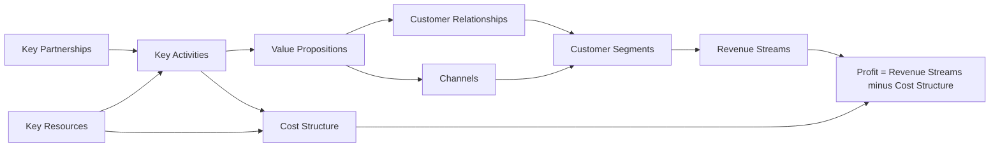

## Introduction

Two online businesses can sell the same product and still have completely different prospects. One may earn a thin margin on each sale and struggle with delivery costs; another may earn recurring subscription income, collect valuable data and benefit from customers who recommend it to others. The difference lies in the **business model**: the logic by which a firm creates value for customers and captures some of that value as revenue and profit.

This lesson equips you to analyse online business models rigorously. You will examine the components of a business model, the main revenue models used online, the sources of digital value creation, and the Business Model Canvas developed by Osterwalder and Pigneur. A full worked example applies the canvas to a hypothetical Ghanaian start-up so that you can reproduce the method in assignments and examinations.

## Learning Objectives

- Define a business model and distinguish it from a business strategy.
- Explain the main sources of digital value creation, including efficiency, novelty, lock-in and complementarities.
- Compare the principal online revenue models and identify the conditions under which each works.
- Apply the nine building blocks of the Business Model Canvas to a digital business.
- Evaluate the coherence and risks of an online business model.

## Prerequisite Knowledge

- The distinction between e-business and e-commerce (previous lesson).
- Basic understanding of revenue, cost and profit.

## Key Terminology

- **Business model**: The rationale of how an organisation creates, delivers and captures value.
- **Value proposition**: The bundle of products and services that creates value for a specific customer segment by solving a problem or satisfying a need.
- **Revenue model**: The way a firm earns income from its value proposition, such as sales, subscriptions, commissions or advertising.
- **Business Model Canvas**: A one-page strategic tool, proposed by Osterwalder and Pigneur, that describes a business model through nine building blocks.
- **Freemium**: A revenue model in which a basic service is free and premium features are paid for.
- **Lock-in**: Features of a business model that make it costly or inconvenient for customers to switch to competitors.
- **Marginal cost**: The additional cost of serving one more customer or producing one more unit; for many digital goods it is close to zero.
- **Unit economics**: The revenue and cost associated with a single unit, customer or order, used to judge whether growth is profitable.

## Detailed Explanation

### What a business model is, and is not

Teece (2010) describes a business model as the design or architecture of the value creation, delivery and capture mechanisms a firm employs. It answers four linked questions: *Who* is the customer? *What* do they value? *How* is it delivered? *How* does the firm make money doing so at an appropriate cost?

A business model is not the same as a strategy. Strategy concerns how a firm positions itself against competitors and chooses where to compete; the business model is the operating logic that strategy selects and refines. Two firms can share a business model (for example, both run marketplaces that earn commissions) yet pursue different strategies (one targets electronics buyers in Accra, the other targets agricultural inputs for farmers).

### Sources of digital value creation

Amit and Zott's research on e-business models identified four interrelated sources of value creation in digital businesses. They are a useful lens for analysis:

1. **Efficiency** – digital processes reduce transaction costs, search costs and errors. Ordering through an app instead of phoning a supplier saves time for both sides.
2. **Complementarities** – value rises when products, services or technologies are bundled together. A ride-hailing app that combines mapping, payment and driver rating offers more value than each element separately.
3. **Lock-in** – loyalty programmes, stored preferences, data and network effects make customers less likely to switch.
4. **Novelty** – new ways of connecting parties or new content and services create value that did not previously exist.

Digital goods also have distinctive cost structures. Software, music and online courses have high fixed costs of creation but **near-zero marginal cost** of reproduction. Shapiro and Varian (1999) showed in *Information Rules* that this encourages pricing by customer value rather than cost, versioning (different editions for different customers) and bundling.

### The main online revenue models

| Revenue model | How income is earned | Conditions for success | Example |
|---|---|---|---|
| Sales (merchant) | Margin on goods or services sold | Efficient supply chain, logistics and pricing | An online electronics retailer |
| Subscription | Recurring fee for ongoing access | Continual value and low churn | Video and music streaming services |
| Transaction fee / commission | Percentage or fixed fee per transaction facilitated | Sufficient volume on both sides of the market | Marketplaces, payment gateways |
| Advertising | Fees from advertisers for audience attention | Large, engaged, well-targeted audience | Search engines, social media |
| Affiliate | Commission for referring customers to another firm | Trusted content and relevant audience | Product review sites |
| Freemium | Free basic tier, paid premium tier | Enough free users convert to paid | Cloud storage and productivity apps |
| Licensing | Fees for use of intellectual property or software | Protectable, valuable IP | Enterprise software licences |

Many successful firms combine models. A marketplace may earn commissions from sellers, advertising fees for promoted listings and subscription fees for premium seller services. Analysts should ask which revenue stream is the *core* and which are supplementary.

### Unit economics

A model can grow quickly and still destroy value if each additional order loses money. Unit economics compares the revenue earned per customer or order with the variable cost of serving it. For an e-commerce firm, this means average order value, gross margin, payment fees, packaging, delivery and returns. The concepts of customer acquisition cost and customer lifetime value are developed fully in Module 3; here, the point is that a business model must be economically coherent, not only attractive to customers.

## Theories, Frameworks and Models

### The Business Model Canvas

Osterwalder and Pigneur's *Business Model Generation* (2010) presents the Business Model Canvas, which describes a business model through nine building blocks. The right-hand side concerns value and customers; the left-hand side concerns efficiency and operations.

| Building block | Guiding question |
|---|---|
| Customer Segments | For whom are we creating value? |
| Value Propositions | What value do we deliver and which problem do we solve? |
| Channels | Through which channels do we reach and deliver to customers? |
| Customer Relationships | What type of relationship does each segment expect? |
| Revenue Streams | For what value are customers willing to pay, and how? |
| Key Resources | What assets are essential to deliver the value proposition? |
| Key Activities | What must we do well to make the model work? |
| Key Partnerships | Who are our key partners and suppliers? |
| Cost Structure | What are the most important costs, and which blocks drive them? |

The canvas is valuable because it makes assumptions visible and shows dependencies between blocks. Its limitations are that it is static, does not explicitly model competition, and can encourage list-making instead of analysis. Good use of the canvas therefore always ends with an evaluation of coherence and risk.

### Timmers' early classification

Timmers (1998) offered one of the first classifications of internet business models, including e-shops, e-procurement, e-auctions, e-malls, third-party marketplaces, virtual communities, value-chain service providers and information brokers. Although technology has moved on, the classification remains a useful reminder that online models differ in their degree of innovation and their integration of functions.

## Worked Example

**Illustrative scenario.** *FarmFresh GH* is a hypothetical start-up in Accra that wants to deliver fresh vegetables from farmers in the Eastern Region to middle-income households and small restaurants. Customers order through a mobile app or WhatsApp, pay by mobile money or card, and receive deliveries twice a week.

**Step 1 – Complete the canvas.**

| Block | FarmFresh GH |
|---|---|
| Customer Segments | (1) Busy middle-income households in Accra; (2) small restaurants and chop bars needing reliable supply |
| Value Propositions | Fresh, consistently graded produce delivered on schedule; saves time otherwise spent at markets; predictable prices for restaurants |
| Channels | Mobile app, WhatsApp Business, Instagram for awareness, own delivery riders |
| Customer Relationships | Automated reordering for households; dedicated account contact for restaurants |
| Revenue Streams | Margin on produce sold; weekly subscription box for households; delivery fee on small orders |
| Key Resources | Farmer network, cold storage facility, rider fleet, customer data, app |
| Key Activities | Sourcing and grading, demand forecasting, last-mile delivery, quality control |
| Key Partnerships | Farmer cooperatives, payment service provider, cold-chain equipment supplier |
| Cost Structure | Produce purchase, transport fuel and riders, cold storage, payment fees, marketing, spoilage |

**Step 2 – Identify value creation sources.** *Efficiency* (customers avoid market trips; farmers gain a predictable buyer), *lock-in* (subscription boxes and saved preferences), *complementarities* (combining sourcing, grading and delivery).

**Step 3 – Test unit economics with simple assumptions.** Suppose an average household order is GHS 250, the gross margin on produce is 25 per cent, delivery costs GHS 30 per order, and payment fees and packaging total GHS 10. Contribution per order = `250 × 0.25 − 30 − 10 = 62.5 − 40 = GHS 22.50`. If spoilage averages 5 per cent of sales value (GHS 12.50), contribution falls to GHS 10. The model is fragile: a small increase in spoilage or fuel costs makes orders unprofitable. (These figures are illustrative assumptions for practice, not market data.)

**Step 4 – Evaluate coherence and risks.** The subscription box improves forecasting and reduces spoilage, linking Revenue Streams to Cost Structure. Restaurant accounts raise order size and lower delivery cost per cedi of sales. Key risks are spoilage, fuel price volatility, dependence on a few farmers and competition from informal market traders who offer credit. A recommendation would be to prioritise restaurant customers in dense delivery zones and set a minimum order value.

## Diagram

The left side drives costs; the right side drives revenue. Profit depends on both sides being designed together.

## Ghanaian Business Application

Several business model patterns are visible in Ghana's digital economy. **Payment service providers** such as Paystack and Hubtel typically earn *transaction fees* on payments they process for merchants; their value proposition to merchants is a single integration that accepts multiple payment methods, including cards and mobile money. **Marketplaces** earn commissions and may add fulfilment and advertising services. **Social commerce sellers** mostly use a simple *sales* model with low fixed costs but face high customer service effort.

The Ghanaian context shapes business model choices in specific ways. Addressing and last-mile delivery are costly, so models that batch deliveries, use pick-up points or serve business customers often have better unit economics. Trust is a recurring concern, which explains the popularity of payment on delivery in some segments, even though it adds cash-handling cost and failed-delivery risk. Mobile money's wide use makes small-value digital payments feasible, supporting micro-subscriptions and pay-as-you-go models (for example, pay-as-you-go solar systems seen in several African markets). When analysing a Ghanaian business model, always test whether it respects these local cost and trust conditions.

## International Case Study

### Netflix: changing the business model, not only the technology

Netflix, founded in 1997, began as a DVD rental service by post, allowing customers to rent films online and receive discs by mail. It later moved from per-rental pricing to a subscription model without late fees, which changed the value proposition. In 2007 it introduced online streaming, and over the following years it shifted towards producing original content.

Each step altered building blocks of the canvas. The *channel* moved from postal delivery to internet streaming. *Key resources* shifted from a disc inventory and distribution centres to streaming technology, licensing agreements and, later, original productions. The *revenue stream* remained subscription-based, but the *cost structure* moved towards large fixed content investments with near-zero marginal cost of serving another subscriber. The case demonstrates Shapiro and Varian's point about digital cost structures and shows why subscription businesses must manage churn: if customers cancel easily, the high fixed costs become difficult to recover. It also shows that business model change can cannibalise an existing business, which requires deliberate leadership choices.

## Common Misconceptions

- **Misconception:** A business model is just how a firm makes money. **Correction:** Revenue is one element; a business model also covers customers, value proposition, delivery, resources, partners and costs.
- **Misconception:** Digital products cost nothing, so they are always profitable. **Correction:** Marginal costs may be low, but fixed costs of development, content and marketing can be very high.
- **Misconception:** Completing every box of the Business Model Canvas is the analysis. **Correction:** The canvas is a description; analysis requires evaluating coherence, assumptions and risks.
- **Misconception:** Fast growth proves a business model works. **Correction:** Growth with negative unit economics can increase losses.
- **Misconception:** Advertising is the default online revenue model. **Correction:** Advertising needs large, targetable audiences; most SMEs earn revenue from sales or service fees.

## Common Examination Mistakes

- Listing the nine canvas blocks without applying them to the case in the question.
- Confusing the value proposition (benefit to the customer) with the product description.
- Proposing revenue models that do not fit the customer segment's ability or willingness to pay.
- Ignoring the cost structure and unit economics when evaluating a model.
- Failing to explain the links between blocks, such as how a subscription stream reduces costs through better forecasting.

## Critical Thinking Questions

1. Is the Business Model Canvas adequate for analysing platform businesses that serve two or more customer groups at once? What would you add?
2. Why might a freemium model fail in a market where many users are highly price-sensitive and data costs are significant?
3. Which source of digital value creation (efficiency, complementarities, lock-in or novelty) is most sustainable as a competitive advantage? Justify your view.
4. Should a Ghanaian e-commerce start-up prioritise growth or positive unit economics in its first two years?

## Practical Exercises

1. **Canvas a real organisation.** Using only publicly available information, complete a Business Model Canvas for a payment service provider operating in Ghana. *Expected output:* a completed nine-block canvas and a 200-word evaluation of its coherence.
2. **Revenue model redesign.** For the illustrative FarmFresh GH case, propose an alternative revenue model (for example, a commission-based marketplace connecting farmers directly to buyers). *Expected output:* a revised canvas showing which blocks change and a comparison of risks.
3. **Unit economics test.** Recalculate FarmFresh GH's contribution per order if delivery cost rises to GHS 40 and average order value rises to GHS 320. *Expected output:* a calculation showing contribution of `320 × 0.25 − 40 − 10 − 16 = GHS 14` (with 5 per cent spoilage of GHS 16) and a one-paragraph interpretation.

## Key Takeaways

- A business model explains how value is created, delivered and captured; strategy chooses and positions the model.
- Digital value comes from efficiency, complementarities, lock-in and novelty.
- Revenue models include sales, subscription, commission, advertising, affiliate, freemium and licensing, often combined.
- The Business Model Canvas describes a model in nine linked blocks but must be followed by evaluation.
- Unit economics and local conditions such as logistics and trust determine whether a model is viable.

## Further Reading

- Osterwalder, A., & Pigneur, Y. (2010). *Business model generation: A handbook for visionaries, game changers, and challengers*. Wiley.
- Teece, D. J. (2010). Business models, business strategy and innovation. *Long Range Planning, 43*(2–3), 172–194. <https://doi.org/10.1016/j.lrp.2009.07.003>
- Zott, C., Amit, R., & Massa, L. (2011). The business model: Recent developments and future research. *Journal of Management, 37*(4), 1019–1042.
- Shapiro, C., & Varian, H. R. (1999). *Information rules: A strategic guide to the network economy*. Harvard Business School Press.
- Timmers, P. (1998). Business models for electronic markets. *Electronic Markets, 8*(2), 3–8.

## Video Resources

- [Strategyzer](https://www.strategyzer.com/) — Strategyzer. Official site of the Business Model Canvas creators, with explanatory resources on business model design.
- [MIT OpenCourseWare](https://ocw.mit.edu/) — Massachusetts Institute of Technology. Official open learning portal; search for entrepreneurship and business model materials.

## Revision Summary

A business model is the logic of value creation, delivery and capture; it is broader than a revenue model and distinct from strategy. Digital businesses create value through efficiency, complementarities, lock-in and novelty, and their near-zero marginal costs encourage subscription, versioning and bundling. The Business Model Canvas organises a model into nine linked blocks, but its use must end with an evaluation of coherence, unit economics and risk.

- Nine blocks: segments, value propositions, channels, relationships, revenue, resources, activities, partnerships, costs.
- Revenue models: sales, subscription, commission, advertising, affiliate, freemium, licensing.
- Check unit economics: contribution per order after delivery, fees and spoilage.
- Local conditions (logistics, trust, mobile money) shape viable models in Ghana.
- Netflix shows business model change through channel, resources and cost structure.
