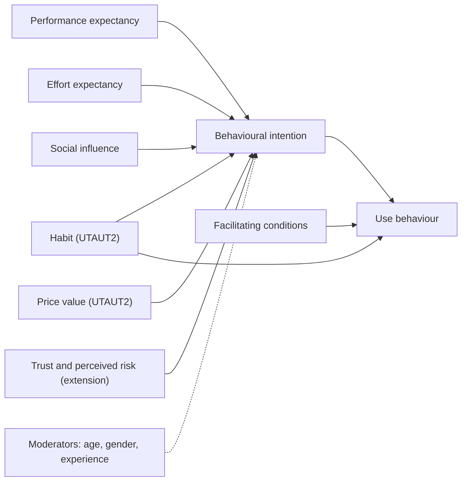

## Introduction

Why does one trader in Kumasi accept mobile money by QR code while her neighbour insists on cash? Why do many Ghanaian online shoppers prefer to pay the rider on delivery even when a wallet payment would be quicker? Questions like these sit at the intersection of technology, behaviour and economics, and they matter to every business planning a digital commerce strategy. A brilliantly engineered checkout fails if customers do not trust it, find it effortful or see no benefit over cash.

This lesson equips you with the main theoretical lenses for explaining adoption — the Technology Acceptance Model, the Unified Theory of Acceptance and Use of Technology and diffusion of innovations — and applies them to Ghanaian digital payments and online retail. It then examines the practical features of online retail in Ghana, including social commerce, delivery and addressing, cash on delivery and returns, before working through a cost analysis of shifting customers to prepaid digital payment. Statements about Ghana are deliberately qualitative; for current figures consult the Bank of Ghana, GSMA and the World Bank's Global Findex.

## Learning Objectives

- Explain the constructs of TAM, UTAUT and UTAUT2 and how they predict technology adoption.
- Apply diffusion of innovations attributes to a Ghanaian digital payment innovation.
- Analyse the factors that shape online retail operations in Ghana, including trust, delivery and cash on delivery.
- Evaluate strategies to convert cash-on-delivery customers to digital payment using a cost model.
- Design research hypotheses for a study of digital payment adoption.

## Prerequisite Knowledge

- The previous lesson on Ghana's mobile money ecosystem.
- Basic familiarity with e-commerce business models and conversion funnels from earlier modules.

## Key Terminology

- **Technology Acceptance Model (TAM)**: Davis's (1989) model proposing that perceived usefulness and perceived ease of use shape intention to use a technology.
- **Perceived usefulness**: The degree to which a person believes using a system will improve their performance or outcomes.
- **Perceived ease of use**: The degree to which a person believes using a system will be free of effort.
- **UTAUT**: The Unified Theory of Acceptance and Use of Technology (Venkatesh et al., 2003), integrating eight earlier models into four core determinants.
- **Facilitating conditions**: The perceived availability of resources and support, such as network coverage, devices and help, needed to use a technology.
- **Perceived risk**: The user's assessment of possible loss, such as fraud, failed transactions or loss of privacy.
- **Cash on delivery (COD)**: A fulfilment model in which the customer pays when goods are delivered.
- **Social commerce**: Selling through social media and messaging platforms such as WhatsApp, Instagram, Facebook and TikTok.

## Theories, Frameworks and Models

### Technology Acceptance Model

Davis (1989) argued that two beliefs dominate technology acceptance: **perceived usefulness (PU)** and **perceived ease of use (PEOU)**. PEOU also influences PU, because a system that is easy to use is more likely to be seen as useful. These beliefs shape behavioural intention, which predicts actual use. TAM's strength is parsimony; its weakness is that it says little about social influence, cost, trust or the resources a user needs.

### UTAUT and UTAUT2

Venkatesh, Morris, Davis and Davis (2003) synthesised eight models into **UTAUT**, with four determinants:

| Construct | Meaning | Digital payment example |
|---|---|---|
| Performance expectancy | Belief that use brings gains | "Paying by wallet saves me a trip to the bank." |
| Effort expectancy | Ease of use | "The QR payment takes only a few steps." |
| Social influence | Perceived expectations of important others | "My suppliers and customers expect me to accept mobile money." |
| Facilitating conditions | Resources and support available | "Network coverage is reliable and an agent is nearby." |

Gender, age, experience and voluntariness moderate these relationships. **UTAUT2** (Venkatesh, Thong & Xu, 2012) adapted the model for consumers by adding **hedonic motivation**, **price value** and **habit**. Price value is especially relevant where transfer fees or levies affect behaviour, and habit helps explain persistent cash use even when digital options exist.

### Trust, risk and diffusion

Payment studies frequently extend these models with **trust** (in the provider, the merchant and the system) and **perceived risk**. A customer who has heard of SIM swap fraud or experienced a failed transaction may judge digital payment risky despite its convenience.

Rogers' **diffusion of innovations** theory adds five attributes of an innovation: **relative advantage**, **compatibility** with existing values and practices, **complexity**, **trialability** and **observability**. It also describes adopter categories from innovators to laggards, reminding analysts that adoption spreads through social systems over time.

## Detailed Explanation

### Applying the theories to Ghana

Digital payment adoption in Ghana can be analysed construct by construct.

- **Performance expectancy** is strong for remittances and bill payment, where mobile money removes travel and queues. It is weaker for small face-to-face purchases where cash is already instant.
- **Effort expectancy** benefits from USSD menus that work on basic phones, yet multi-step menus, PIN entry and unfamiliar app interfaces remain barriers for some users, particularly those with limited literacy or older users.
- **Social influence** operates through families sending money, suppliers requesting wallet payment and merchants displaying QR codes. Observability is high when market neighbours adopt.
- **Facilitating conditions** include network reliability, agent density, smartphone access and electricity for charging. Outages during payment undermine trust quickly.
- **Price value** is shaped by transfer fees, cash-out charges and tax policy. Public debate over the E-Levy illustrated how sensitive users can be to the perceived cost of digital transfers.
- **Trust and risk** are affected by fraud, failed transactions and uncertainty about reversals. Clear dispute processes and visible regulation support trust.
- **Habit** explains why some traders continue to prefer cash, which is also convenient for informal record-keeping and immediately spendable.

### Online retail in Ghana

Ghana's online retail landscape includes general marketplaces such as Jumia, classified platforms, supermarket and electronics retailers' own websites and a large volume of **social commerce**, in which small sellers display products on Instagram, Facebook, TikTok or WhatsApp status and close sales in chat. Several operating realities shape strategy:

1. **Trust deficit between strangers.** Customers fear paying for goods that never arrive; sellers fear dispatching to customers who refuse delivery. Cash on delivery shifts risk to the seller.
2. **Addressing and logistics.** The GhanaPostGPS digital address system provides location codes, but many deliveries still depend on landmarks and phone calls to riders. Last-mile delivery is often handled by motorbike dispatch riders or third-party logistics firms.
3. **Cash on delivery.** COD reduces customer risk but increases seller costs: failed deliveries, rider cash handling, delayed settlement and reconciliation burden. Many riders now accept mobile money at the door, a hybrid "pay on delivery digitally" model.
4. **Returns and quality assurance.** Clear return policies and accurate product images reduce disputes and support trust.
5. **Payment choice at checkout.** Offering mobile money across all networks, cards and bank options through an aggregator reduces abandonment.

## Worked Example

### Evaluating a shift from cash on delivery to prepaid

**Illustrative scenario:** DigiMart Accra is a hypothetical online electronics accessories retailer. All figures are invented assumptions for teaching. It processes 1,000 orders a month with an average order value of GHS 200. Currently 600 orders are COD. The firm assumes that 15% of COD orders are refused at the door, each failed delivery costs GHS 25, and handling cash for each COD order costs GHS 3. Prepaid orders are refused or returned at an assumed 2%, and digital payments cost 2% of order value in PSP fees.

**Proposal:** offer a 3% discount to persuade 300 COD customers to prepay by mobile money or card.

| Item | Calculation | GHS |
|---|---|---|
| Current failed-delivery cost | 600 × 15% × 25 | 2,250 |
| New failed-delivery cost (COD) | 300 × 15% × 25 | 1,125 |
| New failed-delivery cost (converted prepaid) | 300 × 2% × 25 | 150 |
| Failed-delivery saving | 2,250 − 1,125 − 150 | 975 |
| Cash-handling saving | 300 × 3 | 900 |
| **Total savings** | | **1,875** |
| Discount cost | 300 × (3% × 200) | 1,800 |
| PSP fees on converted orders | 300 × (2% × 200) | 1,200 |
| **Total costs** | | **3,000** |
| **Net monthly effect** | 1,875 − 3,000 | **−1,125** |

The 3% discount destroys value. With a **1% discount** (GHS 2 per order), discount cost falls to 600, total costs to 1,800, and the net effect becomes **+75**, roughly break-even.

**Interpretation.** The financial case for prepaid is weaker than intuition suggests because PSP fees replace cash-handling costs. The decision therefore depends on benefits the model omits: faster cash flow, fewer riders carrying cash (security), better data and lower reconciliation effort. A UTAUT lens suggests non-price levers — priority dispatch, a "pay on delivery by wallet" option or visible buyer protection — may raise performance expectancy and trust more cheaply than discounts.

## Ghanaian Business Application

A Ghanaian SME can turn adoption theory into practical design:

- **Performance expectancy:** show what the customer gains — faster dispatch for prepaid orders, digital receipts, easy reordering.
- **Effort expectancy:** use merchant-initiated payment prompts or QR codes so customers approve with a PIN rather than typing wallet numbers.
- **Social influence and observability:** display acceptance signs and encourage reviews from satisfied customers.
- **Facilitating conditions:** support all major wallets and cards through an aggregator; provide a phone or chat line for payment problems.
- **Trust and risk:** publish refund and return policies, confirm orders instantly and never ask for PINs.
- **Price value:** absorb small fees where margins allow, or communicate them transparently.

## International Case Study

### India's Unified Payments Interface

India's **Unified Payments Interface (UPI)**, launched in 2016 by the National Payments Corporation of India, allows instant transfers between bank accounts through interoperable apps using simple identifiers and QR codes. Its rapid growth is often attributed to low or zero cost for users, interoperability across banks and apps, ubiquitous QR codes at small merchants and the participation of large technology firms. Demonetisation in late 2016, which suddenly withdrew high-value banknotes, also pushed many people to try digital payments.

In UTAUT terms, UPI scored highly on effort expectancy (scan and pay), price value (minimal user fees), social influence (merchants everywhere displaying QR codes) and facilitating conditions (smartphone and data growth). The case is useful for Ghana because it shows how public infrastructure, interoperability and merchant acceptance can reinforce one another, while debate continues in India about the long-term funding of a near-zero-fee system.

## Diagram

## Common Misconceptions

- "If a payment method is technically better, people will adopt it." Adoption depends on perceived usefulness, effort, social influence, cost, trust and habit.
- "Cash on delivery is always more costly than prepaid." Payment fees, incentives and customer behaviour can make the difference small; it must be modelled.
- "TAM and UTAUT are interchangeable." UTAUT integrates multiple models and adds social influence and facilitating conditions; UTAUT2 adds consumer-specific constructs.
- "Low adoption means customers are unaware." Many non-adopters are aware but judge cost, risk or habit to outweigh benefits.

## Common Examination Mistakes

- Naming theories without defining constructs or applying them to the case.
- Using invented statistics about Ghanaian adoption instead of qualitative analysis or cited sources.
- Ignoring facilitating conditions such as network reliability and agent access.
- Treating online retail as purely a website problem and omitting delivery, addressing and returns.
- Proposing discounts without calculating their cost.

## Critical Thinking Questions

1. Which UTAUT construct do you consider most important in explaining persistent cash use among Ghanaian market traders, and why?
2. How might the E-Levy debate be analysed using the price value construct of UTAUT2?
3. To what extent can lessons from India's UPI be transferred to Ghana, given differences in market structure?
4. Should researchers add trust as a separate construct in UTAUT studies of mobile payments, or is it already captured by existing constructs?

## Practical Exercises

1. **Hypothesis design.** Formulate five hypotheses for a study of QR code payment adoption by Accra shoppers based on UTAUT2 plus trust. *Expected output:* a list of hypotheses (e.g. "H1: Performance expectancy positively influences intention to use QR payment") and a draft measurement item for each.
2. **COD model.** Rebuild the DigiMart model in a spreadsheet and test three alternative incentives. *Expected output:* a sensitivity table showing the break-even discount.
3. **Social commerce audit.** Observe three Ghanaian social commerce sellers' public pages and note how they address trust (reviews, policies, payment options). *Expected output:* a comparison table and two recommendations each, without contacting or naming individuals.

## Key Takeaways

- TAM centres on perceived usefulness and ease of use; UTAUT adds social influence and facilitating conditions; UTAUT2 adds hedonic motivation, price value and habit.
- Trust and perceived risk are vital extensions for digital payments.
- Ghanaian online retail is shaped by social commerce, last-mile logistics, addressing, COD and returns.
- Moving customers from COD to prepaid must be evaluated with a cost model including PSP fees and incentives.
- Non-price levers such as convenience and buyer protection can be more cost-effective than discounts.

## Further Reading

- Davis, F. D. (1989). Perceived usefulness, perceived ease of use, and user acceptance of information technology. *MIS Quarterly, 13*(3), 319–340.
- Venkatesh, V., Morris, M. G., Davis, G. B., & Davis, F. D. (2003). User acceptance of information technology: Toward a unified view. *MIS Quarterly, 27*(3), 425–478.
- Venkatesh, V., Thong, J. Y. L., & Xu, X. (2012). Consumer acceptance and use of information technology: Extending the unified theory of acceptance and use of technology. *MIS Quarterly, 36*(1), 157–178.
- Rogers, E. M. (2003). *Diffusion of innovations* (5th ed.). Free Press.
- Demirgüç-Kunt, A., Klapper, L., Singer, D., & Ansar, S. (2022). *The Global Findex Database 2021: Financial inclusion, digital payments, and resilience in the age of COVID-19*. World Bank.

## Video Resources

- [Global Findex Database](https://www.worldbank.org/en/publication/globalfindex) — World Bank. Official data and reports on account ownership and digital payment use worldwide.
- [GSMA](https://www.gsma.com/) — GSMA. Research and reports on mobile money adoption and the mobile economy in Africa.
- [National Payments Corporation of India](https://www.npci.org.in/) — NPCI. Official information on UPI and India's retail payment infrastructure.

## Revision Summary

Digital payment adoption is explained by TAM (usefulness, ease of use), UTAUT (performance expectancy, effort expectancy, social influence, facilitating conditions) and UTAUT2 (adding hedonic motivation, price value, habit), often extended with trust and perceived risk, and complemented by diffusion attributes such as relative advantage and observability. Ghanaian online retail combines marketplaces and social commerce, with delivery, addressing, COD and returns shaping costs. Converting COD customers requires modelling fees and incentives, as UPI's success shows the power of low cost, interoperability and merchant acceptance.

- PU and PEOU → intention → use.
- Facilitating conditions drive use directly.
- Price value and habit matter for cash persistence.
- COD shifts risk to sellers; prepaid adds PSP fees.
- Model incentives before offering discounts.
