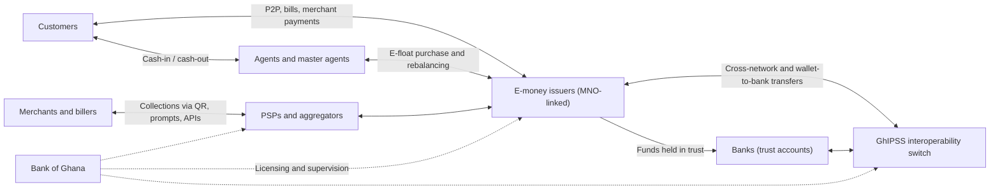

## Introduction

Mobile money has become one of the most visible features of Ghana's digital economy. Traders at Makola accept payment by phone, households receive remittances from relatives in other regions and abroad, and utility bills, school fees and airtime are paid from a wallet rather than with cash. Publications from the Bank of Ghana, GSMA and the World Bank have described Ghana as one of Africa's leading mobile money markets. Behind this everyday convenience lies an ecosystem of mobile network operators, e-money issuers, banks, agents, payment switches, merchants and regulators whose interactions determine how safe, affordable and inclusive the service is.

This lesson analyses that ecosystem as a system. You will identify each actor and its incentives, follow the flows of money and e-value, work through the liquidity problem that every agent faces, and examine how regulation and interoperability have shaped the market. The lesson describes the ecosystem in general terms; details such as licence categories, fees and limits change over time, so always consult current Bank of Ghana publications. It is educational material, not regulatory advice.

## Learning Objectives

- Identify the main actors in Ghana's mobile money ecosystem and explain their roles and incentives.
- Explain how e-money is created, backed by trust funds and redeemed through agents.
- Apply liquidity calculations to an agent's cash and e-float positions.
- Describe the Bank of Ghana's oversight role and the main legal instruments governing mobile money.
- Evaluate the significance of interoperability and the risks facing the ecosystem.

## Prerequisite Knowledge

- The Digital Finance lesson on mobile money and digital wallets.
- The payment security module, especially fraud types such as SIM swap and social engineering.

## Key Terminology

- **Mobile network operator (MNO)**: A telecommunications company providing mobile connectivity whose SIM and USSD channels underpin mobile money.
- **Electronic money issuer (EMI)**: An entity licensed to issue electronic money that is redeemable at par for cash; in Ghana, MNO mobile money services operate through dedicated licensed entities.
- **E-float**: The electronic value an agent holds in a wallet to serve cash-in transactions.
- **Agent**: A business licensed through an issuer's network to perform cash-in and cash-out and register customers on the issuer's behalf.
- **Trust account**: A bank account in which an issuer holds funds equal to outstanding e-money, protecting customer balances.
- **Interoperability**: The ability to transfer value between wallets of different issuers, and between wallets and bank accounts.
- **Tiered KYC**: An approach in which account limits rise as customers provide more identity verification.
- **Liquidity rebalancing**: Converting between cash and e-float so an agent can continue serving customers.

## Detailed Explanation

### The actors

| Actor | Role | Main incentives |
|---|---|---|
| Customers | Hold wallets; send, receive, pay and save | Convenience, low cost, safety, trust |
| MNOs and their e-money subsidiaries | Provide SIM, USSD and app channels; issue e-money; manage agent networks | Transaction fees, customer loyalty, data, cross-selling |
| Agents and master agents | Convert cash to e-value and back; register customers | Commissions; footfall for their main business |
| Banks | Hold trust accounts; provide wallet-to-bank links; partner on credit and savings | Deposits, new customers, fees |
| Payment switch (GhIPSS) | Operates national switching infrastructure including mobile money interoperability | Efficient, secure national payments |
| Payment service providers and aggregators | Connect merchants and billers to multiple wallets and cards | Merchant fees and value-added services |
| Merchants and billers | Accept wallet payments | Lower cash handling, faster collections |
| Bank of Ghana | Licenses, regulates and supervises payment systems and e-money | Stability, consumer protection, inclusion, integrity |

The three major MNO-linked services are associated with **MTN**, **Telecel** (formerly Vodafone Ghana) and **AT** (formerly AirtelTigo). Brand names have changed over time, which is itself a reminder to verify current details.

### How e-money works

When a customer gives an agent GHS 100 in cash, the agent transfers GHS 100 of e-float from their wallet to the customer's wallet. No new money is created: the agent already bought that e-float, so the cash simply changes hands. The issuer's obligation is to hold funds in **trust accounts** at banks equal to all outstanding e-money. This ring-fencing protects customers if the issuer fails, and is a defining difference between e-money and a bank deposit, which can be lent out. Ghanaian e-money rules have also provided for a share of the interest earned on trust balances to be passed to customers, an unusual feature compared with many markets.

### Agents and the liquidity problem

Agents are the ecosystem's physical interface. Their business depends on managing two pools of liquidity: **cash** and **e-float**. Cash-in transactions deplete e-float and increase cash; cash-out transactions do the reverse. An agent who runs out of either must turn customers away, damaging trust in the whole system. Master agents, bank branches and aggregator services help agents rebalance, but rebalancing costs time and carries security risk when moving cash.

### Regulation and oversight

The Bank of Ghana's oversight rests on several instruments. The **Payment Systems and Services Act, 2019 (Act 987)** provides the legal framework for licensing and supervising payment systems, electronic money issuers and payment service providers. Earlier **guidelines on e-money issuers and agents (2015)** set rules on trust accounts, agent conduct and KYC tiers. Related laws include the **Anti-Money Laundering Act, 2020 (Act 1044)**, the **Data Protection Act, 2012 (Act 843)** and the **Cybersecurity Act, 2020 (Act 1038)**. Supervisory concerns include safeguarding customer funds, fraud, agent conduct, consumer protection, data protection and the risk of excessive concentration in one provider.

Tax policy has also affected the ecosystem. The electronic transfer levy (E-Levy) introduced in 2022 generated public debate about the cost of digital transfers and its effect on usage; students should check its current status in official sources.

### Interoperability

Before interoperability, a customer on one network could not easily send money to a wallet on another. GhIPSS launched a mobile money interoperability platform in 2018, enabling transfers between wallets of different providers and between wallets and bank accounts. Interoperability strengthens network effects at the level of the whole market rather than one provider, reduces the need to hold several SIMs and supports merchant acceptance. The universal QR code (GhQR) extends the logic to merchant payments, allowing one code to accept payments from different wallets and bank apps.

## Theories, Frameworks and Models

### Two-sided platforms and network effects

Mobile money is a **multi-sided platform** connecting customers, agents and merchants. Its value to each side rises with participation on the other sides: customers join when many agents and merchants accept the service; agents and merchants join when many customers use it. These **cross-side network effects** explain why early providers invested heavily in agent networks and why the market tended towards concentration. Interoperability changes the strategic picture: when wallets connect, the network effect is partly shared, and competition shifts from network size to price, reliability, user experience and value-added services such as credit and savings.

### Ecosystem risk analysis

A structured view classifies ecosystem risks as:

- **Operational**: system outages, agent liquidity shortages, fraud.
- **Financial**: issuer failure (mitigated by trust accounts), bank risk on trust funds.
- **Conduct**: unclear fees, agent overcharging, mis-selling of digital loans.
- **Systemic**: concentration in one provider, dependence on mobile networks, cyber attacks.

## Worked Example

### Managing an agent's liquidity

**Illustrative scenario:** Efua runs a hypothetical mobile money kiosk in Cape Coast. She opens with **e-float GHS 2,000** and **cash GHS 1,500** (total liquidity GHS 3,500). Commissions are ignored for clarity.

| Time | Transaction | E-float | Cash |
|---|---|---|---|
| Opening | — | 2,000 | 1,500 |
| Morning | Cash-ins totalling 1,200 (traders depositing takings) | 800 | 2,700 |
| Midday | Cash-outs totalling 900 (customers withdrawing remittances) | 1,700 | 1,800 |
| Afternoon | Cash-ins totalling 1,000 | 700 | 2,800 |

**Analysis.**

1. Total liquidity stays at GHS 3,500 throughout: transactions change its **composition**, not its size.
2. By late afternoon e-float is only GHS 700. If a customer wants to deposit GHS 1,000, Efua cannot serve them.
3. **Rebalancing:** Efua deposits GHS 1,500 cash at a bank or with a master agent and receives e-float, moving to e-float GHS 2,200 and cash GHS 1,300.
4. **Pattern recognition:** trading areas often see cash-ins after market hours, while residential areas may see cash-outs around paydays and remittance peaks. Agents who anticipate patterns rebalance before running short.
5. **Risk:** carrying GHS 1,500 cash creates theft risk; digital rebalancing options reduce this exposure.

The example shows that agent viability depends on liquidity management as much as on commission rates, which is why issuers invest in master-agent structures and rebalancing tools.

## Ghanaian Business Application

For a Ghanaian SME, the ecosystem offers several entry points: a **merchant wallet** for collections, **interoperable payments** so customers on any network can pay, **QR acceptance** at the counter, **bulk disbursement** for paying suppliers and staff, and **wallet-to-bank sweeps** for moving collections into a business account. Analysing the ecosystem helps the SME decide whether to integrate directly with one issuer, use an aggregator that connects to all wallets and cards, or combine both. Key evaluation questions include fees on each side, settlement speed, reconciliation reports, reliability during peak periods and dispute handling.

The ecosystem perspective also reveals responsibilities. Merchants should display clear fees, avoid asking customers for PINs and train staff against social engineering. Agents in SMEs' premises must follow issuer rules on KYC and transaction records.

## International Case Study

### M-Pesa in Kenya

Safaricom launched **M-Pesa** in Kenya in 2007, and it became the most widely studied mobile money service in the world. Its growth was driven by a dense agent network, a simple "send money home" proposition for urban-to-rural remittances and a regulatory approach that allowed experimentation while requiring safeguards such as trust accounts. Research by Jack and Suri (2014) found that M-Pesa users were better able to smooth consumption in response to shocks because money could flow quickly through social networks. Suri and Jack (2016) reported evidence that access to mobile money was associated with long-run reductions in poverty, particularly for female-headed households.

The case highlights similarities and differences with Ghana. Both markets show the importance of agents and trust; however, Kenya's market was long dominated by a single provider, whereas Ghana's has several providers connected through national interoperability. Comparing the two invites analysis of how market structure and interoperability policy shape competition and inclusion.

## Diagram

## Common Misconceptions

- "Mobile money is the same as a bank account." E-money is backed by funds held in trust and is not lent out; it differs legally and prudentially from a bank deposit.
- "Agents create money when they perform cash-ins." Agents exchange cash for e-float they already hold; no new money is created.
- "Interoperability eliminates competition." It shifts competition from network size towards price, service quality and value-added services.
- "MNOs regulate mobile money." The Bank of Ghana licenses and supervises payment and e-money activities; MNOs and their subsidiaries are regulated entities.

## Common Examination Mistakes

- Listing actors without explaining flows of money and e-value between them.
- Stating precise fees, limits or market shares from memory instead of describing them qualitatively.
- Ignoring the liquidity problem when discussing agent networks.
- Confusing the payment switch (GhIPSS) with the regulator (Bank of Ghana).
- Treating the ecosystem as purely technological and omitting trust, conduct and regulation.

## Critical Thinking Questions

1. How does interoperability change the strategic value of a large agent network for an e-money issuer?
2. What are the risks of high concentration in one mobile money provider, and what policy tools could mitigate them?
3. How might transaction taxes on electronic transfers affect the balance between cash and digital payments, and which users are most sensitive?
4. Should agents be allowed to set their own fees? Discuss with reference to consumer protection and agent viability.

## Practical Exercises

1. **Ecosystem map.** Draw a stakeholder map of Ghana's mobile money ecosystem showing money flows, information flows and regulatory relationships. *Expected output:* a labelled diagram and a 200-word explanation.
2. **Agent liquidity simulation.** Create a hypothetical day of twelve transactions for an agent in a market town, and determine when and how much the agent should rebalance. *Expected output:* a transaction table with running balances and a rebalancing plan.
3. **Regulatory scan.** Visit the Bank of Ghana website and list the current categories of payment licences and any recent notices on mobile money. *Expected output:* a summary table citing each source and the date accessed.

## Key Takeaways

- Ghana's mobile money ecosystem comprises customers, MNO-linked issuers, agents, banks, GhIPSS, PSPs, merchants and the Bank of Ghana.
- E-money is backed by trust funds and redeemed through agents, who must manage cash and e-float liquidity.
- Act 987 and related laws underpin licensing, supervision, AML, data protection and cybersecurity.
- Interoperability and universal QR codes extend network effects across providers and support merchant acceptance.
- Ecosystem health depends on trust, conduct, liquidity and resilience as much as on technology.

## Further Reading

- Jack, W., & Suri, T. (2014). Risk sharing and transactions costs: Evidence from Kenya's mobile money revolution. *American Economic Review, 104*(1), 183–223.
- Suri, T., & Jack, W. (2016). The long-run poverty and gender impacts of mobile money. *Science, 354*(6317), 1288–1292.
- Demirgüç-Kunt, A., Klapper, L., Singer, D., & Ansar, S. (2022). *The Global Findex Database 2021: Financial inclusion, digital payments, and resilience in the age of COVID-19*. World Bank.
- Payment Systems and Services Act, 2019 (Act 987) (Ghana).
- Parker, G. G., Van Alstyne, M. W., & Choudary, S. P. (2016). *Platform revolution: How networked markets are transforming the economy and how to make them work for you*. W. W. Norton.

## Video Resources

- [GSMA](https://www.gsma.com/) — GSMA. Research, reports and events on mobile money and digital inclusion, including the State of the Industry reports.
- [Bank of Ghana](https://www.bog.gov.gh/) — Bank of Ghana. Official source for payment systems regulation, licensed institutions and notices.
- [GhIPSS](https://ghipss.net/) — Ghana Interbank Payment and Settlement Systems. Information on national payment infrastructure, including mobile money interoperability and GhQR.

## Revision Summary

Ghana's mobile money ecosystem links customers, MNO-linked e-money issuers, agents, banks holding trust accounts, the GhIPSS switch, PSPs, merchants and the Bank of Ghana. E-money is redeemable at par and ring-fenced in trust accounts. Agents exchange cash and e-float and must rebalance as cash-ins and cash-outs change the composition of their liquidity. Act 987 and laws on AML, data protection and cybersecurity frame oversight. Interoperability since 2018 and universal QR have shifted competition towards service quality.

- Actors, flows and incentives — map them.
- E-money ≠ deposit: trust accounts, no lending.
- Agent liquidity: total constant, composition shifts.
- Bank of Ghana regulates; GhIPSS switches.
- M-Pesa: dominant single provider; Ghana: interoperable multi-provider.
