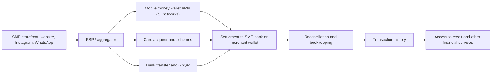

## Introduction

Small and medium-sized enterprises form the backbone of Ghana's private sector, from tailors and caterers to agro-processors and building-material suppliers. For many of them, digital commerce began informally: a WhatsApp catalogue, a mobile money number written on a shop sign, a Facebook page. Moving from these beginnings to a structured digital operation, with reliable payment acceptance, reconciled records and access to finance, is one of the most practical challenges an MSc IT for Business graduate may be asked to solve.

This lesson connects three themes. First, it presents a maturity view of SME digital commerce. Second, it explains the different kinds of **payment service providers (PSPs)** and how an SME should choose among them, using a weighted scoring model. Third, it examines **financial inclusion**: how digital payments can bring individuals and small firms into the formal financial system, and where they can fall short. The lesson is educational; it does not endorse any provider and is not financial or regulatory advice.

## Learning Objectives

- Assess an SME's digital commerce maturity using a staged model.
- Distinguish the roles of payment gateways, aggregators, acquirers, payment facilitators and wallet APIs.
- Apply a weighted scoring model to select a PSP and test the sensitivity of the result.
- Explain the dimensions of financial inclusion and how digital payment data can support SME credit.
- Evaluate the risks and limits of digital financial inclusion, including exclusion, over-indebtedness and consumer protection.

## Prerequisite Knowledge

- Lessons on Ghana's mobile money ecosystem and on digital payment adoption.
- The Digital Finance lesson on payment gateways and the transaction lifecycle.

## Key Terminology

- **Payment service provider (PSP)**: A firm that enables businesses to accept or make electronic payments, often bundling gateway, processing and settlement services.
- **Payment gateway**: The technology that captures payment details at checkout and routes them securely for authorisation.
- **Aggregator**: A provider that connects a merchant, through one integration, to many payment methods such as several mobile money wallets, cards and bank transfers.
- **Acquirer**: A bank or licensed institution that contracts with merchants to accept card payments and settles funds to them.
- **Payment facilitator**: A provider that onboards many small merchants under its own master merchant relationship, simplifying onboarding.
- **Know Your Business (KYB)**: Verification of a business's identity, ownership and legitimacy before onboarding.
- **Financial inclusion**: Access to and use of useful, affordable and responsibly delivered financial services by individuals and businesses.
- **Alternative data credit scoring**: Assessing creditworthiness using non-traditional data such as mobile money or sales transaction histories.

## Detailed Explanation

### A staged model of SME digital commerce

| Stage | Typical features | Main gap to the next stage |
|---|---|---|
| 1. Digital presence | Social media page, phone number, cash or personal wallet payments | No structured catalogue or payment records |
| 2. Social selling | WhatsApp Business catalogue, Instagram shop posts, merchant wallet | Manual order capture and reconciliation |
| 3. Marketplace participation | Listing on an online marketplace with its payment and delivery services | Dependence on platform fees and rules; limited customer data |
| 4. Own online store | Website or hosted store with integrated PSP checkout | Requires traffic generation, operations discipline |
| 5. Integrated omnichannel | Unified inventory, payments, CRM and accounting across channels | Ongoing optimisation and data use |

The model is diagnostic, not prescriptive. A caterer may rationally stay at stage 2 if WhatsApp orders suit its customers; the goal is fit, not maximum sophistication. However, moving at least from personal wallets to merchant collection accounts is almost always beneficial because it separates business and personal funds, creates records and improves reconciliation.

### The PSP landscape

Payment services can be unbundled into distinct roles. A **gateway** captures and routes payment data. An **acquirer** holds the card acceptance contract and settles to the merchant. An **aggregator** gives one integration to many methods: critical in Ghana, where customers use different mobile money networks as well as cards and bank transfers. A **payment facilitator** onboards small merchants quickly under its own master account. **Wallet APIs** from e-money issuers allow direct integration for collections (customer-to-business) and disbursements (business-to-customer). In practice, many PSPs combine several roles. Ghanaian businesses encounter local aggregators and international PSPs operating in the market; under the Payment Systems and Services Act, 2019 (Act 987), providers must be licensed or authorised by the Bank of Ghana, and an SME should verify this before signing up.

### What SMEs need from a PSP

An SME's requirements usually include: coverage of all major mobile money networks and cards; transparent fees; fast and predictable settlement into its bank or wallet; good settlement reports for reconciliation; plugins for common e-commerce platforms or clear APIs; payment links and invoices for social selling; dispute handling; reliable uptime; and responsive local support. Onboarding requires **KYB** documents such as business registration and identity of directors, which can be a barrier for informal firms.

Fee structures deserve careful reading. PSPs may charge a percentage per transaction, a fixed amount, a different rate for each payment method, or fees on withdrawals and settlements, and some pass mobile money charges to the customer. Settlement timing affects working capital: a business that waits several days for card settlements may need to finance stock in the meantime. An SME should therefore model total cost and cash-flow impact at its expected sales mix, not compare headline rates alone.

### Financial inclusion

Financial inclusion is commonly analysed along three dimensions: **access** (availability of services), **usage** (actual, regular use) and **quality** (affordability, suitability and consumer protection). The World Bank's Global Findex surveys have documented substantial growth in account ownership in Sub-Saharan Africa driven largely by mobile money accounts, while also highlighting persistent gaps, including gender gaps. GSMA research similarly emphasises the role of mobile money in inclusion and the barriers of handset access, literacy and trust.

For SMEs, digital payments create **data trails**. A history of regular mobile money receipts can demonstrate cash flow to lenders who would otherwise require collateral, enabling **alternative data credit scoring** and digital loans. This is a powerful inclusion mechanism, but it carries risks: digital loans can be expensive, terms may be unclear, rapid automated lending can encourage over-indebtedness, and firms without digital histories remain excluded. Responsible inclusion therefore requires transparent pricing, fair collection practices, data protection and financial literacy.

## Worked Example

### Selecting a PSP with weighted scoring

**Illustrative scenario:** Bead & Thread, a hypothetical Koforidua craft jewellery SME, sells via Instagram and a new website and plans to accept mobile money and cards. It shortlists three invented providers, A, B and C, and scores each from 1 (poor) to 5 (excellent).

| Criterion | Weight | A | B | C |
|---|---|---|---|---|
| Mobile money coverage across networks | 0.25 | 5 | 4 | 3 |
| Card acceptance | 0.15 | 4 | 5 | 2 |
| Fees | 0.20 | 3 | 4 | 5 |
| Settlement speed | 0.15 | 4 | 3 | 5 |
| APIs, plugins and payment links | 0.15 | 5 | 3 | 2 |
| Support and dispute handling | 0.10 | 3 | 4 | 4 |

**Step 1: Weighted scores.**

- A = 5×0.25 + 4×0.15 + 3×0.20 + 4×0.15 + 5×0.15 + 3×0.10 = 1.25 + 0.60 + 0.60 + 0.60 + 0.75 + 0.30 = **4.10**
- B = 4×0.25 + 5×0.15 + 4×0.20 + 3×0.15 + 3×0.15 + 4×0.10 = 1.00 + 0.75 + 0.80 + 0.45 + 0.45 + 0.40 = **3.85**
- C = 3×0.25 + 2×0.15 + 5×0.20 + 5×0.15 + 2×0.15 + 4×0.10 = 0.75 + 0.30 + 1.00 + 0.75 + 0.30 + 0.40 = **3.50**

Provider A ranks first.

**Step 2: Sensitivity analysis.** Suppose the owner decides she will rely on payment links rather than plugins, so APIs drop to 0.05 and fees rise to 0.30.

- A = 1.25 + 0.60 + 0.90 + 0.60 + 0.25 + 0.30 = **3.90**
- B = 1.00 + 0.75 + 1.20 + 0.45 + 0.15 + 0.40 = **3.95**
- C = 0.75 + 0.30 + 1.50 + 0.75 + 0.10 + 0.40 = **3.80**

Provider B now edges ahead. The ranking is **sensitive to weights**, so the decision depends on a clear view of the business's priorities. Scores should be backed by evidence such as published fee schedules, trial integrations and references. Finally, the weighted model should be accompanied by **hard constraints**: any provider that is not licensed or authorised, or cannot produce reconciliation reports, is excluded regardless of score.

## Ghanaian Business Application

Ghana has several enablers for SME digital commerce. Mobile money interoperability lets a merchant receive payments from customers on any network; the universal QR code (GhQR) allows one code for multiple wallets and bank apps; the Ghana Card supports KYC; and GhanaPostGPS supports delivery addressing. Government programmes have promoted digitalisation of public services, increasing everyday familiarity with digital payments.

Barriers remain. Many SMEs are informal and struggle with KYB requirements; some owners worry that digital records will expose them to taxation, which can discourage formalisation; connectivity and power interruptions affect reliability; and digital skills vary. A practical inclusion strategy for an SME adviser is incremental: start with a merchant wallet and order references, add an aggregator payment link, introduce simple bookkeeping software, then use the resulting transaction history to approach lenders. Throughout, the adviser should emphasise data protection under the Data Protection Act, 2012 (Act 843) and caution about high-cost digital credit.

## International Case Study

### Brazil's Pix

The Central Bank of Brazil launched **Pix**, an instant payment system, in November 2020. Pix allows individuals and businesses to send and receive payments at any time, using keys such as phone numbers or tax identifiers, or QR codes. The central bank required large financial institutions to participate, and person-to-person transfers for individuals were generally free, while merchants paid low fees. Pix was widely reported to have been adopted very quickly by both consumers and small businesses, including informal vendors who previously relied on cash or costly card machines.

For SME inclusion, Pix illustrates how a public, interoperable, low-cost payment rail can lower acceptance costs and create digital records for small firms. Its lessons for Ghana include the value of mandated participation, simple identifiers and QR codes, and the need to manage fraud risks, which rose as instant irreversible payments became popular.

## Diagram

## Common Misconceptions

- "Every SME should build its own online store." The right stage depends on customers, products and capacity; social selling with good payment practices may be optimal.
- "The cheapest PSP is the best PSP." Coverage, settlement speed, reporting and support can matter more than headline fees.
- "Having an account means a person is financially included." Inclusion also requires regular usage and quality, affordable, well-protected services.
- "Digital credit always benefits small businesses." Expensive or poorly disclosed loans can trap borrowers in debt.

## Common Examination Mistakes

- Using "PSP" and "gateway" interchangeably without explaining distinct roles.
- Presenting a weighted scoring model without sensitivity analysis or evidence for scores.
- Defining financial inclusion only as account ownership.
- Ignoring the informality and KYB barriers facing many Ghanaian SMEs.
- Inventing statistics on SME numbers or inclusion rates.

## Critical Thinking Questions

1. Should regulators require PSPs to offer simplified onboarding for informal micro-businesses? What risks would this introduce?
2. How could transaction data from mobile money be used to extend credit to SMEs fairly and without discrimination?
3. To what extent could a Pix-style public rail complement Ghana's existing mobile money interoperability?
4. Is the staged maturity model too linear for SMEs that sell mainly through social media?

## Practical Exercises

1. **Maturity assessment.** Choose a hypothetical or anonymised SME and assess its stage using the five-stage model. *Expected output:* a stage rating, evidence for it and three actions to reach the next appropriate stage.
2. **PSP selection.** Build a weighted scoring model for three real PSPs operating in Ghana using only publicly available information, and run one sensitivity test. *Expected output:* a scoring table, sources and a recommendation; note that it is not an endorsement.
3. **Inclusion brief.** Write a 300-word brief on how a women's market traders' association could use digital payments to strengthen access to credit, including safeguards. *Expected output:* a structured brief with benefits, risks and safeguards.

## Key Takeaways

- SME digital commerce progresses through stages; the goal is fit, not maximum sophistication.
- Gateways, aggregators, acquirers, payment facilitators and wallet APIs perform distinct roles, often bundled.
- PSP selection should use weighted criteria, evidence, hard constraints and sensitivity analysis.
- Financial inclusion spans access, usage and quality; digital payment data can unlock SME credit.
- Inclusion carries risks of exclusion, over-indebtedness and data misuse that require safeguards.

## Further Reading

- Demirgüç-Kunt, A., Klapper, L., Singer, D., & Ansar, S. (2022). *The Global Findex Database 2021: Financial inclusion, digital payments, and resilience in the age of COVID-19*. World Bank.
- Laudon, K. C., & Traver, C. G. (n.d.). *E-commerce: Business, technology, society*. Pearson. (Consult the chapters on e-commerce payment systems in the latest edition.)
- Suri, T., & Jack, W. (2016). The long-run poverty and gender impacts of mobile money. *Science, 354*(6317), 1288-1292.
- Osterwalder, A., & Pigneur, Y. (2010). *Business model generation: A handbook for visionaries, game changers, and challengers*. Wiley.
- Payment Systems and Services Act, 2019 (Act 987) (Ghana).

## Video Resources

- [CGAP](https://www.cgap.org/): CGAP. Research and publications on financial inclusion, digital finance and consumer protection.
- [Global Findex Database](https://www.worldbank.org/en/publication/globalfindex): World Bank. Data and reports on account ownership, digital payments and inclusion gaps.
- [Banco Central do Brasil](https://www.bcb.gov.br/en): Central Bank of Brazil. Official information on the Pix instant payment system.

## Revision Summary

SME digital commerce moves from digital presence through social selling, marketplaces and own stores to omnichannel integration, with merchant collection accounts an early priority. PSP roles include gateways, aggregators, acquirers, payment facilitators and wallet APIs; selection should combine weighted scoring, evidence, hard constraints such as licensing and sensitivity analysis. Financial inclusion covers access, usage and quality; digital transaction histories can open credit for SMEs, but risks of exclusion, costly credit and data misuse require safeguards, as public rails such as Pix illustrate.

- Fit over sophistication.
- Aggregators matter in multi-wallet markets.
- Weighted score + sensitivity + hard constraints.
- Inclusion = access + usage + quality.
- Data trails enable credit: protect borrowers.
