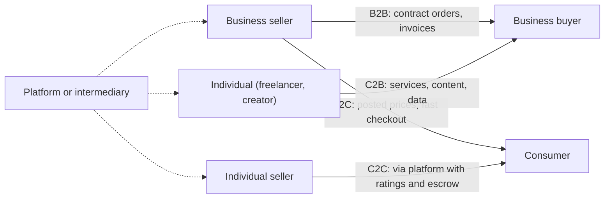

## Introduction

When people think of e-commerce they usually picture a consumer buying a phone or a dress online. That is only one of several models. A large share of digitally enabled trade happens between businesses: manufacturers ordering raw materials, supermarkets replenishing stock from distributors, hospitals procuring medicines through tender portals. Meanwhile, individuals sell second-hand goods to one another on classified sites, and freelancers sell their skills to companies through online work platforms.

Classifying e-commerce by *who sells to whom* is not merely an academic exercise. Each model has different transaction sizes, buying processes, pricing mechanisms, payment methods, trust problems and technology needs. A payment solution that suits a consumer paying GHS 80 for a meal is unsuitable for a distributor settling a GHS 400,000 invoice on 60-day credit terms. This lesson compares the four principal models, B2B, B2C, C2C and C2B, and shows how to apply the classification analytically.

## Learning Objectives

- Define B2B, B2C, C2C and C2B e-commerce and identify the participants in each.
- Compare the four models on transaction size, buying process, pricing, payment and trust.
- Explain the main forms of B2B e-commerce, including e-procurement, private industrial networks and B2B marketplaces.
- Apply the classification to real and illustrative Ghanaian businesses.
- Evaluate the risks and success factors specific to each model.

## Prerequisite Knowledge

- The definitions of e-commerce and e-business (Module 1).
- The revenue models introduced in the online business models lesson.

## Key Terminology

- **B2B (business-to-business)**: E-commerce in which businesses sell goods or services to other businesses.
- **B2C (business-to-consumer)**: E-commerce in which businesses sell to individual consumers.
- **C2C (consumer-to-consumer)**: E-commerce in which individuals sell to other individuals, usually through a platform that provides listings, trust and payment services.
- **C2B (consumer-to-business)**: E-commerce in which individuals offer products, services or information to businesses, which pay them.
- **E-procurement**: The use of digital systems to manage the purchasing process, from requisition and supplier selection to ordering, receipt and payment.
- **Electronic Data Interchange (EDI)**: The computer-to-computer exchange of structured business documents, such as purchase orders and invoices, in standard formats.
- **Private industrial network**: A digital network, usually owned by a large firm, that coordinates transactions and collaboration with its own suppliers and partners.
- **Escrow**: An arrangement in which a trusted third party holds payment until the buyer confirms satisfactory delivery.

## Detailed Explanation

### B2C: business-to-consumer

B2C is the most visible model. Sellers include *e-tailers* (online-only retailers), *omnichannel retailers* (physical stores with online channels), *manufacturers selling direct*, *content providers* and *service providers* such as ride-hailing and food delivery. Transactions are typically small in value, high in volume and made by individuals who decide quickly and often emotionally. Success depends on customer experience, brand trust, convenient payment and reliable delivery. Marketing costs are high because each customer must be acquired individually.

### B2B: business-to-business

B2B differs from B2C in almost every dimension. Orders are larger and repeated; buying involves several people (a *buying centre* of users, budget holders, procurement officers and approvers); prices are often negotiated or set by contract; payment is commonly on credit terms by bank transfer or invoice; and relationships last years. Laudon and Traver note that B2B e-commerce is far larger in value than B2C, although less visible.

B2B takes several forms:

1. **Direct selling by a firm** through a dedicated portal where registered business customers see contract prices and place orders.
2. **E-procurement** systems in the buying firm that route requisitions for approval, match purchase orders against invoices and goods-received notes (*three-way matching*), and pay suppliers.
3. **EDI and integrations** linking buyer and supplier systems directly, so that orders and invoices flow without re-keying.
4. **B2B marketplaces (exchanges)** where many buyers and sellers in an industry meet; examples include wholesale platforms such as Alibaba.com.
5. **Private industrial networks** owned by a large firm to coordinate its supply chain, for example a retailer sharing sales data with suppliers so that they can replenish stock.

### C2C: consumer-to-consumer

In C2C, individuals sell to individuals. The platform rarely owns the goods. Its role is to provide listings, search, a reputation system, communication and sometimes payment protection. The central problem in C2C is **trust between strangers**: the buyer fears paying for goods that never arrive; the seller fears delivering goods that are never paid for. Platforms address this with ratings, identity verification, escrow-style payment holding and dispute resolution. Revenue typically comes from listing fees, commissions, promoted listings or advertising.

### C2B: consumer-to-business

C2B reverses the usual flow. Individuals supply value to businesses: a freelance designer sells logo work to companies through an online work platform; a photographer licenses images to a stock photo site used by businesses; a social media creator is paid by brands to promote products; consumers sell their opinions through paid survey panels. Some reverse-auction models, in which consumers name a price and businesses decide whether to accept it, are also described as C2B. Success depends on the platform verifying quality and ensuring that individuals are paid reliably.

### Related models

Textbooks also describe **B2G/G2B** (businesses selling to government, for example through electronic tendering), **G2C** (government services to citizens, such as online payment of fees) and **mobile commerce (m-commerce)**, which is a *channel* rather than a separate party model. In Ghana, m-commerce is especially important because many consumers access the internet mainly through smartphones.

## Theories, Frameworks and Models

### A comparative framework

The table below provides a structured comparison that can be reproduced in examinations.

| Dimension | B2B | B2C | C2C | C2B |
|---|---|---|---|---|
| Seller | Business | Business | Individual | Individual |
| Buyer | Business | Individual consumer | Individual | Business |
| Typical transaction value | High | Low to medium | Low | Low to medium |
| Buying process | Rational, multi-person, approval workflows | Individual, fast, often emotional | Individual, negotiation common | Business evaluates individual's offer |
| Pricing | Negotiated, contract, volume tiers | Posted list prices, promotions | Seller-set, auctions or negotiation | Fee per task, licence or bid |
| Common payment | Bank transfer, invoice on credit terms | Card, mobile money, pay on delivery | Mobile money, platform-held payment | Platform payout, bank transfer |
| Main trust problem | Supplier reliability, contract compliance | Product quality and delivery | Fraud between strangers | Quality of work and timely payment |
| Key technologies | ERP integration, EDI, APIs, e-procurement | Storefront, catalogue, gateway, CRM | Listings, reputation systems, messaging, escrow | Work platforms, portfolio and rating systems |
| Example | A distributor's reseller ordering portal | An online fashion retailer | A classified-ads site for used goods | A freelance work platform |

### Transaction cost reasoning

A helpful theoretical lens is **transaction cost economics**, associated with Coase and Williamson, which argues that firms choose governance structures that minimise the costs of searching, negotiating, contracting and monitoring. Digital technology reduces many of these costs. In B2B, integration reduces the cost of processing orders and invoices; in C2C, reputation systems reduce the cost of assessing an unknown seller. Analysing *which* transaction costs a model reduces helps explain its value.

## Diagram

The dotted lines show that intermediaries frequently sit between parties, providing search, trust and payment services.

## Worked Example

**Illustrative scenario.** *Ama Agro Inputs* is a hypothetical company in Techiman that distributes fertiliser, seed and crop-protection products. Its managing director wants to know which e-commerce model to prioritise. It has three groups of customers: (1) 400 agro-input retailers across the Bono East and Ashanti regions that order monthly; (2) individual smallholder farmers who visit the warehouse; and (3) a regional government programme that issues tenders for subsidised inputs.

**Step 1 – Classify the relationships.** Retailers are B2B; farmers are B2C; the government programme is B2G.

**Step 2 – Compare value.** Suppose each retailer orders an average of GHS 15,000 per month (illustrative assumption). Annual B2B value = `400 × 15,000 × 12 = GHS 72,000,000`. Even if farmers buy far more often, their individual purchases are small. The B2B channel is where digital efficiency yields most value.

**Step 3 – Design the B2B solution.** A reseller ordering portal or a WhatsApp-integrated ordering system should show each retailer its negotiated prices and credit limit, allow reordering of previous baskets, and generate invoices automatically. Payment options should include bank transfer and mobile money for smaller retailers, with credit terms tracked against limits.

**Step 4 – Address B2C separately.** For farmers, the priority is not a website but a simple channel suited to their context: USSD or SMS price information, mobile money payment at the warehouse and perhaps orders through agro-dealers rather than direct delivery.

**Step 5 – Evaluate.** The B2B portal reduces order processing errors, speeds up collections and improves demand visibility. Risks include low adoption by retailers accustomed to phone ordering, so training and incentives (for example faster dispatch for portal orders) are needed.

The analysis shows that classifying customers by model leads directly to different technology and payment choices.

## Ghanaian Business Application

All four models are visible in Ghana. **B2C** includes marketplaces such as Jumia and many independent online shops and social commerce sellers, with mobile money and payment on delivery as common payment methods. **B2B** activity includes distributors taking orders from retailers digitally, manufacturers integrating with suppliers, and banks and payment providers offering bulk payment services that businesses use to pay suppliers and staff. **C2C** occurs on classified-ads websites and especially on social media groups and WhatsApp, where individuals sell used phones, cars and household goods; the trust problem is acute here, and buyers are commonly advised to inspect goods before paying. **C2B** is growing through freelancing platforms used by Ghanaian designers, developers and writers who sell services to businesses at home and abroad, and through social media creators paid by brands for promotion.

Ghana's government has also expanded **G2B** and **G2C** digital services. Electronic public procurement and online payment of fees are examples of how the state participates in e-commerce. When analysing these models in Ghana, consider payment realities (mobile money versus cards), the strength of trust mechanisms and the role of informal channels such as WhatsApp that blur the boundary between C2C and small-scale B2C.

## International Case Study

### Alibaba Group: multiple models within one ecosystem

Alibaba, founded in 1999 in Hangzhou, China, by Jack Ma and colleagues, illustrates how a single group can operate several e-commerce models. **Alibaba.com** began as a B2B marketplace connecting Chinese manufacturers with business buyers worldwide. **Taobao**, launched in 2003, was a C2C marketplace on which individuals and small merchants sold to consumers. **Tmall** later provided a B2C marketplace for established brands.

Alibaba's treatment of the C2C trust problem is especially instructive. In 2004 it introduced **Alipay**, which initially functioned as an escrow-style service: the buyer's payment was held until the buyer confirmed receipt of goods, protecting both parties. This addressed the central weakness of C2C trade between strangers and became the foundation for a major digital payments business. The case shows that (1) different models require different value propositions and revenue streams; (2) trust mechanisms are a decisive success factor in C2C; and (3) a payment innovation designed to solve an e-commerce problem can grow into a FinTech business in its own right, a theme developed in Module 4.

## Common Misconceptions

- **Misconception:** B2C is the largest form of e-commerce by value. **Correction:** B2B e-commerce is generally far larger by value, even though it is less visible to consumers.
- **Misconception:** C2C platforms own and sell the goods. **Correction:** C2C platforms usually only facilitate transactions between individuals by providing listings, trust and payment services.
- **Misconception:** M-commerce is a fifth party model alongside B2B and B2C. **Correction:** M-commerce is a channel; a mobile transaction can be B2C, C2C, B2B or C2B.
- **Misconception:** B2B e-commerce is simply B2C with bigger orders. **Correction:** B2B involves multi-person buying centres, negotiated prices, credit terms, approval workflows and system integration.
- **Misconception:** C2B is only about reverse auctions. **Correction:** It includes freelancing, content licensing, influencer services and data supplied by individuals to firms.

## Common Examination Mistakes

- Defining the models without comparing them on clear dimensions such as value, buying process, pricing, payment and trust.
- Using only international examples when the question asks for Ghanaian application.
- Classifying a marketplace by its name rather than by who is selling to whom on it.
- Ignoring payment and credit differences between B2B and B2C.
- Failing to identify the trust problem and the mechanisms that address it in C2C.

## Critical Thinking Questions

1. Many small Ghanaian sellers on WhatsApp are individuals running informal businesses. Should their sales be classified as C2C or B2C, and why does the classification matter for regulation and consumer protection?
2. Why has B2B e-commerce in many developing economies been slower to adopt full system integration than B2C has been to adopt social media selling?
3. Can reputation systems fully solve the trust problem in C2C markets? What are their weaknesses?
4. How might C2B freelancing platforms affect the Ghanaian labour market for graduates?

## Practical Exercises

1. **Classification table.** Identify eight digital transactions you or your organisation took part in over the past month and classify each as B2B, B2C, C2C, C2B, B2G or G2C, noting the payment method used. *Expected output:* an eight-row table with classification, payment method and a one-line justification.
2. **B2B process map.** Map the purchasing process of an organisation you know from requisition to payment, then identify which steps an e-procurement system could automate. *Expected output:* a flowchart and a list of at least four automation opportunities, including three-way matching.
3. **Trust design.** Design trust mechanisms for an illustrative C2C platform for used phones in Ghana. *Expected output:* a one-page design covering identity verification, ratings, payment holding and dispute resolution, with one limitation of each mechanism.

## Key Takeaways

- E-commerce models are classified by who sells to whom: B2B, B2C, C2C and C2B, plus government variants.
- B2B is larger by value and features negotiated prices, credit terms, buying centres and system integration.
- B2C emphasises customer experience, fast checkout and delivery.
- C2C depends on platforms solving the trust problem with ratings, verification and escrow-style payment.
- C2B covers individuals supplying services, content or data to businesses.
- Each model implies different technology and payment choices.

## Further Reading

- Laudon, K. C., & Traver, C. G. *E-commerce: Business, technology, society*. Pearson. (Consult the most recent edition available in your library.)
- Chaffey, D., Hemphill, T., & Edmundson-Bird, D. (2019). *Digital business and e-commerce management* (7th ed.). Pearson.
- Williamson, O. E. (1985). *The economic institutions of capitalism*. Free Press.
- UNCTAD. E-commerce and the digital economy. <https://unctad.org/topic/ecommerce-and-digital-economy>

## Video Resources

- [UNCTAD E-commerce and Digital Economy](https://unctad.org/topic/ecommerce-and-digital-economy) — UNCTAD. Official topic page with publications on e-commerce models and readiness in developing countries.
- [MIT OpenCourseWare](https://ocw.mit.edu/) — Massachusetts Institute of Technology. Official open learning portal; search for supply chain and digital business materials relevant to B2B e-commerce.

## Revision Summary

E-commerce models are defined by the parties involved. B2B is the largest by value and involves negotiated prices, credit, buying centres and integration through e-procurement, EDI and portals. B2C focuses on individual consumers, experience and fast checkout. C2C relies on platforms to solve the trust problem between strangers, while C2B reverses the flow so that individuals supply value to businesses.

- Compare models on value, buying process, pricing, payment, trust and technology.
- M-commerce is a channel, not a party model.
- Escrow-style payment (for example early Alipay) addresses C2C trust.
- Transaction cost economics explains why digital tools create value in each model.
- In Ghana, mobile money, WhatsApp selling and freelancing platforms shape all four models.
