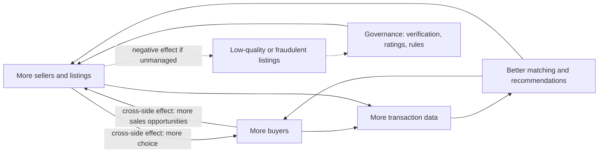

## Introduction

Many of the most valuable firms of the digital era own few of the products or services exchanged through them. Ride-hailing companies do not employ most of their drivers as traditional staff, accommodation platforms own few rooms, and marketplaces may hold little inventory. Their value lies in **orchestrating interactions** between groups of users: drivers and riders, hosts and guests, sellers and buyers. These are *platform businesses*, and they follow economic logic that differs sharply from that of a traditional retailer or manufacturer.

This lesson explains that logic. You will study two-sided markets and network effects, the "chicken-and-egg" problem of launching a platform, how platforms set prices across sides, and how they govern participants to maintain quality and trust. The ideas draw on Rochet and Tirole's economic analysis of two-sided markets and Parker, Van Alstyne and Choudary's *Platform Revolution*. The aim is to enable you to evaluate platform strategies, including those of marketplaces operating in Ghana, rather than simply admire their growth.

## Learning Objectives

- Distinguish pipeline businesses from platform businesses and marketplaces from resellers.
- Explain same-side and cross-side network effects, including negative network effects.
- Analyse platform pricing decisions using the concept of a two-sided market.
- Apply strategies for solving the chicken-and-egg problem to a platform launch.
- Evaluate platform governance, multi-homing and market power concerns.

## Prerequisite Knowledge

- The B2B, B2C, C2C and C2B models (previous lesson).
- The Business Model Canvas and revenue models (Module 1).

## Key Terminology

- **Pipeline business**: A firm that creates value in a linear sequence, buying inputs, transforming them and selling outputs to customers.
- **Platform business**: A firm that creates value by facilitating interactions between two or more interdependent groups of users.
- **Two-sided (multi-sided) market**: A market in which a platform serves distinct user groups whose benefit from the platform depends on participation by the other group(s).
- **Network effect**: The impact that the number of users of a platform has on the value each user obtains.
- **Cross-side network effect**: The effect of the number of users on one side (for example sellers) on the value obtained by users on the other side (for example buyers).
- **Same-side network effect**: The effect of the number of users on one side on the value obtained by others on the same side.
- **Multi-homing**: Users participating in several competing platforms at the same time.
- **Platform governance**: The rules, incentives and enforcement mechanisms by which a platform controls who participates, how they behave and how value is shared.

## Detailed Explanation

### Pipelines and platforms

Parker, Van Alstyne and Choudary (2016) contrast **pipelines** with **platforms**. A pipeline creates value by controlling a linear chain of activities, as when a retailer buys stock and sells it at a margin. A platform creates value by connecting external producers and consumers and facilitating their interactions. Its key assets are not inventory or factories but its *community* and the data and tools that enable matching.

The distinction between a **reseller** and a **marketplace** is the e-commerce expression of this difference. A reseller (merchant model) takes ownership of goods, sets prices and bears inventory risk. A marketplace allows third-party sellers to list goods, typically earning a commission, while sellers retain ownership and pricing decisions. Many firms are hybrids: Amazon both sells its own stock and hosts third-party sellers, and some African marketplaces combine first-party retail with third-party listings.

### The core interaction

Parker and colleagues argue that a platform should be designed around a **core interaction**, consisting of participants (producer and consumer), a *value unit* (a listing, a ride request, a video) and a *filter* (the algorithm or search that shows each consumer relevant value units). The platform performs three functions: **pull** (attracting users), **facilitate** (making interactions easy, for example through payment and messaging tools) and **match** (connecting the right producers and consumers using data).

### Network effects

Network effects are the main source of platform value. Katz and Shapiro (1985) analysed *network externalities*, where the value of a product to one user depends on how many others use it, such as telephones. Platforms add a two-sided dimension:

| Type | Positive example | Negative example |
|---|---|---|
| Cross-side | More sellers give buyers more choice; more buyers attract more sellers | Too many low-quality sellers reduce buyer trust |
| Same-side | More users of a messaging app make it more useful to each user | More drivers on the same side compete for each fare, reducing earnings |

Positive cross-side effects create a **virtuous circle**: buyers attract sellers, who attract more buyers. This circle explains why platforms can grow rapidly and why markets may tend towards a few dominant platforms. However, network effects are not automatically positive. Congestion, spam, fraud and declining quality are **negative network effects**, and much of platform management consists of preventing them.

### The chicken-and-egg problem

A new platform has little value to either side because neither side is present. Buyers will not visit a marketplace without sellers, and sellers will not list without buyers. Strategies identified in the platform literature include:

1. **Subsidise one side**, for example free listings for sellers or discounts for early buyers.
2. **Seed the platform** with the platform's own supply (acting as a reseller first).
3. **Follow the rabbit**: start with a small, dense niche where both sides are easy to bring together, such as one university campus or one city.
4. **Piggyback** on an existing user base, such as an established social network or messaging community.
5. **Create stand-alone value** for one side, such as free inventory or booking software for sellers, so that they join even before buyers arrive.

### Multi-homing and competition

If users can easily use several platforms at once (multi-homing), network effects provide weaker protection. Many drivers in cities with several ride-hailing apps run more than one app simultaneously, and many riders compare prices. Platforms respond with loyalty incentives, exclusive features or differentiated service. Where switching costs are low and multi-homing is common, markets can remain competitive despite network effects.

## Theories, Frameworks and Models

### Rochet and Tirole: pricing in two-sided markets

Rochet and Tirole (2003), in "Platform competition in two-sided markets", showed that platforms must choose not only the *level* of prices but their *structure* across sides. Because each side's participation creates value for the other, it can be rational to charge one side little or nothing, or even to subsidise it, while charging the other side more. Their analysis was motivated partly by payment cards, where cardholders often pay little while merchants pay fees, and it applies equally to marketplaces and software platforms.

The side that is usually subsidised is the one that is more **price-sensitive** and whose presence creates more value for the other side. The side that pays is the one that values access to the subsidised side highly and is less sensitive to price. Getting this wrong can stall the virtuous circle.

### Platform governance

Parker and colleagues stress that platforms must govern their ecosystems. Governance tools include:

- **Curation and access rules** – who may join, and with what verification.
- **Reputation systems** – ratings and reviews that reward good behaviour.
- **Payment and dispute rules** – holding funds until delivery, refund policies.
- **Algorithms and ranking** – which listings are shown first, which shapes behaviour.
- **Value sharing** – commission levels that leave producers enough reward to stay.

Good governance balances openness (to grow supply) with quality control (to prevent negative network effects). Governance also raises ethical and regulatory questions: platforms that rank their own products above those of rival sellers, or that change commission levels once sellers depend on them, face criticism and, in some jurisdictions, regulatory scrutiny.

## Diagram

The solid loop is the virtuous circle; the dotted path shows how governance counters negative network effects.

## Worked Example

**Illustrative scenario.** *TutorLink GH* is a hypothetical platform that connects private tutors with parents of senior high school students in Accra and Kumasi. Analyse its launch strategy.

**Step 1 – Identify the sides and core interaction.** Producers: tutors. Consumers: parents (and students). Value unit: a tutor profile with subjects, availability and ratings. Core interaction: a parent books and pays for a tutoring session.

**Step 2 – Identify network effects.** Cross-side: more tutors give parents better choice by subject and location; more parents give tutors more bookings. Same-side: more tutors in the same subject compete for bookings (negative same-side effect); more parents may create positive same-side effects through reviews.

**Step 3 – Choose which side to subsidise.** Parents are price-sensitive about platform fees but highly value trusted, vetted tutors; tutors value a steady flow of bookings. TutorLink decides to let parents search and book free and to charge tutors a 15 per cent commission on sessions, consistent with Rochet and Tirole's logic of charging the side that values access more and is less price-sensitive to the fee.

**Step 4 – Solve chicken-and-egg.** Start in a dense niche: final-year science and mathematics tutoring in two Accra districts. Recruit 40 vetted tutors before launch and offer them zero commission for the first three months (subsidy and seeding). Give tutors free scheduling and payment tools (stand-alone value).

**Step 5 – Check the economics.** If, after launch, 300 sessions a month are booked at an average of GHS 150, monthly gross transaction value = `300 × 150 = GHS 45,000`, and commission revenue at 15 per cent = `45,000 × 0.15 = GHS 6,750`. (Figures are illustrative assumptions.)

**Step 6 – Governance and risks.** Risks include disintermediation (parents and tutors arranging sessions privately after the first meeting to avoid commission), safeguarding of minors and quality variation. Mitigations: in-platform scheduling, payment protection and session records that give both sides reasons to stay; background checks; ratings and refund policies. This illustrates that a platform must keep delivering value *after* matching, or users will leave.

## Ghanaian Business Application

Platform models are well established in Ghana. **Ride-hailing** services such as Uber and Bolt operate in Accra and other cities, connecting drivers and riders and earning commissions on trips; they show multi-homing in practice, as many drivers and riders use more than one app. **E-commerce marketplaces** such as Jumia, which has operated in Ghana, aggregate third-party sellers and provide payment and delivery services. **Food and parcel delivery platforms** connect restaurants, couriers and customers in a three-sided arrangement.

Mobile money itself has platform characteristics. An operator's mobile money service connects customers, merchants and agents, and the value to each customer rises as more merchants and recipients accept it (a cross-side network effect). The introduction of interoperability between mobile money networks and banks in Ghana, discussed in Module 4, reduced the advantage that the largest network gained from its size and increased the value of the whole system to users.

Local conditions influence platform design. Trust concerns favour strong governance (verification, ratings and payment holding). Informal arrangements make disintermediation a real risk: once a buyer has a trader's phone number, they may transact directly via WhatsApp. Platforms that provide ongoing value, such as payment protection, delivery tracking and credit, are better placed to retain users.

## International Case Study

### Airbnb: building trust in a two-sided accommodation market

Airbnb was founded in 2008 in San Francisco and connects hosts who offer accommodation with guests who need it. It owns few properties; its value lies in matching and in making strangers comfortable enough to stay in each other's homes.

The case illustrates several platform concepts. The **chicken-and-egg** problem was acute: guests would not come without listings, and hosts would not list without guests. The company's early efforts included working directly with hosts to improve listings, a form of seeding supply quality. **Governance** has been central: two-way reviews after each stay, host and guest profiles, identity verification and payment held by the platform until after check-in reduce the risk of fraud. **Cross-side network effects** are strong: more listings attract more guests, which in turn attract more hosts.

The case also highlights **negative externalities beyond the platform**. Many cities have debated the impact of short-term rentals on housing availability and neighbourhoods, and several have introduced rules such as registration requirements or limits on rental days. This demonstrates that platform governance is not only internal: platforms operate within public regulation, and their growth can provoke policy responses that reshape the business model.

## Common Misconceptions

- **Misconception:** Every website that sells products is a platform. **Correction:** A reseller that buys and sells its own stock is a pipeline; a platform facilitates interactions between external producers and consumers.
- **Misconception:** Network effects are always positive. **Correction:** Congestion, fraud and low quality create negative network effects that must be governed.
- **Misconception:** Charging both sides equally is the fairest and most effective pricing. **Correction:** Rochet and Tirole show that the price structure across sides matters, and subsidising one side is often optimal.
- **Misconception:** Network effects guarantee a permanent monopoly. **Correction:** Multi-homing, low switching costs, poor governance and regulation can all erode a leading platform's position.
- **Misconception:** Once users are matched, the platform's job is done. **Correction:** Without ongoing value, users disintermediate and transact directly.

## Common Examination Mistakes

- Describing network effects without distinguishing cross-side from same-side effects.
- Citing Rochet and Tirole without explaining price structure and the subsidised side.
- Discussing platform growth without considering governance, quality and negative effects.
- Ignoring multi-homing and disintermediation risks in local markets.
- Treating marketplaces and resellers as identical when analysing revenue and risk.

## Critical Thinking Questions

1. In a Ghanaian ride-hailing market where most drivers multi-home, what sources of competitive advantage remain for a platform?
2. Should regulators treat a dominant marketplace that also sells its own products differently from one that only hosts third-party sellers? Why?
3. Under what conditions would subsidising sellers rather than buyers be the better launch strategy for a B2C marketplace?
4. Does mobile money interoperability strengthen or weaken network effects for individual operators, and who gains?

## Practical Exercises

1. **Network effect map.** Choose a platform used in Ghana and draw its sides, core interaction and network effects (positive and negative, same-side and cross-side). *Expected output:* a labelled diagram and a 250-word explanation.
2. **Pricing decision.** For an illustrative marketplace connecting artisans with hotel buyers, decide which side to subsidise and justify using Rochet and Tirole's reasoning. *Expected output:* a pricing proposal with fees for each side and a justification addressing price sensitivity and cross-side value.
3. **Disintermediation defence.** List five features that would discourage users of the illustrative TutorLink GH platform from bypassing it. *Expected output:* five features, each with the value it gives both sides and one drawback.

## Key Takeaways

- Platforms create value by orchestrating interactions between external producers and consumers rather than by controlling a linear pipeline.
- Cross-side and same-side network effects, positive and negative, drive platform dynamics.
- Price structure across sides matters; subsidising the more price-sensitive, value-creating side is often rational.
- Launch strategies address the chicken-and-egg problem through subsidies, seeding, niches and stand-alone value.
- Governance, multi-homing and disintermediation determine whether network effects become durable advantage.

## Further Reading

- Parker, G. G., Van Alstyne, M. W., & Choudary, S. P. (2016). *Platform revolution: How networked markets are transforming the economy and how to make them work for you*. W. W. Norton.
- Rochet, J.-C., & Tirole, J. (2003). Platform competition in two-sided markets. *Journal of the European Economic Association, 1*(4), 990–1029. <https://doi.org/10.1162/154247603322493212>
- Katz, M. L., & Shapiro, C. (1985). Network externalities, competition, and compatibility. *The American Economic Review, 75*(3), 424–440.
- Shapiro, C., & Varian, H. R. (1999). *Information rules: A strategic guide to the network economy*. Harvard Business School Press.

## Video Resources

- [MIT OpenCourseWare](https://ocw.mit.edu/) — Massachusetts Institute of Technology. Official open learning portal; search for platform strategy and digital economy course materials.
- [UNCTAD E-commerce and Digital Economy](https://unctad.org/topic/ecommerce-and-digital-economy) — UNCTAD. Official topic page including work on digital platforms in developing economies.

## Revision Summary

Platform businesses create value by facilitating interactions between external user groups, unlike pipelines that control linear value chains. Cross-side and same-side network effects drive platform growth, but negative effects such as fraud and congestion must be governed. Rochet and Tirole show that the structure of prices across sides matters, so platforms often subsidise one side. Launch requires solving the chicken-and-egg problem, while multi-homing and disintermediation limit the durability of network effects.

- Marketplace = third-party sellers and commission; reseller = owns inventory and margin.
- Core interaction: participants, value unit, filter; functions: pull, facilitate, match.
- Subsidise the price-sensitive side whose presence creates value for the other.
- Launch tactics: subsidy, seeding, niche first, piggybacking, stand-alone value.
- Governance: verification, ratings, payment rules, ranking, value sharing.
