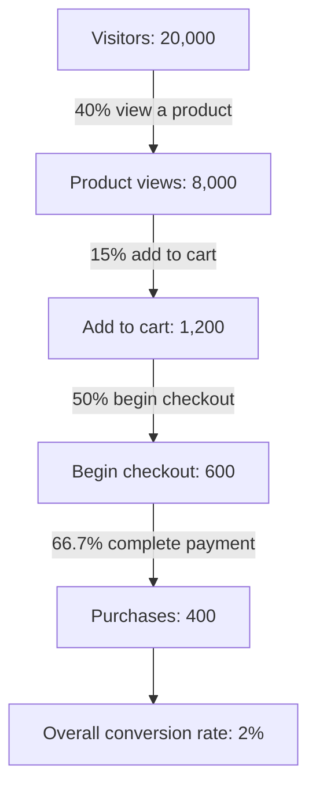

## Introduction

An online shop with no visitors makes no sales, and an online shop with many visitors but few buyers wastes its marketing budget. Digital marketing brings potential customers to the store; analytics tells the business which efforts work, where customers drop out and whether each new customer is worth what it cost to acquire. Because nearly every digital interaction can be measured, e-commerce managers can make decisions on evidence rather than intuition, provided they choose the right measures and interpret them correctly.

This lesson connects marketing and measurement. You will compare the main digital marketing channels, study the conversion funnel, and work through the core metrics that examiners and employers expect you to calculate: **conversion rate**, **customer acquisition cost (CAC)**, **average order value (AOV)** and **customer lifetime value (CLV)**. You will also consider attribution, experimentation and the limits of analytics, with applications to Ghanaian SMEs whose marketing often happens on social media and WhatsApp.

## Learning Objectives

- Compare the main digital marketing channels by cost, reach, intent and measurability.
- Explain the conversion funnel and identify where and why customers drop out.
- Calculate conversion rate, CAC, AOV, CLV and return on ad spend from given data.
- Evaluate marketing performance using the CLV-to-CAC ratio and funnel analysis.
- Explain attribution models and A/B testing, and critique the limitations of analytics.

## Prerequisite Knowledge

- The storefront and checkout concepts and the CRM lesson earlier in this module.
- Comfort with basic arithmetic: percentages, ratios and averages.

## Key Terminology

- **Conversion rate**: The percentage of visitors (or sessions) that complete a desired action, usually a purchase.
- **Customer acquisition cost (CAC)**: Total sales and marketing cost in a period divided by the number of new customers acquired in that period.
- **Average order value (AOV)**: Total revenue divided by the number of orders.
- **Customer lifetime value (CLV)**: The estimated value, usually in gross margin terms, that a customer generates over the whole relationship with the business.
- **Return on ad spend (ROAS)**: Revenue attributed to advertising divided by the advertising cost.
- **Attribution model**: A rule for assigning credit for a conversion to the marketing touchpoints that preceded it.
- **A/B test**: A controlled experiment comparing two versions of a page, message or offer by randomly assigning users to each.
- **Owned, paid and earned media**: Channels the firm controls (website, email list), channels it pays for (ads), and exposure it earns from others (reviews, shares, press).

## Detailed Explanation

### Digital marketing channels

Chaffey and Ellis-Chadwick group digital marketing into a set of channels. Each differs in cost structure, the intent of the audience reached and how easily results are measured.

| Channel | How it works | Strengths | Limitations |
|---|---|---|---|
| Search engine optimisation (SEO) | Improving content and site structure to rank in organic search results | Reaches high-intent searchers; no cost per click | Slow to build; depends on search engine algorithms |
| Paid search (SEM / pay-per-click) | Bidding for ads shown against search queries | Immediate, high intent, precise measurement | Costs rise with competition; stops when spending stops |
| Social media (organic and paid) | Content and ads on platforms such as Facebook, Instagram and TikTok | Large audiences, visual products, precise targeting | Lower purchase intent; organic reach is limited |
| Influencer and affiliate marketing | Paying creators or partners to promote products, often per sale | Borrowed trust and reach | Hard to verify audience quality; disclosure duties |
| Email and SMS marketing | Messages to customers who have opted in | Low cost, strong for retention | Requires consent and a good list; risk of spam |
| Messaging (for example WhatsApp Business) | Catalogues, broadcasts and one-to-one chat | Personal, conversational, familiar to customers | Labour-intensive; consent and over-messaging risks |
| Display advertising | Banner and video ads on websites and apps | Awareness at scale, retargeting | Low click rates; ad blindness; fraud risk |
| Content marketing | Useful articles, videos and guides | Builds trust and SEO | Slow; quality content is costly |

The **owned, paid and earned** framework is useful for strategy: paid media can buy initial reach, owned media (an email list, a WhatsApp community) lowers the cost of reaching customers repeatedly, and earned media (reviews, shares) builds credibility that paid media cannot buy.

### The conversion funnel

A conversion funnel represents the stages a visitor moves through before buying: **visit → view product → add to cart → begin checkout → purchase**. Fewer people reach each stage. Analysing the **step conversion rate** between stages shows where the largest losses occur. A sharp drop from product view to add-to-cart suggests problems with price, product information or images; a drop from checkout to purchase points to payment problems, hidden costs or trust concerns (as discussed in the storefront lesson).

The **AIDA** model (Attention, Interest, Desire, Action) is an older marketing framework that maps onto the funnel and reminds marketers that channels play different roles: display and social ads build attention; content and product pages build interest and desire; checkout design and payment options enable action.

### Core metrics and their formulas

- `Conversion rate = purchases ÷ visitors × 100`
- `CAC = total acquisition marketing and sales cost ÷ new customers acquired`
- `AOV = total revenue ÷ number of orders`
- `ROAS = revenue attributed to ads ÷ ad spend`
- A simple CLV estimate: `CLV = AOV × purchases per year × gross margin % × expected customer lifespan in years`

More sophisticated CLV models discount future cash flows and use retention probabilities, but the simple version is adequate for many SME decisions and examinations. A widely used rule of thumb is that CLV should comfortably exceed CAC; if CAC approaches CLV, the business loses money acquiring customers.

### Analytics tools and data

Web analytics platforms such as Google Analytics collect data about sessions, traffic sources, pages viewed and events such as add-to-cart and purchase. **UTM parameters** added to campaign links identify which campaign brought each visitor. Social media platforms report their own ad metrics (impressions, clicks, cost per click), and payment and order systems provide the authoritative revenue figures. Analysts must reconcile these sources, because each platform tends to measure differently.

## Theories, Frameworks and Models

### Attribution models

Customers often interact with several touchpoints before buying: an Instagram ad, a Google search, a WhatsApp message. Attribution decides how to share the credit.

| Model | Rule | Bias |
|---|---|---|
| Last-click | All credit to the final touchpoint | Over-credits search and retargeting, under-credits awareness channels |
| First-click | All credit to the first touchpoint | Over-credits awareness channels |
| Linear | Equal credit to all touchpoints | Ignores differing influence |
| Time-decay | More credit to touchpoints closer to purchase | Still assumes a fixed pattern |
| Data-driven | Credit estimated statistically from observed paths | Requires substantial data and is less transparent |

No model is "true"; each embodies assumptions. Managers should be aware that changing the model can change which channel appears most profitable.

### Experimentation: A/B testing

An A/B test randomly assigns visitors to version A (control) or B (variant) and compares outcomes, such as conversion rate. Randomisation means differences can be attributed to the change rather than to other factors. Good practice includes defining the metric and sample size in advance, running the test long enough to cover weekly patterns, and avoiding stopping as soon as a difference appears, which inflates false positives. For small SMEs with low traffic, tests may take too long to reach reliable conclusions, so qualitative evidence (customer interviews, chat logs) is also valuable.

### Limits of analytics

Analytics measure behaviour, not motivation. Cookie restrictions, privacy controls and users switching devices create gaps. Correlation in dashboards is not causation: a channel may appear to drive sales because it reaches people who would have bought anyway. Data protection obligations, including Ghana's Data Protection Act, 2012 (Act 843), limit how personal data can be collected and used.

## Diagram

## Worked Example

**Illustrative scenario.** *StyleHub GH* is a hypothetical online fashion retailer in Accra. In one month (all figures are invented for practice):

- Visitors: 20,000
- Product page views (unique visitors): 8,000
- Add to cart: 1,200
- Began checkout: 600
- Orders: 400, of which 300 came from new customers
- Revenue: GHS 100,000
- Marketing spend on acquisition (social ads, influencer fees, paid search): GHS 30,000, of which GHS 18,000 was social ads generating GHS 54,000 of attributed revenue
- Gross margin: 40 per cent
- Customers buy on average 3 times a year and remain customers for about 2 years

**Step 1: Conversion rate.** `400 ÷ 20,000 × 100 = 2%`.

**Step 2: Funnel step rates.** View rate `8,000 ÷ 20,000 = 40%`; add-to-cart rate `1,200 ÷ 8,000 = 15%`; checkout start `600 ÷ 1,200 = 50%`; checkout completion `400 ÷ 600 ≈ 66.7%`. The weakest step is product view to add-to-cart (15 per cent), suggesting that product pages, pricing or sizing information should be investigated first.

**Step 3: AOV.** `100,000 ÷ 400 = GHS 250`.

**Step 4: CAC.** `30,000 ÷ 300 = GHS 100` per new customer.

**Step 5: ROAS for social ads.** `54,000 ÷ 18,000 = 3.0`, meaning GHS 3 of revenue per GHS 1 of ad spend. Because gross margin is 40 per cent, each GHS 1 of ad spend produced `3.0 × 0.40 = GHS 1.20` of gross margin, a modest positive return before other costs.

**Step 6: CLV.** `250 × 3 × 0.40 × 2 = GHS 600` of gross margin over the relationship.

**Step 7: CLV-to-CAC ratio.** `600 ÷ 100 = 6`. Each new customer is expected to generate six times their acquisition cost in gross margin, which suggests acquisition spending is sustainable, provided the retention assumptions hold.

**Step 8: Interpretation and decisions.**
1. Improve the add-to-cart step: add size guides, more photos and clearer delivery fees. If the add-to-cart rate rose from 15 to 18 per cent with other step rates unchanged, purchases would rise to `8,000 × 0.18 × 0.5 × 0.667 ≈ 480`, an increase of about 80 orders without extra traffic.
2. Validate the CLV assumptions with real repeat-purchase data from the CRM; if customers actually buy only once, CLV falls to `250 × 1 × 0.40 × 1 = GHS 100`, equal to CAC, and the acquisition strategy would no longer be profitable.
3. Shift some budget towards owned media (email, WhatsApp community) to lower the cost of repeat purchases.

The example shows why metrics must be interpreted together: a healthy ROAS or CLV-to-CAC ratio can hide a weak funnel step or optimistic assumptions.

## Ghanaian Business Application

Digital marketing in Ghana is strongly social and mobile. Many SMEs rely on Instagram, Facebook, TikTok and WhatsApp to show products, answer questions and close sales. Influencer marketing is common, especially in fashion, beauty and food. These channels are effective for reach and trust, but they create a **measurement challenge**: when a sale closes in a WhatsApp chat and is paid by mobile money, it may not appear in web analytics at all. SMEs can respond with simple techniques: unique discount codes per influencer, campaign-specific WhatsApp links or numbers, asking customers "how did you hear about us?" at checkout, and recording the source of each order in the order management system.

SMS marketing remains useful where customers have basic phones or limited data, but bulk messaging without consent damages trust and may breach data protection requirements. Payment and messaging providers such as Hubtel offer business messaging alongside payment services, which can help link campaigns to transactions. Finally, Ghanaian consumers are often price- and data-sensitive, so lightweight landing pages and clear delivery costs can matter as much as ad creativity in improving the funnel.

## International Case Study

### Dollar Shave Club: content, subscription and lifetime value

Dollar Shave Club, a United States company that sold razors by subscription, gained wide attention in 2012 with a low-budget, humorous launch video shared widely online. The video is often cited as an example of earned media and content marketing: a single piece of content generated large awareness at little paid cost. Unilever acquired the company in 2016.

The case is useful for analytics because the business model depended on **lifetime value** rather than first-order profit. A subscription razor service earns modest revenue per shipment, so acquisition spending is justified only if customers stay subscribed for many months. This makes **retention and churn** central metrics, and it illustrates why CLV-to-CAC thinking is essential for subscription e-commerce. It also illustrates the limitation of viral marketing: earned attention is hard to repeat on demand, so sustained growth requires a reliable mix of paid, owned and earned channels and careful measurement of which customers stay.

## Common Misconceptions

- **Misconception:** More traffic always means more sales. **Correction:** If the funnel is weak, extra traffic raises costs without proportionate sales; improving conversion can be cheaper.
- **Misconception:** ROAS above 1 means advertising is profitable. **Correction:** ROAS uses revenue, not profit; with a 40 per cent margin, a ROAS below 2.5 loses money before other costs.
- **Misconception:** Last-click attribution shows the true value of each channel. **Correction:** It is one assumption among several and tends to undervalue awareness channels.
- **Misconception:** CLV is a fact. **Correction:** CLV is an estimate built on assumptions about frequency, margin and retention that must be validated.
- **Misconception:** A test that shows a difference after one day proves the variant is better. **Correction:** Small samples and early stopping produce unreliable results.

## Common Examination Mistakes

- Calculating CAC using all customers instead of new customers, or AOV using visitors instead of orders.
- Computing CLV from revenue without applying gross margin, then comparing it with CAC.
- Reporting metrics without interpretation or recommendations.
- Ignoring the measurement gap created by social and WhatsApp sales in Ghana.
- Describing channels without comparing cost, intent and measurability.

## Critical Thinking Questions

1. Should a Ghanaian fashion SME prioritise influencer marketing or search advertising? What data would you collect to decide?
2. If privacy controls reduce the data available to analytics platforms, how should e-commerce firms adapt their measurement?
3. Is a CLV-to-CAC ratio of 6 always a sign of a healthy business? What might it conceal?
4. How should a business balance personalisation with customers' expectations of privacy?

## Practical Exercises

1. **Metric calculation.** An illustrative shop has 15,000 visitors, 300 orders, revenue of GHS 54,000, acquisition spend of GHS 16,000 and 200 new customers. Calculate conversion rate, AOV and CAC. *Expected output:* conversion rate 2%, AOV GHS 180, CAC GHS 80, with a sentence interpreting each.
2. **CLV sensitivity.** Using AOV GHS 180, gross margin 35 per cent and a lifespan of 2 years, calculate CLV for purchase frequencies of 1, 2 and 4 times a year and compare each with CAC of GHS 80. *Expected output:* CLVs of GHS 126, GHS 252 and GHS 504, with CLV-to-CAC ratios and a conclusion.
3. **Tracking plan.** Design a measurement plan for an SME that sells through Instagram, WhatsApp and a website. *Expected output:* a table of channels, tracking method (UTM links, discount codes, order source field) and the metric reported.

## Key Takeaways

- Digital channels differ in cost, intent, reach and measurability; combine paid, owned and earned media.
- The conversion funnel reveals where customers drop out; fix the weakest step first.
- Conversion rate, CAC, AOV, ROAS and CLV must be calculated correctly and interpreted together.
- CLV should comfortably exceed CAC, but CLV rests on assumptions that need validation.
- Attribution models and A/B tests guide decisions but have biases and limits; privacy and consent constrain data use.

## Further Reading

- Chaffey, D., & Ellis-Chadwick, F. (2019). *Digital marketing* (7th ed.). Pearson.
- Kohavi, R., Tang, D., & Xu, Y. (2020). *Trustworthy online controlled experiments: A practical guide to A/B testing*. Cambridge University Press.
- Chaffey, D., Hemphill, T., & Edmundson-Bird, D. (2019). *Digital business and e-commerce management* (7th ed.). Pearson.
- Google. Google Analytics Help. <https://support.google.com/analytics/>

## Video Resources

- [Google Skillshop](https://skillshop.withgoogle.com/): Google. Official free training portal with courses on Google Analytics and Google Ads.
- [HubSpot Academy](https://academy.hubspot.com/): HubSpot. Official free learning portal with courses on inbound, content and email marketing.

## Revision Summary

Digital marketing channels (SEO, paid search, social, influencer and affiliate, email and SMS, messaging, display and content) differ in cost, intent and measurability, and are best combined across paid, owned and earned media. The conversion funnel shows where visitors drop out. Core metrics are conversion rate, CAC, AOV, ROAS and CLV; CLV should comfortably exceed CAC, but its assumptions must be tested. Attribution models and A/B tests support decisions but have limitations.

- Conversion rate = purchases ÷ visitors × 100.
- CAC = acquisition cost ÷ new customers; AOV = revenue ÷ orders.
- CLV = AOV × frequency × margin × lifespan (simple model).
- ROAS uses revenue; convert to margin before judging profitability.
- In Ghana, track social and WhatsApp sales with codes, links and order-source fields.
