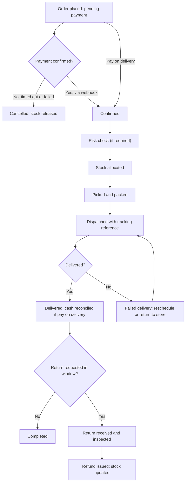

## Introduction

A customer's click on "Place order" is the start, not the end, of an e-commerce transaction. Payment must be confirmed, stock reserved, goods picked and packed, a courier booked, the customer kept informed and, sometimes, a return processed and a refund issued. Each step can fail: payment may time out, stock may be wrong, the rider may not find the address. Customers judge an online business largely on how well it handles these steps, and repeat purchases depend on that judgement.

This lesson covers two closely related capabilities. **Order management** coordinates everything from order capture to delivery and returns. **Customer management**, usually discussed as **customer relationship management (CRM)**, uses customer data and processes to acquire, serve and retain profitable customers. Together they turn one-off buyers into loyal customers. You will trace the order lifecycle, compare fulfilment models, and apply CRM techniques, including a worked RFM segmentation.

## Learning Objectives

- Describe the stages of the e-commerce order lifecycle and the events that move an order between them.
- Explain the functions of an order management system and its integration with inventory, payment and delivery systems.
- Compare in-house, third-party logistics, dropshipping and marketplace fulfilment models.
- Distinguish operational, analytical and collaborative CRM.
- Apply RFM analysis to segment customers and propose targeted retention actions.

## Prerequisite Knowledge

- The storefront, catalogue and checkout concepts in the previous lesson.
- Basic spreadsheet skills for the RFM exercise.

## Key Terminology

- **Order management system (OMS)**: Software that captures, tracks and coordinates orders across payment, inventory, fulfilment, delivery and returns.
- **Order lifecycle**: The sequence of statuses an order passes through, from placement to completion, cancellation or return.
- **Fulfilment**: The process of receiving, picking, packing and shipping orders to customers.
- **Third-party logistics (3PL)**: An external provider that stores, picks, packs and delivers goods on behalf of a merchant.
- **Dropshipping**: A model in which the merchant sells goods that a supplier ships directly to the customer, so the merchant holds no stock.
- **Reverse logistics**: The processes for handling returned goods, including collection, inspection, restocking and refunds.
- **Customer relationship management (CRM)**: A strategy, set of processes and technologies for managing interactions with customers to build long-term, profitable relationships.
- **RFM analysis**: A segmentation method that scores customers on Recency, Frequency and Monetary value of their purchases.

## Detailed Explanation

### The order lifecycle

Although statuses vary between systems, a typical B2C order lifecycle includes:

1. **Placed / pending payment** – the order is created; for mobile money, the customer may still need to approve the payment prompt on their phone.
2. **Paid / confirmed** – the payment provider confirms success, usually by a callback or webhook to the merchant's system.
3. **Verified** – optional fraud or risk checks, especially for high-value orders or unusual patterns.
4. **Allocated** – stock is reserved against the order at a specific warehouse or shop.
5. **Picked and packed** – items are collected, checked and packaged, and a delivery label or reference is generated.
6. **Dispatched / shipped** – handed to a rider or courier with a tracking reference.
7. **Delivered** – confirmed by the courier, customer signature, photo or one-time code.
8. **Completed** – the return window closes and the sale is final.

Branches include **cancelled** (before dispatch), **failed delivery** (customer unavailable, address not found) and **returned / refunded**. For *pay on delivery* orders, payment is collected at the delivery step, which adds a cash reconciliation task: the rider's collections must be matched against delivered orders.

### What an OMS does

An OMS is the coordinating hub. Its main functions are:

- **Order capture** from multiple channels (website, app, marketplace, WhatsApp, phone) into a single queue.
- **Payment status tracking**, including handling of pending, failed and reversed payments.
- **Inventory reservation and synchronisation**, so that stock sold on one channel is not oversold on another.
- **Order routing** to the best fulfilment location.
- **Delivery integration**, booking couriers and updating tracking.
- **Customer notifications** by SMS, email or WhatsApp at each stage.
- **Returns and refunds** management.
- **Reporting** on fulfilment times, cancellation rates and delivery success.

The most common operational problem for growing SMEs is **overselling**: selling items that are not in stock because inventory is not synchronised between channels. A second is **lost orders**, where orders taken in chats are never recorded. A single OMS, even a simple one, addresses both.

### Fulfilment models

| Model | How it works | Advantages | Risks |
|---|---|---|---|
| In-house | Merchant stores, packs and arranges delivery | Control over quality and packaging | Space, staff and delivery costs; hard to scale |
| 3PL | External provider stores and ships goods | Scalable, professional logistics | Fees, less direct control, integration needed |
| Dropshipping | Supplier ships directly to customer | No inventory investment | Long delivery times, quality control, thin margins |
| Marketplace fulfilment | Marketplace stores and delivers seller's stock | Access to the marketplace's logistics and trust | Fees, dependence on the marketplace |

### Customer relationship management

Buttle and Maklan describe CRM as a core business strategy that integrates processes and functions to create and deliver value to targeted customers profitably, supported by customer data and technology. CRM is therefore not merely software. Three types are commonly distinguished:

- **Operational CRM** automates customer-facing processes: sales, marketing campaigns and customer service (tickets, chat, call logs).
- **Analytical CRM** analyses customer data to understand behaviour, segment customers, predict churn and estimate value.
- **Collaborative CRM** shares customer information across departments and channels so that every interaction is informed by previous ones.

A practical way to think about CRM is the **customer lifecycle**: *acquire* (attract and convert), *develop* (encourage repeat and higher-value purchases through cross-selling and up-selling), *retain* (service quality, loyalty programmes, personalised communication) and *win back* lapsed customers. Retention matters because acquiring new customers is usually more expensive than keeping existing ones. Reichheld and Sasser (1990) argued in the *Harvard Business Review* that reducing customer defections can have a large effect on profits, because loyal customers tend to buy more, cost less to serve and refer others.

### Data protection

CRM depends on personal data: names, phone numbers, addresses and purchase histories. In Ghana, the Data Protection Act, 2012 (Act 843) governs the processing of personal data and established the Data Protection Commission. Good practice includes collecting only necessary data, obtaining consent for marketing messages, securing data and respecting customers' requests. This lesson's treatment is educational; organisations should consult the Act and qualified advisers for compliance.

## Theories, Frameworks and Models

### RFM segmentation

RFM is a simple but powerful analytical CRM technique. Each customer is scored, often from 1 (lowest) to 5 (highest), on:

- **Recency** – how recently they purchased (more recent scores higher).
- **Frequency** – how many purchases they made in the period.
- **Monetary value** – how much they spent in the period.

Combinations identify segments such as **Champions** (high R, F and M), **Loyal customers** (high F), **At risk** (low R but previously high F and M) and **New customers** (high R, low F). Each segment receives different treatment: champions might be invited to a loyalty tier, at-risk customers sent a personalised win-back offer.

### Service recovery

The **service recovery** concept holds that how a firm responds to a failure, such as a late delivery, strongly affects customer loyalty. Fast acknowledgement, an apology, a fix and, where appropriate, compensation can retain customers who would otherwise leave. OMS and CRM data make proactive recovery possible: if the system shows an order delayed beyond its promised date, the customer can be contacted before they complain.

## Diagram

## Worked Example

**Illustrative scenario.** *GlowSkin GH*, a hypothetical online skincare retailer in Accra, wants to use its order history to plan retention campaigns. The table shows six customers over the last 12 months (data are invented for practice).

| Customer | Days since last order | Orders in 12 months | Total spend (GHS) |
|---|---|---|---|
| Akosua | 10 | 9 | 2,700 |
| Kwame | 200 | 6 | 1,900 |
| Esi | 15 | 1 | 180 |
| Yaw | 45 | 4 | 900 |
| Abena | 300 | 1 | 150 |
| Kofi | 25 | 7 | 2,100 |

**Step 1 – Define scoring bands (1–3 for simplicity).**
- Recency: 0–30 days = 3; 31–120 days = 2; over 120 days = 1.
- Frequency: 6 or more orders = 3; 2–5 = 2; 1 = 1.
- Monetary: over GHS 1,500 = 3; GHS 500–1,500 = 2; under GHS 500 = 1.

**Step 2 – Score each customer.**

| Customer | R | F | M | RFM code | Segment |
|---|---|---|---|---|---|
| Akosua | 3 | 3 | 3 | 333 | Champion |
| Kofi | 3 | 3 | 3 | 333 | Champion |
| Yaw | 2 | 2 | 2 | 222 | Developing / potential loyalist |
| Esi | 3 | 1 | 1 | 311 | New customer |
| Kwame | 1 | 3 | 3 | 133 | At risk (valuable but lapsing) |
| Abena | 1 | 1 | 1 | 111 | Lost / low value |

**Step 3 – Design actions.**
- *Champions*: early access to new products, a loyalty tier and requests for reviews or referrals.
- *Yaw*: cross-sell complementary products based on purchase history to increase frequency.
- *Esi*: a welcome series with product guidance to encourage a second purchase, which is often the hardest step.
- *Kwame*: priority win-back, because he has high historical value. Check service records for a problem (late delivery, complaint) and contact him personally with a tailored offer; this is service recovery in practice.
- *Abena*: low-cost automated reminder only.

**Step 4 – Evaluate.** RFM is easy to calculate and explain, but it is backward-looking, ignores margins and product categories, and depends on accurate order data. This is why OMS and CRM must be integrated: without reliable order records, segmentation is unreliable.

## Ghanaian Business Application

Order and customer management in Ghana must accommodate several local realities. **Multi-channel orders** are normal: a single SME may take orders on Instagram, WhatsApp, a website and by phone. Without a central record, orders are lost and stock is oversold. Even a shared spreadsheet or low-cost OMS that brings all channels into one queue is a significant improvement.

**Delivery** is commonly handled by motorbike riders and courier firms, and failed deliveries due to unclear locations are a frequent cost. Capturing digital addresses and landmarks at checkout and calling or messaging customers before dispatch reduce failures. **Pay on delivery** remains popular where trust is limited, so rider cash collections must be reconciled daily against delivered orders, a control discussed further in Module 5. Mobile money collection on delivery, using a merchant number or payment link, reduces cash-handling risk.

For **CRM**, WhatsApp Business is widely used as an operational CRM channel, with labels for customer stages and broadcast lists for promotions. However, marketing messages should be sent with consent and in line with the Data Protection Act, 2012 (Act 843). As businesses grow, they benefit from moving customer histories out of individual staff phones into shared systems, which is collaborative CRM in practice and also protects the business when staff leave.

## International Case Study

### Zappos: customer service as strategy

Zappos, an American online shoe and clothing retailer founded in 1999, became widely known for treating customer service as its central competitive strategy. It publicised generous policies such as free shipping and free returns and encouraged customer service staff to spend as long as needed on calls rather than minimising call time. Amazon acquired Zappos in 2009.

The case links order management and CRM. Generous returns policies reduce the perceived risk of buying shoes online, where fit is uncertain, and so increase conversion. However, they make **reverse logistics** a core operational capability: returns must be collected, inspected and restocked efficiently, and their cost must be built into the business model. The emphasis on service also illustrates **operational CRM** (empowered service staff) and the logic of **retention** argued by Reichheld and Sasser: loyal customers who trust the returns process buy repeatedly and recommend the firm. A critical reading should ask whether such policies are affordable for SMEs with thin margins, and how a Ghanaian retailer might adapt the principle, for example by offering exchanges at pick-up points rather than free home collection.

## Common Misconceptions

- **Misconception:** The sale is complete when the customer pays. **Correction:** Fulfilment, delivery, returns and service determine whether the customer is satisfied and returns.
- **Misconception:** CRM is a software package. **Correction:** CRM is a customer-focused strategy supported by processes, data and technology.
- **Misconception:** Dropshipping is a risk-free way to start e-commerce. **Correction:** It avoids inventory costs but brings long delivery times, quality control problems and thin margins.
- **Misconception:** All customers deserve the same marketing effort. **Correction:** Segmentation such as RFM directs effort to where it creates most value.
- **Misconception:** Collecting as much customer data as possible is always beneficial. **Correction:** Data protection law and good practice require collecting only necessary data with appropriate consent and security.

## Common Examination Mistakes

- Listing order statuses without explaining the events and systems that move an order between them.
- Ignoring failure paths such as payment failure, failed delivery and returns.
- Defining CRM only as software, or failing to distinguish operational, analytical and collaborative CRM.
- Performing RFM scoring without proposing differentiated actions for each segment.
- Omitting data protection when discussing customer data in Ghana.

## Critical Thinking Questions

1. Should a Ghanaian SME offer free returns to compete with larger marketplaces? Under what conditions would this be sustainable?
2. RFM ignores profit margins. How would you adapt it for a retailer whose products have very different margins?
3. How might pay on delivery affect both order management costs and customer trust, and how could mobile money change this balance?
4. Is WhatsApp an adequate CRM tool for a growing business? What risks does relying on it create?

## Practical Exercises

1. **Lifecycle mapping.** Map the order lifecycle for an illustrative food delivery business, including at least three failure paths. *Expected output:* a flowchart with statuses, triggering events and the system responsible for each transition.
2. **RFM practice.** Create a dataset of 15 illustrative customers and apply the RFM bands from this lesson. *Expected output:* a scored table, segment labels and one targeted action per segment.
3. **Fulfilment choice.** Recommend a fulfilment model for an illustrative Takoradi electronics accessory seller expanding to Accra. *Expected output:* a comparison of at least three models against cost, control, speed and risk, with a justified recommendation.

## Key Takeaways

- The order lifecycle runs from placement through payment, allocation, fulfilment and delivery to completion, with failure and return paths.
- An OMS unifies multi-channel orders, synchronises inventory and coordinates payment, delivery and notifications.
- Fulfilment models (in-house, 3PL, dropshipping, marketplace) trade control against cost and scalability.
- CRM is a strategy supported by operational, analytical and collaborative capabilities across the customer lifecycle.
- RFM segmentation directs retention efforts, but depends on accurate order data and ignores margins.

## Further Reading

- Buttle, F., & Maklan, S. (2019). *Customer relationship management: Concepts and technologies* (4th ed.). Routledge.
- Reichheld, F. F., & Sasser, W. E. (1990). Zero defections: Quality comes to services. *Harvard Business Review, 68*(5), 105–111.
- Laudon, K. C., & Traver, C. G. *E-commerce: Business, technology, society*. Pearson. (Consult the most recent edition available in your library.)
- Chaffey, D., Hemphill, T., & Edmundson-Bird, D. (2019). *Digital business and e-commerce management* (7th ed.). Pearson.

## Video Resources

- [MIT OpenCourseWare](https://ocw.mit.edu/) — Massachusetts Institute of Technology. Official open learning portal; search for supply chain, logistics and operations management materials.
- [HubSpot Academy](https://academy.hubspot.com/) — HubSpot. Official free learning portal with courses on customer relationship management and customer service.

## Revision Summary

Order management coordinates the journey from order placement to payment confirmation, stock allocation, fulfilment, delivery, completion and returns, while handling failures such as payment timeouts and failed deliveries. Fulfilment can be in-house, outsourced to 3PLs, dropshipped or handled by marketplaces. CRM is a strategy for acquiring, developing, retaining and winning back customers, supported by operational, analytical and collaborative capabilities and constrained by data protection law.

- Key OMS functions: multi-channel capture, payment tracking, inventory sync, routing, delivery, notifications, returns.
- Overselling and lost orders are typical SME failures without a central OMS.
- RFM = Recency, Frequency, Monetary; segments get differentiated actions.
- Retention is usually cheaper than acquisition (Reichheld and Sasser).
- In Ghana: multi-channel orders, rider delivery, pay-on-delivery reconciliation, Act 843.
