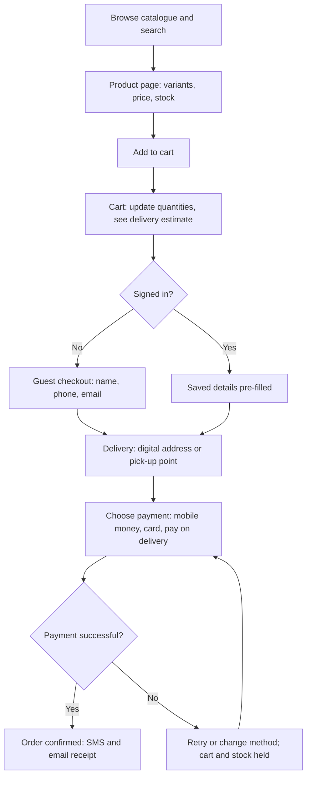

## Introduction

Customers experience an online shop as a handful of pages: a home page, product listings, a product page, a cart and a checkout. Behind those pages sits a set of interacting systems: a web or mobile front end, application logic, a database of products and orders, integrations with payment and delivery providers, and infrastructure that keeps everything fast and secure. Decisions about these systems determine how quickly a business can launch, how much it pays, how well it scales and how many visitors complete a purchase.

This lesson examines the three components at the heart of any e-commerce operation: the **storefront** (and the architecture behind it), the **product catalogue** (the structured data describing what is for sale) and the **shopping cart and checkout** (the process that turns intent into an order). You will learn to compare platform options, model catalogue data and redesign a checkout to remove friction, with attention to conditions faced by Ghanaian SMEs.

## Learning Objectives

- Describe the layers of an e-commerce storefront architecture and the role of each.
- Compare hosted (SaaS), open-source and custom or headless storefront options.
- Design a product catalogue data model using products, variants, attributes and categories.
- Explain how shopping carts maintain state and why carts are abandoned.
- Apply checkout design principles to reduce friction for mobile users in Ghana.

## Prerequisite Knowledge

- The B2C e-commerce model (Module 2).
- Basic awareness of websites, databases and mobile apps.

## Key Terminology

- **Storefront**: The customer-facing interface of an online shop, delivered through a website, mobile app or social commerce channel.
- **SaaS e-commerce platform**: A hosted service, paid by subscription or fees, that provides storefront, catalogue, cart and checkout functions without the merchant managing servers.
- **Headless commerce**: An architecture in which the front-end presentation layer is separated from the back-end commerce engine and connected through APIs.
- **SKU (stock-keeping unit)**: A unique identifier for each distinct sellable item, such as a shirt in a specific size and colour.
- **Product variant**: A version of a product that differs by attributes such as size, colour or capacity, usually with its own SKU, price and stock level.
- **Product taxonomy**: The hierarchical classification of products into categories and sub-categories that supports navigation and search.
- **Cart abandonment**: When a shopper adds items to a cart but leaves without completing the purchase.
- **Guest checkout**: Allowing customers to buy without creating an account.

## Detailed Explanation

### Storefront architecture in layers

A useful way to analyse a storefront is as a set of layers:

1. **Presentation layer**: the web pages or app screens the customer sees, built with HTML, CSS and JavaScript or native mobile code. It must be responsive, because many Ghanaian shoppers browse on smartphones.
2. **Application (commerce) layer**: the business logic: pricing rules, promotions, cart calculations, tax and delivery fees, customer accounts and order creation.
3. **Data layer**: databases holding products, inventory, customers, carts and orders, plus a search index for fast product search.
4. **Integration layer**: APIs connecting to payment gateways, delivery partners, accounting or ERP systems, messaging (SMS, email, WhatsApp) and analytics.
5. **Infrastructure layer**: hosting, content delivery networks (CDNs) that cache images close to users, TLS certificates for HTTPS, backups and monitoring.

Performance and security cut across all layers. Slow pages reduce conversion, especially on mobile data connections, so image compression and caching matter. Security requires HTTPS, secure handling of credentials and, ideally, leaving card data handling to a certified payment provider (see Module 5).

### Comparing storefront options

| Option | Description | Advantages | Disadvantages | Suited to |
|---|---|---|---|---|
| Social commerce | Selling through Instagram, Facebook or WhatsApp Business catalogues | Almost no cost; customers already there | Limited catalogue, manual order handling, platform dependence | Very small sellers testing demand |
| Marketplace listing | Selling on a third-party marketplace | Instant traffic, trust and logistics | Commissions, little control over brand and customer data | Sellers needing reach |
| SaaS platform | Hosted store builder (for example Shopify) | Fast launch, managed security and updates, app ecosystems | Monthly fees, transaction fees, less flexibility | Most SMEs |
| Open-source | Self-hosted software (for example WooCommerce on WordPress) | Flexible, no licence fee, large community | Merchant responsible for hosting, updates and security | Firms with some technical capacity |
| Custom or headless | Bespoke front end on a commerce engine via APIs | Maximum flexibility and performance | Highest cost and skills requirement | Large or fast-growing firms |

The right choice depends on budget, skills, the size and complexity of the catalogue, integration needs and growth expectations. A common path for Ghanaian SMEs is to begin with social commerce, add a SaaS or open-source store integrated with a local payment provider, and move to more complex architectures only when scale justifies it.

### The product catalogue

The catalogue is the structured data that describes what is for sale. Poor catalogue data produces poor search results, confusing product pages, wrong stock levels and customer complaints. A sound catalogue model separates:

- **Product**: the general item (for example "Ankara wrap dress").
- **Variants**: combinations of attributes (size M, blue pattern), each with its own **SKU**, price, stock quantity and possibly image.
- **Attributes**: structured properties (size, colour, fabric, weight) used for filtering.
- **Categories**: a taxonomy (Women > Dresses > Wrap dresses) for navigation; a product can belong to several categories.
- **Media and content**: images, descriptions, size guides and reviews.
- **Pricing and promotions**: list price, sale price, start and end dates, and customer-group prices for B2B buyers.
- **Inventory**: stock per location or warehouse, with reserved quantities for unpaid orders.

Catalogue quality has a direct business effect. Consistent attributes allow filtering ("size M under GHS 300"), accurate weights allow correct delivery fees, and good images reduce returns.

### Shopping carts and state

The web is stateless: each request to a server is independent. A cart must therefore persist the shopper's selections. **Session carts** store items for the duration of a browsing session, often linked to a browser cookie. **Persistent carts** store items in the database against a customer account or long-lived identifier, so that a shopper can return days later or switch from phone to laptop. Carts also recalculate totals as items change, apply promotions, estimate delivery fees and check stock.

### Why carts are abandoned

Common reasons for abandonment include unexpected extra costs (delivery fees revealed late), forced account creation, long or confusing forms, limited payment options, slow pages, concerns about security or returns, and simply browsing without strong intent. In Ghana, specific factors include uncertainty about delivery to locations without clear street addresses and the absence of a preferred payment method such as mobile money.

## Theories, Frameworks and Models

### Checkout friction and usability principles

Usability research, notably from the Baymard Institute and the Nielsen Norman Group, consistently recommends reducing the number of form fields, showing total costs early, offering guest checkout, displaying progress indicators, giving clear error messages and providing trust signals. These recommendations can be organised into a simple **friction audit**:

| Principle | Question to ask | Example improvement |
|---|---|---|
| Transparency | Are all costs visible before the final step? | Show delivery fee on the product or cart page |
| Minimal effort | Is every field necessary? | Ask for phone number and digital address instead of a long postal address |
| Choice | Are preferred payment methods available? | Offer mobile money, card and, where appropriate, pay on delivery |
| Reassurance | Does the shopper trust the process? | Display returns policy, contact number and secure payment provider |
| Recovery | Can errors be corrected easily? | Inline validation of phone numbers; saved cart if payment fails |

### The cart and checkout as a state machine

It is useful to model checkout as a sequence of **states** (cart, details, delivery, payment, confirmation) with defined transitions. This makes it easier to identify where users drop out, which data must be validated at each stage, and what should happen if payment fails or times out, such as keeping the cart and reserved stock for a limited period.

## Diagram

## Worked Example

**Illustrative scenario.** *Kente & Co Accessories* is a hypothetical Accra-based seller of bags and jewellery. Its current website checkout has seven steps: create account, verify email, enter full postal address, choose delivery, see delivery fee, enter card details, confirm. Only card payment is offered. Analytics show that of 1,000 shoppers who reach the cart each month, 120 complete an order.

**Step 1: Calculate the cart-to-order rate.** `120 ÷ 1,000 = 12%`. Therefore 88 per cent of carts are abandoned at some stage.

**Step 2: Apply the friction audit.**
- *Transparency*: delivery fee appears late. Move a delivery estimate to the cart.
- *Minimal effort*: forced account creation and email verification add two steps. Introduce guest checkout using phone number.
- *Local fit*: a full postal address is unsuitable where many locations are described by landmarks. Accept a Ghana Post digital address or a pick-up point, with a landmark field.
- *Choice*: card-only payment excludes many customers. Integrate a payment service provider that supports mobile money and cards.
- *Reassurance*: add a returns policy, a WhatsApp contact and visible secure payment branding.

**Step 3: Redesign.** New flow: cart (with delivery estimate) → details (name, phone, optional email) → delivery (digital address or pick-up point) → payment (mobile money or card) → confirmation by SMS. Four steps replace seven.

**Step 4: Estimate impact.** If the redesign raises the cart-to-order rate to 18 per cent (an illustrative target, not a forecast), orders rise to `1,000 × 0.18 = 180` per month, an increase of 60 orders. With an average order value of GHS 220, additional monthly revenue = `60 × 220 = GHS 13,200`. The business should test the change and measure the actual effect rather than assume it.

**Step 5: Catalogue fix.** The seller's bags come in several colours, but each colour was listed as a separate product, cluttering search. Restructure as one product with colour variants, each with its own SKU and stock, so that shoppers see one listing and can choose a colour.

## Ghanaian Business Application

Ghanaian merchants have a growing range of storefront options. Many begin with **WhatsApp Business catalogues and Instagram shops**, which let customers browse products and message the seller, with payment by mobile money. As volumes grow, manual order handling becomes error-prone, prompting a move to a website or SaaS store.

Local **payment service providers** such as Paystack and Hubtel offer checkout integrations and plugins for common e-commerce platforms, allowing a merchant's checkout to accept mobile money and cards through one integration. This addresses one of the main local abandonment drivers: lack of a preferred payment method.

**Addressing and delivery** are distinctive challenges. Ghana introduced the GhanaPostGPS digital address system in 2017, which assigns location-based codes, and many online shops ask customers for a digital address or a nearby landmark. Pick-up points and agent locations are alternatives where home delivery is costly. Finally, mobile-first design and lightweight pages are essential because customers often browse on smartphones over mobile data, where large images slow loading and increase customers' data costs.

## International Case Study

### Shopify: making storefront technology available to small merchants

Shopify was founded in 2006 in Ottawa, Canada. Its founders originally built an online store to sell snowboards and, frustrated with the available software, developed their own platform, which they then offered to other merchants. Shopify grew into one of the best-known SaaS e-commerce platforms, offering hosted storefronts, catalogue management, cart and checkout, and an app ecosystem through which third-party developers extend functionality.

The case illustrates several points from this lesson. First, SaaS platforms **lower the technical barrier** to e-commerce: merchants configure rather than build, and the platform manages hosting, security and updates. Second, the **app ecosystem** is itself a platform with network effects: more merchants attract more app developers, whose apps attract more merchants. Third, Shopify's revenue combines **subscriptions** with **merchant solutions** such as payment processing, showing how business models (Module 1) and technology choices interlock. A critical evaluation should also note the trade-offs for merchants: recurring fees, dependence on the platform's policies and limits on deep customisation compared with custom builds.

## Common Misconceptions

- **Misconception:** A storefront is just a website design. **Correction:** It sits on application, data, integration and infrastructure layers that determine performance, security and capability.
- **Misconception:** Each colour or size should be listed as a separate product. **Correction:** Variants with their own SKUs under one product keep the catalogue clean and stock accurate.
- **Misconception:** Requiring account creation builds loyalty. **Correction:** Forced registration is a common cause of abandonment; guest checkout with an optional account afterwards usually works better.
- **Misconception:** Cart abandonment always means lost interest. **Correction:** Many abandonments result from fixable friction such as hidden costs, payment gaps or slow pages.
- **Misconception:** Custom-built storefronts are always superior. **Correction:** For most SMEs, SaaS or open-source platforms provide better value and security than bespoke builds.

## Common Examination Mistakes

- Describing a storefront without discussing architecture layers or integration with payment and delivery.
- Confusing products, variants and SKUs when designing a catalogue.
- Listing reasons for cart abandonment without proposing specific, context-appropriate fixes.
- Ignoring mobile-first design and local payment and addressing conditions in Ghana.
- Recommending a platform option without justifying it against budget, skills and scale.

## Critical Thinking Questions

1. For a Ghanaian SME with a small catalogue and no in-house developer, is it better to rely on a marketplace or to build its own SaaS store? What evidence would you need to decide?
2. Payment on delivery reduces abandonment but adds cash-handling and failed-delivery costs. How should a merchant weigh these effects?
3. Does headless commerce offer meaningful benefits for SMEs, or is it relevant only to large enterprises?
4. To what extent can good catalogue data compensate for weak marketing?

## Practical Exercises

1. **Catalogue model.** Design a catalogue for an illustrative shoe shop with five styles, each in four sizes and two colours. *Expected output:* a table listing products, variants and SKU codes, attributes and categories, with the total number of SKUs (40) correctly calculated.
2. **Friction audit.** Complete a checkout on a Ghanaian e-commerce site of your choice (without paying) and audit it against the five friction principles. *Expected output:* a five-row audit table with evidence and one improvement per principle.
3. **Option appraisal.** Recommend a storefront option for an illustrative bakery in Cape Coast that wants online pre-orders. *Expected output:* a 300-word recommendation comparing at least three options against cost, skills, payment integration and delivery.

## Key Takeaways

- A storefront rests on presentation, application, data, integration and infrastructure layers.
- Storefront options range from social commerce to SaaS, open-source and headless, with trade-offs in cost, control and skills.
- Catalogue data should separate products, variants (SKUs), attributes, categories, pricing and inventory.
- Carts maintain state across a stateless web; persistent carts support multi-device shopping.
- Checkout friction, hidden costs and missing payment methods drive abandonment; local addressing and mobile money matter in Ghana.

## Further Reading

- Laudon, K. C., & Traver, C. G. *E-commerce: Business, technology, society*. Pearson. (Consult the most recent edition available in your library.)
- Chaffey, D., Hemphill, T., & Edmundson-Bird, D. (2019). *Digital business and e-commerce management* (7th ed.). Pearson.
- Krug, S. (2014). *Don't make me think, revisited: A common sense approach to web usability* (3rd ed.). New Riders.
- Baymard Institute. E-commerce checkout usability research. <https://baymard.com/>

## Video Resources

- [Paystack Documentation](https://paystack.com/docs/): Paystack. Official developer documentation describing how online checkouts accept card and mobile money payments.
- [Shopify Help Center](https://help.shopify.com/): Shopify. Official help resources explaining storefront, product and checkout configuration on a SaaS platform.

## Revision Summary

An online storefront is the customer-facing layer of a multi-layer system that includes commerce logic, data, integrations and infrastructure. Merchants choose between social commerce, marketplaces, SaaS, open-source and headless options according to budget, skills and scale. Catalogue data must be structured into products, variants with SKUs, attributes, categories, prices and stock. Carts preserve state, and well-designed checkouts minimise friction to reduce abandonment.

- Five layers: presentation, application, data, integration, infrastructure.
- Variants share a product; each variant has its own SKU, price and stock.
- Abandonment drivers: hidden costs, forced accounts, long forms, missing payment methods, slow pages.
- Friction audit: transparency, minimal effort, choice, reassurance, recovery.
- Ghana: mobile-first pages, mobile money via PSPs, digital addresses and pick-up points.
