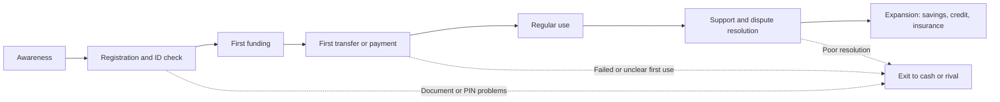

## Introduction

When several providers offer similar wallets, transfers and bill payments at similar prices, customers choose on the basis of how the service feels to use and whether they trust it. A payment that fails at a market stall, a menu that cannot be read on a basic phone, or a loan offer with unclear charges can send a customer back to cash within days. Customer experience (CX) is therefore not a decorative extra; in digital finance it is a main source of advantage, and it is closely tied to strategy: which customers a firm serves, through which channels, and with what capabilities.

This lesson shows how to analyse experience systematically through customer journey mapping, how to measure it with indicators such as Net Promoter Score (NPS) and Customer Satisfaction (CSAT) without being misled by them, and how to design omnichannel services that work for customers on smartphones and on feature phones. It then connects experience to digital business strategy and compares the positions of banks, mobile network operators (MNOs) and FinTechs. The lesson is educational. Market positions change, so the examples are described qualitatively and should be checked against current sources.

## Learning Objectives

- Construct a customer journey map for a digital financial service and identify moments of truth and pain points.
- Select and interpret CX metrics (NPS, CSAT, customer effort, completion and drop-off rates) while recognising their limitations.
- Design omnichannel and USSD, app and agent experiences that include customers with differing devices, literacy and connectivity.
- Explain how trust is built and lost in digital finance and apply design principles that support it.
- Evaluate digital business strategy options and the competitive positions of banks, MNOs and FinTechs using established frameworks.

## Prerequisite Knowledge

- The Digital Finance lessons on FinTech, mobile money and payment gateways.
- Ghana's mobile money ecosystem and financial inclusion lessons.
- The e-business foundations module (business models and value propositions).

## Key Terminology

- **Customer experience (CX)**: The cumulative perception a customer forms from all interactions with a provider across the relationship.
- **Customer journey**: The sequence of stages and touchpoints a customer passes through, from awareness and onboarding to use, support and exit.
- **Touchpoint**: Any interaction between the customer and the provider, such as an agent visit, a USSD session, an SMS or a call.
- **Moment of truth**: A touchpoint that disproportionately shapes the customer's overall judgement, such as the first transfer or the first failed transaction.
- **Net Promoter Score (NPS)**: A measure derived from the question "How likely are you to recommend us?" on a 0-10 scale, calculated as the percentage of promoters minus the percentage of detractors.
- **Customer Satisfaction score (CSAT)**: The share of customers rating a specific interaction as satisfactory, usually on a short scale.
- **Customer Effort Score (CES)**: A measure of how easy it was to get something done.
- **Omnichannel**: An approach in which channels are integrated so that the customer experiences one consistent relationship and context carries across channels.
- **USSD (Unstructured Supplementary Service Data)**: A session-based menu service available on basic phones without data or an app.
- **Digital business strategy**: A firm's integrated plan that uses digital resources and capabilities to create and capture value and to compete.

## Detailed Explanation

### Customer experience as a system

Lemon and Verhoef (2016) describe customer experience as a journey made of touchpoints across stages, shaped by the firm's design, by the customer's own context, and by other parties such as agents, social contacts and media. For digital finance, three consequences follow. First, experience is **cumulative**: one smooth transfer does not offset three failed ones. Second, it is **multi-actor**: a mobile money customer's experience depends on the issuer, the agent, the network, the merchant and the bank at the other end. A failed payment to a merchant is blamed on the wallet even if the merchant's system caused it. Third, it is **emotional as well as functional**: money is tied to anxiety, status and security, so reassurance matters as much as speed.

### Customer journey mapping

A journey map is a structured diagram of what the customer does, thinks and feels at each stage, what the firm and its partners do in response, and where things go wrong. A useful map for a digital financial product has the following steps.

1. **Define the persona and goal.** Be specific: not "customers" but "a market trader in Kumasi who uses a feature phone and wants to pay a supplier in Accra". Base personas on interviews and observation, not assumption.
2. **List the stages.** A typical financial journey includes awareness, registration and identity verification, first funding, first use, regular use, problem resolution, and expansion into other products or exit.
3. **Identify touchpoints per stage.** Include channels the firm does not control, such as an agent's shop or a relative's advice.
4. **Record actions, thoughts and emotions.** Use qualitative research to capture what customers say, the questions they ask and their worries (for example, "Will I lose my money if I press the wrong number?").
5. **Mark pain points and moments of truth.** Examples include a failed identity check, an unexpected fee at confirmation, a reversal that takes days, or an agent who is out of float.
6. **Attach metrics and owners.** For each pain point, define how it will be measured (drop-off rate, time to resolution, complaint volume) and who is responsible.
7. **Prioritise and redesign.** Rank issues by customer impact and business value, and test redesigns with real users.

A journey map also reveals **handoffs**, where responsibility moves between teams or firms. Many failures occur at handoffs, such as when a dispute raised with a merchant must be resolved by the wallet provider but neither takes ownership.

### Measuring experience carefully

Metrics make experience manageable, but each metric answers a different question and has weaknesses.

| Metric | What it measures | Strengths | Cautions |
|---|---|---|---|
| NPS | Overall willingness to recommend | Simple, comparable over time, associated with loyalty in some sectors (Reichheld, 2003) | Single question hides reasons; cultural differences in rating style; 0-10 scales may confuse less literate respondents; correlation with growth is debated |
| CSAT | Satisfaction with a specific interaction or product | Actionable at touchpoint level | Easily biased by who responds; satisfaction does not guarantee loyalty |
| CES | Ease of completing a task | Strong link to repeat use in service settings (Dixon, Freeman and Toman, 2010) | Needs clear task definitions |
| Completion and drop-off rates | Share finishing each step | Objective, from system logs | Do not explain why people leave |
| Time to resolve and first-contact resolution | Support effectiveness | Closely tied to trust | Can be gamed by closing tickets early |
| Complaints per thousand transactions | Pain at scale | Hard evidence of failure | Under-reports where customers do not know how to complain |

Principles for using metrics **carefully**: triangulate survey scores with behavioural data and interviews; mind sampling and response bias (satisfied or angry customers answer more often, and SMS or USSD surveys exclude some people); avoid target gaming by tying incentives to outcomes such as resolved cases and repeat use rather than to scores; compare like with like, since benchmarks differ by industry and country; report sample sizes and uncertainty; and link experience indicators to retention, cost to serve and revenue.

### Omnichannel design and inclusion

Customers move between channels: they register with an agent, transact by USSD, check balances in an app and call a help line. **Omnichannel** design makes these feel like one relationship. For an inclusive financial service this means:

- **USSD as a first-class channel.** USSD works on every handset and needs no data bundle. Good menus are short, in the customer's language, show fees before confirmation and confirm before sending. Limits are small screens, session time-outs and weaker security than encrypted apps, so sensitive actions may need extra verification.
- **Apps for richer features.** QR payments, biometrics, notifications and statements, but they need a smartphone and data, so they must be light and tolerate patchy connectivity.
- **Agents as human infrastructure.** Agents provide cash services, onboarding and trust, and need training, working float and escalation paths.
- **Local language, voice and accessibility.** Voice prompts, local-language content, larger text and simple icons widen the market and reduce errors.
- **Consistent context.** A support agent should see the transaction history of a failed payment without asking for every detail again.

Design for the **least capable device and context** in your target segment, then enhance for others. Inclusion is both a social and a commercial argument, since the largest untapped segments are often those not served by app-only products.

### Trust in digital finance

Trust is built through reliability, transparency, security and fair treatment, and it is lost quickly. Practical trust signals include clear receipts and confirmation messages, fees shown before the customer commits, visible licence information, simple dispute processes, fraud warnings and prompt reversals when mistakes occur. Social engineering and SIM swap fraud, discussed in the payment security module, damage trust beyond the victim's own account. Design should therefore include **friction in the right places**: confirming the recipient's name before sending, warning on unusual transfers, and cooling-off steps before a new device accesses an account. Removing all friction improves conversion but may increase fraud and regret. Interfaces that push customers into costly choices, such as hidden fees or pre-ticked consent for credit, may raise short-term revenue but breach conduct expectations and corrode trust.

## Theories, Frameworks and Models

### Digital business strategy

Bharadwaj and colleagues (2013) argue that digital technology should no longer be treated as a functional-level strategy that supports business strategy; **digital business strategy** is the organisational strategy formulated and executed by leveraging digital resources to create differential value. For financial services, capabilities such as data, APIs, platforms and agent networks are therefore sources of competitive advantage, not mere support tools.

### Porter's Five Forces applied to digital payments

Porter (2008) offers five forces that shape industry profitability. Applied to a payments market:

| Force | Digital payments illustration |
|---|---|
| Rivalry among competitors | Banks, MNO-linked issuers and FinTechs compete on price, reach and features |
| Threat of new entrants | Lower technology barriers, but licences, trust and agent networks are barriers |
| Bargaining power of buyers | Customers can hold several wallets when interoperability and low switching costs exist; large merchants negotiate fees |
| Bargaining power of suppliers | Mobile networks, switches, card schemes and cloud providers can control critical inputs |
| Threat of substitutes | Cash, informal savings groups, cards and QR payments |

The analysis shows why interoperability and regulation affect profitability as well as customer outcomes.

### Competitive positioning: banks, MNOs and FinTechs

| Player | Typical strengths | Typical weaknesses | Strategic options |
|---|---|---|---|
| Banks | Trusted brands, licences, balance sheets, regulated lending, corporate relationships | Legacy systems, branch cost, slower product cycles, limited reach to low-income segments | Modernise core systems, partner with FinTechs, offer wallet-linked savings and credit |
| MNOs and their e-money entities | Huge customer bases, agent networks, billing and distribution, usage data | Regulatory limits on credit and deposits, variable brand trust | Expand into savings, credit and insurance via partners, open platforms to merchants |
| FinTechs | Speed, focused user experience, willingness to experiment, data science | Smaller balance sheets, high acquisition costs, dependence on licensed partners | Specialise in a niche, become an embedded provider, partner with banks or MNOs, or be acquired |

These positions are tendencies, not rules. The key strategic pattern is **coopetition**: the same firms compete for customers and cooperate on infrastructure such as shared switches, wallet-to-bank links and API partnerships. Platform thinking (Parker, Van Alstyne and Choudary, 2016) adds that value rises with participation on each side, so firms must decide whom to subsidise to reach critical mass and how open to be to third parties.

## Worked Example

### Mapping and improving a first-transfer journey

**Illustrative scenario:** A hypothetical wallet provider, "NkwaPay", notices that many newly registered users never complete a first transfer. Registration is by agent, followed by a USSD PIN set-up.

**Step 1: assemble the data.** The funnel figures below are invented for the exercise.

| Stage | Users entering | Users completing | Completion rate |
|---|---|---|---|
| Agent registration | 1,000 | 900 | 90% |
| PIN set-up by USSD | 900 | 630 | 70% |
| First cash-in | 630 | 504 | 80% |
| First transfer | 504 | 252 | 50% |

**Step 2: find the largest losses.** The biggest absolute loss is at PIN set-up (270 users), followed by first transfer (252 users), and first transfer has the lowest completion rate (50%). Overall, only about 25 of every 100 registrants complete a first transfer.

**Step 3: diagnose with qualitative research.** Interviews with ten drop-outs reveal that many did not know how to start a transfer, feared sending money to the wrong number, and were unsure about the fee. At PIN set-up, the USSD menu timed out before users finished.

**Step 4: redesign and measure.** NkwaPay lengthens the session time-out, shows the recipient's registered name before sending, displays the fee on the confirmation screen, and trains agents to walk each new customer through a small first transfer. It then tracks completion by stage, repeat transfers within thirty days, fraud reports and wrong-transfer complaints, because a rise in completions accompanied by a rise in errors would not be an improvement.

The funnel shows where to look; interviews explain why. Neither alone would have revealed both the scale and the fear of mistakes.

## Ghanaian Business Application

Ghana offers a rich setting for CX strategy. Mobile money is widely used, customers often hold SIMs from more than one network, and usage spans smartphones and feature phones, so USSD remains important alongside apps. Interoperability means customers can pay across wallets and banks, which makes reliability and experience quality more decisive than network size alone. A Ghanaian bank competing with MNO-linked wallets might emphasise secure savings, credit and merchant services, integrating with wallets rather than ignoring them. A FinTech may focus on a niche such as SME bookkeeping linked to payments, using licensed partners and aggregators. All must handle fraud, including impersonation and fake agents, with visible safeguards and customer education in local languages. Market traders, farmers and informal workers form large segments whose journeys differ from those of salaried urban users, so segmentation by context, device and trust needs is essential. The strategic questions are: where does our firm have a distinct capability, which partners fill the gaps, and what experience will keep customers using the service after promotional offers end?

## International Case Study

### Kenya's M-Pesa and competition on experience

Safaricom's M-Pesa, launched in Kenya in 2007, became a standard example of a mobile money service whose growth was linked to a simple proposition (send money to relatives), a large agent network and an experience that worked on basic phones through a SIM-based menu. Over time the service widened to bill payments, merchant payments, and savings and credit products with banking partners, while banks and FinTechs responded with their own mobile products and partnerships. The case illustrates that an MNO-based provider can build a platform from distribution and trust, that incumbent banks can respond by integrating with the wallet or competing on specialised products, and that an inclusive channel such as USSD can sustain mass adoption long after smartphones spread. It also shows risks: concentration in one provider and public concern about the pricing and conduct of digital credit. Compare this with Ghana, where several providers are connected through national interoperability, and consider how market structure affects customer choice, innovation and bargaining power.

## Diagram

## Common Misconceptions

- "High NPS means customers are loyal." NPS shows stated willingness to recommend; loyalty must be confirmed with behaviour such as repeat use and retention.
- "A good app is enough." Many customers rely on USSD and agents, so an app-only experience excludes them.
- "Removing friction is always good." Some friction, such as confirming a recipient, prevents costly errors and builds trust.
- "Banks will lose to FinTechs and MNOs." Each type has structural strengths and weaknesses; partnership and coopetition are common outcomes.

## Common Examination Mistakes

- Describing a journey as a list of features instead of stages, touchpoints, emotions and pain points.
- Quoting NPS formulae or benchmark scores without discussing limitations.
- Treating USSD as obsolete rather than a key inclusion channel.
- Applying Five Forces as a list of headings without evidence or a conclusion.
- Ignoring regulation and trust when recommending strategy for a financial service.

## Critical Thinking Questions

1. A provider's NPS rises while active usage falls. What explanations are possible, and what data would you collect to distinguish them?
2. Should a financial service add friction, such as extra confirmation screens, if it reduces conversion but also reduces fraud losses? Justify your position.
3. How might interoperability change the basis of competition between banks, MNOs and FinTechs?

## Practical Exercises

1. **Journey map.** Choose a digital financial service and map a journey for a defined persona across at least six stages, marking touchpoints, emotions, pain points and metrics. *Expected output:* a labelled diagram or table and a 250-word analysis of the two most critical moments of truth.
2. **Funnel analysis.** Using the invented NkwaPay figures, calculate the completion rate at each stage and overall, then propose two experiments to improve the weakest stage. *Expected output:* a table of rates and a short experiment plan with success measures.
3. **USSD menu design.** Design a five-step USSD menu for a bill payment that shows fees, confirms the recipient and handles errors. *Expected output:* a menu flow diagram with the exact wording of each screen.

## Key Takeaways

- Customer experience is cumulative, multi-actor and emotional, and is a main differentiator in digital finance.
- Journey mapping combines qualitative insight and quantitative data to locate pain points and moments of truth.
- NPS, CSAT, CES and funnel metrics each have uses and limits, and should be triangulated and linked to behaviour.
- Inclusive omnichannel design treats USSD, agents and apps as parts of one relationship and designs for the least capable device first.
- Trust depends on reliability, transparency, security and fair treatment, and some friction supports it.
- Banks, MNOs and FinTechs hold different strengths, and coopetition shapes strategy.

## Further Reading

- Bharadwaj, A., El Sawy, O. A., Pavlou, P. A., & Venkatraman, N. (2013). Digital business strategy: Toward a next generation of insights. *MIS Quarterly, 37*(2), 471-482.
- Dixon, M., Freeman, K., & Toman, N. (2010). Stop trying to delight your customers. *Harvard Business Review, 88*(7-8), 116-122.
- Lemon, K. N., & Verhoef, P. C. (2016). Understanding customer experience throughout the customer journey. *Journal of Marketing, 80*(6), 69-96.
- Parker, G. G., Van Alstyne, M. W., & Choudary, S. P. (2016). *Platform revolution: How networked markets are transforming the economy and how to make them work for you*. W. W. Norton.
- Porter, M. E. (2008). The five competitive forces that shape strategy. *Harvard Business Review, 86*(1), 78-93.
- Reichheld, F. F. (2003). The one number you need to grow. *Harvard Business Review, 81*(12), 46-54.

## Video Resources

- [GSMA Mobile for Development](https://www.gsma.com/mobilefordevelopment/): GSMA. Research and reports on mobile money, digital inclusion and customer needs in emerging markets.
- [CGAP](https://www.cgap.org/): Consultative Group to Assist the Poor. Publications on customer-centred design and financial inclusion.
- [Bank of Ghana](https://www.bog.gov.gh/): Bank of Ghana. Official notices relevant to payment services and consumer protection.

## Revision Summary

Customer experience in digital finance is the cumulative result of touchpoints across a journey involving the provider, agents, partners and the customer's context. Journey mapping identifies stages, emotions, pain points and moments of truth, and metrics such as NPS, CSAT, CES and funnel completion help to measure them but must be triangulated and linked to behaviour. Inclusive omnichannel design treats USSD, agents and apps as one relationship and builds in trust through transparency and sensible friction. Digital business strategy uses frameworks such as Five Forces and platform thinking to compare banks, MNOs and FinTechs, whose strengths and weaknesses lead them to compete and cooperate.

- Experience is cumulative, multi-actor and emotional.
- Funnel shows where, interviews show why.
- NPS is a trend indicator, not proof of loyalty.
- Design for the least capable device first.
- Coopetition shapes bank, MNO and FinTech strategy.
