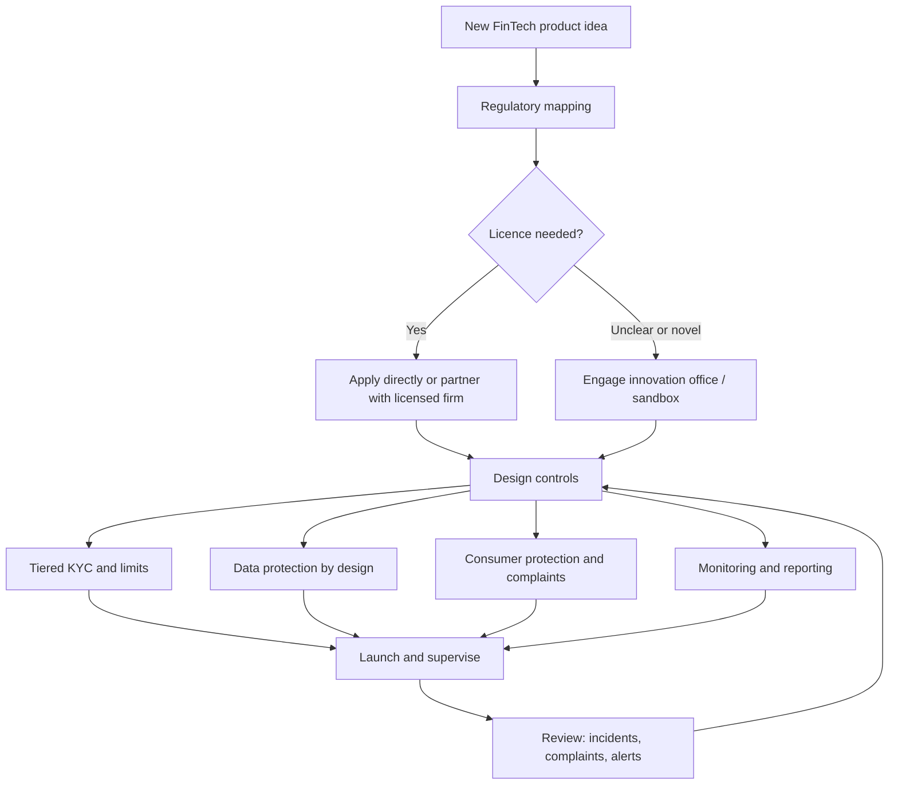

## Introduction

Every digital payment, wallet top-up or instant loan rests on a promise: the customer's money will be there tomorrow, the provider will not misuse personal data, and criminals will not be able to use the service to launder proceeds or finance harm. Regulation is the machinery that makes this promise credible. For a FinTech founder, a bank product manager or a mobile network operator, regulation is not an obstacle that appears after the product is built; it shapes who may offer the service, how customers are identified, how funds are held and how complaints are resolved.

This lesson builds on the earlier lessons on FinTech, mobile money and the Ghanaian ecosystem. It explains the objectives of financial regulation, the main regulatory instruments, and the compliance functions a digital finance business must run. It then examines regulatory sandboxes and the idea of designing compliance into products from the start. The lesson describes Ghanaian and international frameworks at a general level. Licence categories, thresholds, fees and deadlines change frequently, so always consult current publications of the Bank of Ghana and other authorities. This material is educational and is not legal, regulatory or financial advice.

## Learning Objectives

- Explain the main objectives of financial regulation and why digital finance raises distinctive regulatory challenges.
- Distinguish licensing, prudential supervision, conduct supervision and market integrity as regulatory functions.
- Describe how AML/CFT obligations and tiered KYC work, and evaluate their effect on financial inclusion.
- Apply data protection principles and consumer protection rules to the design of a digital financial product.
- Evaluate regulatory sandboxes and compliance by design as approaches to balancing innovation and risk.

## Prerequisite Knowledge

- The Digital Finance lessons on FinTech and digital banking and on mobile money and digital wallets.
- The Ghanaian mobile money ecosystem lesson, especially the roles of the Bank of Ghana and GhIPSS.
- The payment security module (fraud types, authentication).

## Key Terminology

- **Anti-money laundering and countering the financing of terrorism (AML/CFT)**: Measures that prevent financial services from being used to disguise criminal proceeds or fund terrorism.
- **Know Your Customer (KYC)**: Procedures for identifying and verifying customers and understanding the purpose of the account.
- **Tiered KYC**: A risk-based approach in which accounts with low limits need lighter identification, and higher limits require fuller verification.
- **Regulatory sandbox**: A supervised, time-limited environment in which firms test innovations with real customers under tailored regulatory conditions.

## Detailed Explanation

### Why financial services are regulated

Financial services are regulated because markets for money have predictable failure modes. Four rationales recur. **Stability**: a failing provider can harm many customers at once, so prudential rules require, for e-money, that funds equal to outstanding balances are held safely and apart from the issuer's own assets. **Consumer protection**: providers know more than customers about fees and risks, and first-time users can be misled or sold unsuitable products. **Market integrity**: payment systems can move illicit funds quickly, so providers must know who uses them and report suspicious activity. **Competition and inclusion**: regulators increasingly aim to widen access and keep markets contestable, for example through interoperability rules.

Digital finance does not remove these rationales; it changes how they apply. Speed means that fraud and errors scale quickly. Non-bank providers, such as telecom operators and software firms, perform bank-like functions without being banks. Data becomes both an asset and a risk. Products are assembled from partners (a wallet provider, a bank, a cloud host, a scoring vendor), which blurs who is responsible when something goes wrong.

### The regulatory architecture

It is useful to separate four functions that a single authority may perform or that several may share.

| Function | Question it answers | Typical tools |
|---|---|---|
| Licensing and authorisation | Who may offer this service? | Licence categories, fit and proper tests, minimum capital, business plans |
| Prudential supervision | Will the provider stay safe and solvent? | Safeguarding of customer funds, capital, liquidity, audits, reporting |
| Conduct supervision | Are customers treated fairly? | Disclosure rules, complaint handling, agent oversight, marketing controls |
| Market integrity | Is the system protected from abuse? | AML/CFT rules, sanctions screening, fraud reporting, cybersecurity standards |

In Ghana, the **Bank of Ghana** is the principal authority for banks, specialised deposit-taking institutions, payment systems and electronic money. The **Payment Systems and Services Act, 2019 (Act 987)** provides the framework for licensing and supervising payment service providers, e-money issuers and payment system operators, and the Bank of Ghana's **FinTech and Innovation Office** is the point of engagement for innovators and runs its regulatory sandbox. The Bank of Ghana also operates under its governing legislation and the banking legislation (the Banks and Specialised Deposit-Taking Institutions Act, 2016 (Act 930)). Other relevant bodies include the **Data Protection Commission** under the **Data Protection Act, 2012 (Act 843)**, the **Financial Intelligence Centre** under the **Anti-Money Laundering Act, 2020 (Act 1044)**, the **Cyber Security Authority** under the **Cybersecurity Act, 2020 (Act 1038)**, and sector bodies such as the Securities and Exchange Commission, the National Insurance Commission and the National Pensions Regulatory Authority for investment, insurance and pension FinTech. A product that spans payments, savings and insurance can therefore fall under several regulators at once, and a founder must map this at the start.

### AML/CFT and KYC

Money laundering is commonly described in three stages: **placement** (getting cash into the financial system), **layering** (moving it through transactions to obscure its origin) and **integration** (returning it to the economy as apparently legitimate wealth). Mobile money and instant payments are attractive for layering because transfers are fast and cheap. International standards for AML/CFT are set by the **Financial Action Task Force (FATF)**, an intergovernmental body whose recommendations countries implement through national law. Ghana's Anti-Money Laundering Act, 2020 (Act 1044) is part of that national implementation.

Providers typically operate customer due diligence (identifying and verifying the customer and understanding expected use, with enhanced checks for higher-risk customers such as politically exposed persons), ongoing monitoring for patterns such as rapid in-and-out movement or structuring below thresholds, escalation of suspicious transactions to the compliance function and, where required, to the national financial intelligence unit, sanctions screening, and record keeping and staff training that extend to agents.

A **risk-based approach** is central. It means that a low-value wallet used mainly for airtime and small transfers can be treated lightly, whereas a high-volume merchant account receiving payments from many countries warrants closer scrutiny. This principle underlies **tiered KYC**: a basic account might need only limited identity information and carry low balance and transaction limits, a mid-level account needs a national identity document, and a fully verified account carries higher limits. Tiering exists because strict identification can exclude people who lack documents, and exclusion pushes them back to cash or informal channels that are harder to monitor. In Ghana, national identification, the Ghana Card, and the linking of SIM registration to identity data have become important elements of the verification landscape; the exact rules and deadlines are set by regulators and have changed over time, so consult current sources.

Tiered KYC illustrates a general tension that students should be ready to discuss: strict controls reduce financial crime risk but can reduce inclusion, while light controls widen access but raise risk. The regulatory skill lies in calibrating controls to risk, supported by transaction limits, monitoring and digital identity.

### Data protection

Digital finance generates detailed behavioural data: who pays whom, when, how much and from where. Under the **Data Protection Act, 2012 (Act 843)**, organisations that process personal data are expected to follow recognised principles, which are widely shared with other data protection laws. In plain terms they include lawfulness and fairness, purpose limitation (wallet data collected for payments should not be quietly reused for loan marketing without a proper basis), minimality, accuracy, limited retention, security safeguards, openness to the data subject, and accountability, which usually includes registration with the Data Protection Commission as the law requires.

For FinTech, the practical questions are consent design for credit scoring that uses phone data, sharing data with partners and third-party SDKs, storing data abroad, and responding to breaches. A breach is both a security incident and a potential data protection violation.

### Consumer protection and complaints

Conduct rules protect customers from harms that financial-crime rules do not address. Typical expectations are **transparent pricing** (fees and the total cost of credit disclosed before the transaction, in plain language and in the channels customers actually use, including USSD), **fair treatment and suitability** of products, **agent accountability** (the provider is generally responsible for its agents, including overcharging), responsible **digital credit** (very short, high-cost loans have drawn international concern about over-indebtedness, opaque pricing and abusive collection), accessible **complaints and redress** with stated resolution times and escalation to the regulator, and clear rules on **fraud liability** and reversal of wrongly sent funds.

The Bank of Ghana has issued directives and guidelines on consumer protection and complaint handling for regulated institutions; the current instruments should be checked on its website. A useful teaching point is that effective protection depends on **enforcement and awareness** as much as on rules: a customer who does not know where to complain, or cannot afford to, gets little benefit from a good rule.

### Regulatory sandboxes and innovation offices

Regulators face a recurring dilemma: intervene too early and innovation may be stifled, wait too long and harms may spread (a version of the Collingridge dilemma in technology policy). Sandboxes, pilots and staged licensing are attempts to gather evidence while keeping the stakes small (see Arner, Barberis and Buckley, 2016).

A **regulatory sandbox** lets firms test products with real customers, within limits, under close supervision. A typical sandbox has an application and eligibility stage (the innovation must be genuine, beneficial and not fit existing rules easily), agreed boundaries (number of customers, transaction caps, duration), safeguards (customer disclosure, compensation arrangements, exit plan) and regular reporting. At the end the firm either exits, proceeds to full authorisation, or stops. Regulators gain evidence about new risks; firms gain regulatory clarity earlier and sometimes faster access to the market.

Sandboxes are not a free pass. They do not waive consumer protection or AML basics, and they do not guarantee later approval. Critics note that they take regulatory resources, may favour well-resourced applicants and can create a perception of endorsement. **Innovation offices** (sometimes called innovation hubs) offer a lighter alternative: a contact point where firms can ask questions without entering a formal test. The Bank of Ghana's FinTech and Innovation Office and its regulatory sandbox are examples of this approach.

### Compliance by design

Compliance by design treats regulatory requirements as product requirements. In practice this means mapping regulators, licences and laws to each feature at concept stage; minimising data before forms and databases are built; building KYC tiers, limits, screening and audit logs into the transaction flow so a back-end error cannot bypass them; segregating customer funds with reconciliation reports; logging decisions, consents and complaints as evidence; governing third parties such as aggregators, agents and cloud providers, since the regulator holds the licensed firm responsible; and using RegTech tools for identity verification, monitoring and reporting, while supervisors increasingly use SupTech to analyse the data they receive.

## Worked Example

### Designing the compliance layer for a wallet product

**Illustrative scenario:** A hypothetical start-up, "KasaPay", plans a savings and payments wallet for market traders. It wants onboarding by phone, a micro-credit feature scored from transaction history, and cross-border transfers to a neighbouring country in a later phase.

**Step 1: map the perimeter.** Holding customer balances and issuing e-value points to e-money rules; processing transfers points to payment service licensing; micro-credit raises lending rules; cross-border transfers add foreign exchange and remittance rules. KasaPay decides to partner with a licensed issuer for phase one instead of seeking its own licence, and documents that the licensed partner remains accountable to the regulator.

**Step 2: design tiered KYC.**

Basic tier: name, phone number and basic identity data, with very low limits so new users can try the service. Standard tier: a national identity number verified against a trusted source, with moderate limits. Enhanced tier: additional documents, business registration and source of funds, with higher limits. The limits are placeholders: the real values come from current regulatory instruments and the partner's licence conditions.

**Step 3: data protection.** KasaPay records a lawful basis and a clear consent screen for the credit-scoring feature, states that scoring uses only in-app transaction history, avoids collecting phone contacts, sets a retention period, and appoints a person responsible for data protection.

**Step 4: consumer protection.** The app and USSD menu show fees before confirmation. The credit feature displays the total repayment amount and due date in simple language. A complaint button leads to a ticket with a reference number and a promised response time, and unresolved cases are told how to escalate to the regulator.

**Steps 5 and 6: monitor and evaluate.** Rules flag accounts that receive many small deposits and quickly forward the sum (a layering pattern), a compliance officer reviews and records each alert, and KasaPay tracks tier completion, alert volumes, complaint resolution times and confirmed fraud, adjusting tier limits with its partner and the regulator if they block normal use.

## Ghanaian Business Application

A Ghanaian FinTech, bank or MNO subsidiary can use this framework as a launch checklist. First, determine which authorities are relevant to each feature: the Bank of Ghana for payments and e-money, the Data Protection Commission for personal data, the Financial Intelligence Centre for AML reporting, the Cyber Security Authority for security incidents, and sector regulators for investment, insurance or pensions. Second, decide whether to obtain a licence or partner with a licensed institution, remembering that partnership does not remove conduct and data duties. Third, engage the Bank of Ghana's FinTech and Innovation Office early and consider the sandbox for genuinely novel products. Fourth, design for customers with limited documents, limited literacy and feature phones: tiered KYC, plain-language disclosures and accessible complaint channels. Compliance cost is real for small firms, so the strategic question is how to spread it through shared services, aggregators and RegTech.

## International Case Study

### The United Kingdom's regulatory sandbox

The UK Financial Conduct Authority launched one of the first formal regulatory sandboxes in 2016, accepting cohorts of firms to test products with real customers under agreed safeguards. Many jurisdictions, including several in Africa and Asia, later introduced sandboxes or innovation hubs, adapting the model to local capacity. Three lessons stand out. A sandbox works best with clear eligibility criteria and defined exit routes, so that testing leads to a decision. Regulators learned about emerging risks and sometimes revised guidance, so a sandbox is also a learning tool for the supervisor. And it is resource-intensive, so smaller regulators often prefer a narrower design or an innovation office. Evidence on outcomes is still debated, so treat the sandbox as one tool among several.

## Diagram

## Common Misconceptions

- "Regulation only slows innovation." Well-designed rules build the trust that adoption depends on; the problem is poorly calibrated rules, not regulation as such.
- "A sandbox exempts a firm from the law." Sandbox participants still owe core protections to customers and must follow the conditions agreed with the regulator.
- "Tiered KYC means weaker AML." Tiers apply light checks only where limits keep risk low, with monitoring continuing at every tier.
- "Partnering with a licensed bank removes my compliance duties." The partner is accountable to the regulator, but the FinTech still owes conduct, data protection and contractual duties.
- "Data protection is only an IT matter." It involves legal basis, consent design, retention, governance and customer rights, not only encryption.

## Common Examination Mistakes

- Naming laws without explaining what each requires or which function (licensing, AML, data, cyber) it serves.
- Quoting specific limits, fees or deadlines from memory instead of explaining the principle and directing to current sources.
- Presenting strict KYC as always good, ignoring the inclusion trade-off.
- Describing a sandbox as deregulation rather than supervised experimentation.
- Treating consumer protection as only a complaint hotline, ignoring disclosure, fair pricing and agent conduct.

## Critical Thinking Questions

1. When should a regulator prefer activity-based rules over entity-based licensing for FinTech, and what risks does each approach create?
2. How would you decide whether the inclusion benefits of a lighter KYC tier outweigh its added financial crime risk?
3. A lender wants to use phone metadata to score borrowers. Which data protection and consumer protection questions should be answered before launch?

## Practical Exercises

1. **Regulatory map.** Choose a FinTech product (for example a merchant lending app) and list each Ghanaian authority and law that may apply, with one sentence on why. *Expected output:* a one-page table citing official sources and the date consulted.
2. **KYC tier design.** Design a three-tier KYC scheme for a hypothetical wallet, stating the information required at each tier and justifying the limits as placeholders. *Expected output:* a table and a 200-word justification linking each tier to risk and inclusion.
## Key Takeaways

- Financial regulation addresses stability, consumer protection, market integrity and competition or inclusion; digital finance changes how these apply.
- Licensing, prudential, conduct and market integrity functions can sit with different authorities, so mapping the perimeter is the first compliance task.
- AML/CFT works through a risk-based approach, and tiered KYC links identification effort to account limits to protect inclusion.
- Data protection and consumer protection require lawful, transparent, minimal processing and accessible complaint and redress mechanisms.
- Regulatory sandboxes support evidence-based supervision of novel products but do not waive core obligations.
- Compliance by design embeds requirements in the product and evidence trail from the outset.

## Further Reading

- Arner, D. W., Barberis, J., & Buckley, R. P. (2016). FinTech, RegTech, and the reconceptualization of financial regulation. *Northwestern Journal of International Law & Business, 37*(3), 371-413.
- Financial Action Task Force. *The FATF Recommendations: International standards on combating money laundering and the financing of terrorism and proliferation*. (Current edition published by the FATF.)
- Payment Systems and Services Act, 2019 (Act 987) (Ghana).
- Data Protection Act, 2012 (Act 843) (Ghana).
- Anti-Money Laundering Act, 2020 (Act 1044) (Ghana).

## Video Resources

- [Bank of Ghana](https://www.bog.gov.gh/): Bank of Ghana. Official source for licensing, directives, consumer protection notices and information on the FinTech and Innovation Office.
- [Financial Action Task Force](https://www.fatf-gafi.org/): FATF. Official site for AML/CFT standards, guidance and publications.

## Revision Summary

Financial services are regulated to secure stability, protect consumers, preserve market integrity and widen access. Regulators license who may offer services, supervise safety and conduct, and impose AML/CFT duties based on a risk-based approach, of which tiered KYC is a key example. Data protection law limits how personal financial data may be collected and used, and consumer protection rules demand transparent pricing, accountable agents and effective complaint handling. Sandboxes and innovation offices let regulators learn about new products under supervision, while compliance by design makes regulatory requirements part of the product itself.

- Four functions: licensing, prudential, conduct, market integrity.
- Risk-based approach: tiered KYC trades control against inclusion.
- Act 987, Act 843, Act 1044 and Act 1038 each address a different risk.
- Sandbox is supervised testing, not an exemption.
- Compliance by design: map, minimise, embed controls, keep evidence.
