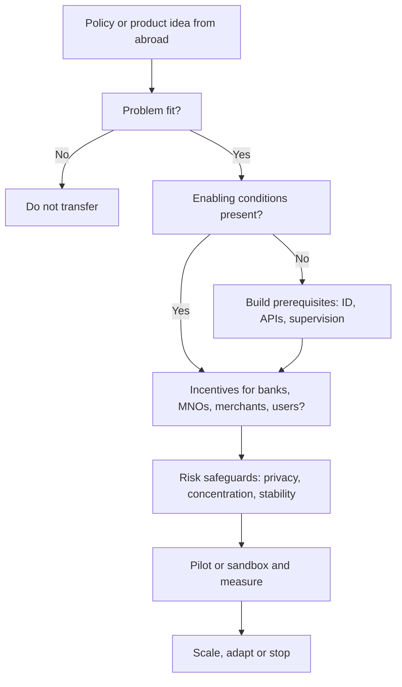

## Introduction

Digital finance is shaped by decisions taken in many countries at once. The European Union required banks to open customer data to authorised third parties. India built a public instant payment interface that private apps use. Brazil's central bank launched an instant payment system open to banks and non-banks. Kenya demonstrated that a mobile network operator could run a national payment network. Several central banks have experimented with digital versions of their currencies, with very different results. Studying these developments allows a Ghanaian student or practitioner to see which design choices produce which outcomes, and which lessons transfer to a different institutional context.

This lesson surveys six themes: open banking and APIs, instant payment systems, mobile money beyond Ghana, cross-border and remittance innovation, central bank digital currencies (CBDCs), and embedded finance. It distinguishes **established practice**, where there is a track record, from **emerging** or **speculative** developments, where evidence is still limited. Descriptions are kept at the level of widely documented facts, and no statistics are given unless widely established. The lesson is educational and is not financial or legal advice.

## Learning Objectives

- Explain how open banking and API-based data sharing work and compare the regulation-led and market-led approaches.
- Compare account-based instant payment systems such as India's UPI and Brazil's Pix with Ghana's arrangements.
- Analyse the factors behind the success and limits of mobile money in different countries.
- Evaluate innovations in cross-border payments and remittances, including their regulatory and cost challenges.
- Distinguish retail CBDCs, wholesale CBDCs and other digital money, and critically assess eNaira and the Bank of Ghana's eCedi pilot.
- Draw reasoned lessons for Ghana, distinguishing transferable principles from context-dependent choices.

## Prerequisite Knowledge

- The Digital Finance lessons on FinTech, mobile money and payment gateways.
- The Ghanaian mobile money ecosystem lesson and the regulation and compliance lesson in this module.
- The blockchain and digital finance module, especially cryptocurrencies and distributed ledgers.

## Key Terminology

- **Open banking**: A framework in which banks share customer account data and payment initiation capabilities with authorised third parties, with the customer's consent, through secure APIs.
- **PSD2**: The EU's second Payment Services Directive, which introduced requirements for strong customer authentication and for banks to give licensed third-party providers access to customer accounts.
- **Instant payment system**: A system that clears and settles account-to-account payments within seconds, around the clock.
- **UPI (Unified Payments Interface)**: India's real-time payment system, run by the National Payments Corporation of India.
- **Pix**: Brazil's instant payment system, introduced by the Central Bank of Brazil.
- **Central bank digital currency (CBDC)**: A digital form of a country's currency issued as a direct liability of the central bank.
- **Embedded finance**: The integration of financial services such as payments, credit or insurance into non-financial platforms and journeys.

## Detailed Explanation

Before copying any foreign model, ask what problem it solved, who led it, which enabling conditions (digital identity, mobile penetration, trusted institutions) existed, and what trade-offs it accepted.

### Open banking and APIs

Open banking turns bank-held data into a resource that customers can direct to other providers. With the customer's consent, a third party can retrieve transaction histories, which supports budgeting tools and credit assessment, or initiate payments directly from the customer's bank account, which can bypass card networks. Technically, the model relies on secure APIs, standard data formats, customer consent management and strong authentication.

Two broad approaches are visible.

| Approach | Description | Example |
|---|---|---|
| Regulation-led | Law or regulator requires banks to open APIs to licensed providers | The EU's PSD2; the UK's open banking programme, which began with a competition authority order on the largest banks and was supported by a standards body |
| Market-led | Banks and providers develop access through industry agreements and commercial deals, sometimes supported by regulator guidance | Various jurisdictions where banks offer APIs commercially |

Widely discussed benefits are more competition, better personal finance tools and richer data for lending to people with thin credit files. Concerns include privacy, liability when something goes wrong, third-party security, who bears API costs, and whether customers truly understand consent. Evidence on long-run outcomes varies by market, so state conclusions cautiously.

Open banking extends into broader **open finance** (insurance, pensions, investments), still emerging in many places. A related trend is **data portability rights** in data protection law, which give customers a basis for moving their data.

### Instant payment systems

Instant payment systems let customers send money from one bank account to another in seconds at any time. Established examples include the UK's Faster Payments service (introduced in 2008), the EU's SEPA Instant Credit Transfer scheme, and the United States' FedNow service (launched in 2023). Two public-sector-led systems have attracted special attention in emerging markets.

**India's UPI**, developed by the National Payments Corporation of India and launched in 2016, lets customers link bank accounts to apps and pay using virtual addresses or QR codes. Key design features are open, interoperable standards that allow many third-party apps to operate on the same rails, very low or zero merchant fees for many transaction types (a policy choice), and linkage with India's national digital identity infrastructure. UPI has been widely studied as an example of public digital infrastructure.

**Brazil's Pix**, introduced by the Central Bank of Brazil in late 2020, is run by the central bank and open to banks and authorised payment institutions. It supports payments by key (such as a phone number) or QR code, around the clock, and participation obligations on larger institutions helped drive rapid adoption.

What the cases share is **central coordination of an open, interoperable rail**, a user-friendly proxy identifier, and a public interest design that lowers prices. What differs is who operates the system and how fees are set. In Ghana, the **Ghana Interbank Payment and Settlement Systems (GhIPSS)** operates national infrastructure including instant interbank payments (known as GhIPSS Instant Pay), the gh-link card network, mobile money interoperability and the GhQR code. This places Ghana in the category of countries with a national switch coordinating multiple providers, so comparisons with UPI and Pix focus on pricing, merchant acceptance, ease of use and the inclusion of non-bank wallets.

### Mobile money beyond Ghana

Mobile money first scaled in East Africa. **M-Pesa** in Kenya (launched in 2007) is the best-known case, supported by an agent network, a simple remittance proposition and a flexible regulatory approach. Elsewhere in Africa, mobile money has grown in West and East African markets with varying structures: some countries have telecom-led e-money issuers, others require bank-led models. Outside Africa, **bKash** in Bangladesh is a frequently cited example of a mobile financial service operating through agents, while in the Philippines, wallet providers such as GCash grew alongside regulatory support for e-money. In China, **Alipay** and **WeChat Pay** show a different pattern: super-apps from technology platforms that embedded payments into social and commerce ecosystems, using QR codes.

Comparing these cases highlights the factors that shape outcomes: starting conditions (how inconvenient cash and bank alternatives were), agent distribution and profitability, the regulatory model (e-money safeguards and tiered KYC), market structure (one dominant provider versus several connected by interoperability), and whether payments grew into savings, credit and insurance under adequate consumer protection.

Mobile money's contribution to inclusion is well documented, though it does not by itself guarantee broad financial health; usage depth, quality of credit products and customer protection remain important.

### Cross-border payments and remittances

Cross-border payments have traditionally relied on chains of correspondent banks, which can make them slow, opaque and expensive, especially for small remittances. International bodies, including the G20 and the Financial Stability Board, have set out roadmaps to make cross-border payments faster, cheaper, more transparent and more inclusive. Innovation takes several forms. Traditional networks have added tracking and speed, for example SWIFT's gpi service. Specialist remittance firms and apps pool funds locally and pay out locally, reducing cross-border movements. Links between mobile money schemes and between national instant payment systems allow a wallet in one country to pay an account in another. Regional systems such as the **Pan-African Payment and Settlement System (PAPSS)**, supported by Afreximbank and the African Continental Free Trade Area (AfCFTA) Secretariat, aim to settle intra-African payments in local currencies instead of routing them through foreign currencies and external banks; adoption has progressed in stages, so check its current status. Stablecoins and crypto-assets for cross-border transfers are **emerging and contested**: they may offer speed and lower fees but raise questions of reserve backing, volatility, AML compliance, consumer protection and capital flow management, so treat claims of cost savings cautiously.

For Ghana, remittances from the diaspora are economically important, and the cost, speed and traceability of inbound transfers, as well as the use of mobile wallets as payout channels, are key policy and business questions.

### Central bank digital currencies

A CBDC is a digital liability of the central bank in the national unit of account. It differs from commercial bank deposits (a liability of a bank), from e-money (a liability of a licensed issuer backed by trust funds) and from cryptocurrencies such as Bitcoin (no issuer). A 2020 joint report by several central banks and the Bank for International Settlements set out foundational principles, including that a CBDC should coexist with cash and other forms of money and should not harm monetary or financial stability.

Design choices include retail versus wholesale; account-based or token-based; direct issuance or an intermediated model in which banks and payment firms serve the public; offline functionality; privacy features; and holding limits. Stated motives include inclusion, payment efficiency, resilience and monetary sovereignty. Risks include **disintermediation of banks** if people move deposits to the central bank, privacy and surveillance concerns, and cyber and operational burden.

The Bahamas' Sand Dollar was among the first national retail CBDCs. Nigeria's eNaira, launched by the Central Bank of Nigeria in October 2021, was a major African retail CBDC, and public reports indicated that uptake remained modest, which is often read as evidence that a CBDC must offer clear advantages over existing mobile money and bank apps. The Bank of Ghana has described its eCedi as a digital currency initiative in a pilot stage, with aims including inclusion and improved payments; because its status can change, rely on current Bank of Ghana statements. Wholesale CBDC experiments involving several central banks and the BIS are mainly **experimental**. In markets where mobile money and interoperability already work well, the added value of a retail CBDC is less obvious, and offline capability, privacy and resilience are the more plausible distinctive benefits. Claims that CBDCs will transform finance remain speculative until evidence accumulates.

### Embedded finance

Embedded finance means that non-financial platforms, such as marketplaces, ride-hailing apps, software providers or telecom services, offer financial products within their own journeys, often via licensed partners through APIs ("banking as a service"). Examples include a marketplace offering working capital to sellers based on their sales data, or an accounting platform that offers payments and lending to small firms. The model promises convenience, better data for underwriting and new distribution. Risks include blurred responsibility between platform and licensed provider, conduct risks if credit is pushed at the point of sale, data protection concerns, and concentration of dependencies on a few infrastructure providers. Regulators increasingly stress that the licensed entity remains accountable and that customers must know who provides the product.

## Theories, Frameworks and Models

### Public infrastructure versus private platforms

One framework distinguishes **public digital infrastructure** (open rails operated or coordinated by public authorities, on which many private actors innovate) from **private platform ecosystems** (closed networks run by firms). UPI and Pix lean to the first, Alipay and WeChat Pay to the second, and M-Pesa to a telecom-led hybrid shaped by regulation. Each affects competition, data control, resilience and innovation differently. Questions to ask: who sets the rules, who captures the data, who earns fees, and what happens if the operator fails?

### Policy transfer checklist

When considering a foreign model for Ghana, apply a five-step test.

1. **Problem fit**: is the problem the same?
2. **Prerequisites**: are identity, connectivity, data protection, interoperability and supervisory capacity in place?
3. **Incentives**: do banks, MNOs, merchants and users gain enough to participate?
4. **Risks and safeguards**: what new risks, such as concentration, privacy or financial stability, appear, and how would they be managed?
5. **Evidence and sequencing**: can it be piloted and measured before scaling?

## Worked Example

### Scoring a policy option against the checklist

**Illustrative scenario:** A hypothetical Ghanaian policy team is asked whether Ghana should require banks to offer standardised open banking APIs to licensed third parties. They use the policy transfer checklist and a simple weighted score. The scores are invented for teaching and are not evidence.

| Criterion | Weight | Score (1-5) | Weighted |
|---|---|---|---|
| Problem fit (limited use of data for SME lending) | 0.25 | 4 | 1.00 |
| Prerequisites (identity, data protection law, API capability in banks) | 0.25 | 3 | 0.75 |
| Incentives (banks may resist, FinTechs and SMEs gain) | 0.20 | 2 | 0.40 |
| Risk safeguards (consent, security, liability rules) | 0.20 | 3 | 0.60 |
| Evidence and sequencing (pilot possible in sandbox) | 0.10 | 4 | 0.40 |
| **Total** | 1.00 | | **3.15** |

**Interpretation.** The total of 3.15 out of 5 indicates a moderately favourable case, not an automatic yes. The team notes that the weakest criterion is incentives for banks. They therefore recommend a **staged approach**: first a voluntary standard and a sandbox pilot with willing banks, then review the experience, and only then consider mandatory obligations. They also state that the weights and scores are judgements which stakeholders should debate and revise, and that the method structures reasoning rather than producing a scientific answer.

## Ghanaian Business Application

Ghanaian firms can use these international developments as strategic scenarios. A bank can prepare for open banking by building secure APIs for its own channels and partners, since the capability is useful even without mandatory rules. An SME lender can use consented transaction data from wallets or bank accounts to assess borrowers with no formal credit history, within data protection law. A payment aggregator can position itself for cross-border demand through regional initiatives and remittance corridors, and an e-commerce platform can embed payments and working capital for sellers through licensed partners. At national level, GhIPSS interoperability, GhQR and the Ghana Card are building blocks similar to those behind UPI and Pix. Any plan involving CBDC or crypto-assets should rely on current Bank of Ghana and legal guidance, because policy is evolving.

## International Case Study

### Brazil's Pix

The Central Bank of Brazil launched Pix in November 2020 as an instant payment system operated by the central bank itself, available around the clock. Larger financial institutions were required to participate, and users could pay with a simple key such as a phone number, or by QR code. The design combined a public-interest rail, open participation for banks and authorised non-banks, and a user experience built around simple keys. Observers have noted rapid adoption by individuals and businesses, and effects on how payments are made for small merchants and person-to-person transfers. The case is useful for three reasons. First, it shows that a central bank can act as infrastructure provider, not only regulator. Second, mandatory participation helped create network effects quickly, which parallels the way interoperability in Ghana expanded network effects across providers. Third, it raises questions about competition with private payment methods, data governance and the role of the public sector. For Ghana, the transferable lesson is the combination of simple identifiers, universal QR, fair access and pricing policy; the context-specific parts are the scale of the Brazilian banking sector and its institutional structure.

## Diagram

## Common Misconceptions

- "UPI and Pix can simply be copied." They depend on identity, interoperability, bank participation and policy choices that differ by country.
- "A CBDC is the same as a cryptocurrency." A CBDC is issued by the central bank in the national currency, while cryptocurrencies have no issuer backing.
- "Open banking means banks share data with anyone." Access is limited to authorised providers, with customer consent and security requirements.
- "Mobile money only works where there is a single dominant provider." Ghana shows that several providers connected by interoperability can operate at scale.
- "Stablecoins have already solved cross-border payments." They remain contested, with unresolved regulatory, reserve and consumer protection questions.

## Common Examination Mistakes

- Giving statistics on adoption or transaction volumes from memory instead of describing patterns qualitatively.
- Presenting emerging developments, such as CBDC adoption or stablecoin payments, as proven success stories.
- Describing foreign systems without analysing what problem they solved and under what conditions.
- Confusing open banking (data and payment access for third parties) with open-source software or with public APIs generally.
- Concluding that Ghana should adopt a model without checking prerequisites and risks.

## Critical Thinking Questions

1. Why might a regulation-led open banking regime produce different results from a market-led one, and which is more suitable for Ghana's current conditions?
2. If mobile money and instant interbank payments already work in a country, what additional value could a retail CBDC provide, and what are the risks?
3. What design features of Pix and UPI could improve merchant acceptance in Ghana, and which would be hard to replicate?

## Practical Exercises

1. **Comparative table.** Compare two instant payment systems (for example UPI or Pix, and GhIPSS Instant Pay) on operator, participants, identifiers, QR use and pricing approach, using official sources. *Expected output:* a table with sources and dates, plus a 200-word comparison.
2. **Open banking consent design.** Design a consent screen for a budgeting app that requests account data, showing purpose, duration, data types and how to withdraw. *Expected output:* a wireframe or text mock-up with a short rationale linked to data protection principles.
3. **CBDC evaluation.** Write a 400-word assessment of whether Ghana's eCedi should prioritise offline payments, financial inclusion or cross-border use, citing the Bank of Ghana's current statements. *Expected output:* a short report with a recommendation and risks.

## Key Takeaways

- International models differ in problem, leadership, enabling conditions and trade-offs, so transfer requires analysis, not imitation.
- Open banking uses consented API access to data and payments, and can be regulation-led or market-led.
- Instant payment systems such as UPI and Pix combine open rails, simple identifiers and QR codes with public coordination.
- Mobile money outcomes depend on distribution, regulation, market structure and product expansion.
- Cross-border innovation includes better messaging, remittance firms, scheme links and regional systems like PAPSS, while stablecoin use remains contested.
- CBDCs vary widely in design and results, and their added value over existing digital payments must be demonstrated.
- Embedded finance extends reach but raises accountability and conduct questions.

## Further Reading

- Bank for International Settlements, Bank of Canada, European Central Bank, Bank of Japan, Sveriges Riksbank, Swiss National Bank, Bank of England, & Board of Governors of the Federal Reserve System. (2020). *Central bank digital currencies: Foundational principles and core features*. Bank for International Settlements.
- Demirgüç-Kunt, A., Klapper, L., Singer, D., & Ansar, S. (2022). *The Global Findex Database 2021: Financial inclusion, digital payments, and resilience in the age of COVID-19*. World Bank.
- Jack, W., & Suri, T. (2014). Risk sharing and transactions costs: Evidence from Kenya's mobile money revolution. *American Economic Review, 104*(1), 183-223.
- Directive (EU) 2015/2366 of the European Parliament and of the Council on payment services in the internal market (PSD2).

## Video Resources

- [Bank for International Settlements](https://www.bis.org/): BIS. Publications and innovation hub projects on CBDCs, payments and cross-border arrangements.
- [Central Bank of Brazil](https://www.bcb.gov.br/): Banco Central do Brasil. Official information on Pix.
- [National Payments Corporation of India](https://www.npci.org.in/): NPCI. Official information on UPI.
- [Afreximbank](https://www.afreximbank.com/): African Export-Import Bank. Official information on PAPSS and intra-African trade finance.

## Revision Summary

International developments show several design families. Open banking opens bank data and payment initiation to authorised third parties through APIs. Instant payment systems such as UPI and Pix combine open rails, simple identifiers and QR codes with public coordination, and GhIPSS plays a comparable infrastructure role in Ghana. Mobile money spread through agents and flexible regulation, cross-border payments are being improved by scheme and regional links, and CBDCs such as eNaira and the eCedi pilot must prove added value over existing digital payments. Embedded finance brings financial products into non-financial platforms. Ghana should test each model for problem fit, prerequisites, incentives, risks and pilot evidence.

- Open banking: consented API access, regulation-led or market-led.
- UPI and Pix: open rails, simple identifiers, public coordination.
- Mobile money: distribution, regulation and market structure drive outcomes.
- CBDC: not a cryptocurrency; value over mobile money must be shown.
- Test every foreign model: problem, prerequisites, incentives, risks, pilot.
