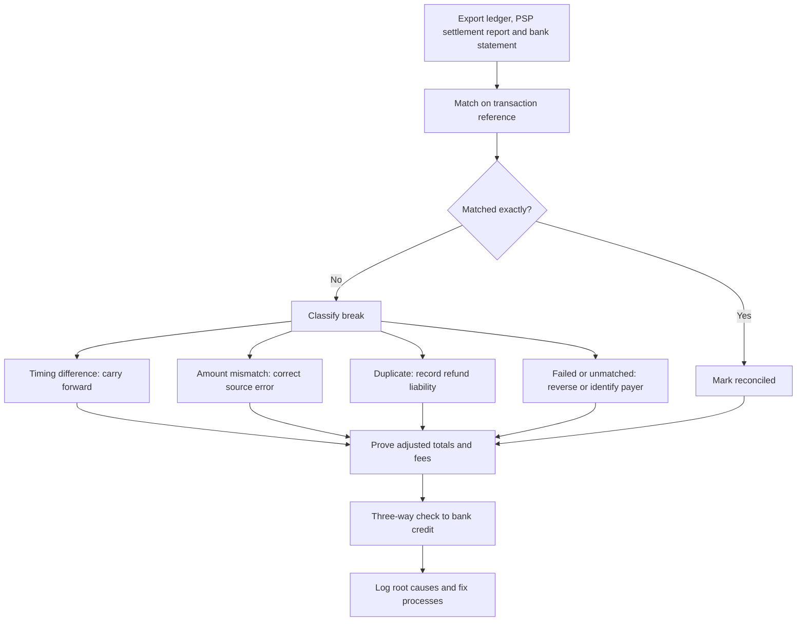

## Introduction

Authentication and encryption make payments harder to attack, but no control is perfect. Fraudsters adapt, customers make mistakes, systems fail mid-transaction and providers occasionally settle the wrong amount. A business that accepts digital payments therefore needs three further capabilities: the ability to **prevent and detect fraud**, a disciplined approach to **managing payment risk**, and a reliable process of **reconciliation** that proves every cedi recorded as received has actually arrived in the bank.

This lesson treats these capabilities as one control system. Fraud controls reduce the probability of loss; risk management decides which risks deserve investment; reconciliation is the detective control that catches what the others miss. You will study the fraud types most relevant to mobile money and card payments, learn how rule-based and score-based detection work, apply a risk assessment matrix and complete a full reconciliation worked example. The content is educational and does not replace professional audit, legal or regulatory advice.

## Learning Objectives

- Explain how SIM swap fraud, social engineering, account takeover and friendly fraud are carried out and which controls address each.
- Compare rule-based and score-based fraud detection and evaluate their trade-offs in false positives and adaptability.
- Apply a likelihood-impact matrix and the four risk treatment options to digital payment risks.
- Perform a reconciliation of a merchant ledger against a PSP settlement report and a bank statement.
- Classify and resolve reconciliation breaks such as timing differences, duplicates, amount mismatches and unmatched items.

## Prerequisite Knowledge

- The previous lesson on payment authentication and transaction security.
- Understanding of authorisation, clearing and settlement, and of payment service provider fees.
- Basic bookkeeping concepts such as debits, credits and ledgers are helpful.

## Key Terminology

- **SIM swap fraud**: Fraud in which a criminal transfers a victim's mobile number to a SIM card they control, then intercepts OTPs or resets wallet and banking credentials.
- **Social engineering**: Manipulating people into revealing credentials or authorising payments, for example through deceptive phone calls, messages or impersonation.
- **Account takeover (ATO)**: Gaining control of a legitimate customer's account and using it to make payments or change details.
- **Friendly fraud**: A cardholder disputing a genuine purchase they made or authorised, often to obtain a refund while keeping the goods; also called first-party misuse.
- **Chargeback**: A reversal of a card payment initiated through the card scheme's dispute process.
- **Velocity rule**: A fraud rule that limits the number or value of transactions within a time window.
- **False positive**: A legitimate transaction wrongly flagged or declined as fraudulent.
- **Reconciliation**: The process of comparing two or more independent records of the same transactions and investigating differences.
- **Break**: Any difference found during reconciliation that must be explained and resolved.
- **Settlement report**: A PSP's statement of transactions, fees and the net amount it will pay to the merchant.

## Detailed Explanation

### Fraud types in digital payments

**SIM swap fraud** exploits the role of the phone number as a possession factor. The fraudster gathers personal information, then persuades or deceives staff into issuing a replacement SIM, or uses an insider. Once the victim's phone loses signal, the fraudster receives OTPs and can reset PINs. Controls include stricter identity verification for SIM replacement, temporary limits on wallet activity after a SIM change, and APIs that let banks check whether a number's SIM was recently changed.

**Social engineering** targets people rather than systems. Common patterns include callers impersonating a provider's customer service, a "wrong transfer" message asking the recipient to return money that was never actually sent, fake prize notifications and impersonation of a company executive instructing staff to make an urgent transfer. Technical controls help, but awareness campaigns, clear rules that staff never ask for PINs, and verification through a second channel are essential.

**Account takeover** follows credential theft through phishing, password reuse or malware. Signals include a login from a new device, a change of phone number or e-mail followed soon by a large payment, and new beneficiaries. Controls include device binding, step-up authentication for sensitive changes and cooling-off periods before newly added beneficiaries receive large payments.

**Friendly fraud** arises after a genuine purchase: the customer claims non-receipt or non-recognition. It is hard to prevent with authentication because the customer *was* authenticated. Controls are evidential: clear billing descriptors, delivery confirmation, signed proof of delivery, accessible refund policies and good records for dispute responses.

Other important types include **card-not-present fraud** using stolen card details, **refund and return abuse**, **merchant or agent collusion** and **insider fraud** by staff with system access.

### Control layers

Fraud controls are usually classified as **preventive** (stop the event, such as authentication or transaction limits), **detective** (identify it, such as monitoring alerts and reconciliation) and **corrective** (limit and recover the damage, such as account freezing, reversal requests and customer refunds). Layering matters because each control has gaps.

### Rule-based and score-based detection

A **rule-based** system applies explicit conditions: "decline if more than five wallet-to-wallet transfers in ten minutes", "hold if a new beneficiary receives more than a set amount within 24 hours of being added". Rules are transparent, quick to deploy and easy to explain to regulators and customers. Their weaknesses are rigidity, because fraudsters learn the thresholds and operate just beneath them, and the tendency for rule sets to grow into hundreds of overlapping conditions that generate false positives.

A **score-based** system combines many signals into a single risk score, either through weighted points, as in the previous lesson, or through statistical and machine-learning models trained on historical fraud labels. Scores capture interactions between signals and adapt when retrained, but they demand quality data, careful monitoring for drift and attention to explainability and fairness. Most mature providers use a hybrid: hard rules for regulatory and obvious cases, a score for nuanced decisions and human analysts for review queues.

Detection performance should be evaluated on several dimensions at once: fraud caught, false positives, customer friction and operational cost of manual review. Optimising only for fraud caught can drive away good customers.

## Theories, Frameworks and Models

### The risk management cycle

Payment risk management follows a cycle common to frameworks such as ISO 31000: **identify** risks, **assess** them, **treat** them, then **monitor and review**. Assessment frequently uses a likelihood-impact matrix:

| Risk (illustrative) | Likelihood (1–5) | Impact (1–5) | Rating | Treatment |
|---|---|---|---|---|
| Customers tricked into revealing PINs | 4 | 3 | 12 (high) | Reduce: awareness messages, PIN-never-shared policy |
| Chargebacks from friendly fraud | 3 | 2 | 6 (medium) | Reduce: delivery evidence, clear descriptors |
| PSP outage during peak sales | 2 | 4 | 8 (medium) | Reduce and transfer: second PSP, contractual service levels |
| Large card data breach | 1 | 5 | 5 (medium) | Avoid: hosted checkout so card data is never stored |
| Small cash-handling discrepancies | 3 | 1 | 3 (low) | Accept: monitor through reconciliation |

The four treatment options are **avoid** (stop the activity), **reduce** (apply controls), **transfer** (insurance, contracts, liability shift) and **accept** (tolerate within risk appetite). Governance commonly follows the Institute of Internal Auditors' Three Lines Model: operational management owns risks, risk and compliance functions oversee them, and internal audit provides independent assurance.

## Worked Example

### Reconciling a ledger to a settlement report

**Illustrative scenario:** Nhyira Naturals, a hypothetical Kumasi cosmetics SME, sells through its website and WhatsApp. Payments are collected by a PSP that charges a 2% fee and settles net amounts to the merchant's bank account the next working day. Some WhatsApp orders are keyed into the ledger by hand.

**Merchant ledger (orders marked paid on 14 March)**

| Ledger ref | Order | Amount (GHS) |
|---|---|---|
| T1001 | ORD-501 | 250.00 |
| T1002 | ORD-502 | 120.00 |
| T1003 | ORD-503 | 480.00 |
| T1004 | ORD-504 | 75.00 |
| T1005 | ORD-505 | 300.00 |
| T1006 | ORD-506 | 60.00 |
| **Total** | | **1,285.00** |

**PSP settlement report (transactions dated 14 March)**

| PSP ref | Merchant ref | Gross | Fee (2%) | Net |
|---|---|---|---|---|
| P-9001 | T1001 | 250.00 | 5.00 | 245.00 |
| P-9002 | T1002 | 120.00 | 2.40 | 117.60 |
| P-9003 | T1003 | 408.00 | 8.16 | 399.84 |
| P-9004 | T1005 | 300.00 | 6.00 | 294.00 |
| P-9005 | T1005 | 300.00 | 6.00 | 294.00 |
| P-9006 | (none) | 90.00 | 1.80 | 88.20 |
| **Total** | | **1,468.00** | **29.36** | **1,438.64** |

**Step 1 — Match on reference.** T1001, T1002 and the first T1005 match exactly. T1003 matches on reference but not amount.

**Step 2 — Classify the breaks.**

1. *T1003 amount mismatch (480.00 versus 408.00).* The difference is 72.00. A difference divisible by 9 is a classic sign of transposed digits. The PSP record shows the customer paid GHS 408.00, which matches the original WhatsApp order; the ledger entry was mis-keyed. **Resolution:** correct the ledger to 408.00.
2. *T1004 missing from settlement (75.00).* The PSP dashboard shows the payment succeeded at 23:52, after the daily cut-off, so it appears in the next report. **Resolution:** a timing difference; carry forward and confirm next day.
3. *T1006 missing from settlement (60.00).* The PSP shows the payment as failed, yet the ledger marked it paid because the shop updated status when the customer was redirected back rather than on a verified callback. **Resolution:** reverse the ledger entry, stop dispatch, contact the customer, and fix the integration so orders are marked paid only on a verified notification.
4. *Duplicate T1005 (P-9005).* The customer was charged twice after pressing "pay" again during a slow response. **Resolution:** record a refund liability of 300.00, refund the customer and add idempotency keys to the payment request.
5. *Unmatched P-9006 (90.00).* A payment with no merchant reference, made through a shared payment link. **Resolution:** identify the payer from the PSP details, then either record the sale or refund.

**Step 3 — Prove the reconciliation.**

```text
Ledger total                         1,285.00
Less timing difference (T1004)         -75.00
Less failed payment (T1006)            -60.00
Less keying error correction (T1003)   -72.00
Add duplicate charge (refund owed)    +300.00
Add unmatched receipt (P-9006)         +90.00
Adjusted gross                       1,468.00  = settlement gross
Less PSP fees                          -29.36
Expected bank credit                 1,438.64
```

**Step 4 — Three-way check.** The bank statement shows a credit of GHS 1,438.64 from the PSP on 15 March, completing a three-way match between ledger, settlement report and bank. Fees should also be checked: 2% of 1,468.00 is 29.36, confirming the PSP applied the contracted rate.

The example demonstrates that reconciliation is not merely accounting. Two of the five breaks revealed design flaws (status set on redirect, missing idempotency) and one revealed a customer-service obligation (the duplicate refund).

## Ghanaian Business Application

In Ghana, mobile money fraud awareness messages from providers and the Bank of Ghana regularly warn customers never to share PINs and to be wary of "wrong transfer" requests. The Cyber Security Authority, established under the Cybersecurity Act, 2020 (Act 1038), also runs public awareness activities. For SMEs, the practical implications are clear: train staff never to request PINs or OTPs, confirm unexpected "refund" requests by checking the actual wallet or PSP balance rather than SMS messages (which can be forged), and reconcile daily.

Reconciliation is particularly important where businesses collect through several channels: personal or merchant mobile money wallets across different networks, a card PSP and bank transfers. Mixing personal and business wallets makes reconciliation almost impossible and weakens evidence in disputes. A sound practice is to use dedicated merchant collection accounts, require an order reference on every payment, and export PSP settlement reports for daily matching. Anti-money laundering obligations under the Anti-Money Laundering Act, 2020 (Act 1044) apply to regulated institutions, and PSPs may ask merchants to explain unusual patterns.

## International Case Study

### The 2016 Bangladesh Bank cyber-heist

In February 2016, attackers who had compromised systems at Bangladesh Bank used the bank's credentials to send fraudulent payment instructions over the SWIFT network to its account at the Federal Reserve Bank of New York. Most instructions were blocked, partly because of errors in the messages and screening by intermediaries, but a large sum was transferred to accounts in the Philippines and laundered, and only part was recovered. Public reporting described how malware interfered with the local software and the printed confirmations used to check transactions, and how the timing across weekends and holidays in different countries delayed detection.

The case illustrates several principles of this lesson. Valid credentials do not guarantee a legitimate instruction, so authentication alone is insufficient. Detective controls such as independent reconciliation and confirmation monitoring are only effective if they cannot be tampered with by the same compromise. Speed of detection determines recoverability. In response, SWIFT launched its Customer Security Programme, setting security controls for its users, an example of a network raising the baseline for all participants.

## Diagram



## Common Misconceptions

- "Strong authentication eliminates fraud." Friendly fraud and social engineering involve the genuine customer authenticating, so authentication cannot stop them.
- "More fraud rules always mean better protection." Excessive rules raise false positives, frustrate customers and are easily learned and evaded by fraudsters.
- "Reconciliation is an accounting chore done at month end." Daily reconciliation is a detective control that reveals fraud, integration defects and customer obligations quickly.
- "If the bank credit matches the settlement total, everything is reconciled." The ledger may still contain failed payments marked as paid or unrecorded receipts; all three records must agree.
- "SMS confirmation of a payment proves the money arrived." SMS messages can be forged; merchants should confirm in the wallet or PSP dashboard.

## Common Examination Mistakes

- Describing fraud types without linking each to specific preventive, detective and corrective controls.
- Treating rule-based and machine-learning detection as mutually exclusive rather than complementary.
- Presenting a risk matrix without justifying likelihood and impact scores or the chosen treatment.
- In reconciliation questions, netting breaks together instead of explaining and resolving each one.
- Forgetting to verify PSP fees and to complete the match to the bank statement.

## Critical Thinking Questions

1. A PSP proposes replacing its rule set with a machine-learning model. What evidence would you require before approving the change, and how would you manage explainability to merchants?
2. Who should bear the loss in a SIM swap fraud: the customer, the MNO, the e-money issuer or the bank? Justify your answer with reference to control ownership.
3. How might a fraud control that is effective for card payments become counter-productive for low-value mobile money payments in rural areas?
4. Why does the Bangladesh Bank case suggest that detective controls must be independent of the systems they monitor?

## Practical Exercises

1. **Fraud control map.** For each of SIM swap, social engineering, account takeover and friendly fraud, list one preventive, one detective and one corrective control for a hypothetical Ghanaian online electronics shop. *Expected output:* a 4 × 3 table with a one-line justification per control.
2. **Reconciliation practice.** Create an invented ledger of eight transactions and a settlement report containing one of each break type (timing, amount mismatch, duplicate, failed, unmatched). Exchange with a classmate and reconcile each other's data. *Expected output:* a reconciliation proof that ties the adjusted ledger to settlement gross and the bank credit.
3. **Risk register.** Build a risk register of six payment risks for a small hotel that accepts mobile money and cards. *Expected output:* likelihood, impact, rating, treatment option and owner for each risk.

## Key Takeaways

- Key fraud types include SIM swap, social engineering, account takeover and friendly fraud, each requiring different controls.
- Preventive, detective and corrective controls should be layered because each has gaps.
- Rule-based detection is transparent but rigid; score-based detection is adaptive but data-hungry; hybrids are common.
- Risk management identifies, assesses, treats (avoid, reduce, transfer, accept) and monitors risks.
- Reconciliation matches ledger, settlement report and bank, then classifies and resolves every break, often revealing process defects.

## Further Reading

- Anderson, R. (2020). *Security engineering: A guide to building dependable distributed systems* (3rd ed.). Wiley.
- International Organization for Standardization. (2018). *ISO 31000:2018 Risk management — Guidelines*. ISO.
- The Institute of Internal Auditors. (2020). *The IIA's Three Lines Model: An update of the Three Lines of Defense*. The IIA.
- PCI Security Standards Council. (2022). *Payment Card Industry Data Security Standard: Requirements and testing procedures* (Version 4.0). <https://www.pcisecuritystandards.org/>
- Cybersecurity Act, 2020 (Act 1038) (Ghana).

## Video Resources

- [Cyber Security Authority, Ghana](https://www.csa.gov.gh/) — Cyber Security Authority. Official site with public cyber-safety awareness material relevant to digital payment fraud.
- [Bank of Ghana](https://www.bog.gov.gh/) — Bank of Ghana. Official site with notices, payment systems information and consumer guidance.
- [OWASP Foundation](https://owasp.org/) — OWASP. Community guidance on application security, including authentication and session controls that prevent account takeover.

## Revision Summary

Digital payment fraud includes SIM swap, social engineering, account takeover, friendly fraud and card-not-present fraud. Controls should be layered as preventive, detective and corrective, combining transparent rules, adaptive scores and human review, judged on fraud caught, false positives and friction. Risk management assesses likelihood and impact and chooses to avoid, reduce, transfer or accept. Reconciliation matches the ledger to the PSP settlement report and the bank statement, resolving timing differences, mismatches, duplicates, failed payments and unmatched receipts individually.

- Authentication cannot stop friendly fraud or social engineering.
- Velocity and new-beneficiary rules counter account takeover.
- Risk rating = likelihood × impact; justify treatment.
- Adjusted ledger must equal settlement gross; less fees equals bank credit.
- Breaks reveal process defects — fix root causes.
