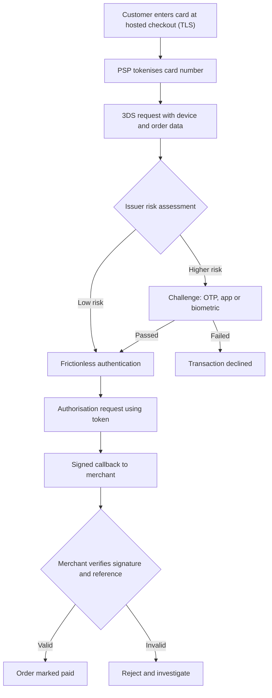

## Introduction

Every digital payment rests on two questions that the payment system must answer within seconds: *is this really the account holder?* and *has the instruction arrived exactly as it was sent?* The first is the problem of **authentication**; the second is the problem of **transaction security**, covering confidentiality, integrity and protection against replay. For a Ghanaian SME that has just begun accepting mobile money and card payments online, a single wave of fraud or a leaked customer database can wipe out the margin gained from going digital.

This lesson examines the main authentication mechanisms used in card and mobile money payments, from PINs and one-time passwords to EMV 3-D Secure, biometrics and risk-based authentication. It then explains how encryption in transit, message signing, tokenisation and the PCI Data Security Standard work together to protect payment data. Throughout, the emphasis is on evaluating trade-offs: stronger security usually adds friction, and the art of payment design is applying friction only where risk justifies it. This material is educational and does not constitute security, legal or regulatory advice.

## Learning Objectives

- Explain the three classes of authentication factor and apply them to PINs, OTPs, biometrics and device binding.
- Compare static, step-up and risk-based authentication approaches for card-not-present and mobile money payments.
- Describe the frictionless and challenge flows of EMV 3-D Secure and the concept of liability shift.
- Distinguish tokenisation from encryption and explain how each reduces the impact of a data breach.
- Explain the purpose and high-level structure of PCI DSS and how merchants reduce their compliance scope.

## Prerequisite Knowledge

- Familiarity with the payment transaction lifecycle (authorisation, clearing and settlement) from the Digital Finance module.
- A basic understanding of how mobile money wallets and payment gateways work.
- No prior cryptography knowledge is assumed beyond the idea that encryption scrambles data using a key.

## Key Terminology

- **Authentication**: The process of verifying that a person or device is who or what it claims to be before a payment is allowed.
- **Authentication factor**: A category of evidence used to authenticate: something you know (knowledge), something you have (possession) or something you are (inherence).
- **Multi-factor authentication (MFA)**: Authentication that requires evidence from at least two different factor categories.
- **One-time password (OTP)**: A short code valid for a single use or a short time window, delivered by SMS, app or hardware token.
- **EMV 3-D Secure (3DS)**: A card-scheme protocol that lets the card issuer authenticate the cardholder during an online purchase, using risk data and, where needed, a challenge.
- **Risk-based authentication (RBA)**: An approach that scores each transaction's risk and applies extra authentication steps only when the score exceeds a threshold.
- **Tokenisation**: Replacing a sensitive value, such as a card number, with a surrogate token that has no exploitable meaning outside a controlled system.
- **TLS (Transport Layer Security)**: The cryptographic protocol that encrypts and authenticates data travelling between a browser or app and a server.
- **PCI DSS**: The Payment Card Industry Data Security Standard, a set of security requirements for organisations that store, process or transmit cardholder data.
- **Replay attack**: Capturing a valid message and resending it to repeat a transaction without authorisation.

## Detailed Explanation

### Authentication factors and their weaknesses

Authentication evidence falls into three classes. **Knowledge** factors include PINs, passwords and security questions. They are cheap and familiar but can be guessed, observed over a shoulder or extracted through social engineering. **Possession** factors include a registered SIM card, a phone with a bound banking app, a smart card chip or a hardware token. They are stronger because an attacker must control a physical object, but possession can be transferred: SIM swap fraud works precisely by moving the victim's number to an attacker's SIM. **Inherence** factors are biometrics such as fingerprints and facial recognition. They are convenient and hard to share, yet they cannot be changed if compromised, they produce probabilistic matches rather than exact ones, and they raise privacy questions about where templates are stored.

Multi-factor authentication combines classes, not instances. A password plus a security question is still single-factor because both are knowledge. A mobile money PIN entered on the customer's own handset is stronger than it first appears, because the transaction is initiated from a SIM registered to the account: the network itself contributes a possession factor.

### PINs and OTPs in practice

In mobile money, the **PIN** is the primary authenticator, entered through USSD or an app. A key design principle is that the PIN should be entered only on the customer's device, never disclosed to an agent or merchant. Merchant "push" payments, where the merchant's system triggers a prompt on the customer's phone and the customer approves with a PIN, follow this principle.

**OTPs** add a possession factor to online card and banking transactions. SMS OTPs are widely used because they need no special app, but they inherit the weaknesses of the mobile network: SIM swap, interception of SMS and social engineering in which a fraudster persuades the victim to read out the code. App-generated OTPs and push approvals bound to a specific device are stronger, because they are tied to cryptographic keys on the handset rather than to the phone number.

### EMV 3-D Secure

Early versions of 3-D Secure redirected shoppers to a static password page that many found confusing. **EMV 3-D Secure (version 2.x)**, managed by EMVCo, redesigned the protocol around data. The merchant, through its payment service provider, sends the issuer a rich set of data: device characteristics, shipping address, account age and purchase history. The issuer's access control server assesses risk and chooses between:

- a **frictionless flow**, in which the issuer authenticates the customer silently on the basis of the data, and
- a **challenge flow**, in which the customer must complete a step such as an OTP, app approval or biometric check.

When a transaction is successfully authenticated through 3DS, card-scheme rules commonly shift liability for certain fraud chargebacks from the merchant to the issuer. This **liability shift** is a major commercial incentive for merchants to adopt 3DS, but scheme rules vary, so merchants should confirm details with their acquirer.

### Risk-based authentication

Risk-based authentication generalises the 3DS idea. Rather than demanding the same strong check for every payment, the system calculates a risk score from signals such as device recognition, location, amount relative to the customer's history, velocity (number of attempts in a short period) and recent account changes. Low-risk transactions proceed with minimal friction; medium-risk transactions trigger **step-up authentication**; high-risk transactions are declined or held for review. RBA depends on good data and continuous tuning to avoid excessive false declines.

### Transaction security: confidentiality, integrity and replay protection

Authentication confirms who is paying; transaction security protects the instruction itself.

- **Encryption in transit** using TLS protects data between the customer, the merchant and the PSP. Merchants must use valid certificates, disable obsolete protocol versions and enforce HTTPS across the whole site, not only the checkout page, because an attacker who can alter an unencrypted product page can redirect the customer to a fake checkout.
- **Encryption at rest** protects stored data, with keys managed separately from the data, ideally in a hardware security module (HSM). PIN processing at banks and switches relies on HSMs so that clear PINs never appear in ordinary memory.
- **Message integrity** ensures an instruction has not been altered. PSPs typically sign callback notifications (webhooks) with a shared secret or a digital signature; the merchant must verify the signature before marking an order as paid.
- **Replay protection** relies on unique transaction references, timestamps and **idempotency keys**, so that the same instruction submitted twice is processed only once.

### Tokenisation versus encryption

Encryption transforms data with a key; anyone with the key can reverse it. **Tokenisation** substitutes the data with a token and keeps the mapping in a secure **token vault**. A token has no mathematical relationship to the original value, so stealing tokens from a merchant database is far less damaging. Two forms are common. **PSP tokenisation** lets a merchant store a token for recurring billing while the PSP holds the card number. **Network tokenisation**, provided by card schemes, replaces the card number with a token that can be restricted to one merchant or device and updated automatically when a card is reissued.
### PCI DSS at an overview level

The **PCI Data Security Standard**, maintained by the PCI Security Standards Council, applies to any organisation that stores, processes or transmits cardholder data. Version 4.0, published in 2022, organises its twelve principal requirements under six broad goals:

| Goal | Illustrative requirement themes |
|---|---|
| Build and maintain a secure network and systems | Network security controls; secure configurations |
| Protect account data | Protect stored data; encrypt transmission over open networks |
| Maintain a vulnerability management programme | Anti-malware; secure systems and software development |
| Implement strong access control measures | Need-to-know access; user identification and authentication; physical access |
| Regularly monitor and test networks | Logging and monitoring; regular security testing |
| Maintain an information security policy | Policies and programmes that support security |

The most effective compliance strategy for a small merchant is **scope reduction**: using a PSP's hosted payment page or embedded fields so that card numbers never touch the merchant's servers. The merchant still has obligations, for example securing the page that loads the payment form, but these are far lighter than those of a business that stores card data itself. PCI DSS concerns card data; mobile money security is governed by the policies of e-money issuers and the national regulator rather than by PCI DSS.

## Worked Example

### Applying a risk-based authentication score

**Illustrative scenario:** KenteHub, a hypothetical Accra-based online fabric retailer, configures a simple rule-based score at checkout. Each signal adds points:

| Signal | Points |
|---|---|
| Device not seen before for this customer | +30 |
| Amount more than three times the customer's average order | +25 |
| Delivery address differs from all previous addresses | +15 |
| Three or more payment attempts in ten minutes | +20 |
| Customer account created less than 24 hours ago | +20 |
| Device previously used successfully by this customer | -10 |

Decision thresholds: score below 30 means proceed (frictionless); 30 to 59 means step-up authentication (3DS challenge or mobile money PIN prompt); 60 or more means decline and refer for manual review.

**Transaction A:** a returning customer on a known device buys fabric worth GHS 400 against an average of GHS 300, delivered to her usual address. Score = -10 (known device) = **-10**. Decision: proceed frictionlessly.

**Transaction B:** an account created three hours ago, on a new device, places a GHS 2,500 order to a new address after two failed attempts and a third success. Signals: new device (+30), new account (+20), new address (+15), velocity (+20). The amount rule does not apply because there is no order history. Score = 30 + 20 + 15 + 20 = **85**. Decision: decline and review.

**Transaction C:** a known customer on a new phone buys GHS 1,200 against an average of GHS 350, to his usual address. Signals: new device (+30), amount above three times average (+25). Score = **55**. Decision: step-up. If he completes the challenge, the order proceeds and the new device can be recorded as trusted.

Transaction A experiences no friction, while Transaction C is verified rather than lost. Fixed weights are crude, however; mature systems calibrate them against historical fraud outcomes and monitor false-positive rates.

## Ghanaian Business Application

Ghanaian businesses typically accept a mix of mobile money and card payments through local payment service providers and aggregators. For mobile money, authentication is anchored in the customer's PIN and the SIM registered to the wallet. The national SIM re-registration exercise, which linked SIM cards to the Ghana Card, was presented publicly as a measure to strengthen identity assurance and reduce fraud, illustrating how national identity infrastructure supports payment authentication.

For an SME, practical priorities include: using merchant-initiated payment prompts so customers approve on their own handsets; never asking customers for their PIN or OTP; enforcing HTTPS site-wide; verifying signed PSP callbacks before releasing goods; using hosted card checkout pages; and training staff, because many attacks target employees rather than technology. Under the Payment Systems and Services Act, 2019 (Act 987), payment service providers in Ghana are licensed and supervised by the Bank of Ghana, and merchants should rely on licensed providers. The Data Protection Act, 2012 (Act 843) is also relevant whenever customer data is collected.

## International Case Study

### Strong Customer Authentication in the European Union and United Kingdom

The EU's revised Payment Services Directive (PSD2) introduced **Strong Customer Authentication (SCA)**, requiring most electronic payments to be authenticated with at least two independent factors from the knowledge, possession and inherence categories. The accompanying regulatory technical standards allowed exemptions for low-value payments, trusted beneficiaries, recurring payments and transactions judged low-risk through transaction risk analysis. Industry adopted EMV 3-D Secure 2.x as the main mechanism for card SCA, and implementation was phased in because of concerns about checkout abandonment. The United Kingdom retained similar requirements after leaving the EU.

The case shows that regulation can mandate multi-factor authentication, but risk-based exemptions and data-rich protocols are essential to keep payments usable, and that a mandate is only as effective as the weakest party's implementation.

## Diagram

## Common Misconceptions

- "Two passwords make two-factor authentication." Factors must come from different categories; two knowledge items remain single-factor.
- "Tokenisation is just another name for encryption." Encrypted data can be decrypted with the key; a token has no mathematical link to the original and can only be resolved by the token vault.
- "An SMS OTP makes a transaction safe." SMS OTPs are vulnerable to SIM swap and social engineering; their strength depends on the security of the mobile number.
- "PCI DSS only applies to large retailers." It applies to any entity that stores, processes or transmits cardholder data, though small merchants can greatly reduce their scope.
- "HTTPS is only needed on the payment page." Unprotected pages can be altered to redirect customers to fraudulent checkouts, so HTTPS should be enforced site-wide.

## Common Examination Mistakes

- Listing authentication methods without classifying them into factor categories or evaluating their weaknesses.
- Describing 3-D Secure only as a password redirect and ignoring the frictionless, data-driven flow of version 2.x.
- Confusing authentication (who is paying) with authorisation (whether the issuer approves the funds).
- Claiming PCI DSS governs mobile money wallets.
- Recommending maximum security everywhere without discussing friction, conversion and proportionality.

## Critical Thinking Questions

1. Under what circumstances would you argue that a mobile money PIN entered on a registered handset is stronger than a card number plus SMS OTP, and when would it be weaker?
2. Risk-based authentication relies on extensive data collection about customers' devices and behaviour. How should a Ghanaian PSP balance fraud prevention against privacy obligations?
3. If liability shift moves fraud losses to issuers, what incentives might issuers have to challenge more transactions, and how might this affect merchants?
4. Is network tokenisation likely to make card-not-present fraud disappear? Justify your answer by identifying the fraud types tokenisation does not address.

## Practical Exercises

1. **Factor classification.** Classify ten authentication methods you have personally used (for example, a banking app login, ATM withdrawal, mobile money transfer) into knowledge, possession and inherence, and state which are multi-factor. *Expected output:* a table with method, factors involved, MFA (yes/no) and one weakness each.
2. **Design an RBA rule set.** For a hypothetical online electronics shop in Kumasi, propose six risk signals with weights and three decision thresholds, then apply them to three invented transactions. *Expected output:* a scoring table, calculations and a short justification of each threshold.
3. **Checkout security review.** Using a public online shop you can browse legitimately (do not attempt any testing or intrusion), observe whether HTTPS is enforced, whether payment is hosted by a PSP and how payment confirmation is shown. *Expected output:* a one-page observation note with three recommendations; record only what is publicly visible.

## Key Takeaways

- Authentication factors are knowledge, possession and inherence; real multi-factor authentication combines different categories.
- EMV 3-D Secure 2.x and risk-based authentication apply friction selectively, improving both security and conversion.
- Transaction security requires confidentiality (TLS, encryption at rest), integrity (signed messages) and replay protection (unique references and idempotency).
- Tokenisation reduces breach impact because tokens are useless outside the token vault.
- PCI DSS applies to anyone handling card data; hosted payment pages are the most practical way for SMEs to reduce scope.

## Further Reading

- PCI Security Standards Council. (2022). *Payment Card Industry Data Security Standard: Requirements and testing procedures* (Version 4.0). <https://www.pcisecuritystandards.org/>
- Anderson, R. (2020). *Security engineering: A guide to building dependable distributed systems* (3rd ed.). Wiley.
- EMVCo. (n.d.). *EMV 3-D Secure*. <https://www.emvco.com/>
- Laudon, K. C., & Traver, C. G. (n.d.). *E-commerce: Business, technology, society*. Pearson. (Consult the chapters on e-commerce security and payment systems in the latest edition.)
- Payment Systems and Services Act, 2019 (Act 987) (Ghana).

## Video Resources

- [PCI Security Standards Council](https://www.pcisecuritystandards.org/) — PCI Security Standards Council. Official home of PCI DSS with overview material, resources and educational content for merchants.
- [OWASP Foundation](https://owasp.org/) — OWASP. Free, community-maintained guidance on web application security, including authentication and session management.
- [EMVCo](https://www.emvco.com/) — EMVCo. Official site describing EMV specifications, including 3-D Secure and payment tokenisation.

## Revision Summary

Payment authentication verifies the payer using knowledge, possession and inherence factors; multi-factor authentication combines categories. PINs, OTPs and biometrics each have characteristic weaknesses, notably SIM swap and social engineering for SMS-based methods. EMV 3-D Secure 2.x and risk-based authentication score transactions and challenge only the risky ones. Transaction security depends on TLS, encryption at rest with well-managed keys, signed callbacks and idempotent processing. Tokenisation replaces card numbers with surrogates that are worthless if stolen, and PCI DSS sets security requirements for card data, with hosted checkouts offering scope reduction.

- Factors: know, have, are — combine categories.
- 3DS 2.x: frictionless versus challenge; liability shift.
- TLS plus signed webhooks plus idempotency keys.
- PCI DSS v4.0: twelve requirements under six goals; reduce scope.
