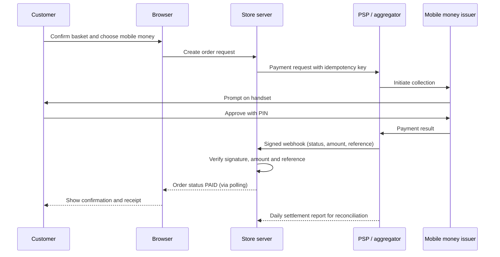
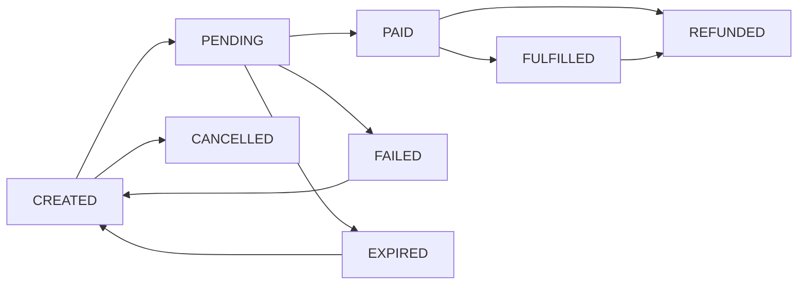

## Introduction

The earlier modules of this course built a toolkit: business models and value creation, e-commerce technology, digital finance, payment security, blockchain and Ghana's digital payments ecosystem. This lesson asks you to apply that toolkit to two practical projects of the kind an MSc IT for Business graduate might be asked to produce for an employer, client or capstone assessment.

**Project A** designs an e-commerce business model for a Ghanaian SME, grounded in the Business Model Canvas and tested with unit economics. **Project B** designs the online payment process that the business model depends on, from checkout to confirmation, settlement and reconciliation, documented with a sequence diagram and a payment state model. Both projects use the same **Illustrative scenario**, so that the business model and the payment design reinforce each other. Each project specifies deliverables, evaluation criteria and risks. These are supplementary practice projects; they are not official University of Ghana assessments, and any payment or regulatory content is educational rather than professional advice.

## Learning Objectives

- Apply the Business Model Canvas to design an e-commerce model for a Ghanaian SME.
- Calculate contribution margin per order and evaluate the viability of a model using unit economics.
- Design an online payment process covering mobile money and cards, with security and failure handling.
- Construct a sequence diagram and a payment state model for a checkout flow.
- Evaluate project deliverables against explicit criteria and identify key project risks.

## Prerequisite Knowledge

- Online business models and the Business Model Canvas from the E-Business Foundations module.
- Payment gateways, the transaction lifecycle and payment security from the Digital Finance and Payment Security modules.
- Reconciliation and fraud controls from the Payment Security module.

## Key Terminology

- **Business Model Canvas**: Osterwalder and Pigneur's nine-block framework describing how an organisation creates, delivers and captures value.
- **Unit economics**: Revenue and costs measured per unit, such as per order or per customer, to test whether growth creates or destroys value.
- **Contribution margin**: Revenue per unit minus variable costs per unit, available to cover fixed costs and profit.
- **Customer acquisition cost (CAC)**: The average marketing and sales cost of acquiring one paying customer or order.
- **Sequence diagram**: A diagram showing the order of messages exchanged between participants in a process.
- **Payment state model**: A definition of the states a payment or order can be in and the events that move it between them.
- **Webhook**: A server-to-server notification by which a PSP informs a merchant system that a payment's status has changed.
- **Idempotency**: The property that repeating the same request produces the same result once, preventing duplicate charges.

## Detailed Explanation

### The shared scenario

**Illustrative scenario:** Asante Shea Naturals is a hypothetical Tamale-based SME producing shea butter skincare. It currently sells at local markets and to a few customers via WhatsApp. The owners want to sell nationally online, and later to the Ghanaian diaspora, accepting mobile money on all networks and cards.

### Project A: e-commerce business model design

**Task.** Design an e-commerce business model for Asante Shea Naturals and test its viability.

**Method.**

1. **Customer segments.** Distinguish, for example, urban professionals in Accra and Kumasi buying natural skincare, gift buyers, small salons reselling products and, in a later phase, diaspora customers.
2. **Value propositions.** Authentic Northern Ghana shea, natural ingredients, traceable sourcing from women's cooperatives and convenient delivery. Each proposition should be linked to a segment.
3. **Channels.** Instagram and TikTok for discovery, WhatsApp for customer service, an own online store for checkout, and possibly a marketplace listing for reach.
4. **Customer relationships.** Community-led content, loyalty rewards and responsive chat support.
5. **Revenue streams.** Product sales, bundles and gift sets, and wholesale to salons.
6. **Key resources and activities.** Production, quality control, content creation, order fulfilment and payment operations.
7. **Key partners.** Shea cooperatives, packaging suppliers, a licensed PSP or aggregator, delivery firms.
8. **Cost structure.** Raw materials, packaging, delivery subsidies, payment fees, marketing and platform subscriptions.
9. **Unit economics.** Test whether each order makes money after variable costs and marketing.

**Deliverables.** A completed canvas with justification for each block; a unit-economics model with assumptions stated; a competitor comparison of at least three alternatives available to the target segment; and a 1,000–1,500-word business model report with recommendations.

**Evaluation criteria.**

| Criterion | What good looks like |
|---|---|
| Coherence | Value propositions, segments, channels and revenue streams fit together logically |
| Evidence | Assumptions are explicit and supported by observation or credible sources, not invented statistics |
| Viability | Unit economics show positive contribution after acquisition costs, or a credible path to it |
| Local fit | The model reflects Ghanaian payment habits, logistics and trust issues |
| Critical reflection | Weaknesses and alternative models are discussed honestly |

**Risks.** Over-optimistic assumptions about demand or costs; underestimating delivery costs outside major cities; dependence on social media algorithms; product regulatory requirements for cosmetics, which must be checked with the relevant authority; and diaspora shipping complexity.

### Project B: online payment process design

**Task.** Design the end-to-end online payment process for the Asante Shea Naturals store.

**Design requirements.**

- Accept mobile money on all major networks, cards and, optionally, bank transfer through a licensed aggregator.
- Use a hosted or embedded checkout so that card data never touches the merchant's servers.
- For mobile money, use merchant-initiated payment prompts so customers approve on their own handsets with a PIN.
- Mark orders as paid only after a **verified webhook** or a server-side status query, never on browser redirect alone.
- Use an **idempotency key** for each payment request to prevent duplicate charges.
- Handle pending, failed, expired and reversed payments explicitly.
- Store PSP references with each order to enable daily reconciliation.

**Payment state model.**

| State | Entered when | Next possible states |
|---|---|---|
| CREATED | Customer confirms basket | PENDING, CANCELLED |
| PENDING | Payment request sent to PSP | PAID, FAILED, EXPIRED |
| PAID | Verified webhook confirms success | FULFILLED, REFUNDED |
| FAILED | PSP reports failure | CREATED (retry) |
| EXPIRED | No confirmation within the time limit | CREATED (retry) |
| FULFILLED | Order dispatched | REFUNDED (return) |
| REFUNDED | Refund confirmed by PSP | — |

**Deliverables.** A process narrative; a sequence diagram; the state model; a controls table mapping each risk to a control; a reconciliation procedure; and a test plan with at least ten test cases, including duplicate clicks, network timeouts, a forged callback and a customer who closes the browser after paying.

**Evaluation criteria.** Correctness and completeness of the flow; security (no card data stored, signatures verified, PINs never collected); robustness to failures; reconcilability; usability for customers on low-end phones; and clarity of documentation.

**Risks.** Integration errors leading to unpaid orders being dispatched; webhook delays causing customer confusion; PSP outages during campaigns; fraud through stolen cards or social engineering; and data protection obligations when storing customer details.

## Worked Example

### Unit economics for Asante Shea Naturals

All figures are hypothetical assumptions for teaching.

| Item per order | GHS |
|---|---|
| Average order value | 180.00 |
| Cost of goods (shea products) | −70.00 |
| Packaging | −8.00 |
| Delivery subsidy (portion not charged to customer) | −15.00 |
| Payment fee (2% of 180) | −3.60 |
| **Contribution margin before marketing** | **83.40** |
| Customer acquisition cost per order | −40.00 |
| **Contribution after marketing** | **43.40** |

**Interpretation.** Each order contributes GHS 43.40 towards fixed costs such as salaries, rent and software. If monthly fixed costs were, say, GHS 6,500, the break-even volume would be 6,500 ÷ 43.40 ≈ 150 orders a month. The model is most sensitive to acquisition cost and delivery subsidy: if CAC rose to GHS 70, contribution after marketing would fall to GHS 13.40, and break-even would rise to about 485 orders. This sensitivity suggests prioritising repeat purchases, which have lower acquisition costs, through loyalty programmes and excellent service.

### The payment sequence

The sequence for a mobile money checkout is shown in the diagram section. Key design points:

1. The storefront server, not the browser, creates the payment request with an idempotency key.
2. The PSP triggers a prompt on the customer's phone; the customer enters the PIN on the handset.
3. The PSP sends a signed webhook; the server verifies the signature and checks amount and reference before marking the order paid.
4. The browser polls the server for status and shows confirmation, so a closed browser does not affect the order.
5. Settlement reports are imported daily for reconciliation.

## Ghanaian Business Application

Both projects must reflect Ghanaian realities. Customers expect to pay by mobile money from any network, so an aggregator is usually preferable to integrating with a single wallet. Many customers use low-end Android phones on mobile data, so the checkout should be lightweight and the prompt-and-PIN approach avoids typing long card numbers. Cash on delivery may still be offered at first, with a plan to encourage digital payment as trust grows. Delivery outside major cities can be expensive and slow, which affects both the unit economics and the payment design, for example by holding payment confirmation until dispatch is confirmed for remote areas. The PSP should be licensed or authorised under the Payment Systems and Services Act, 2019 (Act 987), and customer data should be handled in line with the Data Protection Act, 2012 (Act 843).

## International Case Study

### Payment process design in hosted checkout platforms

International PSPs such as Stripe publish developer documentation that illustrates widely adopted good practice in payment process design: server-side creation of payment intents, client-side collection of payment details in provider-hosted fields, signed webhooks as the source of truth for payment status, and idempotency keys for safe retries. Hosted e-commerce platforms similarly let small merchants plug in a payment provider without handling card data. These practices emerged because early integrations that trusted browser redirects or stored card numbers suffered fraud, disputes and breaches. For Ghanaian SMEs, the lesson is that a small business can achieve robust payment design by adopting proven patterns through a reputable PSP, rather than building them from scratch.

## Diagram

## Common Misconceptions

- "A business model is just how the business makes money." It also covers value propositions, segments, channels, relationships, resources, partners and costs.
- "Positive gross margin means the model is viable." Delivery, payment fees and acquisition costs can turn a healthy gross margin into a loss per order.
- "Payment is finished when the customer sees a success page." The source of truth is the verified PSP notification, followed by settlement and reconciliation.
- "Retry buttons are harmless." Without idempotency, retries can create duplicate charges.

## Common Examination Mistakes

- Filling in the canvas blocks without showing how they connect or justifying choices.
- Presenting invented market statistics instead of clearly labelled assumptions.
- Drawing a payment flow that omits failure, timeout and refund paths.
- Ignoring reconciliation in a payment process design.
- Omitting evaluation criteria and risks from a project proposal.

## Critical Thinking Questions

1. How would the business model change if Asante Shea Naturals prioritised wholesale to salons over direct online sales?
2. Which single assumption in the unit-economics model would you test first, and how?
3. Should the store offer cash on delivery at launch? Argue both sides and reach a conclusion.
4. How would the payment design need to change to serve diaspora customers paying by international card?

## Practical Exercises

1. **Project A submission.** Produce the canvas, unit-economics model and report for Asante Shea Naturals or another clearly labelled illustrative Ghanaian SME. *Expected output:* the deliverables listed for Project A, assessed against the evaluation criteria.
2. **Project B submission.** Produce the process narrative, sequence diagram, state model, controls table, reconciliation procedure and test plan. *Expected output:* a design pack of six to ten pages.
3. **Peer review.** Exchange designs with a classmate and review each other's payment flow against the design requirements. *Expected output:* a review note listing at least three strengths, three weaknesses and prioritised fixes.

## Key Takeaways

- A coherent business model links segments, value propositions, channels and revenue, and must survive unit-economics testing.
- Contribution after acquisition costs, and its sensitivity to assumptions, determines whether growth creates value.
- Robust payment design uses hosted checkout, handset PIN approval, verified webhooks, idempotency and explicit failure states.
- Sequence diagrams and state models make payment designs precise and testable.
- Every project needs clear deliverables, evaluation criteria and a risk analysis.

## Further Reading

- Osterwalder, A., & Pigneur, Y. (2010). *Business model generation: A handbook for visionaries, game changers, and challengers*. Wiley.
- Laudon, K. C., & Traver, C. G. (n.d.). *E-commerce: Business, technology, society*. Pearson. (Consult the chapters on business models and payment systems in the latest edition.)
- PCI Security Standards Council. (2022). *Payment Card Industry Data Security Standard: Requirements and testing procedures* (Version 4.0). <https://www.pcisecuritystandards.org/>
- Parker, G. G., Van Alstyne, M. W., & Choudary, S. P. (2016). *Platform revolution: How networked markets are transforming the economy and how to make them work for you*. W. W. Norton.

## Video Resources

- [Stripe documentation](https://docs.stripe.com/) — Stripe. Developer documentation illustrating payment intents, webhooks and idempotent requests as general design patterns.
- [Strategyzer](https://www.strategyzer.com/) — Strategyzer. Official resources on the Business Model Canvas from its creators.
- [Mermaid documentation](https://mermaid.js.org/) — Mermaid. Official guide to writing sequence diagrams and flowcharts in text.

## Revision Summary

Project A designs an e-commerce business model with the Business Model Canvas and tests it with unit economics: contribution margin per order after cost of goods, packaging, delivery, payment fees and acquisition costs, with sensitivity analysis. Project B designs the payment process: hosted checkout, handset PIN prompts, server-created requests with idempotency keys, verified webhooks as the source of truth, explicit failure and refund states and daily reconciliation. Each project specifies deliverables, evaluation criteria and risks, adapted to Ghanaian payment habits and logistics.

- Canvas blocks must cohere.
- Contribution after CAC drives break-even.
- Webhook, not redirect, confirms payment.
- Idempotency prevents duplicate charges.
- Define states, failures and reconciliation.
