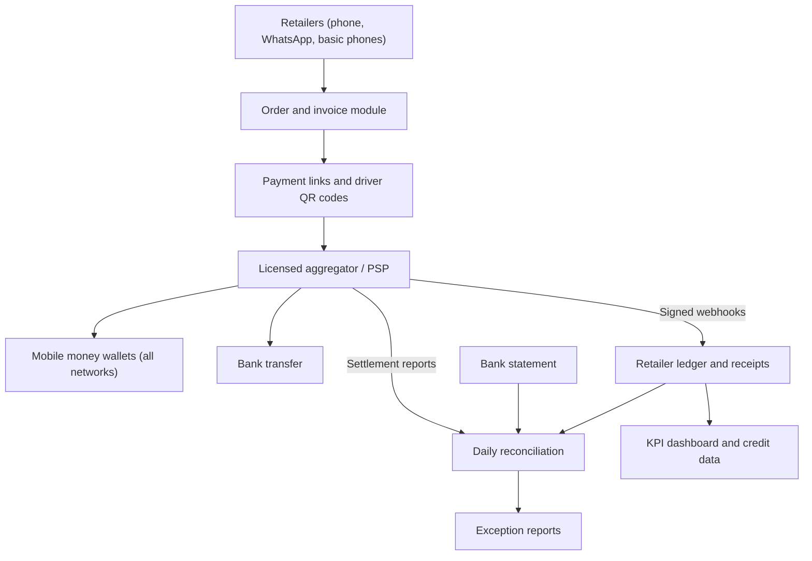

## Introduction

This final lesson brings the course together in three connected projects. **Project C** analyses Ghana's mobile money ecosystem from the viewpoint of a business that wants to use it. **Project D** turns that analysis into a phased digital commerce strategy for an SME. **Project E** designs a concrete digital payment solution that implements the strategy, complete with requirements, architecture, security controls and a business case. Working through the three projects in sequence mirrors how consultants and in-house IT-for-business teams operate: understand the environment, set direction, then design and justify a solution.

All three projects use one **Illustrative scenario**. The organisation is hypothetical and must not be treated as real. The projects are supplementary practice exercises, not official University of Ghana assessments. Where they touch on regulation, the content is educational, and real implementations require current guidance from the Bank of Ghana and qualified advisers.

## Learning Objectives

- Analyse a mobile money ecosystem using stakeholder mapping, PESTEL and value network analysis.
- Develop a phased SME digital commerce strategy with measurable key performance indicators.
- Specify functional and non-functional requirements for a digital payment solution and prioritise them.
- Design a solution architecture with security, reconciliation and compliance controls.
- Evaluate a solution using a business case, explicit evaluation criteria and a risk register.

## Prerequisite Knowledge

- All earlier modules, especially Ghana's mobile money ecosystem, SME commerce and PSPs, payment security and reconciliation.
- The previous projects lesson on business models and payment process design.

## Key Terminology

- **Stakeholder map**: A diagram identifying the parties affected by or able to influence a system, with their interests and power.
- **PESTEL analysis**: A framework examining political, economic, social, technological, environmental and legal factors in a business environment.
- **Value network**: A map of the exchanges of value, money and information among participants in an ecosystem.
- **Key performance indicator (KPI)**: A measurable value that shows progress towards a strategic objective.
- **Functional requirement**: A statement of what a system must do, such as "send a payment request to the customer's wallet".
- **Non-functional requirement**: A statement of how well a system must perform, covering security, availability, performance and usability.
- **MoSCoW prioritisation**: Classifying requirements as Must have, Should have, Could have or Won't have this time.
- **Payback period**: The time taken for cumulative benefits of an investment to equal its cost.

## Detailed Explanation

### The shared scenario

**Illustrative scenario:** Nkabom Provisions is a hypothetical wholesale distributor in Accra supplying rice, cooking oil, tinned goods and toiletries to about two hundred small retail shops in Greater Accra and the Eastern Region. Retailers order by phone or WhatsApp, pay in cash to delivery drivers or by mobile money to staff members' personal numbers, and many buy on short credit. The owner reports frequent disputes about balances, cash losses on delivery routes, slow collections and difficulty knowing which retailers are reliable.

### Project C: mobile money ecosystem analysis

**Task.** Analyse the mobile money ecosystem as it affects Nkabom Provisions and its retailers.

**Method.**

1. **Stakeholder map.** Identify retailers, drivers, Nkabom staff, e-money issuers, agents, banks, PSPs and aggregators, GhIPSS, the Bank of Ghana, tax authorities and suppliers. Classify each by interest and power.
2. **Value network.** Trace money, goods and information flows: goods to retailers, cash and e-value back, settlement into bank accounts, data into records.
3. **PESTEL.** For example: *political and legal* — Act 987, data protection, AML and transfer taxes; *economic* — inflation, fees and working capital; *social* — trust, cash habits and digital skills; *technological* — interoperability, GhQR, network reliability; *environmental* — fuel use on delivery routes.
4. **Opportunities and threats.** Summarise what the ecosystem enables (cross-network collections, bulk disbursements, transaction data) and what could go wrong (fraud, outages, fee changes).

**Deliverables.** A stakeholder map, a value network diagram, a PESTEL table with evidence, and a 1,000-word analysis citing official sources such as Bank of Ghana, GSMA and World Bank publications in general terms.

**Evaluation criteria.** Completeness of stakeholders; accuracy of flows; evidence-based PESTEL with no invented statistics; insight into implications for Nkabom; and clarity of diagrams.

**Risks.** Relying on outdated information about providers, fees or regulation; treating the ecosystem only technically; and overlooking retailers' perspectives.

### Project D: SME digital commerce strategy

**Task.** Develop a 12-month digital commerce strategy for Nkabom Provisions.

**Method.**

1. **Current-state assessment** using the maturity stages from the SME commerce lesson. Nkabom is at stage 2 at best, with informal ordering and personal wallets.
2. **Strategic objectives**, for example: reduce cash on delivery routes, shorten collection times, cut balance disputes and build reliable credit data on retailers.
3. **Phased roadmap.**

| Phase | Months | Initiatives |
|---|---|---|
| Foundation | 0–3 | Merchant collection account via a licensed aggregator; unique retailer IDs; WhatsApp Business catalogue; daily reconciliation |
| Expansion | 3–6 | Payment links on invoices; QR codes for drivers; order capture form; digital statements to retailers |
| Optimisation | 6–12 | Ordering portal or app; credit limits based on payment history; analytics dashboard; possible supplier payments by bulk disbursement |

4. **KPIs** such as share of collections received digitally, average days to collect, number of balance disputes per month, cash carried per route and repeat order frequency. Baselines must be measured, not assumed.
5. **Change management.** Retailer onboarding sessions, driver training, incentives such as faster delivery for digital payers, and a transition period in which cash remains accepted.

**Deliverables.** A strategy document of 1,500–2,000 words with roadmap, KPIs, change plan and budget outline.

**Evaluation criteria.** Alignment with the Project C analysis; realism of phasing; measurable KPIs with baselines; attention to people and change; and justification of priorities.

**Risks.** Retailer resistance, driver collusion or resistance, staff turnover, over-ambitious technology choices and underestimated training needs.

### Project E: digital payment solution design

**Task.** Design the payment solution for the Foundation and Expansion phases.

**Functional requirements (MoSCoW).**

- *Must:* accept mobile money from all major networks and bank transfer; tag every payment with a retailer ID and invoice number; send instant payment receipts; produce daily reconciliation against PSP settlement reports; show each retailer's running balance.
- *Should:* send payment links by WhatsApp or SMS; generate a QR code per driver for on-delivery payments; issue monthly digital statements.
- *Could:* accept cards; offer automated credit limits; integrate with accounting software.
- *Won't (this phase):* cryptocurrency acceptance or a custom wallet.

**Non-functional requirements.** Security (no PIN collection; signed webhooks; role-based access; audit logs); availability during business hours with a fallback process during outages; usability on basic phones; data protection under the Data Protection Act, 2012 (Act 843); and scalability to several hundred retailers.

**Architecture.** Ordering channels feed an order and invoicing module; a payment service integrates with a licensed aggregator; webhooks update a retailer ledger; a reconciliation job matches ledger, settlement reports and bank credits; dashboards report KPIs. Drivers use QR codes linked to invoices rather than carrying cash.

**Controls.** Segregation of duties between staff who record sales and those who reconcile; daily exception reports; dual approval for refunds and credit-limit changes; staff awareness training on social engineering.

**Deliverables.** A requirements specification, architecture diagram, controls matrix, test plan, implementation plan and business case.

**Evaluation criteria.** Traceability from strategy to requirements; soundness of architecture; strength and proportionality of controls; quality of the business case; and a realistic implementation plan.

**Risks.** Integration delays, PSP dependency, low adoption by retailers, data breaches, and regulatory changes affecting fees or taxes.

## Worked Example

### A simple business case for Project E

All figures are hypothetical assumptions for teaching. Nkabom estimates a one-off investment of **GHS 18,000** (configuration, integration, training and QR materials) and ongoing costs of **GHS 600** per month (software subscriptions). It expects monthly benefits as follows:

| Benefit | Assumption | GHS per month |
|---|---|---|
| Reduced cash losses on routes | Losses estimated from past incidents | 1,200 |
| Staff time saved on reconciliation and disputes | 40 hours × GHS 25 | 1,000 |
| Faster collections reducing overdraft interest | Estimated from bank charges | 800 |
| **Total monthly benefits** | | **3,000** |

PSP fees on collections are estimated at **GHS 1,000** per month, partly offset by savings on cash transport already included above.

**Net monthly benefit** = 3,000 − 600 − 1,000 = **GHS 1,400**.

**Payback period** = 18,000 ÷ 1,400 ≈ **12.9 months**.

**Sensitivity.** If retailer adoption is slower and benefits reach only 70% (GHS 2,100), net benefit becomes 2,100 − 600 − 1,000 = 500, and payback stretches to 36 months. If the business negotiates fees down to GHS 700, the base-case net benefit becomes 1,700 and payback about 10.6 months. The business case is therefore most sensitive to adoption and fees, which suggests focusing early effort on retailer onboarding and fee negotiation. Unquantified benefits — retailer credit data, fewer disputes and better customer relationships — should be described qualitatively rather than given invented values.

## Ghanaian Business Application

The projects are designed around real features of the Ghanaian environment: interoperable mobile money, the universal QR code, licensed aggregators, Ghana Card-based KYC and a large population of small retailers who buy on credit. A distributor such as the hypothetical Nkabom Provisions can use these features to digitise collections without forcing retailers to change wallets or buy smartphones, because payment prompts and USSD approval work on basic phones. The strategy respects cash habits by keeping cash as a fallback during transition, and it addresses trust by giving retailers instant receipts and clear statements, which often resolves the balance disputes that damage relationships. Analysts must, however, verify current regulatory details, provider capabilities and fees at the time of the project.

## International Case Study

### Merchant and distributor payments on M-Pesa

In Kenya, Safaricom extended M-Pesa beyond person-to-person transfers to merchant payments through **Lipa na M-Pesa** and to business services such as paybill numbers used for invoices, utility bills and school fees. Distributors and fast-moving consumer goods companies have used mobile money to collect from small retailers, reducing the cash carried by delivery staff. The Kenyan experience illustrates the progression this lesson models: once a mobile money ecosystem is widely used for transfers, businesses can build structured collections, reconciliation and data on top of it. It also shows that merchant adoption depends on pricing, settlement speed and the convenience of tools for small businesses — the same factors evaluated in Projects D and E.

## Diagram

## Common Misconceptions

- "A strategy is a list of technologies to buy." Strategy sets objectives, phasing, KPIs and change management; technology serves it.
- "Retailers will adopt digital payment once it is available." Adoption requires trust, incentives, training and a transition period.
- "A short payback period proves a project is right." Payback ignores benefits after the payback point and is sensitive to assumptions; it should be used with sensitivity analysis.
- "Non-functional requirements are optional extras." Security, availability and usability often determine whether a payment solution succeeds.

## Common Examination Mistakes

- Producing a PESTEL list without linking factors to implications for the organisation.
- Setting KPIs without baselines or targets.
- Writing requirements that cannot be tested.
- Presenting a business case with no stated assumptions or sensitivity analysis.
- Omitting controls such as segregation of duties and exception reporting.

## Critical Thinking Questions

1. Which stakeholder in the Nkabom ecosystem has the most power to make or break the project, and how should the strategy address them?
2. How would the solution design change if most retailers insisted on paying in cash?
3. What ethical issues arise when payment histories are used to set retailers' credit limits?
4. Is a payback period of about a year acceptable for an SME of this kind? What other appraisal methods could you use?

## Practical Exercises

1. **Project C submission.** Produce the stakeholder map, value network, PESTEL table and analysis for Nkabom Provisions or another clearly labelled illustrative Ghanaian SME. *Expected output:* the Project C deliverables assessed against its criteria.
2. **Project D submission.** Write the 12-month strategy with a phased roadmap, KPIs with baselines and a change plan. *Expected output:* a strategy document of 1,500–2,000 words.
3. **Project E submission.** Produce a MoSCoW-prioritised requirements specification, architecture diagram, controls matrix, test plan and business case with sensitivity analysis. *Expected output:* a solution design pack with every assumption stated.

## Key Takeaways

- Ecosystem analysis combines stakeholder mapping, value networks and PESTEL to reveal opportunities and threats.
- An SME strategy needs objectives, a phased roadmap, measurable KPIs and change management.
- Solution design traces strategy to prioritised functional and non-functional requirements, architecture and controls.
- Business cases must state assumptions and test sensitivity, especially to adoption and fees.
- Every project needs explicit deliverables, evaluation criteria and risks.

## Further Reading

- Osterwalder, A., & Pigneur, Y. (2010). *Business model generation: A handbook for visionaries, game changers, and challengers*. Wiley.
- Jack, W., & Suri, T. (2014). Risk sharing and transactions costs: Evidence from Kenya's mobile money revolution. *American Economic Review, 104*(1), 183–223.
- Demirgüç-Kunt, A., Klapper, L., Singer, D., & Ansar, S. (2022). *The Global Findex Database 2021: Financial inclusion, digital payments, and resilience in the age of COVID-19*. World Bank.
- Venkatesh, V., Morris, M. G., Davis, G. B., & Davis, F. D. (2003). User acceptance of information technology: Toward a unified view. *MIS Quarterly, 27*(3), 425–478.
- Payment Systems and Services Act, 2019 (Act 987) (Ghana).

## Video Resources

- [Bank of Ghana](https://www.bog.gov.gh/) — Bank of Ghana. Official source for payment systems regulation and licensed providers, essential for verifying project assumptions.
- [GhIPSS](https://ghipss.net/) — Ghana Interbank Payment and Settlement Systems. Information on interoperability, GhQR and national payment infrastructure.
- [CGAP](https://www.cgap.org/) — CGAP. Research and guidance on digital finance for small businesses and responsible inclusion.

## Revision Summary

Project C analyses the mobile money ecosystem through stakeholder mapping, value networks and PESTEL. Project D builds a phased SME strategy with objectives, KPIs with baselines and change management. Project E designs the payment solution: MoSCoW-prioritised functional and non-functional requirements, an architecture centred on a licensed aggregator, signed webhooks, a retailer ledger and daily reconciliation, proportionate controls and a business case with payback and sensitivity analysis. Each project has deliverables, evaluation criteria and risks.

- Analyse, then strategise, then design.
- KPIs need baselines and targets.
- MoSCoW keeps scope realistic.
- Payback = investment ÷ net monthly benefit; test sensitivity.
- Keep cash as a transition fallback.
