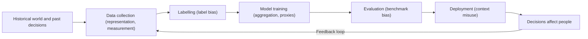

## Introduction

Artificial intelligence systems now help decide who is shortlisted for a job, who receives a loan, which transactions are flagged as fraudulent, which patients are prioritised and what news people see. In Ghana, as elsewhere, banks, telecommunications companies, mobile-money operators, insurers and public agencies are adopting machine-learning tools to automate and scale decisions. These systems can bring real benefits (speed, consistency, the ability to serve customers without formal credit histories) but they can also reproduce and amplify unfairness at a scale and speed that no individual decision-maker could.

This lesson examines why AI raises distinctive ethical problems, explains how bias enters AI systems at each stage of their life cycle, distinguishes types of algorithmic discrimination and introduces the competing definitions of fairness used to measure it. It draws on well-documented international cases and applies the ideas to Ghanaian business contexts. The aim is to equip you, as a future IT manager or analyst, to ask the right questions before an AI system is built, bought or deployed.

## Learning Objectives

- Explain why AI systems raise ethical issues that differ in scale, opacity and accountability from traditional software.
- Identify the main types of bias that can arise across the machine-learning life cycle.
- Distinguish direct discrimination, indirect (disparate impact) discrimination and proxy discrimination in algorithmic systems.
- Compare common statistical fairness criteria and explain why they cannot all be satisfied at once.
- Evaluate practical measures for detecting and mitigating algorithmic bias in an organisational setting.

## Prerequisite Knowledge

- The ethical theories covered in the Ethical Foundations module, particularly utilitarianism, deontology and justice-based reasoning.
- A basic conceptual understanding of how supervised machine learning learns patterns from labelled training data.

## Key Terminology

- **Artificial intelligence (AI)**: Computer systems that perform tasks associated with human intelligence, such as prediction, classification, recommendation or content generation.
- **Machine learning**: An approach to AI in which a model learns patterns from data rather than being explicitly programmed with rules.
- **Algorithmic bias**: Systematic and unjustified differences in how an algorithmic system treats or affects different individuals or groups.
- **Algorithmic discrimination**: Unfair or unlawful disadvantage to people based on protected or sensitive characteristics, produced wholly or partly by an algorithmic system.
- **Proxy variable**: A feature that is not itself a sensitive attribute but is correlated with one, such as a residential area that correlates with ethnicity or income.
- **Disparate impact**: An outcome in which a facially neutral practice disproportionately disadvantages a particular group.
- **Fairness metric**: A quantitative criterion, such as demographic parity or equal error rates, used to assess whether a model treats groups comparably.
- **Feedback loop**: A process in which a model's outputs shape future data, reinforcing its earlier predictions.

## Detailed Explanation

### Why AI is ethically distinctive

All software embodies choices, but machine-learning systems raise particular concerns:

1. **Scale.** A biased human loan officer affects the applicants they meet; a biased credit model can affect every applicant in a market simultaneously.
2. **Opacity.** Complex models, such as deep neural networks or large ensembles, may be difficult even for their developers to explain. Affected people often do not know an algorithm was involved.
3. **Apparent objectivity.** Numerical outputs can appear neutral and scientific, discouraging challenge. Cathy O'Neil's *Weapons of Math Destruction* (2016) describes models that are opaque, operate at scale and cause damage as particularly dangerous because their authority is rarely questioned.
4. **Learning from the past.** Models trained on historical data learn the patterns in that data, including patterns produced by past discrimination.
5. **Diffuse responsibility.** Data suppliers, model developers, vendors, deploying organisations and end users all contribute to outcomes, making it hard to assign accountability: a problem addressed in the next lesson.

### How bias enters AI systems

Bias is not a single defect but can arise at any stage of the life cycle. A widely used way to organise the sources is as follows.

| Type of bias | Where it arises | Illustration |
|---|---|---|
| Historical bias | The world the data reflect | Past hiring favoured men, so "successful employee" labels reflect that pattern |
| Representation (sampling) bias | Data collection | A face data set contains few darker-skinned women, so accuracy is lower for them |
| Measurement bias | Choice of features and labels | Using "arrests" as a proxy for "crime" when policing intensity differs between areas |
| Label bias | Human annotation | Annotators judge accents or dialects as less "professional" |
| Aggregation bias | Modelling | One model applied to groups whose relationships between variables differ |
| Evaluation bias | Testing | Benchmarks that under-represent the populations where the model will be used |
| Deployment bias | Use in context | A tool designed for decision support is used as an automatic decision-maker |
| Feedback-loop bias | After deployment | Predictive policing sends officers to the same areas, generating more recorded incidents there |

Two points deserve emphasis. First, simply **removing a sensitive attribute** such as gender from the training data rarely eliminates bias, because other features act as **proxies**. A model can infer gender from a CV's mention of a women's football club or a single-sex school, and infer ethnicity or income from location data. Second, bias is not only a data problem. The choice of the **target variable**: what the model is asked to predict, embeds value judgements. Predicting "likelihood to repay as observed historically" is not the same as predicting "creditworthiness", because past lending decisions determined who had the opportunity to repay.

### Forms of algorithmic discrimination

- **Direct discrimination**: the system explicitly uses a protected characteristic to treat people less favourably, for example, a rule that scores applicants lower because of sex.
- **Indirect discrimination or disparate impact**: a neutral-seeming criterion disproportionately disadvantages a group without adequate justification, for example, heavily weighting continuous formal employment history, which may disadvantage people in Ghana's large informal economy.
- **Proxy discrimination**: the model relies on correlated features that function as stand-ins for protected characteristics.
- **Representational harm**: systems that demean, stereotype or erase groups, such as search results or image-generation outputs that associate certain groups with negative stereotypes. Safiya Umoja Noble's *Algorithms of Oppression* (2018) documents how search engines can reinforce racist and sexist representations.

Discrimination can be **allocative** (affecting access to resources such as loans, jobs or services) or **representational** (affecting how groups are portrayed and perceived). Both matter ethically.

## Theories, Frameworks and Models

### Competing definitions of fairness

Fairness can be formalised in several ways, and the choice among them is an ethical decision, not merely a technical one.

| Criterion | Plain-language meaning | Example question |
|---|---|---|
| Demographic (statistical) parity | Each group receives positive outcomes at the same rate | Do men and women receive loan approvals at equal rates? |
| Equal opportunity | Among people who truly qualify, each group has the same chance of a positive decision | Among applicants who would repay, are approval rates equal? |
| Equalised odds | Both true-positive and false-positive rates are equal across groups | Are wrongful rejections and wrongful approvals equally likely? |
| Predictive parity (calibration) | A given score means the same probability of the outcome in every group | Does a "70% risk" score mean 70% for every group? |
| Individual fairness | Similar individuals receive similar decisions | Are two applicants with the same relevant profile treated alike? |

Research has shown that when groups differ in their underlying base rates, it is generally mathematically impossible to satisfy predictive parity and equal error rates simultaneously, except in special cases. This was central to the debate over the COMPAS recidivism tool discussed below. Organisations must therefore decide which kind of error is most harmful in their context, justify that choice and be transparent about it.

### Ethical theories applied to algorithmic bias

- **Utilitarianism** asks whether the system increases overall welfare. A model that improves average accuracy but concentrates errors on a vulnerable minority may increase total utility while being deeply unfair: highlighting a known weakness of simple aggregate reasoning.
- **Kantian deontology** insists that each person be treated as an end, not merely a means. Judging people by statistical correlations with groups they belong to, rather than as individuals, sits uneasily with respect for persons, especially when they cannot understand or contest the decision.
- **Rawlsian justice** asks what principles people would choose behind a "veil of ignorance". Rawls' difference principle suggests that inequalities are acceptable only if they benefit the least advantaged: a useful test for AI systems deployed across unequal populations.
- **Virtue ethics** asks what a conscientious, just and prudent professional would do, for example, insisting on testing a model's performance for under-represented groups before deployment.

### The ACM Code of Ethics

Several ACM principles apply directly: **1.2 Avoid harm**, **1.4 Be fair and take action not to discriminate**, **2.5 Give comprehensive and thorough evaluations of computer systems and their impacts, including analysis of possible risks**, and **3.7 Recognise and take special care of systems that become integrated into the infrastructure of society**.

### A bias-management procedure

1. **Frame the problem.** Clarify the decision, the target variable and who could be harmed. Ask whether AI is appropriate at all.
2. **Audit the data.** Check representation of relevant groups, label quality and potential proxies.
3. **Choose fairness criteria** appropriate to the context, with stakeholder input, and document the reasons.
4. **Test disaggregated performance.** Report accuracy and error rates separately for relevant groups, not only overall.
5. **Mitigate.** Options include collecting better data, reweighting, changing features or targets, adjusting thresholds and adding human review.
6. **Monitor after deployment** for drift and feedback loops, and provide channels for complaints and appeals.

## Ghanaian Business Application

### Illustrative scenario: alternative credit scoring

*Illustrative scenario.* "Adom Digital Credit", a Ghanaian lender, offers small loans through a mobile app. It trains a model on mobile-money transaction histories, airtime purchases and phone metadata to predict repayment. The model promises to extend credit to people without bank accounts: a genuine inclusion benefit.

A bias review raises several concerns:

- **Representation**: early customers were mainly urban, salaried users, so the model may perform poorly for rural farmers whose incomes are seasonal.
- **Proxies**: phone model and location may proxy for income, region or ethnicity.
- **Gender**: if women are more likely to share phones or use a relative's mobile-money account, their transaction histories may be thinner, producing lower scores for reasons unrelated to repayment ability.
- **Target variable**: historical repayment data reflect who was previously offered loans and on what terms.
- **Data protection**: use of personal data must comply with Ghana's Data Protection Act, 2012 (Act 843), including fair and lawful processing and respect for data subjects' rights.

A defensible approach would test approval and error rates separately by region and gender, examine whether seasonal income patterns are being misread as risk, offer a human review and explanation channel for rejected applicants, and monitor outcomes over time. The ethical goal is to realise the inclusion benefit without simply automating the exclusion that already exists.

## International Case Study

### Gender Shades and the COMPAS debate

**Gender Shades.** In a 2018 study, Joy Buolamwini and Timnit Gebru evaluated commercial gender-classification systems from several technology companies using a benchmark balanced by gender and skin type. They found that the systems were substantially less accurate for darker-skinned women than for lighter-skinned men. The study illustrated **representation and evaluation bias**, showing that a system that performs well "on average" can perform badly for specific intersectional groups, and that benchmarks themselves must be representative.

**COMPAS.** In 2016 the investigative newsroom ProPublica published "Machine Bias", an analysis of the COMPAS risk-assessment tool used in parts of the US criminal justice system. ProPublica reported that Black defendants who did not reoffend were more likely than white defendants to be incorrectly labelled high risk. The tool's developer responded that the scores were similarly calibrated across groups: that a given score corresponded to similar reoffending rates. Both claims could be true at the same time, because, as later research showed, calibration and equal false-positive rates generally cannot be achieved simultaneously when base rates differ. The case demonstrates that "is this algorithm fair?" has no purely technical answer: it requires an explicit ethical choice about which errors matter most and who bears them.

## Diagram

## Common Misconceptions

- "Algorithms are objective because they are mathematical." Models learn from data and objectives chosen by people; they can encode historical and measurement biases while appearing neutral.
- "Removing gender or ethnicity from the data makes a model fair." Correlated proxy variables can reproduce the same patterns; fairness must be tested on outcomes.
- "High overall accuracy means the model works for everyone." Aggregate accuracy can hide large error-rate differences for minority or intersectional groups.
- "There is one correct mathematical definition of fairness." Fairness criteria conflict; choosing among them is an ethical and contextual decision.
- "Bias is only a data problem." Bias can also arise from the choice of target, model design, evaluation and the way the system is deployed.

## Common Examination Mistakes

- Listing "bias" without distinguishing its types or explaining where in the life cycle each arises.
- Claiming a real case proves more than it does, for example stating that COMPAS was "proven racist" without explaining the competing fairness definitions.
- Recommending "remove the sensitive attribute" as a complete solution.
- Failing to apply an ethical theory or ACM principle when asked to evaluate a system.
- Ignoring the potential benefits of AI, such as financial inclusion, which a balanced evaluation must weigh.

## Critical Thinking Questions

1. Should a lender be permitted to use data such as airtime top-up patterns in credit scoring if doing so expands access to credit but cannot be explained to applicants?
2. When equal error rates and calibration conflict, which should a recruitment tool prioritise, and why?
3. Is it ever ethically justified to deploy a model known to perform less accurately for one group? What safeguards would be required?
4. How might Ghana's linguistic diversity create bias risks for speech-recognition and chatbot systems used by banks and public services?

## Practical Exercises

1. **Bias source mapping.** For an illustrative AI system that triages patient appointments at a Ghanaian hospital, identify at least one plausible example of each of five bias types from the table. Expected output: a five-row table of bias type, example and mitigation.
2. **Fairness metric calculation.** Given a confusion matrix for two applicant groups (create simple numbers, for example 100 applicants per group), calculate approval rates, true-positive rates and false-positive rates for each group and state which fairness criteria are met. Expected output: calculations and a 150-word interpretation.
3. **Impact memo.** Write a one-page memo to a bank's board explaining the risks of buying a vendor's AI credit model without disaggregated performance data. Expected output: a memo with at least four specific questions to ask the vendor.

## Key Takeaways

- AI raises distinctive ethical issues because of scale, opacity, apparent objectivity, learning from the past and diffuse responsibility.
- Bias can enter at every life-cycle stage: historical, representation, measurement, label, aggregation, evaluation, deployment and feedback loops.
- Removing sensitive attributes does not remove bias, because proxies remain.
- Fairness metrics conflict, so choosing one is an ethical decision requiring justification and transparency.
- Responsible practice involves disaggregated testing, mitigation, human review, monitoring and channels for appeal.

## Further Reading

- O'Neil, C. (2016). *Weapons of math destruction: How big data increases inequality and threatens democracy*. Crown.
- Noble, S. U. (2018). *Algorithms of oppression: How search engines reinforce racism*. NYU Press.
- Buolamwini, J., & Gebru, T. (2018). Gender shades: Intersectional accuracy disparities in commercial gender classification. *Proceedings of Machine Learning Research, 81*, 77-91.
- Angwin, J., Larson, J., Mattu, S., & Kirchner, L. (2016, May 23). Machine bias. *ProPublica*.
- Barocas, S., Hardt, M., & Narayanan, A. (2023). *Fairness and machine learning: Limitations and opportunities*. MIT Press. <https://fairmlbook.org/>
- Eubanks, V. (2018). *Automating inequality: How high-tech tools profile, police, and punish the poor*. St. Martin's Press.

## Video Resources

- [Ethics of AI](https://ethics-of-ai.mooc.fi/): University of Helsinki. Free online course covering fairness, transparency, accountability and other ethical questions in AI.
- [Elements of AI](https://www.elementsofai.com/): University of Helsinki and MinnaLearn. Free introductory course explaining how machine learning works and its societal implications.

## Revision Summary

AI systems raise distinctive ethical problems because they operate at scale, can be opaque, appear objective, learn from historical data and diffuse responsibility. Bias may enter through historical patterns, unrepresentative samples, flawed measurement and labels, aggregated models, unrepresentative evaluation, inappropriate deployment and feedback loops. Discrimination may be direct, indirect or via proxies, and harms may be allocative or representational. Statistical fairness criteria conflict, so their selection is an ethical choice.

- Bias is a life-cycle problem, not just a data problem.
- Dropping sensitive attributes does not stop proxy discrimination.
- Test performance separately for each relevant group.
- Calibration and equal error rates generally cannot both hold when base rates differ (COMPAS).
- Gender Shades: average accuracy can hide intersectional failure.
- ACM 1.2, 1.4, 2.5 and 3.7 apply to AI systems.
