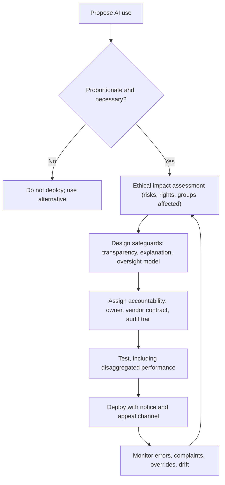

## Introduction

The previous lesson showed how AI systems can produce biased and discriminatory outcomes. Identifying harm, however, is only half the task. Organisations also need mechanisms that make AI systems understandable, assign responsibility when things go wrong and keep meaningful human judgement in the loop where it matters. Without such mechanisms, people affected by automated decisions cannot find out why a decision was made, cannot challenge it and cannot hold anyone to account.

This lesson examines four interlocking safeguards: **transparency, explainability, accountability and human oversight**: and the broader idea of **responsible AI**. It summarises the UNESCO *Recommendation on the Ethics of Artificial Intelligence*, adopted by UNESCO's member states in November 2021 as the first global standard-setting instrument on AI ethics, and sets it alongside other well-known frameworks. Finally, it shows how an IT manager in a Ghanaian organisation could translate these principles into practical governance. Regulatory content is summarised for educational purposes and is not legal advice.

## Learning Objectives

- Distinguish transparency, explainability, interpretability and accountability as they apply to AI systems.
- Explain the "problem of many hands" and why AI makes assigning responsibility difficult.
- Compare human-in-the-loop, human-on-the-loop and human-in-command oversight and evaluate the risk of automation bias.
- Summarise the values, principles and policy areas of the UNESCO Recommendation on the Ethics of AI (2021).
- Design a proportionate responsible-AI governance process for an organisation.

## Prerequisite Knowledge

- The lesson on AI ethics, bias and algorithmic discrimination.
- The ACM Code of Ethics principles introduced in the IT Professionalism module.

## Key Terminology

- **Transparency**: Openness about the fact that an AI system is being used, its purpose, data sources, capabilities, limitations and governance.
- **Explainability**: The ability to provide understandable reasons for a particular output or decision of an AI system, appropriate to the audience.
- **Interpretability**: The degree to which a human can understand how a model's internal mechanics produce its outputs.
- **Accountability**: The existence of identifiable parties who are answerable for an AI system's outcomes, with mechanisms for scrutiny, redress and sanction.
- **Human oversight**: Arrangements that allow people to monitor, intervene in, override or halt an AI system's operation.
- **Automation bias**: The tendency of people to over-rely on automated recommendations, even when they are wrong.
- **Ethical impact assessment**: A structured process for identifying and addressing an AI system's potential benefits, harms and risks before and during deployment.
- **Responsible AI**: An approach to designing, procuring and operating AI that embeds ethical principles, risk management and governance across the system's life cycle.

## Detailed Explanation

### Transparency and explainability

Transparency operates at several levels:

1. **Disclosure that AI is being used**: people should know when they are interacting with a chatbot or when an automated system contributed to a decision about them.
2. **System-level transparency**: documentation of purpose, training data, performance (including disaggregated performance), known limitations and intended use. Tools such as *model cards* (proposed by Mitchell and colleagues in 2019) and *datasheets for datasets* provide structured formats for this information.
3. **Decision-level explanation**: reasons for a particular outcome, such as the main factors behind a loan rejection, and what the person could change.

Explainability must be **audience-appropriate**. A data scientist auditing a model needs technical detail; a rejected loan applicant needs a clear, actionable reason; a regulator needs evidence of testing and controls. Some models, such as decision trees or linear scoring models, are inherently interpretable. Others, such as deep neural networks, are often explained after the fact using techniques such as feature-importance methods (for example, LIME or SHAP). Post-hoc explanations are approximations and can be incomplete or misleading, so for high-stakes decisions there is a strong argument for preferring inherently interpretable models where they perform comparably.

Transparency has limits. Full disclosure of a fraud-detection model could help fraudsters evade it; disclosure of training data could breach privacy; vendors claim trade-secret protection. Responsible practice seeks **meaningful transparency**: enough for affected people to understand and contest decisions, and for auditors and regulators to verify claims, even if not every detail is public.

### Accountability

Accountability means that someone can be asked to explain and justify an AI system's behaviour, and that there are consequences and remedies when it causes harm. Helen Nissenbaum's 1996 paper "Accountability in a computerized society" identified barriers that remain relevant: the **problem of many hands** (many contributors, so no one feels responsible), the acceptance of **bugs** as inevitable, the tendency to blame **the computer**, and **ownership without liability**, where producers disclaim responsibility through licence terms.

AI intensifies these barriers. A deployed model may combine data from third parties, a vendor's pre-trained model, an in-house fine-tuning team and front-line staff who act on its output. Effective accountability therefore requires:

- **clear role allocation**: a named system owner, accountable executive and technical lead;
- **documentation and audit trails** recording data, versions, decisions and changes;
- **contracts** with vendors that allocate responsibility, require performance information and permit audit;
- **redress mechanisms**: ways for affected people to complain, obtain human review and receive remedies;
- **independent audit** for high-impact systems.

### Human oversight

Human oversight can take different forms:

| Model | Description | Suitable for |
|---|---|---|
| Human-in-the-loop | A person must approve each decision before it takes effect | High-stakes individual decisions, such as dismissals or medical diagnoses |
| Human-on-the-loop | The system acts automatically while people monitor and can intervene | High-volume decisions with moderate risk, such as fraud alerts |
| Human-in-command | People decide whether, when and how to use the system at all, and can switch it off | Governance of all AI systems |

Oversight must be **meaningful**, not symbolic. If reviewers have too little time, lack authority to override, are not given the information needed to judge, or are evaluated on how quickly they process cases, a "human in the loop" becomes a rubber stamp. **Automation bias** compounds the risk: people tend to defer to machine recommendations, particularly when they are presented confidently. Designing for meaningful oversight means training reviewers, showing uncertainty, sampling decisions for audit, protecting reviewers who override the system, and tracking override rates.

## Theories, Frameworks and Models

### The UNESCO Recommendation on the Ethics of AI (2021)

Adopted by UNESCO's General Conference in November 2021, the Recommendation is a global, non-binding standard that member states are invited to implement through policy and law. Its structure can be summarised as follows.

**Four core values**

1. Respect, protection and promotion of human rights, fundamental freedoms and human dignity.
2. Living in peaceful, just and interconnected societies.
3. Ensuring diversity and inclusiveness.
4. Environment and ecosystem flourishing.

**Ten principles**

1. Proportionality and do no harm: AI use should not exceed what is necessary to achieve a legitimate aim, with risk assessment to prevent harm.
2. Safety and security.
3. Right to privacy and data protection.
4. Multi-stakeholder and adaptive governance and collaboration.
5. Responsibility and accountability.
6. Transparency and explainability.
7. Human oversight and determination: ultimate responsibility should remain with humans, and life-and-death decisions should not be ceded to AI systems.
8. Sustainability.
9. Awareness and literacy.
10. Fairness and non-discrimination.

**Policy action areas.** The Recommendation sets out eleven areas for action: ethical impact assessment; ethical governance and stewardship; data policy; development and international cooperation; environment and ecosystems; gender; culture; education and research; communication and information; economy and labour; and health and social well-being. UNESCO has developed implementation tools, including a **Readiness Assessment Methodology** for countries and an **Ethical Impact Assessment** tool for AI systems.

For a developing economy such as Ghana, several features are notable: the emphasis on inclusiveness and closing digital divides, on gender equality, on protecting cultural and linguistic diversity, and on international cooperation so that countries are not merely consumers of AI built elsewhere.

### Other frameworks

- **OECD AI Principles (2019, updated 2024)**: promote AI that is innovative, trustworthy and respects human rights and democratic values, including transparency, robustness and accountability.
- **EU AI Act (adopted 2024)**: a binding regulation for the European Union that takes a risk-based approach: prohibited practices, obligations for high-risk systems (such as many employment and credit uses), transparency duties for certain systems and lighter rules for others. Ghanaian firms serving EU customers may be affected.
- **NIST AI Risk Management Framework (2023)**: a voluntary US framework organised around the functions Govern, Map, Measure and Manage.
- **Floridi and Cowls (2019)**: synthesised principles from many guidelines into five: beneficence, non-maleficence, autonomy, justice and explicability.

### Ethical justification of these safeguards

- **Deontology**: transparency and explanation respect people as rational agents who are entitled to understand and contest decisions affecting them.
- **Utilitarianism**: accountability and oversight reduce the expected harm of errors and sustain public trust, which is necessary for beneficial AI adoption.
- **Social contract theory**: legitimate use of powerful systems requires that those affected could reasonably accept the rules governing them, which presupposes that the rules are visible.
- **ACM Code**: principles 1.3 (be honest and trustworthy, including about system capabilities and limitations), 2.5 (thorough evaluation of risks) and 3.7 (special care for systems integrated into society's infrastructure).

## Ghanaian Business Application

### Illustrative scenario: an AI chatbot for an insurance company

*Illustrative scenario.* "Gold Coast Assurance" plans to deploy a generative-AI chatbot to answer customer questions in English and Twi and to pre-screen motor insurance claims, flagging likely fraud for investigation.

A responsible-AI approach would include:

1. **Proportionality check**: is AI necessary for each function? Answering FAQs is low risk; fraud flagging affects customers' payouts and is higher risk.
2. **Ethical impact assessment**: identify risks such as inaccurate answers about policy terms, poorer performance in Twi, wrongful fraud flags and data-protection issues under the Data Protection Act, 2012 (Act 843).
3. **Transparency**: tell customers they are talking to an AI assistant; publish a plain-language notice explaining how claims screening works; provide reasons when a claim is referred for investigation.
4. **Human oversight**: fraud flags lead to human investigation, never automatic rejection (human-in-the-loop for adverse decisions); customers can request a human agent at any time.
5. **Accountability**: appoint a system owner; require the vendor to provide performance data and audit access; log conversations and decisions within data-retention limits.
6. **Monitoring**: track error rates, complaints and override rates, and test performance across languages.

This approach does not prevent innovation; it makes the system defensible to customers, regulators and the board.

## International Case Study

### The Dutch childcare benefits scandal

In the Netherlands, the tax authority's handling of childcare benefits led to a major scandal, often called the *toeslagenaffaire*. Thousands of parents were wrongly accused of fraud and required to repay large sums, causing severe financial and personal hardship. Investigations found that the authority's practices included the use of a risk-classification model in which nationality was among the factors considered, and that affected families had great difficulty finding out why they had been targeted or challenging the decisions. A parliamentary inquiry report in 2020 strongly criticised the government, and the Dutch cabinet resigned in January 2021 over the affair. The Dutch Data Protection Authority also found that the processing of nationality data had been unlawful and discriminatory.

The case illustrates failures across all four safeguards: **opacity** (families could not understand the basis of decisions), **weak accountability** (responsibility was diffused across institutions), **inadequate human oversight** (risk flags drove harsh outcomes without meaningful individual review) and **discrimination** (use of nationality). It shows that the ethical risks of algorithmic systems are greatest in public administration, where people cannot choose another provider.

## Diagram

## Common Misconceptions

- "Transparency means publishing the source code." Meaningful transparency is audience-appropriate: disclosure of AI use, documentation of purpose and limitations, and understandable reasons for decisions; source code alone rarely helps affected people.
- "Having a human in the loop guarantees good oversight." Without time, information, authority and protection from automation bias, human review can become a rubber stamp.
- "If the vendor built the model, the vendor is responsible." Deploying organisations remain accountable for how they use AI on their customers and staff, and should allocate responsibilities contractually.
- "The UNESCO Recommendation is a binding international treaty." It is a non-binding standard-setting instrument adopted by member states, which are invited to implement it.
- "Post-hoc explanations show exactly how a model works." Techniques such as feature attribution approximate model behaviour and can be incomplete or misleading.

## Common Examination Mistakes

- Using transparency, explainability and accountability as synonyms rather than distinguishing them.
- Listing UNESCO principles inaccurately or inventing obligations; summarise its values and principles carefully and note that it is non-binding.
- Recommending "add human oversight" without specifying the oversight model and what makes it meaningful.
- Ignoring legitimate limits on transparency, such as privacy, security and trade secrets.
- Failing to link recommendations to an organisation's actual risk level (proportionality).

## Critical Thinking Questions

1. Should high-stakes decisions about individuals, such as dismissals or benefit fraud findings, ever be made using models that cannot be explained? Justify your position.
2. How can a small Ghanaian company that buys AI services from a large foreign vendor achieve real accountability?
3. Does the UNESCO Recommendation's non-binding status make it ineffective, or can soft law shape practice? Give reasons.
4. How should organisations protect employees who override an AI system's recommendation and are later proven right, or wrong?

## Practical Exercises

1. **Model card draft.** For an illustrative AI system that predicts which mobile-money agents are likely to commit fraud, draft a one-page model card covering purpose, intended users, data, performance by group, limitations and ethical considerations. Expected output: a structured model card.
2. **Oversight design.** For three AI uses in a bank (FAQ chatbot, transaction fraud alerts, loan rejection) choose an oversight model and justify it. Expected output: a table with use, risk level, oversight model and three conditions for meaningful oversight.
3. **UNESCO mapping.** Map each of the ten UNESCO principles to one concrete control an organisation could implement. Expected output: a ten-row table.

## Key Takeaways

- Transparency covers disclosure, documentation and decision-level explanation, and must be meaningful for each audience.
- Accountability requires named owners, documentation, contracts, redress and audit to overcome the problem of many hands.
- Human oversight must be meaningful; automation bias can turn reviewers into rubber stamps.
- The UNESCO Recommendation (2021) sets out four values, ten principles and eleven policy areas, and is a non-binding global standard.
- Responsible AI is a life-cycle governance process proportionate to risk, not a one-off technical fix.

## Further Reading

- UNESCO. (2021). *Recommendation on the ethics of artificial intelligence*. UNESCO. <https://www.unesco.org/en/artificial-intelligence/recommendation-ethics>
- Nissenbaum, H. (1996). Accountability in a computerized society. *Science and Engineering Ethics, 2*(1), 25-42.
- Floridi, L., & Cowls, J. (2019). A unified framework of five principles for AI in society. *Harvard Data Science Review, 1*(1).
- Mitchell, M., Wu, S., Zaldivar, A., Barnes, P., Vasserman, L., Hutchinson, B., Spitzer, E., Raji, I. D., & Gebru, T. (2019). Model cards for model reporting. In *Proceedings of the Conference on Fairness, Accountability, and Transparency* (pp. 220-229). ACM.
- National Institute of Standards and Technology. (2023). *Artificial intelligence risk management framework (AI RMF 1.0)*. <https://www.nist.gov/itl/ai-risk-management-framework>

## Video Resources

- [UNESCO: Ethics of Artificial Intelligence](https://www.unesco.org/en/artificial-intelligence/recommendation-ethics): UNESCO. Official page for the Recommendation with summaries, implementation tools and related materials.
- [OECD.AI: AI Principles](https://oecd.ai/en/ai-principles): OECD. Official overview of the OECD AI Principles and policy resources.

## Revision Summary

Transparency (disclosure and documentation), explainability (understandable reasons for decisions), accountability (identifiable, answerable parties with redress) and human oversight (ability to monitor, intervene and halt) are complementary safeguards against AI harms. Nissenbaum's problem of many hands explains why responsibility diffuses; automation bias explains why nominal oversight fails. The UNESCO Recommendation (2021), a non-binding global standard, rests on four values and ten principles, from proportionality to fairness, with eleven policy areas and tools such as ethical impact assessment.

- Transparency ≠ explainability ≠ accountability.
- Oversight models: in the loop, on the loop, in command.
- Meaningful oversight needs time, information, authority and protection.
- UNESCO: 4 values, 10 principles, 11 policy areas; non-binding.
- Deployers stay accountable for vendor AI; contract for audit and data.
- Dutch childcare benefits scandal: opacity plus discrimination plus weak oversight.
