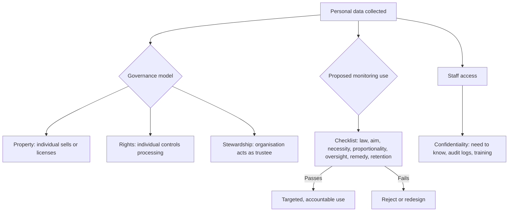

## Introduction

"Who owns my data?" is one of the most frequently asked questions in technology ethics, and one of the most misleading. When a customer pays with mobile money, the transaction record involves the customer, the recipient, the network operator and possibly a bank; when a hospital records a diagnosis, the information concerns the patient but was produced by clinicians using the hospital's systems. Treating data like a physical object that one person owns rarely captures these relationships. Yet the question matters, because whoever controls data gains power: to profit from it, to make decisions about people and to watch them.

This lesson examines three connected themes. First, **data ownership**: the property, rights-based and stewardship models of who should control data. Second, **surveillance**: the systematic monitoring of people by employers, companies and states, its justifications and its dangers. Third, **confidentiality**: the professional duty not to disclose information entrusted to one, and its limits. Each theme is explored through ethical theory, Ghanaian applications and well-documented international cases. Legal references are general and educational, not legal advice.

## Learning Objectives

- Compare property, rights-based and stewardship models of data ownership and evaluate their strengths and weaknesses.
- Explain surveillance as a social and political phenomenon, using the panopticon and surveillance capitalism as frameworks.
- Evaluate the ethics of state, commercial and workplace surveillance using the principles of legality, necessity and proportionality.
- Distinguish confidentiality from privacy and apply the duty of confidentiality to IT roles.
- Recommend governance measures that balance legitimate uses of data with the rights of individuals.

## Prerequisite Knowledge

- Privacy theories, consent and data protection principles (previous lesson).
- The proportionality framework for workplace monitoring (Technology and Society module).

## Key Terminology

- **Data ownership**: The idea that a person or organisation holds property-like rights over data, including rights to use, exclude others and transfer.
- **Data stewardship**: An approach in which organisations hold data as trustees with duties to use it responsibly in the interests of data subjects and society.
- **Data portability**: The right of individuals to obtain their data in a reusable format and transfer it to another provider.
- **Surveillance**: The focused, systematic and routine attention to personal details for purposes of influence, management, protection or control.
- **Mass surveillance**: Indiscriminate monitoring of large populations rather than targeted monitoring of individuals suspected of wrongdoing.
- **Panopticon**: Bentham's design for a prison in which inmates can always potentially be observed, used by Foucault as a metaphor for disciplinary power.
- **Surveillance capitalism**: Zuboff's term for an economic logic in which human experience is captured as behavioural data to predict and influence behaviour for profit.
- **Confidentiality**: The duty of a person who receives information in a relationship of trust not to disclose it without authorisation.
- **Chilling effect**: The discouragement of lawful behaviour, such as expression or association, caused by awareness of being watched.

## Detailed Explanation

### Who owns data?

**The property model.** On this view, individuals should own their personal data as property, able to sell or license it. Advocates argue that this would give people a share of the value their data generates and a clearer basis to control it. Critics raise several objections. Personal data is often **relational**: a message involves sender and recipient, a family photograph involves everyone in it, genetic data reveal information about relatives. Property rights can be **sold**, and people under financial pressure may sell away their privacy cheaply, which could deepen inequality. Markets in personal data could also entrench, rather than challenge, the commodification of human life.

**The rights-based model.** Most data protection law, including Ghana's Data Protection Act, 2012 (Act 843) and the GDPR, does not grant ownership of personal data. Instead it gives data subjects **rights** over processing: to be informed, to access, to correct, to object and, under the GDPR, rights such as erasure and portability. These rights are attached to the person and generally cannot be sold. This model treats privacy as an aspect of dignity rather than a commodity.

**The stewardship (fiduciary) model.** A third view holds that organisations that collect data should act as **stewards** or trustees, with duties of loyalty and care towards data subjects, similar to the duties a doctor or lawyer owes to a client. They may use data, but only in ways consistent with the interests of the people it concerns and the public good. This model fits professional ethics well and underlies concepts such as data trusts and data cooperatives, in which data are pooled and governed on behalf of a community.

| Model | Core idea | Strength | Weakness |
|---|---|---|---|
| Property | Individuals own and can sell their data | Clear control and potential compensation | Relational data, coercive sales, commodification |
| Rights-based | Individuals hold inalienable rights over processing | Protects dignity; established in law | Burden on individuals to exercise rights |
| Stewardship | Organisations hold data in trust with duties of care | Aligns with professional ethics; protects without placing burden on individuals | Depends on strong enforcement and culture |

Organisational data, such as business records, trade secrets and databases, raise different questions. Companies may protect them through contracts, confidentiality obligations, trade secret law and, for some databases, intellectual property rights. Even here, stewardship matters when organisational data contain personal information.

### Surveillance: concepts and theories

Surveillance is not new, but digital technology has made it cheaper, more continuous, more automated and more invisible. David Lyon and other surveillance studies scholars define surveillance broadly as systematic attention to personal details for purposes of influence, management or control. It can protect (fraud detection, public-health monitoring) as well as oppress.

**The panopticon.** Jeremy Bentham designed the panopticon as a prison in which a single watchman could observe any inmate without the inmates knowing whether they were being watched. Michel Foucault, in *Discipline and Punish*, used the panopticon as a metaphor for modern disciplinary power: people who know they may be watched come to regulate their own behaviour. Digital monitoring in workplaces, schools and online platforms can have this panoptic effect, producing conformity and **chilling** legitimate activities.

**Surveillance capitalism.** Shoshana Zuboff, in *The Age of Surveillance Capitalism* (2019), argues that some large technology companies treat human experience as raw material: behavioural data are extracted, analysed to predict behaviour, and used to influence it, for example through targeted advertising. On this account, the problem is not only privacy breaches but an economic model built on asymmetries of knowledge and power between platforms and users.

### Three arenas of surveillance

**State surveillance.** States conduct surveillance for national security, law enforcement and public administration. Legitimate aims exist, but history shows that surveillance powers can be misused against journalists, opposition politicians, activists and minorities. Human rights standards require that state surveillance be **prescribed by law**, pursue a **legitimate aim**, be **necessary and proportionate**, and be subject to **independent oversight** and **remedies**. Mass, indiscriminate surveillance is particularly difficult to justify under these standards.

**Commercial surveillance.** Companies track users across websites and apps, combine data from many sources and build profiles for advertising, pricing and risk assessment. The ethical concerns include lack of meaningful consent, manipulation, discrimination (for example in credit or insurance), and security risks from large data stores.

**Workplace surveillance.** As discussed in the Technology and Society module, employers monitor email, internet use, location, productivity and even biometrics. Power asymmetry makes consent weak, so proportionality and transparency are crucial.

## Theories, Frameworks and Models

### Evaluating surveillance with ethical theories

- **Utilitarian**: surveillance may prevent crime or fraud, but costs include chilling effects, loss of trust, errors, misuse and security risks. Many benefits are speculative while harms are widespread; careful evidence is required.
- **Kantian**: covert surveillance treats people as objects to be managed rather than as rational agents; transparency and accountability are required for respect.
- **Virtue**: an organisation that watches everyone expresses suspicion rather than trust; justice and prudence call for targeted, accountable measures.
- **Social contract**: behind a veil of ignorance, people would likely accept limited, accountable surveillance for genuine threats, but not unchecked mass surveillance that might be turned against them.

### A surveillance assessment checklist

1. **Legal basis**: is the surveillance authorised by clear, accessible law or a lawful policy?
2. **Legitimate aim**: what specific harm is being addressed?
3. **Necessity**: is surveillance needed, and is it targeted rather than indiscriminate?
4. **Proportionality**: is the intrusion reasonable relative to the expected benefit?
5. **Oversight**: is there independent review, such as judicial authorisation for state surveillance or a governance committee in an organisation?
6. **Transparency and remedy**: can affected people learn of and challenge the surveillance, at least after the fact?
7. **Security and retention**: are the data protected and deleted when no longer needed?

### Confidentiality

**Confidentiality** is related to privacy but distinct. Privacy concerns an individual's interest in information about themselves; confidentiality is a **duty** owed by someone who has received information in a relationship of trust. IT professionals routinely receive confidential information: system administrators can read email, database administrators can see customer records, consultants learn clients' trade secrets. The ACM Code (2018) includes a separate principle to honour confidentiality, and many employment contracts and non-disclosure agreements create legal duties of confidence.

Confidentiality is **not absolute**. Recognised limits include legal requirements (such as a court order), consent of the person concerned, and, in exceptional cases, disclosure in the public interest to prevent serious harm, which raises questions about whistleblowing examined in a later module. The ACM Code itself acknowledges that confidentiality may be overridden by obligations such as law or other principles of the Code, including the duty to avoid harm. A professional who discovers serious wrongdoing must therefore weigh confidentiality against other duties, ideally using internal channels first.

Practical confidentiality obligations for IT staff include accessing data only as needed for one's role ("need to know"), not browsing records out of curiosity, using secure channels, not discussing client information socially, and protecting information after leaving an employer.

## Ghanaian Business Application

### SIM registration and the Ghana Card

Ghana required mobile subscribers to re-register their SIM cards and link them to the Ghana Card (the national identity card issued by the National Identification Authority), with a major re-registration exercise in 2021–2022. The stated aims included reducing fraud and crime associated with anonymous SIMs. The exercise illustrates tensions explored in this lesson: linking identity data across systems may help law enforcement and fraud prevention, but it also creates detailed, centralised records connecting identity, communications and mobile money activity. Ethical analysis asks whether the data are adequately secured, whether access by state agencies is governed by clear law and independent oversight, whether retention is limited, and how citizens can exercise their rights under Act 843.

### Illustrative scenario: a curious database administrator

*Illustrative scenario.* Yaw is a database administrator at Adom Health Systems, a fictional provider of hospital software in Kumasi. He has full access to patient records for maintenance. A well-known musician is admitted to a client hospital, and colleagues ask Yaw to "check what is wrong with him". There is no technical reason to view the record.

Applying confidentiality principles, Yaw should refuse: access without a legitimate role-based purpose breaches confidentiality, the patient's privacy and data protection principles, and likely his employment terms. Health information is special personal data with heightened protection. Adom Health Systems should support such decisions through **role-based access control**, **audit logs** that record who views records, regular **access reviews** and training that makes clear that curiosity access is misconduct.

## International Case Study

### The Snowden disclosures (2013)

In June 2013, journalists began publishing documents provided by Edward Snowden, a contractor working for the US National Security Agency (NSA). The documents described large-scale surveillance programmes, including the bulk collection of telephone metadata of people in the United States and programmes, such as one known as PRISM, through which the NSA obtained data from major internet companies. The disclosures prompted worldwide debate, legal challenges and reforms; in the United States, the USA FREEDOM Act of 2015 ended the bulk collection of telephone records in its previous form.

The case is rich for analysis. It raises questions about **mass surveillance** and proportionality, about the adequacy of **oversight** of intelligence agencies, about the role of **private companies** in state surveillance, and about **confidentiality and whistleblowing**: Snowden breached legal duties of confidentiality and has been charged in the United States, while supporters argue that the disclosures served the public interest. Students should evaluate both sides using the frameworks in this lesson rather than assuming a conclusion.

## Diagram

## Common Misconceptions

- **"Individuals legally own their personal data."** Most data protection laws, including Act 843 and the GDPR, give people rights over processing rather than property ownership.
- **"If you have done nothing wrong, surveillance cannot harm you."** Surveillance can lead to errors, misuse, discrimination, security breaches and chilling effects on lawful expression.
- **"Confidentiality and privacy are the same."** Privacy is an individual's interest; confidentiality is a duty owed by someone entrusted with information.
- **"Confidentiality is absolute."** It can be overridden by law, consent or, in exceptional cases, the need to prevent serious harm.
- **"Metadata is harmless because it does not include content."** Metadata such as who called whom, when and from where can reveal relationships, habits and beliefs.

## Common Examination Mistakes

- Asserting that data "belongs" to someone without examining the property, rights and stewardship models.
- Discussing surveillance only as a privacy issue, ignoring power, chilling effects and democratic accountability.
- Treating all surveillance as wrong, rather than evaluating legality, necessity, proportionality and oversight.
- Confusing confidentiality with privacy or treating it as absolute.
- Describing the Snowden case without analysing the competing ethical arguments.
- Proposing vague safeguards rather than specific measures such as audit logs, access reviews and retention limits.

## Critical Thinking Questions

1. Would giving Ghanaians property rights over their personal data improve or worsen their position relative to large technology companies?
2. Is the stewardship model realistic for commercial companies whose business depends on monetising data?
3. Does linking SIM cards to the Ghana Card strike an appropriate balance between security and privacy? What safeguards would make it more defensible?
4. When, if ever, should an IT professional breach confidentiality to reveal wrongdoing? What steps should come first?
5. Does Zuboff's critique of surveillance capitalism apply to local Ghanaian digital businesses, or mainly to global platforms?

## Practical Exercises

1. **Ownership debate brief.** Prepare a one-page brief for and against a proposal that individuals should be able to sell their personal data to companies. *Expected output:* three strong arguments on each side, a rebuttal of the strongest opposing argument and a justified conclusion.
2. **Surveillance assessment.** Choose a surveillance practice (for example CCTV with facial recognition in a shopping mall, or school monitoring of student devices). *Expected output:* a completed seven-point checklist with a judgement on each point and an overall recommendation.
3. **Confidentiality controls design.** For the Adom Health Systems illustrative scenario, design a set of technical and organisational controls. *Expected output:* a table of at least six controls (for example role-based access, break-glass procedures, audit logs, alerts on unusual access, training, disciplinary policy), each with its purpose and how it would be monitored.

## Key Takeaways

- Personal data is relational, so simple property ownership fits poorly; rights-based and stewardship models better protect dignity.
- Surveillance operates in state, commercial and workplace arenas and can protect or oppress.
- The panopticon explains self-discipline under observation; surveillance capitalism explains the economic logic of behavioural data extraction.
- Legitimate surveillance must be lawful, targeted, necessary, proportionate, overseen and subject to remedy and retention limits.
- Confidentiality is a duty arising from trust, distinct from privacy, and limited by law, consent and serious harm.

## Further Reading

- Foucault, M. (1977). *Discipline and punish: The birth of the prison* (A. Sheridan, Trans.). Pantheon Books.
- Nissenbaum, H. (2010). *Privacy in context: Technology, policy, and the integrity of social life*. Stanford University Press.
- Zuboff, S. (2019). *The age of surveillance capitalism: The fight for a human future at the new frontier of power*. PublicAffairs.
- Floridi, L. (2013). *The ethics of information*. Oxford University Press.
- Association for Computing Machinery. (2018). *ACM code of ethics and professional conduct*. <https://www.acm.org/code-of-ethics>
- Tavani, H. T. (2016). *Ethics and technology: Controversies, questions, and strategies for ethical computing* (5th ed.). Wiley.

## Video Resources

- [Data Protection Commission, Ghana](https://dataprotection.org.gh/) — Data Protection Commission. Official site explaining data subject rights and controllers' obligations in Ghana.
- [Markkula Center for Applied Ethics](https://www.scu.edu/ethics/) — Santa Clara University. Official portal with resources on internet ethics, surveillance and data.

## Revision Summary

Personal data is relational, so the property model fits poorly; data protection law instead grants inalienable rights, and the stewardship model asks organisations to act as trustees. Surveillance by states, companies and employers can protect or oppress; the panopticon and surveillance capitalism explain its power effects. Legitimate surveillance must satisfy law, aim, necessity, proportionality, oversight, remedy and retention limits. Confidentiality is a professional duty, distinct from privacy and not absolute.

- Three models: property, rights-based, stewardship.
- Panopticon: possible observation produces self-discipline and chilling effects.
- Zuboff: behavioural data extracted to predict and influence behaviour.
- Seven-point surveillance checklist; mass surveillance is hardest to justify.
- Confidentiality: need-to-know access, audit logs, training; limits are law, consent, serious harm.
- Ghana Card SIM linkage and Snowden illustrate security–privacy trade-offs.
