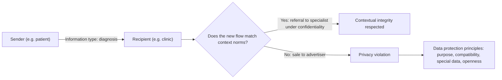

## Introduction

Every day, people in Ghana disclose personal information to organisations: national identification numbers when registering a SIM card, health histories at clinics, salaries to lenders, locations to ride-hailing apps and preferences to social media platforms. Much of this disclosure is necessary and beneficial. But it also creates risks: data can be leaked, sold, combined with other data to build detailed profiles, or used to make decisions people never anticipated. The questions of what privacy is, why it matters and how personal data should be governed are among the most important in IT ethics.

This lesson first examines **theories of privacy**, from the early "right to be let alone" to Alan Westin's account of informational control and Helen Nissenbaum's influential framework of **contextual integrity**. It then evaluates **consent**, the mechanism on which much data practice relies, and explains why consent alone is often inadequate. Finally, it introduces the **data protection principles** reflected in Ghana's **Data Protection Act, 2012 (Act 843)**, the role of the **Data Protection Commission**, and a high-level comparison with the European Union's **General Data Protection Regulation (GDPR)**. The legal content is educational and general; it is not legal advice, and you should consult the official texts and qualified advisers for specific situations.

## Learning Objectives

- Explain and compare major theories of privacy, including Warren and Brandeis, Westin and Nissenbaum's contextual integrity.
- Evaluate why privacy matters for individuals, relationships and society.
- Analyse the conditions for valid consent and the limitations of notice-and-consent models.
- Describe the data protection principles and institutional framework of Ghana's Data Protection Act, 2012 (Act 843).
- Compare Act 843 and the GDPR at a high level and apply their principles to an organisational scenario.

## Prerequisite Knowledge

- Ethical theories, especially Kantian respect for persons (Ethical Foundations module).
- Digital rights and the proportionality framework (Technology and Society module).

## Key Terminology

- **Privacy**: A cluster of interests concerning control over, or appropriate flow of, information about oneself and freedom from unwanted intrusion.
- **Informational privacy**: The interest in determining when, how and to what extent information about oneself is communicated to others.
- **Contextual integrity**: Nissenbaum's framework holding that privacy is respected when information flows conform to the norms of the context in which it was shared.
- **Personal data**: Information relating to an identified or identifiable individual.
- **Data subject**: The individual to whom personal data relate.
- **Data controller**: The person or organisation that determines the purposes and means of processing personal data.
- **Data processor**: A person or organisation that processes personal data on behalf of a controller.
- **Consent**: A freely given, specific, informed and unambiguous indication of a data subject's agreement to the processing of their personal data.
- **Special personal data**: Categories of personal data treated as especially sensitive, such as data on health, religious beliefs, ethnic origin or criminal behaviour, which attract additional protection.

## Detailed Explanation

### Theories of privacy

**Privacy as the right to be let alone.** In 1890, Samuel Warren and Louis Brandeis published "The Right to Privacy" in the *Harvard Law Review*, responding to new technologies of their time, instant photography and mass-circulation newspapers. They argued for legal recognition of a "right to be let alone", protecting individuals from intrusion and unwanted publicity. The article is a useful reminder that privacy debates have always been driven by technological change.

**Privacy as control over information.** In *Privacy and Freedom* (1967), Alan Westin defined privacy as the claim of individuals, groups or institutions to determine for themselves when, how and to what extent information about them is communicated to others. Westin also described four states of privacy: **solitude** (being free from observation), **intimacy** (close relationships within a small group), **anonymity** (being unidentified in public) and **reserve** (limiting disclosure about oneself). He identified functions of privacy, including personal autonomy, emotional release, self-evaluation and limited, protected communication. The control theory underpins much data protection law, which gives individuals rights to know about and influence the processing of their data.

**Limits of the control theory.** Critics note that individuals cannot realistically control every flow of information about them in a networked world; that some information is legitimately known to others (a doctor must know a patient's symptoms); and that people may "choose" to disclose in ways that harm them because of poor design or unequal power. Some theorists, such as James Moor, proposed *restricted access* accounts, which focus on whether people are protected from access by others in particular situations rather than on personal control alone.

**Contextual integrity.** Helen Nissenbaum, in *Privacy in Context* (2010), offered an influential alternative. She argued that the public/private dichotomy is too crude. What matters is whether an information flow is **appropriate to its context**. Every social context, such as healthcare, banking, education, employment or friendship, has informational norms. These norms concern five parameters:

1. the **sender** of the information;
2. the **recipient**;
3. the **subject** (whom the information is about);
4. the **information type** (for example diagnosis, income, location);
5. the **transmission principle** (the conditions of the flow, such as confidentiality, consent, legal requirement or sale).

A privacy violation occurs when a flow breaches the norms of its context. For example, a patient telling a doctor about symptoms under a principle of confidentiality is appropriate; the clinic selling those symptoms to an advertiser breaches the norms of the healthcare context, even though the information was "voluntarily" disclosed. Contextual integrity explains why aggregating "public" information, such as compiling social media posts into a profile, can violate privacy: the new flow does not respect the norms under which the information was originally shared.

### Why privacy matters

Privacy is valuable for several reasons:

- **Autonomy and dignity**: people need space to form their own views and make choices without pressure or judgement.
- **Relationships**: different relationships depend on sharing different information; controlling disclosure allows intimacy and trust.
- **Protection from harm**: exposure can lead to discrimination, fraud, harassment, stigma or physical danger.
- **Democracy and freedom**: surveillance can chill expression, association and political participation.
- **Power balance**: concentrations of personal data give organisations and states power over individuals.

Daniel Solove's "taxonomy of privacy" emphasises that privacy problems are plural: they include information collection (surveillance, interrogation), processing (aggregation, identification, insecurity, secondary use, exclusion), dissemination (breach of confidentiality, disclosure, exposure) and invasion (intrusion, decisional interference).

### Consent and its limitations

Consent is morally significant because it respects people as autonomous agents, a Kantian idea. For consent to be meaningful it should be:

- **Freely given**: without coercion or a significant penalty for refusal.
- **Specific**: for defined purposes, not blanket agreement to anything.
- **Informed**: based on clear information about what will happen.
- **Unambiguous**: expressed by a clear affirmative action, not silence or pre-ticked boxes.
- **Revocable**: able to be withdrawn.

In practice, the **notice-and-consent** model faces serious problems:

1. **Information overload**: privacy policies are long and complex; few people read them.
2. **Take-it-or-leave-it terms**: essential services may require acceptance, so refusal is not a realistic option.
3. **Power asymmetry**: employees, borrowers and patients may feel unable to refuse.
4. **Unforeseeable uses**: data may be combined and analysed in ways nobody could explain at the time of collection.
5. **Others' data**: one person's consent can expose others, for example uploading a contact list or sharing genetic data.
6. **Dark patterns**: interface designs that nudge people into accepting.

For these reasons, modern data protection law does not rely on consent alone. It also imposes **substantive principles**, such as purpose limitation, minimisation and security, that apply whatever the individual has agreed to, and it allows other lawful grounds for processing.

## Theories, Frameworks and Models

### Ghana's Data Protection Act, 2012 (Act 843)

Ghana's Data Protection Act, 2012 (Act 843) establishes the **Data Protection Commission** and sets out a framework for protecting the privacy of individuals and personal data by regulating how personal information is processed. In general terms, the Act:

- applies to data controllers established in Ghana and to processing of personal data in Ghana;
- requires data controllers to **register** with the Data Protection Commission;
- sets out **data protection principles** that controllers must observe;
- gives **data subjects rights**, including rights to access their personal data, to request correction or deletion of inaccurate or unlawfully held data, and to object to certain processing, including processing for direct marketing;
- provides additional protection for **special personal data**, which includes categories such as health, religious or philosophical beliefs, ethnic origin, political opinions, sex life and criminal behaviour, and gives particular attention to the personal data of children;
- requires **security safeguards** and creates offences and enforcement powers.

The principles commonly identified in Act 843 can be summarised as follows:

| Act 843 principle (summarised) | What it requires in practice |
|---|---|
| Accountability | The controller is responsible for ensuring the principles are met and can demonstrate it. |
| Lawfulness of processing | Processing must be lawful and reasonable, without unnecessarily infringing privacy, and based on a recognised ground such as consent, contract or legal obligation. |
| Specification of purpose | Data must be collected for a specific, explicitly defined and lawful purpose. |
| Compatibility of further processing | Later processing must be compatible with the purpose for which data were collected. |
| Quality of information | Data must be complete, accurate, up to date and not misleading. |
| Openness | Data subjects should be informed about the collection, its purpose and their rights. |
| Data security safeguards | Appropriate technical and organisational measures must protect data against loss, damage and unauthorised access. |
| Data subject participation | Individuals may access, correct and object to the processing of their data. |

The **Data Protection Commission** (official website <https://dataprotection.org.gh/>) is responsible for implementing the Act, maintaining the register of data controllers, receiving complaints and promoting compliance. Organisations should check the Commission's current guidance and requirements directly rather than relying on summaries.

### High-level comparison with the GDPR

The EU **General Data Protection Regulation** (Regulation (EU) 2016/679) has applied since 25 May 2018. It is relevant to Ghanaian organisations because it can apply to organisations outside the EU that offer goods or services to people in the EU or monitor their behaviour there.

| Dimension | Ghana Act 843 (general description) | GDPR (general description) |
|---|---|---|
| Regulator | Data Protection Commission | Independent supervisory authority in each EU member state, coordinated through the European Data Protection Board |
| Registration | Controllers must register with the Commission | No general registration requirement; records of processing and, in some cases, data protection officers instead |
| Core principles | Accountability, lawfulness, purpose specification, compatible further processing, quality, openness, security, data subject participation | Lawfulness, fairness and transparency; purpose limitation; data minimisation; accuracy; storage limitation; integrity and confidentiality; accountability |
| Lawful bases | Consent and other recognised grounds | Six lawful bases: consent, contract, legal obligation, vital interests, public task, legitimate interests |
| Sensitive data | Special personal data with additional restrictions | Special categories of personal data with additional restrictions |
| Individual rights | Access, correction, deletion of inaccurate or unlawful data, objection | Access, rectification, erasure, restriction, portability, objection, and rights relating to automated decision-making |
| Territorial reach | Primarily processing in Ghana and Ghana-based controllers | Includes non-EU organisations targeting or monitoring people in the EU |

The comparison shows strong convergence in principles, which reflects a shared lineage in international data protection thinking, together with differences in institutional design and the detail of rights. This is a general overview; precise obligations depend on the full legal texts.

## Worked Example

### Applying the principles to a loyalty programme

*Illustrative scenario.* Kente Mart, a fictional Ghanaian retail chain, launches a loyalty app. Registration requires name, phone number, Ghana Card number, date of birth, location access "at all times" and access to the phone's contacts. The privacy notice says data may be used "for any business purpose and shared with partners". The marketing team plans to sell purchase histories to a health insurer.

**Step 1: Purpose specification.** "Any business purpose" is not specific. Kente Mart should define purposes such as administering points, preventing fraud and, with a clear choice, personalised offers.

**Step 2: Minimisation and lawfulness.** A loyalty scheme does not obviously need a Ghana Card number, continuous location or contacts. Collecting them unnecessarily infringes privacy. Phone number and name, with optional date of birth for birthday offers, may suffice.

**Step 3: Compatibility of further processing.** Selling purchase histories to a health insurer is a new purpose incompatible with the original context of shopping rewards. Under contextual integrity, it breaches the norms of retail: shoppers do not expect their purchases of food or medicines to influence insurance decisions. It may also reveal health information, which could be special personal data.

**Step 4: Openness and consent.** A vague notice and bundled permissions do not produce informed, specific consent. Kente Mart should use a layered notice in plain language, separate optional permissions and allow withdrawal.

**Step 5: Security and accountability.** Kente Mart must protect the data, register with the Data Protection Commission as required, keep records demonstrating compliance and assign responsibility internally.

**Conclusion.** The redesigned app collects only necessary data, specifies purposes, separates optional marketing consent, abandons the sale to the insurer and implements security controls. Ethically, this respects customers as ends (Kant), maintains trust (rule utilitarian benefits) and reflects contextual integrity.

## International Case Study

### Facebook and Cambridge Analytica (2018)

In March 2018, reporting by *The Guardian*/*The Observer* and *The New York Times* revealed that personal data from Facebook users had been harvested through a personality quiz app developed by researcher Aleksandr Kogan. Because of Facebook's platform rules at the time, the app collected data not only from users who installed it but also from their friends. The data were passed to the political consulting firm Cambridge Analytica. Facebook later estimated that the data of up to 87 million people may have been improperly shared.

The consequences were significant. Facebook's chief executive testified before the United States Congress in April 2018. Cambridge Analytica ceased operations in 2018. The UK Information Commissioner's Office fined Facebook £500,000, the maximum available under the law then applicable. In 2019, the US Federal Trade Commission announced a settlement with Facebook that included a USD 5 billion penalty and new privacy oversight requirements.

The case illustrates several lesson themes. **Consent failed**: friends of app users never agreed to the collection. **Contextual integrity was breached**: information shared among friends on a social network flowed to political profiling. **Purpose limitation** was violated when data collected for research were used for political consulting. And **accountability** was weak because the platform had not effectively policed third-party developers.

## Ghanaian Business Application

For Ghanaian organisations, data protection is both a legal obligation and a source of customer trust. Practical steps include: registering with the Data Protection Commission where required; mapping what personal data is held, where and why; minimising collection, especially of Ghana Card numbers and biometrics unless genuinely needed; writing plain-language privacy notices, available in local languages where appropriate; securing data with access controls, encryption and staff training; managing processors such as cloud providers through contracts; responding promptly to data subject requests; and appointing a responsible person for data protection. Organisations with customers in the EU should also assess whether the GDPR applies to them.

## Diagram

## Common Misconceptions

- **"Privacy only matters to people with something to hide."** Privacy protects autonomy, relationships, freedom of expression and protection from harm for everyone, and the risks of exposure are often unforeseeable.
- **"Information that is public cannot raise privacy issues."** Contextual integrity shows that aggregating or moving public information into new contexts can violate privacy.
- **"If a user clicked I agree, any processing is lawful and ethical."** Consent must be free, specific, informed and unambiguous, and substantive principles such as purpose limitation and security apply regardless.
- **"Act 843 is the same as the GDPR."** They share many principles but differ in institutions, registration requirements and the detail of rights.
- **"Data protection is only the IT department's job."** Accountability rests with the organisation as data controller and involves leadership, legal, marketing and operations.

## Common Examination Mistakes

- Defining privacy with a single definition without comparing theories.
- Describing contextual integrity without naming its parameters or applying them to a flow.
- Inventing section numbers or penalties for Act 843; describe its principles and institutions accurately and generally.
- Treating consent as the only lawful basis for processing.
- Presenting the Cambridge Analytica case as a simple "hack"; it involved platform rules, third-party access and secondary use.
- Omitting the disclaimer that legal analysis is educational, not legal advice.

## Critical Thinking Questions

1. Does Westin's control theory or Nissenbaum's contextual integrity better explain the privacy concerns raised by SIM card registration linked to the Ghana Card? Why?
2. Should consent remain central to data protection, given its practical limitations? What alternatives or supplements would you propose?
3. Should Ghanaian law adopt GDPR-style rights on automated decision-making? What benefits and costs might follow for local businesses?
4. Is selling anonymised purchase data ethically different from selling identifiable data? Consider the risks of re-identification.
5. How should the principle of openness be applied for users with limited literacy?

## Practical Exercises

1. **Contextual integrity analysis.** Choose three information flows in a Ghanaian context (for example school results, mobile money transactions, hospital records). *Expected output:* for each, a table identifying the five parameters, the context's norms and whether a proposed new flow respects them.
2. **Privacy notice rewrite.** Find a privacy notice of a service you use. *Expected output:* a one-page, plain-language layered version that specifies purposes, data collected, sharing, retention, rights and contact details, and a short commentary on what the original lacked.
3. **Principles audit.** For the Kente Mart illustrative scenario or a real organisation you know, assess compliance with each summarised Act 843 principle. *Expected output:* an eight-row table with a rating (meets, partially meets, does not meet), evidence and a recommended action.

## Key Takeaways

- Privacy has been theorised as the right to be let alone, control over information, restricted access and contextual integrity.
- Contextual integrity assesses whether a flow matches context norms across sender, recipient, subject, information type and transmission principle.
- Valid consent must be free, specific, informed, unambiguous and revocable, but notice-and-consent has serious practical limits.
- Ghana's Act 843 establishes the Data Protection Commission, requires controller registration, sets out principles and gives data subjects rights.
- Act 843 and the GDPR converge on core principles but differ in institutional design and the detail of rights.

## Further Reading

- Nissenbaum, H. (2010). *Privacy in context: Technology, policy, and the integrity of social life*. Stanford University Press.
- Solove, D. J. (2006). A taxonomy of privacy. *University of Pennsylvania Law Review, 154*(3), 477–564.
- Warren, S. D., & Brandeis, L. D. (1890). The right to privacy. *Harvard Law Review, 4*(5), 193–220.
- Westin, A. F. (1967). *Privacy and freedom*. Atheneum.
- Data Protection Commission, Ghana. (n.d.). *Data Protection Commission*. <https://dataprotection.org.gh/>
- Regulation (EU) 2016/679 of the European Parliament and of the Council (General Data Protection Regulation). (2016). <https://eur-lex.europa.eu/eli/reg/2016/679/oj>
- Stanford Encyclopedia of Philosophy. Privacy and information technology. <https://plato.stanford.edu/entries/it-privacy/>

## Video Resources

- [Data Protection Commission, Ghana](https://dataprotection.org.gh/) — Data Protection Commission. Official site with information on registration, data subject rights and guidance under Act 843.
- [UK Information Commissioner's Office](https://ico.org.uk/) — Information Commissioner's Office. Official regulator site with accessible guidance and explainer resources on data protection principles.

## Revision Summary

Privacy can be understood as freedom from intrusion, control over information, restricted access or, in Nissenbaum's account, appropriate information flows within contexts. Consent matters ethically but is weakened by overload, power asymmetry and unforeseeable uses, so data protection law adds substantive principles. Ghana's Act 843 establishes the Data Protection Commission, registration of controllers, eight principles and data subject rights; the GDPR shares similar principles with different institutional design. Legal content here is educational, not advice.

- Westin: control; four states (solitude, intimacy, anonymity, reserve).
- Nissenbaum: five parameters; violations are flows that breach context norms.
- Valid consent: free, specific, informed, unambiguous, revocable.
- Act 843 principles: accountability, lawfulness, purpose, compatibility, quality, openness, security, participation.
- GDPR: seven principles, six lawful bases, extraterritorial reach.
- Cambridge Analytica: friends' data, secondary use, weak platform accountability.
