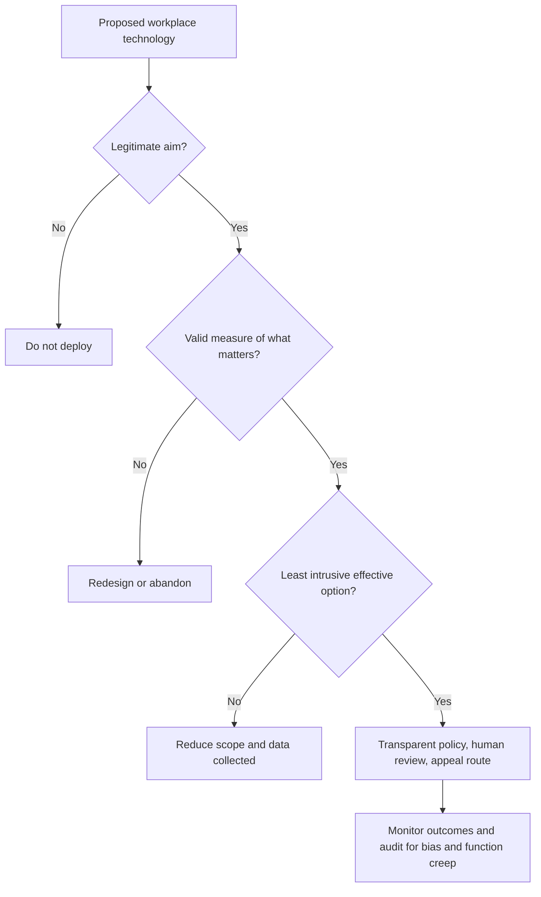

## Introduction

Earlier modules introduced ethical theories, structured decision-making, privacy, AI bias and workplace ethics. This lesson brings them together in two extended case studies set in the workplace, where technology increasingly shapes who is hired and how employees are watched. The first case examines automated recruitment, using the well-documented Amazon recruiting tool reported by Reuters in 2018 alongside a Ghanaian illustrative scenario. The second examines employee monitoring in an illustrative Ghanaian contact centre.

Each case follows the same structure, which you should reproduce in examinations and assignments: **facts, stakeholders, ethical issues, analysis through ethical theories and the ACM Code, options, a recommendation and counter-arguments**. The aim is not to find a single "correct" answer but to build an argument that a reasonable, informed reader would accept as well-justified. Legal references are general and educational, not legal advice.

## Learning Objectives

- Apply a structured case-analysis method to workplace technology dilemmas.
- Identify stakeholders and the ethical issues raised by AI recruitment tools and employee monitoring.
- Analyse each case using at least two ethical theories and relevant ACM Code principles.
- Evaluate alternative courses of action and recommend a defensible option.
- Anticipate and respond to counter-arguments to your recommendation.

## Prerequisite Knowledge

- The lessons on AI bias and on transparency, accountability and human oversight.
- The lessons on privacy and data protection, including Ghana's Data Protection Act, 2012 (Act 843).
- Utilitarianism, deontology and virtue ethics from the Ethical Foundations module.

## Key Terminology

- **Automated recruitment tool**: Software that screens, ranks or assesses job applicants, for example by parsing CVs, scoring video interviews or analysing test results.
- **Historical bias**: Bias that arises because training data reflect past patterns of discrimination or unequal opportunity.
- **Employee monitoring**: The collection of information about employees' activities, communications, location or performance by an employer, often using technology.
- **Proportionality**: The principle that an intrusion on rights should be suitable, necessary and no greater than required to achieve a legitimate aim.
- **Function creep**: The gradual use of data or a system for purposes beyond those for which it was originally introduced.
- **Chilling effect**: The discouragement of legitimate behaviour, such as raising concerns or communicating freely, caused by the awareness of being watched.
- **Stakeholder**: Any person or group who affects, or is affected by, a decision.
- **Defensible recommendation**: A conclusion supported by explicit reasoning that addresses relevant facts, values and objections.

## Case Analysis Method

The following method is used for both cases and for the remaining case-study lessons.

| Step | Question to answer |
|---|---|
| 1. Facts | What happened, and what do we not know? |
| 2. Stakeholders | Who is affected, and what are their interests and rights? |
| 3. Ethical issues | Which values or duties are in tension? |
| 4. Analysis | What do at least two ethical theories and the ACM Code recommend? |
| 5. Options | What realistic courses of action exist? |
| 6. Recommendation | Which option is best justified, and how would it be implemented? |
| 7. Counter-arguments | What are the strongest objections, and how do you respond? |

Separating **facts** from **assumptions** is essential. Many weak answers assert facts that the case does not state. Where facts are uncertain, say so and explain how the conclusion would change.

## Case Study 1: AI Recruitment Bias

### Facts — the international case

In October 2018, Reuters reported that Amazon had worked for several years on an experimental machine-learning tool to review job applicants' CVs and rate candidates. According to the report, the models were trained on CVs submitted to the company over roughly a ten-year period, most of which came from men, reflecting male dominance in the technology industry. The system learned to favour male candidates for software development and other technical roles: it reportedly penalised CVs containing the word "women's" (as in "women's chess club captain") and downgraded graduates of two all-women's colleges. Engineers edited the programs to make them neutral to those particular terms, but there was no guarantee that the system would not find other ways to discriminate. Amazon ultimately disbanded the team, and the company told Reuters that the tool was never used by its recruiters to evaluate candidates.

### Facts — the Ghanaian application

*Illustrative scenario.* "Kasa Talent Solutions", an Accra recruitment platform, sells an AI screening service to banks and telecoms companies. Its model ranks graduate applicants using CV text, university attended, grades, location and video-interview analysis of speech and facial expression. A client bank notices that shortlists contain few graduates from regional universities and few applicants who speak English with strong local accents. Kasa says the model is "objective" and declines to share details, citing trade secrets.

### Stakeholders

- **Applicants**, including women, regional graduates and people with local accents or disabilities: interests in fair consideration, dignity, privacy and an explanation.
- **Client employers**: interests in efficient hiring of capable staff, diversity, reputation and legal compliance.
- **The vendor**: commercial interest, intellectual property, reputation.
- **Existing employees and recruiters**: workload, team composition, professional judgement.
- **Society and regulators**: equal opportunity, data protection, public trust in AI.

### Ethical issues

- **Algorithmic discrimination**: historical bias and proxies (university, location, accent) may reproduce exclusion.
- **Validity**: is there evidence that facial-expression or accent analysis predicts job performance at all?
- **Transparency and contestability**: applicants do not know they are scored by AI or how to challenge outcomes.
- **Accountability**: the vendor's secrecy prevents the employer from discharging its own responsibilities.
- **Privacy**: video and biometric-like analysis involve sensitive data, engaging Ghana's Data Protection Act, 2012 (Act 843).

### Analysis

**Utilitarian analysis.** Automated screening can save time and may reduce some individual biases of human recruiters. But the expected harms are substantial: talented applicants are excluded, employers lose talent and diversity, inequality between regions widens, and public trust in AI declines. When the model's validity is unproven, the claimed efficiency benefits are themselves uncertain. On balance, deploying an unvalidated, opaque tool produces worse expected consequences than a validated, monitored alternative.

**Kantian analysis.** Treating applicants as data points scored by correlations with group characteristics — where they studied, how they sound — fails to treat them as ends in themselves who are entitled to be judged on relevant qualities. A maxim such as "use any predictive signal that reduces screening cost, regardless of whether it is relevant or explicable" could not be accepted by those it judges. Respect for persons requires notice, relevant criteria and an opportunity to contest.

**Rawlsian justice.** Behind a veil of ignorance, no one knowing whether they would be a regional graduate with a local accent would agree to a hiring rule that systematically disadvantages them without justification.

**ACM Code.** Principle **1.4** (be fair and take action not to discriminate) is central; **1.2** (avoid harm), **1.3** (honesty about system capabilities and limitations) and **2.5** (comprehensive evaluation of systems and risks) also apply. Kasa's refusal to disclose performance information and its claim of "objectivity" conflict with 1.3.

### Options

1. Continue using the tool as is.
2. Abandon automated screening entirely.
3. Suspend the tool pending an independent bias and validity audit; remove features without demonstrated job relevance (such as facial-expression analysis); require disaggregated performance data contractually; add human review and an applicant appeal route.
4. Use the tool only to remove clearly unqualified applicants against published minimum criteria, with human decisions for all ranking.

### Recommendation

Option 3, potentially leading to option 4, is the most defensible. The bank should suspend the tool and require the vendor, as a contractual condition, to provide disaggregated selection rates and validity evidence. Features without a demonstrated link to job performance should be removed, especially video emotion and accent analysis. Applicants should be told that automated tools are used, what data are processed and how to request human review, consistent with data protection principles. The bank's HR and IT leaders should be named as accountable owners, with periodic audits. If the vendor refuses, the bank should change vendors — Amazon's own experience suggests that a tool which cannot be shown to be fair should be abandoned rather than patched.

### Counter-arguments

- *"Human recruiters are biased too."* True — but replacing hidden human bias with hidden algorithmic bias at scale is not an improvement. The recommendation keeps humans accountable while using data to detect bias in both.
- *"Vendor secrecy protects legitimate IP."* Trade secrets can be respected through confidential audits; they do not justify withholding the information needed to show non-discrimination.
- *"Auditing is costly."* The cost is modest compared with the legal, reputational and talent costs of discriminatory hiring.

## Case Study 2: Employee Monitoring

### Facts

*Illustrative scenario.* "Volta Connect", a contact centre in Accra serving international clients, installs software on all work laptops that records keystrokes, takes screenshots every five minutes, tracks websites visited, monitors webcam presence during remote shifts and analyses call recordings for "sentiment". Staff were told only that "systems are monitored for quality". Managers begin using webcam data to discipline staff for brief absences, and an employee who complained about overtime pay on a private messaging app on her work laptop is disciplined after screenshots revealed her messages.

### Stakeholders

- **Employees**: privacy, dignity, autonomy, fair treatment and freedom to raise concerns.
- **Managers and the company**: productivity, quality, security of client data, contractual obligations.
- **Clients and their customers**: protection of their data handled by the contact centre.
- **Families and household members** visible on webcams during remote work.
- **Regulators**: compliance with data protection law, including Act 843.

### Ethical issues

- **Privacy and proportionality**: continuous keystroke logging, screenshots and webcam monitoring are highly intrusive and may capture personal communications and family life.
- **Transparency and consent**: a vague notice does not give employees meaningful understanding; in employment, consent is weakened by the power imbalance.
- **Function creep**: data collected for "quality" are used for discipline over a private complaint.
- **Chilling effect**: monitoring of private messages about pay deters legitimate concerns and collective voice.
- **Legitimate interests**: the company does have genuine needs to secure client data and assure quality.

A useful reference point from international human-rights law is *Bărbulescu v Romania* (2017), in which the Grand Chamber of the European Court of Human Rights found a violation of the right to respect for private life and correspondence where an employee's messages were monitored without adequate prior notice of the nature and extent of the monitoring. Although not binding in Ghana, it illustrates widely accepted principles: prior notice, legitimate reasons, proportionality and safeguards.

### Analysis

**Utilitarian analysis.** Some monitoring improves security and service quality. However, blanket surveillance tends to raise stress, reduce trust and morale, increase staff turnover and encourage "performative" busyness rather than real productivity. The disciplinary use of private messages harms the individual and deters others from raising problems that management needs to know about. Targeted, transparent monitoring is likely to achieve the legitimate benefits at far lower cost.

**Kantian analysis.** Covertly reading an employee's private messages and watching her home treats her merely as a means to productivity, disregarding her autonomy and dignity. Workers could not rationally consent to a universal practice of unlimited, undisclosed employer surveillance.

**Virtue ethics.** A just and trustworthy employer would not seek to know everything about employees, but only what it needs, and would be honest about what it collects.

**ACM Code.** Principles **1.6** (respect privacy), **1.7** (honour confidentiality), **3.3** (manage personnel and resources to enhance the quality of working life) and **1.3** (honesty) apply. IT staff who configure the software share responsibility for whether it is proportionate.

### Options

1. Keep the current regime.
2. Remove all monitoring.
3. Redesign monitoring through a proportionality assessment: keep security monitoring of client-data systems and quality sampling of calls; remove keystroke logging, routine screenshots and webcam presence checks; prohibit access to personal messages; publish a clear monitoring policy; restrict access and retention; use data for discipline only under defined procedures; review the disciplinary action taken against the employee.
4. Keep intrusive monitoring but obtain signed consent.

### Recommendation

Option 3. The company should conduct a data protection impact assessment, retain only monitoring that is necessary for client-data security and quality, and communicate a specific policy explaining what is monitored, why, who can see it and for how long. The disciplinary action over the private message should be withdrawn and reviewed, and a channel for raising pay concerns should be protected. Option 4 is weaker because consent obtained as a condition of employment is not freely given and does not cure disproportionate intrusion.

### Counter-arguments

- *"The laptops are company property."* Ownership of equipment does not extinguish employees' privacy interests, especially in remote work at home.
- *"International clients demand strict controls."* Clients' legitimate requirements concern data security; they can be met with access controls and targeted monitoring rather than total surveillance.
- *"Productivity data improves performance management."* Activity metrics are poor proxies for quality; outcome-based measures are more valid and less intrusive.

## Comparative Analysis and Diagram

Both cases show technology being used to make judgements about people at work, with three shared lessons: **validity** (does the data actually measure what matters?), **proportionality** (is the intrusion or risk justified by a legitimate aim?) and **accountability** (who answers for the system's effects, and can affected people challenge them?).

## Common Misconceptions

- "If a tool was never formally used for decisions, there are no ethical lessons." — The Amazon case shows how bias arises from historical data and why tools must be tested before and during use.
- "Removing the gendered words fixes a biased CV model." — Other proxies can carry the same pattern; outcome testing is required.
- "Employers may monitor anything on company devices." — Monitoring must still be proportionate, transparent and lawful under data protection principles.
- "Employee consent makes any monitoring acceptable." — Consent in employment is weakened by power imbalance and does not justify disproportionate intrusion.

## Common Examination Mistakes

- Describing the case without separating facts, stakeholders, issues, analysis and recommendation.
- Overstating the facts of real cases, for example claiming the Amazon tool made hiring decisions.
- Using only one ethical theory or listing theories without applying them to the facts.
- Recommending "ban the technology" or "keep it" without considering intermediate options.
- Failing to address counter-arguments.

## Critical Thinking Questions

1. Should automated video-interview analysis of facial expressions ever be used in hiring? What evidence would be needed?
2. How should employers distinguish legitimate security monitoring from intrusive productivity surveillance in remote work?
3. Is there a duty for client organisations to audit the AI tools their vendors use on applicants?
4. How might trade unions or staff associations contribute to fair monitoring policies?

## Practical Exercises

1. **Stakeholder matrix.** For Case Study 1, build a matrix listing each stakeholder, their interests, their power and the impact of each option on them. Expected output: a matrix with at least five stakeholders and four options.
2. **Monitoring policy.** Draft a one-page monitoring policy for the illustrative Volta Connect contact centre that applies proportionality. Expected output: a policy with sections on purpose, scope, prohibited monitoring, access, retention and complaints.
3. **Vendor questionnaire.** Write ten questions a Ghanaian bank should ask any AI recruitment vendor before purchase. Expected output: a questionnaire grouped under validity, fairness, transparency, data protection and accountability.

## Key Takeaways

- Case analysis follows facts, stakeholders, issues, theory-based analysis, options, recommendation and counter-arguments.
- The Amazon case shows historical bias and proxies in recruitment AI and the wisdom of abandoning tools that cannot be shown to be fair.
- AI recruitment requires validity evidence, disaggregated testing, transparency to applicants and human accountability.
- Employee monitoring must be proportionate, transparent, purpose-limited and protected against function creep.
- Intermediate, redesigned options are usually more defensible than outright adoption or rejection.

## Further Reading

- Dastin, J. (2018, October 10). Amazon scraps secret AI recruiting tool that showed bias against women. *Reuters*.
- O'Neil, C. (2016). *Weapons of math destruction: How big data increases inequality and threatens democracy*. Crown.
- Zuboff, S. (2019). *The age of surveillance capitalism: The fight for a human future at the new frontier of power*. PublicAffairs.
- Association for Computing Machinery. (2018). *ACM code of ethics and professional conduct*. <https://www.acm.org/code-of-ethics>
- Quinn, M. J. (2020). *Ethics for the information age* (8th ed.). Pearson.

## Video Resources

- [ACM Code of Ethics – Case Studies](https://www.acm.org/code-of-ethics/case-studies) — Association for Computing Machinery. Official worked case studies applying the Code to dilemmas, including workplace and AI scenarios.
- [Ethics of AI](https://ethics-of-ai.mooc.fi/) — University of Helsinki. Free online course with material on fairness, accountability and AI in society.

## Revision Summary

Workplace technology cases are best analysed by separating facts from assumptions, mapping stakeholders, naming the ethical issues, applying at least two theories and the ACM Code, weighing realistic options, recommending one and answering objections. Amazon's experimental recruiting tool, reported by Reuters in 2018, learned to favour men from historical CV data and was abandoned. Employee monitoring must be proportionate, transparent and purpose-limited.

- Seven-step method: facts → stakeholders → issues → analysis → options → recommendation → counter-arguments.
- Recruitment AI: historical bias, proxies, validity, contestability (ACM 1.4).
- Monitoring: proportionality, transparency, function creep, chilling effect (ACM 1.6, 3.3).
- Consent in employment is weak justification.
- Prefer redesign with safeguards over all-or-nothing options.
