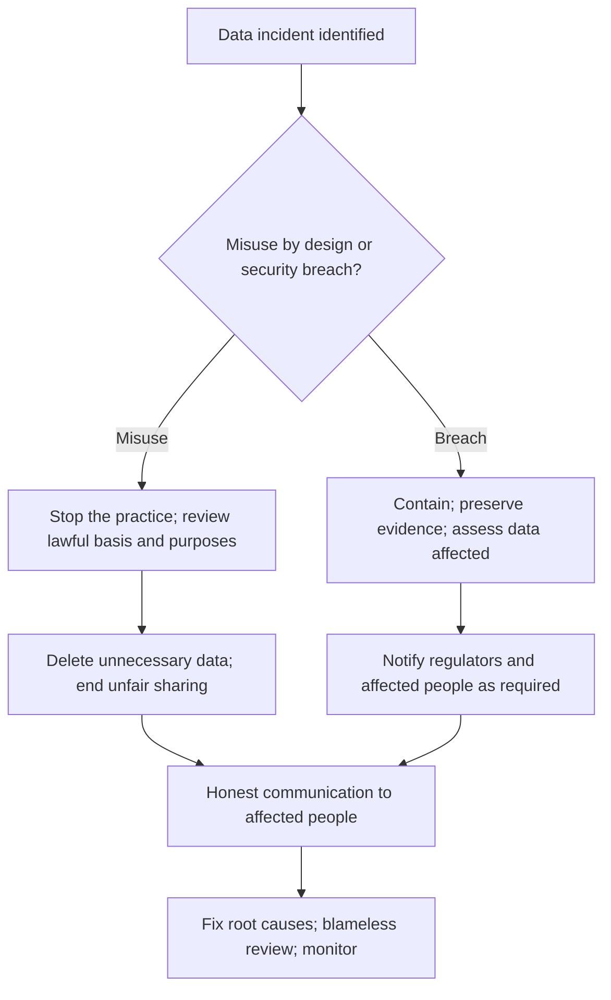

## Introduction

Customer data are among an organisation's most valuable assets and its most serious liabilities. Used responsibly, they enable better services, fraud prevention and financial inclusion. Misused or poorly protected, they can expose millions of people to fraud, manipulation and loss of autonomy, and can destroy an organisation's reputation. Two kinds of failure are especially common. **Data misuse** occurs when data are collected or used in ways that people did not expect or agree to, even if no one "breaks in". **Data breaches** occur when security failures allow unauthorised access to or disclosure of data.

This lesson analyses both types of failure through two well-documented international cases — the Cambridge Analytica affair and the 2017 Equifax breach — and two Ghanaian illustrative scenarios. Each case applies the seven-step method from the previous lesson: facts, stakeholders, ethical issues, analysis, options, recommendation and counter-arguments. References to Ghana's Data Protection Act, 2012 (Act 843) and Cybersecurity Act, 2020 (Act 1038) are general and educational, not legal advice.

## Learning Objectives

- Distinguish data misuse from data breaches and explain why both are ethical failures.
- Identify stakeholders and ethical issues in customer data cases.
- Analyse data misuse and breach cases using at least two ethical theories and the ACM Code.
- Evaluate organisational options for preventing and responding to data incidents.
- Recommend defensible actions, including disclosure to affected people, and respond to objections.

## Prerequisite Knowledge

- The Data and Privacy module, including consent, purpose limitation and Ghana's Data Protection Act, 2012 (Act 843).
- The lesson on cybercrime and the misuse of information systems.
- The seven-step case method from the previous lesson.

## Key Terminology

- **Data misuse**: Collection, sharing or use of personal data beyond the purposes people were told about or would reasonably expect, or without a lawful basis.
- **Data breach**: A security incident leading to unauthorised access to, or accidental or unlawful disclosure, alteration or loss of, personal data.
- **Purpose limitation**: The principle that personal data should be collected for specified purposes and not used in ways incompatible with them.
- **Data minimisation**: Collecting and retaining only the personal data necessary for a specified purpose.
- **Third-party data sharing**: Transfer of personal data to another organisation, such as a partner, app developer or data broker.
- **Patch management**: The process of identifying, testing and applying software updates that fix security vulnerabilities.
- **Breach notification**: Informing regulators and affected individuals about a data breach so that they can protect themselves.
- **Informational harm**: Harm resulting from misuse of information, such as fraud, discrimination, manipulation, embarrassment or loss of control over one's data.

## Analytical Approach for Data Cases

The seven-step method applies, but data cases benefit from three additional lenses.

1. **Lifecycle lens.** Trace the data from collection through use, sharing, storage and deletion. Ask at each stage whether the activity is necessary, expected by the person concerned and protected.
2. **Expectation lens.** Ask what a reasonable customer would expect given what they were told. Helen Nissenbaum's idea of *contextual integrity* captures this: information flows are appropriate when they respect the norms of the context in which the information was shared.
3. **Accountability lens.** Distinguish individual errors from organisational choices — business models, budgets for security, governance and culture — because effective remedies must target the level at which the failure occurred.

These lenses help avoid two common errors: treating a lawful-looking privacy notice as the end of the analysis, and treating a breach as the fault of a single careless employee.

## Case Study 1: Customer Data Misuse

### Facts — the international case

In 2018, reporting by *The Guardian*, *The Observer* and *The New York Times* revealed that the political consultancy Cambridge Analytica had obtained data derived from millions of Facebook users. The data had been collected through a personality-quiz app developed by researcher Aleksandr Kogan. Although only a relatively small number of users installed the app, Facebook's platform at the time allowed apps to access data about users' friends, so data relating to a far larger number of people — Facebook later estimated up to 87 million — were obtained. The data were passed to Cambridge Analytica, which was reported to use them for political profiling and targeting. In 2019 the US Federal Trade Commission announced a record US$5 billion penalty against Facebook over privacy failures, and the UK Information Commissioner's Office had earlier fined Facebook the maximum then available under UK law. Cambridge Analytica ceased operations in 2018.

### Facts — the Ghanaian application

*Illustrative scenario.* "QuickLoan GH", a digital lending app, requests access to users' contacts, photos and messages at installation. Its privacy notice says data are used "to improve services". When borrowers fall behind, the app's collection team sends messages to people in their contact lists describing the borrower as a debtor. The company also sells anonymised-looking "behavioural segments" to a marketing firm, which can re-identify individuals by combining them with other data.

### Stakeholders

- **Borrowers**: privacy, dignity, fair debt collection, control over their data.
- **Contacts of borrowers**: people who never used the app but whose data were collected and who received messages.
- **The lender and its investors**: repayment rates, growth, reputation, regulatory standing.
- **The marketing firm and its clients**.
- **Regulators**, such as the Data Protection Commission and, for lending, the financial regulator.
- **The digital lending sector**, whose legitimacy depends on public trust.

### Ethical issues

- **Lack of meaningful consent**: broad permissions and vague notices do not give users real understanding or choice.
- **Purpose limitation**: data collected for credit assessment are used for shaming and for sale.
- **Third-party harm**: contacts are affected without any relationship with the lender — as were the friends of quiz-takers in the Cambridge Analytica case.
- **Re-identification**: "anonymised" segments that can be re-linked to individuals remain personal data.
- **Dignity and coercion**: public shaming exploits social pressure and can cause serious distress.

### Analysis

**Utilitarian analysis.** The lender may increase repayment in the short term, but the harms are widespread: humiliation and distress for borrowers, intrusion on contacts, loss of trust in digital credit, and regulatory action that may damage the whole sector. Digital credit can advance financial inclusion; practices that make people fear using it undermine that larger social benefit.

**Kantian analysis.** Using people's contact lists to shame them treats both borrowers and contacts merely as means to debt recovery. Contacts are treated as instruments without any consent. A maxim permitting firms to use any data they can access for whatever purpose benefits them could not be universalised without destroying trust in all digital services.

**Contractarian (social contract) analysis.** The informal social contract of digital services is that people share data in exchange for services, within reasonable expectations. Selling data and shaming borrowers break the terms that a reasonable user would accept.

**ACM Code.** Principles **1.6** (respect privacy — including using data only for legitimate ends and limiting collection), **1.3** (honesty about data practices), **1.2** (avoid harm) and **1.1** (contribute to human well-being, acknowledging that all people are stakeholders) apply. Developers asked to build contact-scraping or shaming features should raise objections.

**Legal context.** Ghana's Data Protection Act, 2012 (Act 843) sets out data protection principles, including lawful processing, purpose specification, minimality and security safeguards, and confers rights on data subjects. The practices described would raise serious questions under those principles.

### Options

1. Continue, but rewrite the privacy notice to describe the practices.
2. Stop contact-list messaging but keep selling segments.
3. Redesign: request only the permissions necessary for credit assessment, end contact-list collection and shaming, stop the sale of segments, delete unnecessary data, adopt fair collection practices and appoint a data protection lead.
4. Exit the market.

### Recommendation

Option 3. Transparency alone (option 1) does not cure unfair processing, and selling re-identifiable data (option 2) remains misuse. The company should cease contact scraping and shaming immediately, delete data it does not need, end the data sale, register and engage with the Data Protection Commission as required, and introduce humane collection practices. It should also review its credit model to ensure that it does not rely on data obtained unfairly.

### Counter-arguments

- *"Borrowers agreed to the permissions."* Click-through consent to broad permissions is not informed or specific, and contacts never agreed at all.
- *"Shaming is the only way to recover loans from people without collateral."* Responsible lenders use affordability checks, reminders and restructuring; shaming may also drive borrowers away from formal credit.
- *"The segments were anonymised."* If individuals can be re-identified, the data remain personal and the risk remains.

## Case Study 2: Data Breach

### Facts — the international case

In 2017 the US credit reporting agency Equifax suffered one of the most significant data breaches on record. Attackers exploited a known vulnerability in the Apache Struts web framework used in an online dispute portal. A patch for the vulnerability had been publicly released months earlier, but Equifax had not applied it to the affected system. The attackers remained in the network for weeks and accessed personal information — including names, Social Security numbers and dates of birth — relating to approximately 147 million people. Equifax announced the breach in September 2017, some weeks after discovering it, and its response was widely criticised, including problems with the website it set up for consumers. In 2019 Equifax agreed a settlement with the Federal Trade Commission, the Consumer Financial Protection Bureau and US states. Investigations also highlighted weaknesses such as poor asset inventory and an expired security certificate that had impaired monitoring of network traffic.

### Facts — the Ghanaian application

*Illustrative scenario.* "Sankofa Health Insurance", a Ghanaian private insurer, discovers that a test database containing members' names, Ghana Card numbers, phone numbers and medical claim histories was left accessible on the internet without a password for several months. A security researcher reports it. There is no evidence yet of malicious access, but logs are incomplete. The marketing director argues that because there is "no proof of harm", members need not be told.

### Stakeholders

- **Members**, whose health and identity data were exposed: privacy, protection from fraud and discrimination, a right to know.
- **The insurer**: legal compliance, reputation, financial exposure.
- **Staff responsible for the database**: accountability, fair treatment.
- **The security researcher**: recognition, legal safety for responsible disclosure.
- **Regulators**: the Data Protection Commission, the insurance regulator and, for cybersecurity incidents, the Cyber Security Authority and sectoral CERTs as applicable.
- **Hospitals and health partners** whose trust depends on the insurer.

### Ethical issues

- **Negligent security**: using real personal data in a test environment and leaving it unprotected falls short of basic security practice; Equifax similarly failed to patch a known vulnerability.
- **Disclosure versus concealment**: members cannot protect themselves if not told; delay or concealment compounds the harm.
- **Sensitivity**: health data can lead to discrimination and embarrassment; Ghana Card numbers can enable identity fraud.
- **Accountability**: responsibility should rest with organisational controls and leadership, not only with the individual developer.
- **Treatment of the researcher**: rewarding responsible disclosure encourages future reports.

### Analysis

**Utilitarian analysis.** Notifying members has short-term costs (reputational damage, call-centre load) but substantial benefits: members can watch for fraud, change details where possible and make informed decisions, and the organisation retains long-term trust. Concealment risks far greater harm if misuse later emerges, as the criticism of Equifax's delayed and poorly executed response illustrates.

**Kantian analysis.** Withholding information people need to protect themselves treats them as means to protect the company's reputation. Honesty is owed to those whose data were entrusted to the insurer. A maxim "conceal breaches whenever harm cannot be proven" could not be universalised without making all assurances of data security worthless.

**Virtue ethics.** Honesty, responsibility and courage call for prompt disclosure and an apology; defensiveness and minimisation reflect vices that erode institutional character.

**ACM Code.** Principles **2.9** (design and implement systems that are robustly and usably secure), **1.6** (respect privacy), **1.3** (honesty), **2.5** (thorough evaluation of risks) and **3.6** (use care when modifying or retiring systems) apply, together with **1.2** (avoid harm), whose guidance states that where harm occurs unintentionally, those responsible are obliged to undo or mitigate it as far as possible — which includes enabling affected people to protect themselves.

**Legal context.** Act 843 requires appropriate security safeguards and includes provisions on notification where personal data have been accessed by unauthorised persons; Act 1038 provides for cybersecurity incident reporting structures. The insurer should take legal advice on its specific obligations and the sector regulator's requirements.

### Options

1. Close the database and say nothing.
2. Close it, investigate, and notify only if evidence of misuse appears.
3. Close it, preserve evidence, investigate, notify the regulator(s) as required, inform affected members clearly with practical guidance, offer support, thank the researcher and fix the underlying process.
4. Option 3 plus public scapegoating and dismissal of the developer.

### Recommendation

Option 3. The insurer should secure the database immediately, preserve and review logs, notify the Data Protection Commission and other regulators as required, and tell members what happened, what data were involved, what the company is doing and what members can do. It should stop using real personal data in test environments (using synthetic or masked data), implement asset inventories and configuration scanning, and conduct a blameless post-incident review. The researcher should be thanked and, ideally, a vulnerability-disclosure policy published.

### Counter-arguments

- *"Notification will cause panic and damage the brand."* Clear, honest communication reduces panic; concealment discovered later causes far greater damage, as Equifax shows.
- *"There is no proof anyone accessed the data."* Incomplete logs mean absence of proof is not proof of absence; members are entitled to make their own risk decisions.
- *"The developer who left the database open should be dismissed."* Individual accountability matters, but the absence of controls for test data and configuration review is an organisational failure; scapegoating discourages future reporting.

## Comparative Analysis and Diagram

Misuse and breach cases differ in mechanism — one is a deliberate choice about data use, the other a failure of protection — but share a root cause: **treating customer data as an asset to exploit rather than a trust to honour**. In both, the ethical response combines stopping the harm, honesty with affected people, accountability at organisational level and structural change.

| Dimension | Data misuse | Data breach |
|---|---|---|
| Mechanism | Intended use beyond expectations or lawful basis | Security failure enabling unauthorised access |
| Typical cause | Business model, vague consent, weak governance | Unpatched systems, misconfiguration, weak monitoring |
| Key principles | Purpose limitation, consent, minimisation | Security safeguards, notification, accountability |
| Main ACM principles | 1.6, 1.3, 1.2 | 2.9, 1.6, 1.3, 2.5 |

## Common Misconceptions

- "If no one hacked us, we have not mishandled data." — Misuse beyond people's expectations or lawful purposes is an ethical and legal failure even without a breach.
- "Anonymised data can be shared freely." — Data that can be re-identified remain personal data and carry privacy risk.
- "No proof of harm means no need to notify." — Affected people need information to protect themselves, and legal notification duties may apply regardless.
- "Breaches are always sophisticated attacks." — Many result from basic failures, such as Equifax's unpatched known vulnerability or an unprotected test database.

## Common Examination Mistakes

- Treating misuse and breach as the same issue without explaining their different mechanisms.
- Overstating real-case facts or inventing figures; use only well-documented details.
- Focusing only on legal compliance without ethical analysis.
- Recommending punishment of an individual without addressing organisational causes.
- Ignoring third parties, such as contacts or family members, who are affected without consent.

## Critical Thinking Questions

1. Should digital lenders in Ghana be prohibited from accessing borrowers' contact lists at all? What would be lost and gained?
2. How quickly should an organisation notify affected people when it is still investigating whether data were actually accessed?
3. Does a platform such as Facebook bear more responsibility than the app developer who extracted the data? Why?
4. Is it ethical to use real customer data in testing if access is restricted? What alternatives exist?

## Practical Exercises

1. **Notification letter.** Write a plain-language notification to members of the illustrative Sankofa Health Insurance explaining the incident, the data involved, actions taken and steps members can take. Expected output: a 250–300 word letter.
2. **Permissions review.** Examine the permissions requested by three finance apps on your own phone and judge whether each is necessary for the service. Expected output: a table of app, permission, stated purpose and your assessment.
3. **Root-cause analysis.** Using public reporting on the Equifax breach, construct a root-cause diagram distinguishing technical, process and governance failures. Expected output: a diagram with at least six causes and one control for each.

## Key Takeaways

- Data misuse is use beyond legitimate purposes or expectations; a breach is a failure of protection. Both betray trust.
- Cambridge Analytica showed how platform design allowed data about non-consenting friends to be harvested and repurposed.
- Equifax showed how failing to patch a known vulnerability and responding poorly can harm millions.
- Defensible responses stop harm, notify honestly, accept organisational accountability and fix root causes.
- ACM principles 1.6, 1.3 and 2.9 and Ghana's Act 843 frame expectations for data handling.

## Further Reading

- Zuboff, S. (2019). *The age of surveillance capitalism: The fight for a human future at the new frontier of power*. PublicAffairs.
- Federal Trade Commission. (n.d.). *Equifax data breach settlement*. <https://www.ftc.gov/enforcement/refunds/equifax-data-breach-settlement>
- Republic of Ghana. (2012). *Data Protection Act, 2012 (Act 843)*.
- Association for Computing Machinery. (2018). *ACM code of ethics and professional conduct*. <https://www.acm.org/code-of-ethics>
- Tavani, H. T. (2016). *Ethics and technology: Controversies, questions, and strategies for ethical computing* (5th ed.). Wiley.

## Video Resources

- [FTC – Equifax Data Breach Settlement](https://www.ftc.gov/enforcement/refunds/equifax-data-breach-settlement) — US Federal Trade Commission. Official page summarising the Equifax breach settlement and consumer guidance.
- [Data Protection Commission, Ghana](https://dataprotection.org.gh/) — Data Protection Commission. Official site of Ghana's data protection regulator with guidance for data controllers.

## Revision Summary

Customer data cases fall into misuse (using data beyond legitimate purposes or expectations) and breaches (security failures allowing unauthorised access). Cambridge Analytica illustrates misuse enabled by platform design and harm to non-consenting third parties; Equifax illustrates a breach caused by an unpatched known vulnerability and a poorly handled response. Analysis through utilitarian, Kantian and virtue perspectives, and ACM principles 1.6, 1.3 and 2.9, supports stopping harm, honest notification, organisational accountability and structural fixes.

- Misuse = purpose violation; breach = protection failure.
- Consent via vague notices and broad permissions is weak.
- Re-identifiable data are still personal data.
- No proof of harm ≠ no duty to notify.
- Fix systems, not scapegoats.
