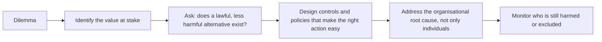

## Introduction

This final case-study lesson examines three dilemmas that Ghanaian organisations face regularly but often discuss only informally. **Software piracy**: using unlicensed copies of commercial software: is sometimes defended as a practical necessity where licences are expensive. **Unauthorised AI use**: staff pasting confidential information into public generative-AI tools without approval: is a new and fast-growing risk. **Digital exclusion**: designing services that some people cannot use, can occur without anyone intending harm, simply because designers assume that every user has a smartphone, data, literacy in English and a reliable connection.

Each case uses the seven-step method: facts, stakeholders, ethical issues, analysis through at least two ethical theories and the ACM Code, options, a recommendation and counter-arguments. Two cases are Ghanaian illustrative scenarios; the unauthorised-AI case also draws on widely reported international events. Legal references are general and educational, not legal advice.

## Learning Objectives

- Analyse software piracy using ethical theories, intellectual property concepts and the ACM Code.
- Evaluate the confidentiality, accuracy and accountability risks of unauthorised generative-AI use in organisations.
- Explain how digital services can exclude people and apply inclusion principles to service design.
- Recommend defensible, practical courses of action and respond to counter-arguments.
- Compare the three cases to identify recurring themes in IT ethics.

## Prerequisite Knowledge

- The Intellectual Property module, especially copyright and software licensing.
- The lessons on AI ethics and on digital inclusion and technology access.
- The seven-step case method from the earlier case-study lessons.

## Key Terminology

- **Software piracy**: Copying, installing, distributing or using software in breach of its licence terms, such as using cracked copies or exceeding the number of licensed installations.
- **Software asset management (SAM)**: Processes for tracking software licences, installations and usage to ensure compliance and value for money.
- **Shadow AI**: Use of AI tools by staff without organisational approval, oversight or data-protection safeguards.
- **Data leakage**: Unintended transfer of confidential or personal information outside an organisation's control.
- **Digital exclusion**: The inability of individuals or groups to access or use digital services effectively because of cost, connectivity, skills, disability, language or design.
- **Assisted digital**: Support channels, such as agents or help desks, that allow people to complete digital processes with help.
- **Universal design**: Designing products and services so that they are usable by as many people as possible without the need for adaptation.
- **Accessibility**: The degree to which people with disabilities can perceive, understand, navigate and interact with a service.

## Case Study 1: Software Piracy

### Facts

*Illustrative scenario.* "Bright Future Academy", a private secondary school in Cape Coast, runs 40 computers in its ICT lab. To save money, the IT officer installed cracked copies of a commercial office suite and a design package obtained from a file-sharing site. The school's owner says that "everyone does it" and that the licences cost more than the school can afford. A parent who works in IT notices activation warnings and raises concerns. Several machines have also shown signs of malware.

### Stakeholders

- **The school and its owner**: budget, reputation, legal exposure.
- **The IT officer**: professional integrity, job security, possible personal liability.
- **Students**: access to learning tools, security of their data, the values the school models.
- **Software vendors and their staff**: revenue and rights as copyright holders.
- **Parents and the wider community**: trust in the school.

### Ethical issues

- **Respect for intellectual property**: unlicensed use breaches copyright and licence terms; Ghana's Copyright Act, 2005 (Act 690) protects computer software.
- **Security**: cracked software is a common route for malware, risking student and staff data.
- **Role modelling**: an educational institution teaching students to disregard licences.
- **Affordability and access**: the school's financial constraints are genuine.
- **Professional responsibility**: the IT officer installed the software.

### Analysis

**Utilitarian analysis.** Piracy appears to produce benefits (access at no cost) with diffuse costs (lost vendor revenue). But a fuller account includes malware risks to students' data, potential legal penalties and reputational damage, and the long-term effect of normalising rule-breaking. Crucially, alternatives exist (open-source office and design tools, education licensing schemes and free web-based tools) that provide most of the benefit without the harms, so piracy is not the welfare-maximising option.

**Kantian analysis.** Using software in breach of the only conditions on which its creators offered it treats them merely as means. The maxim "use others' work without permission whenever paying is inconvenient" cannot be universalised without undermining the practice of software creation the school depends on.

**Virtue ethics.** A school exists to cultivate character. Honesty and fairness are poorly taught by an institution that relies on pirated tools.

**ACM Code.** Principles **1.5** (respect the work required to produce new ideas and computing artefacts), **2.3** (know and respect existing rules pertaining to professional work) and **2.9** (robustly and usably secure systems) apply directly. Principle 2.3 recognises that rules may sometimes be challenged when unethical, but a high price is not grounds for disregarding a legitimate licence.

### Options

1. Continue and hope the issue is not discovered.
2. Remove all software immediately with no replacement.
3. Remove pirated software, scan and rebuild affected machines, and replace with open-source alternatives and any available education licences; introduce a simple software asset register.
4. Buy full commercial licences for every machine.

### Recommendation

Option 3. It ends the infringement and the security risk while preserving students' access to learning tools. Open-source suites and design tools teach transferable skills; where commercial software is genuinely needed for examinations or certification, the school can seek education pricing for a smaller number of machines. The IT officer should document the remediation and a policy should require approval for all installations.

### Counter-arguments

- *"Licences are unaffordable, so piracy is the only way to give students access."* Affordable or free lawful alternatives exist, so the dilemma is a false one.
- *"Vendors are large multinationals that will not miss the revenue."* The wrongness of using work without permission does not depend on the owner's wealth, and Ghanaian software developers depend on the same respect for licences.
- *"Everyone does it."* Widespread practice is not ethical justification: an instance of the bandwagon fallacy.

## Case Study 2: Unauthorised AI Use

### Facts

In 2023, media outlets widely reported that Samsung restricted employees' use of generative-AI tools after staff were reported to have entered confidential information, including source code, into ChatGPT. The episode became a frequently cited example of the risks of "shadow AI".

*Illustrative scenario.* At "Tamale Commercial Bank", a credit analyst pastes customer loan files (names, Ghana Card numbers, income details) into a free public chatbot to generate summaries for a credit committee. A developer pastes proprietary code into another tool to fix a bug. A junior officer uses AI to draft a regulatory report, which includes an invented statistic. None of these uses has been approved, and the bank has no AI policy.

### Stakeholders

- **Customers**, whose personal and financial data have been disclosed to a third party.
- **The bank**: confidentiality, regulatory compliance, IP, accuracy of reports.
- **Employees**: productivity gains, but also exposure to discipline for acting without guidance.
- **Regulators**: the Data Protection Commission, the Bank of Ghana and others relying on accurate reports.
- **AI providers**, whose terms of use govern how inputs may be stored or used.

### Ethical issues

- **Confidentiality and data protection**: customer data were transferred outside the bank's control without a lawful basis or safeguards, raising issues under Ghana's Data Protection Act, 2012 (Act 843).
- **Intellectual property and trade secrets**: proprietary code may lose protection or be exposed.
- **Accuracy and honesty**: AI-generated content containing a fabricated statistic was submitted to a regulator.
- **Accountability**: who is responsible, the employees, their managers, or leadership that provided no policy or approved tools?
- **Fairness to employees**: staff used AI to cope with workload in the absence of guidance.

### Analysis

**Utilitarian analysis.** AI tools can save significant time. But the expected harms from unmanaged use: data protection breaches affecting many customers, regulatory sanctions, loss of trade secrets and decisions based on fabricated information, are large. The greatest overall benefit comes from enabling AI under controls, not from prohibition or from uncontrolled use.

**Kantian analysis.** Customers entrusted their data to the bank for a specific purpose; disclosing them to an external tool without their knowledge disregards their autonomy. Submitting unverified, invented figures to a regulator is deception, regardless of whether a tool produced them.

**Virtue ethics.** Prudence and conscientiousness require checking whether a tool is approved and verifying its output. Leadership, too, shows a lack of practical wisdom by failing to anticipate predictable staff behaviour.

**ACM Code.** Principles **1.7** (honour confidentiality), **1.6** (respect privacy), **1.3** (honesty), **2.2** (maintain high standards of professional competence) and **3.4** (articulate, apply and support policies reflecting the Code) apply. Principle 3.4 places a duty on leaders to provide policy.

### Options

1. Ban all AI use and discipline the employees involved.
2. Ignore the issue because the productivity gains are valuable.
3. Contain and assess the incidents (including whether notification is required), correct the regulatory report, and introduce an AI policy with approved enterprise tools, data classification rules, mandatory verification and disclosure, training and proportionate, fair handling of the employees.
4. Allow any tool but require staff to sign a disclaimer.

### Recommendation

Option 3. The bank should first treat the customer-data disclosure as a potential data incident: assessing what was shared and the provider's data handling, and taking advice on notification obligations, and correct the report to the regulator. It should then publish an AI policy: which tools are approved, which data must never be entered into external tools, requirements to verify outputs and disclose AI assistance, and named accountability. Employee responses should be proportionate, recognising that the lack of policy was a leadership failure; training is more effective than scapegoating.

### Counter-arguments

- *"A total ban is safest."* Bans tend to drive use underground; approved tools with safeguards reduce risk more effectively.
- *"Employees are adults and should take responsibility."* They should, but organisations must give them the rules and tools to do so (ACM 3.4).
- *"The AI provider promised not to use inputs."* Terms vary between consumer and enterprise products and can change; customer data should not be disclosed without a lawful basis and due diligence.

## Case Study 3: Digital Exclusion

### Facts

*Illustrative scenario.* A Ghanaian municipal assembly launches an app-only system for paying market-stall fees and renewing trading permits, replacing cash payment at the assembly office. The app is available only in English, requires a smartphone, mobile data and a one-time password sent by SMS, and offers no assisted channel. Within weeks, older traders, traders with visual impairments and those who cannot read English struggle to renew permits; some pay intermediaries who overcharge, and others are fined for late renewal.

### Stakeholders

- **Traders**, especially older people, people with disabilities, low-literacy users and those without smartphones.
- **The assembly**: efficiency, revenue collection, transparency, reducing cash handling and leakage.
- **IT vendor and designers**.
- **Intermediaries**, some of whom exploit the situation.
- **Citizens generally**, who benefit from efficient services and accountable revenue.

### Ethical issues

- **Justice and equal access to public services**: a public body excluding some citizens from a mandatory service.
- **Unintended harm**: fines and overcharging falling on the most vulnerable.
- **Accessibility and language**: no support for screen readers or local languages.
- **Legitimate aims**: digitisation can reduce corruption and leakage, which benefits the public.

### Analysis

**Utilitarian analysis.** Digital payment can increase revenue transparency and reduce queues, benefiting many. But the harms are concentrated on those least able to bear them, and the fines and exploitation could be avoided at modest cost through assisted channels. A design that keeps the benefits while removing the harms produces greater overall welfare.

**Rawlsian justice.** The difference principle asks whether a policy benefits the least advantaged. An app-only system that works well for the digitally connected but penalises older, disabled and low-literacy traders fails this test unless alternatives are provided.

**Capability approach.** Associated with Amartya Sen, it asks whether people have real freedom to do what they value. Formal access, "the app is available to everyone", is not real access if people lack devices, skills or accessible design.

**ACM Code.** Principles **1.4** (be fair and take action not to discriminate: the guidance refers to accessibility and inclusion), **1.1** (contribute to human well-being, acknowledging all people as stakeholders) and **3.7** (special care for systems integrated into the infrastructure of society) apply.

### Options

1. Keep the app-only system and wait for adoption to improve.
2. Abandon digitisation and return to cash.
3. Keep digital payment but add inclusive channels: USSD payment, payment through mobile-money agents, an assisted desk at the assembly office, local-language interfaces and voice prompts, accessibility testing with disabled users, and a grace period with fines waived for those affected.
4. Allow intermediaries to operate formally at a set fee.

### Recommendation

Option 3. It retains the legitimate benefits of digitisation while ensuring that no citizen is excluded from a mandatory public service. The assembly should co-design improvements with trader associations and disability organisations, monitor which groups are failing to complete renewals and waive fines caused by the transition. The lesson for designers is to treat inclusion as a requirement from the start, not an afterthought.

### Counter-arguments

- *"Most traders already use mobile money, so adoption will rise."* Average adoption does not help those who are excluded now and are being fined.
- *"Multiple channels are expensive."* USSD and agent networks already exist in Ghana; the cost is modest compared with the harm and lost revenue from non-compliance.
- *"Returning to cash is fairer."* Cash systems carry their own risks of leakage and inefficiency; inclusive digital design serves everyone better.

## Comparative Analysis and Diagram

| Theme | Piracy | Unauthorised AI | Digital exclusion |
|---|---|---|---|
| Core value at stake | Respect for creators' rights | Confidentiality and honesty | Justice and equal access |
| Who is harmed | Creators; users exposed to malware | Customers; the bank; regulators | Vulnerable citizens |
| Organisational root cause | No licensing policy or budget planning | No AI policy or approved tools | Design assumptions about users |
| Defensible response | Lawful alternatives plus asset management | Enable AI under controls | Inclusive, multi-channel design |

Across all three cases, individual misconduct or design choices are shaped by organisational gaps. Ethical IT practice therefore requires both **personal integrity** and **institutional design** that makes the right action the easy action.

## Common Misconceptions

- "Piracy is victimless." It infringes creators' rights, exposes users to malware and undermines the software ecosystem, including local developers.
- "If the AI tool is free and public, using it at work is harmless." Entering confidential or personal data can breach confidentiality and data protection obligations.
- "Making a service digital makes it accessible to everyone." Cost, skills, disability, language and connectivity can all exclude people.
- "Banning AI solves the risk." Bans often drive use underground; approved tools and clear rules are more effective.

## Common Examination Mistakes

- Treating affordability as a complete justification for piracy without considering lawful alternatives.
- Blaming individual staff for shadow AI without analysing leadership's duty to provide policy and tools.
- Discussing digital exclusion only in terms of internet access, ignoring disability, language and literacy.
- Failing to apply two distinct ethical theories to each case.
- Giving a recommendation without implementation steps or counter-arguments.

## Critical Thinking Questions

1. Is there any situation in which using unlicensed software could be ethically justified? What conditions would have to hold?
2. Who should be accountable when an AI-generated error reaches a regulator: the employee, the manager or the organisation?
3. Should governments be required by law to keep non-digital channels for essential public services?
4. How can designers in Ghana test services with users who are least likely to be represented in typical user research?

## Practical Exercises

1. **SAM register.** Design a simple software asset register for a 40-computer school lab, recording software, licence type, number of installations, expiry and owner. Expected output: a register template with three sample rows.
2. **AI acceptable-use policy.** Draft a one-page generative-AI policy for an illustrative Ghanaian bank covering approved tools, prohibited data, verification, disclosure and accountability. Expected output: a policy with at least eight numbered rules.
3. **Inclusion audit.** Choose a Ghanaian digital service you use and assess it against cost, connectivity, language, literacy, disability and assisted-channel criteria. Expected output: a scored checklist with three improvement recommendations.

## Key Takeaways

- Piracy breaches creators' rights and creates security risks; lawful alternatives usually remove the apparent dilemma.
- Shadow AI risks confidentiality, data protection, IP and accuracy; organisations should enable AI under clear controls.
- Digital exclusion arises from design assumptions; inclusive, multi-channel and accessible design is an ethical requirement for public services.
- Each case benefits from two or more ethical theories and specific ACM principles.
- Organisational root causes must be addressed alongside individual responsibility.

## Further Reading

- Quinn, M. J. (2020). *Ethics for the information age* (8th ed.). Pearson.
- Tavani, H. T. (2016). *Ethics and technology: Controversies, questions, and strategies for ethical computing* (5th ed.). Wiley.
- van Dijk, J. (2020). *The digital divide*. Polity Press.
- Association for Computing Machinery. (2018). *ACM code of ethics and professional conduct*. <https://www.acm.org/code-of-ethics>
- Republic of Ghana. (2005). *Copyright Act, 2005 (Act 690)*.

## Video Resources

- [W3C Web Accessibility Initiative](https://www.w3.org/WAI/): World Wide Web Consortium. Official resources on web accessibility, including introductions to accessibility principles and guidelines.
- [ACM Code of Ethics: Case Studies](https://www.acm.org/code-of-ethics/case-studies): Association for Computing Machinery. Official case studies applying the Code to ethical dilemmas in computing.

## Revision Summary

Software piracy, unauthorised AI use and digital exclusion each combine individual choices with organisational gaps. Piracy disregards creators' licence conditions and invites malware; lawful open-source and education options usually remove the dilemma. Shadow AI exposes confidential and personal data and can introduce fabricated content; the answer is enabling AI under clear policy. Digital exclusion arises when services assume devices, data, literacy and ability; inclusive, multi-channel design is required, especially for public services.

- Piracy: ACM 1.5, 2.3, 2.9; Act 690 protects software.
- Shadow AI: ACM 1.7, 1.6, 1.3, 3.4; Act 843 for personal data.
- Exclusion: ACM 1.4, 1.1, 3.7; Rawls and the capability approach.
- Prefer controlled enablement over bans.
- Fix root causes, not only individuals.
