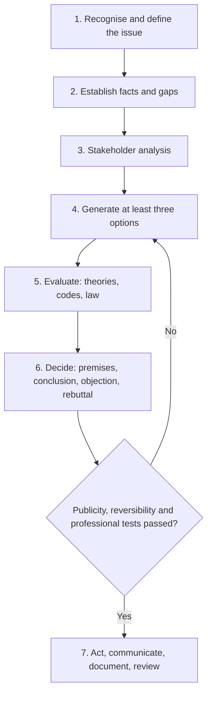

## Introduction

Knowing ethical theories is necessary but not sufficient. In practice, IT professionals face messy situations with incomplete facts, time pressure, conflicting obligations and colleagues who see things differently. What they need is a reliable *method*: a way of moving from a vague sense that "something is not right" to a clear, justified recommendation that can be explained to a manager, a client, a regulator or an examiner.

This lesson presents a seven-step ethical decision-making framework, shows how to conduct a stakeholder analysis, and teaches you to build a **defensible ethical argument**: one that states its premises explicitly, reaches a valid conclusion, anticipates objections and rebuts them. The framework is then applied step by step to a realistic Ghanaian IT dilemma. These skills are directly assessed in case-study questions and are the foundation for the later module on ethical case studies.

## Learning Objectives

- Explain why structured methods improve the quality and defensibility of ethical decisions.
- Apply a seven-step ethical decision-making framework to an IT dilemma.
- Conduct a stakeholder analysis that identifies interests, rights, power and potential harms.
- Construct an ethical argument with explicit premises and conclusion, and evaluate its validity and soundness.
- Evaluate a recommendation by stating the strongest objection and providing a reasoned rebuttal.

## Prerequisite Knowledge

- Utilitarianism, Kantian deontology, virtue ethics and social contract theory (previous lesson).
- The ACM and IEEE codes of ethics (IT Professionalism module).

## Key Terminology

- **Ethical dilemma**: A situation in which an agent must choose between options that each involve some moral cost, often because obligations conflict.
- **Stakeholder**: Any person, group or entity that can affect or is affected by a decision, including those without a voice in it.
- **Stakeholder analysis**: A systematic identification of stakeholders, their interests, rights and power, and how each option would affect them.
- **Premise**: A statement offered as a reason in support of a conclusion.
- **Valid argument**: An argument in which, if the premises are true, the conclusion must be true.
- **Sound argument**: A valid argument whose premises are actually true.
- **Objection**: A reason for thinking that an argument's premise or conclusion is mistaken.
- **Rebuttal**: A reasoned response that answers an objection, either by showing it fails or by modifying the argument to accommodate it.
- **Moral imagination**: The ability to envisage options beyond the obvious ones and to see a situation from others' perspectives.

## Detailed Explanation

### Why use a structured method?

Unstructured ethical reasoning is vulnerable to predictable errors. People frame the problem too narrowly ("this is a technical issue"), consider only two options ("comply or resign"), forget stakeholders who are not in the room, rationalise the convenient choice, or reach a conclusion first and seek reasons afterwards. A structured framework slows the process enough to correct these errors and produces a written record that shows the decision was reasoned rather than arbitrary. That record is itself valuable: it supports accountability and helps the professional defend their choice later.

Several frameworks exist. The Markkula Center for Applied Ethics at Santa Clara University publishes a widely used framework that asks decision-makers to recognise an ethical issue, get the facts, evaluate options through several ethical "lenses" (including rights, justice, utilitarian, common good, virtue and care), test the decision and reflect on the outcome. Textbooks such as Tavani's *Ethics and Technology* and Quinn's *Ethics for the Information Age* offer comparable approaches. The framework below synthesises these ideas into seven steps suited to IT practice.

### The seven-step framework

1. **Recognise and define the ethical issue.** State the dilemma in one or two sentences. Distinguish the ethical question ("should we...?") from technical and legal questions, while noting how they interact.
2. **Establish the facts and identify gaps.** What is known? What is assumed? What additional information would change the analysis? Who could provide it?
3. **Identify stakeholders and their interests.** Use a stakeholder table (see below). Include indirect and vulnerable stakeholders.
4. **Generate options.** Aim for at least three, including creative middle-ground options. Avoid the false choice between doing exactly what is asked and refusing entirely.
5. **Evaluate options using ethical theories, codes and law.** Apply utilitarian, Kantian, virtue and social contract lenses; check relevant professional code principles; note legal constraints (educationally, not as legal advice).
6. **Decide and justify.** Choose an option, construct an explicit argument for it, state the strongest objection and rebut it.
7. **Act, communicate and review.** Plan implementation, communicate with stakeholders, document the reasoning and set a point at which the outcome will be reviewed.

### Tests for a decision

Before finalising a decision, three quick tests can expose weaknesses:

- **Publicity test**: would you be comfortable if your decision and reasons were reported in the news?
- **Reversibility test**: would you accept the decision if you were in the position of the most affected stakeholder?
- **Professional test**: could you justify the decision to a respected peer or professional body, by reference to the relevant code?

## Theories, Frameworks and Models

### Stakeholder analysis

A useful stakeholder table records, for each stakeholder, their **interests** (what they want or need), **rights** (legitimate claims they can make), **power** (their ability to influence the decision) and **impact** (how each option affects them). Power matters because ethical analysis must pay special attention to stakeholders with high impact but low power, such as customers who do not know their data is being used, or communities affected by automated decisions.

| Stakeholder | Interests | Rights / legitimate claims | Power | Vulnerability |
|---|---|---|---|---|
| Customers | Fair treatment, privacy, reliable service | Consent, data protection rights, honest information | Low individually | High |
| Employees | Job security, safe working conditions, clear conscience | Fair treatment, not to be required to act unethically | Medium | Medium |
| Shareholders / owners | Profit, reputation | Return on investment within the law | High | Low |
| Regulators | Compliance, public protection | Accurate reporting and cooperation | High | Low |
| Wider society | Trust in digital services, fairness | Protection from harm | Diffuse | Varies |

### Building a defensible ethical argument

An ethical argument makes its reasoning explicit so that others can evaluate it. A standard structure is:

- **P1 (factual premise)**: a claim about the situation, supported by evidence.
- **P2 (normative premise)**: a moral principle, drawn from a theory, code or widely shared value.
- **P3 (application premise)**: a claim that the principle applies to these facts.
- **C (conclusion)**: what ought to be done.

For example: P1, the proposed feature collects users' contacts without clear notice; P2, it is wrong to collect personal data in ways people have not knowingly agreed to (Kantian respect for persons; ACM principle to respect privacy; consent requirements in data protection law); P3, users cannot knowingly agree to collection they are not told about; C, the feature should not be released without clear notice and a genuine choice.

Two questions evaluate an argument:

1. **Is it valid?** Does the conclusion follow from the premises? Arguments often hide a missing premise; making it explicit is a key analytical skill.
2. **Is it sound?** Are the premises true? Factual premises need evidence; normative premises need justification.

### Objections and rebuttals

A defensible argument anticipates the **strongest** objection, not a weak one (attacking a weak version of an opposing view is the *straw man* fallacy). Objections usually target one of three things: the facts ("users do read the privacy policy"), the principle ("consent is not required when the benefit is large") or the application ("contacts are not really personal data"). A good rebuttal either shows that the objection fails, with reasons, or concedes part of it and modifies the conclusion, for example by adding safeguards. Conceding a strong point is a sign of rigour, not weakness.

Common fallacies to avoid include **appeal to common practice** ("everyone does it"), **slippery slope** without evidence, **false dilemma**, and **appeal to authority** ("the manager said so").

## Worked Example

### A full application of the framework

*Illustrative scenario.* Nana is a senior data analyst at SikaLend, a fictional Ghanaian digital lender that provides small loans through a mobile app. The product manager asks her to add a feature that reads borrowers' phone contact lists. If a borrower falls behind on repayment, the system would automatically send messages to their contacts saying the borrower owes money. The product manager argues that this will reduce defaults, keep interest rates lower for everyone and is "standard in the industry".

**Step 1: Define the issue.** Should SikaLend collect borrowers' contact lists and use them to pressure borrowers by notifying their contacts of debts?

**Step 2: Facts and gaps.** Known: the feature would access contacts, send debt messages to third parties and probably reduce defaults. Unknown: whether borrowers would be clearly told; whether contacts consent to receiving messages; the legal position under Ghana's data protection framework and any lending regulations; evidence of the actual effect on defaults. Nana should seek advice from the compliance officer and ask for any data on effectiveness.

**Step 3: Stakeholders.**

| Stakeholder | Interests | Impact of the feature |
|---|---|---|
| Borrowers | Access to credit, dignity, privacy | Humiliation, strain on relationships, possible coercion |
| Borrowers' contacts | Privacy, not to be involved | Their numbers processed without their knowledge; unwanted messages |
| SikaLend owners | Lower defaults, profit, reputation | Possible gains; serious reputational and regulatory risk |
| Nana and colleagues | Professional integrity, employment | Asked to build a feature they may consider unethical |
| Regulators | Consumer protection, data protection compliance | Potential enforcement concern |
| Society | Trust in digital finance and financial inclusion | Erosion of trust in digital lending |

**Step 4: Options.**

- A. Build the feature as requested.
- B. Refuse to build it.
- C. Propose an alternative collections strategy: clear reminders to the borrower only, flexible repayment plans, and responsible credit assessment, without accessing contacts.
- D. Build a version that only allows borrowers to *voluntarily* nominate a guarantor who explicitly agrees to be contacted.

**Step 5: Evaluate.**

- *Utilitarian*: A may reduce defaults, but the harms to borrowers and third parties (humiliation, damaged relationships) are serious and widespread, and loss of trust in digital lending harms financial inclusion. C and D deliver much of the benefit with far less harm.
- *Kantian*: A uses borrowers' contacts merely as means; they never agreed to participate. Shaming borrowers manipulates rather than respects their agency. D respects autonomy because the guarantor consents.
- *Virtue*: An honest, just and compassionate lender would not shame customers. Courage may be required for Nana to push back.
- *Social contract*: Behind a veil of ignorance, few would accept a rule allowing lenders to broadcast their debts to their contacts.
- *Codes*: ACM principles to avoid harm, respect privacy and be fair; IEEE commitments to protect privacy and treat people with respect.
- *Law (educational only)*: processing third parties' personal data without their knowledge raises clear questions under data protection principles such as lawfulness, purpose specification and openness. Compliance advice is required.

**Step 6: Decide and argue.**

- P1: Option A processes contacts' personal data without their knowledge and uses it to shame borrowers.
- P2: It is wrong to process people's personal data without a lawful basis and their knowledge, and to use information to humiliate people, when less harmful alternatives can achieve the legitimate goal (Kantian respect, utilitarian harm minimisation, ACM and IEEE privacy principles).
- P3: Options C and D can achieve the legitimate goal of reducing defaults with far less harm.
- C: SikaLend should not build Option A and should adopt Options C and D.

*Strongest objection*: "Without the feature, defaults will rise, interest rates will increase and poorer borrowers will lose access to credit, which is worse for them overall."

*Rebuttal*: This objection has force because access to credit matters. However, (1) the claimed effect on defaults is unproven and should be tested; (2) the harm of public shaming falls on the same vulnerable borrowers the objection seeks to protect; (3) responsible credit assessment and flexible repayment can reduce defaults without coercion; and (4) the reputational and regulatory risks could threaten the lender's survival, harming all borrowers. The recommendation is modified to include a time-limited trial of Options C and D with monitored default rates.

**Step 7: Act and review.** Nana writes a memo to the product manager and compliance officer setting out the analysis, proposes the alternatives, and suggests a three-month review of default rates. If the product manager insists on Option A, she escalates through internal channels and, if necessary, considers whether the matter becomes a whistleblowing question (addressed in a later module).

## Ghanaian Business Application

Structured decision-making is directly useful in Ghanaian organisations, where hierarchical cultures can make it difficult for junior staff to question senior decisions. A written, reasoned analysis shifts the conversation from personal disagreement ("I don't like this") to professional judgement ("here are the stakeholders, risks and alternatives"). It also helps organisations demonstrate accountability to regulators such as the Data Protection Commission and the Bank of Ghana.

Organisations can institutionalise the framework by including an "ethical impact" section in project initiation documents, establishing an ethics or risk committee for high-impact systems, and training staff to use stakeholder tables. Such measures are especially valuable in sectors where technology affects vulnerable customers, including digital finance, health and education.

## International Case Study

### Uber's "Greyball" tool

In 2017, The New York Times reported that Uber had used a software tool, known internally as Greyball, to identify and evade officials, including regulators, who were trying to document the service operating in cities where it was not authorised. The tool showed such users a fake version of the app. Uber later said it would stop using the tool for this purpose.

The case illustrates what can happen when decisions are made without structured ethical analysis. A stakeholder analysis would have identified regulators and the public as stakeholders with legitimate claims. The publicity test would have flagged the reputational risk: the decision did not survive public scrutiny. A defensible argument for the tool would have had to rely on a premise such as "it is acceptable to deceive regulators when one disagrees with the law", which is very difficult to justify under any of the major ethical theories or professional codes.

## Diagram

## Common Misconceptions

- **"Ethical decision-making frameworks produce automatic answers."** Frameworks structure judgement; they do not replace it. Two careful analysts may reach different but defensible conclusions.
- **"There are only two options: comply or refuse."** Good analysis generates creative alternatives that meet legitimate goals with less harm.
- **"Stakeholders are only the people in the meeting."** The most important stakeholders are often absent and powerless, such as customers or third parties whose data is processed.
- **"Acknowledging objections weakens an argument."** Stating and answering the strongest objection is what makes an argument defensible.
- **"If an argument is valid, its conclusion must be true."** Validity only guarantees the conclusion if the premises are true; the argument must also be sound.

## Common Examination Mistakes

- Skipping the facts step and assuming facts not given in the case, or failing to note what is unknown.
- Listing stakeholders without analysing their interests, rights, power and the impact of each option.
- Evaluating only the option the candidate prefers.
- Stating a conclusion without explicit premises, or leaving the normative premise unstated.
- Choosing a weak objection (straw man) instead of the strongest one.
- Ending with a decision but no plan for implementation, communication or review.

## Critical Thinking Questions

1. Which step of the seven-step framework is most often neglected in real organisations, and what are the consequences?
2. How should a professional weigh the interests of stakeholders who are powerful against those who are vulnerable? Is it ever right to prioritise the powerful?
3. In the SikaLend example, would your conclusion change if the borrower explicitly agreed to contacts being notified as a condition of the loan? Why or why not?
4. Can the publicity test mislead, for example where a decision is right but unpopular?
5. How might cultural norms of deference in a workplace affect the use of this framework, and how could those obstacles be reduced?

## Practical Exercises

1. **Full framework application.** *Illustrative scenario:* a school management software vendor is asked by a private school to add a feature that ranks pupils publicly on parents' dashboards. *Expected output:* a 900-word analysis applying all seven steps, including a stakeholder table, at least three options, and a final argument with premises, conclusion, objection and rebuttal.
2. **Argument repair.** Take the argument "Monitoring staff email is legal, so it is ethical" and identify the missing premise, evaluate it and rewrite the argument so that it is valid. *Expected output:* the original, the identified missing premise, a critique and a revised argument.
3. **Fallacy spotting.** Collect three short arguments about technology from news articles or social media. *Expected output:* for each, identify any fallacy (for example appeal to common practice, false dilemma, slippery slope) and explain why it weakens the reasoning.

## Key Takeaways

- Structured frameworks counter narrow framing, false dilemmas, forgotten stakeholders and rationalisation.
- The seven steps are: define, facts, stakeholders, options, evaluate, decide and justify, act and review.
- Stakeholder analysis must record interests, rights, power and impact, with special attention to the powerless.
- A defensible argument makes factual, normative and application premises explicit and is both valid and sound.
- The strongest objection must be stated fairly and rebutted or accommodated; modifying a conclusion can increase its defensibility.

## Further Reading

- Markkula Center for Applied Ethics. (n.d.). *A framework for ethical decision making*. Santa Clara University. <https://www.scu.edu/ethics/>
- Quinn, M. J. (2020). *Ethics for the information age* (8th ed.). Pearson.
- Tavani, H. T. (2016). *Ethics and technology: Controversies, questions, and strategies for ethical computing* (5th ed.). Wiley.
- Johnson, D. G. (2009). *Computer ethics* (4th ed.). Pearson.
- Association for Computing Machinery. (2018). *ACM code of ethics and professional conduct*. <https://www.acm.org/code-of-ethics>

## Video Resources

- [Markkula Center for Applied Ethics](https://www.scu.edu/ethics/): Santa Clara University. Official portal with the Framework for Ethical Decision Making and related resources.
- [Justice with Michael Sandel](https://justiceharvard.org/): Harvard University. Official course site modelling how to state, challenge and defend moral arguments.

## Revision Summary

A structured framework turns intuition into defensible judgement. Define the issue, establish facts and gaps, analyse stakeholders, generate several options, evaluate them through ethical theories, codes and law, then decide with an explicit argument that names and answers the strongest objection, and finally act, communicate and review. Arguments must be valid and sound, with the normative premise stated.

- Seven steps: define, facts, stakeholders, options, evaluate, decide, act and review.
- Stakeholder table: interests, rights, power, impact; protect the vulnerable.
- Generate at least three options; avoid false dilemmas.
- Argument: factual, normative and application premises leading to a conclusion.
- Strongest objection plus reasoned rebuttal or modification.
- Tests: publicity, reversibility, professional.
