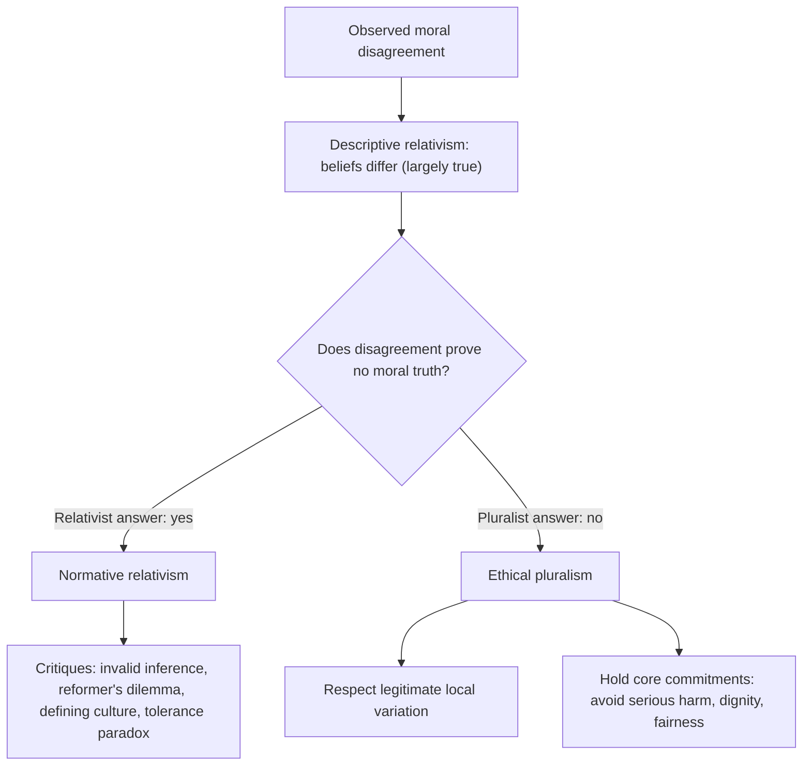

## Introduction

IT professionals increasingly work across borders. A Ghanaian developer may build software for a client in Europe, using cloud infrastructure in the United States, for users across West Africa. Practices that are routine in one setting, such as sharing a family member's mobile money PIN, giving gifts to secure a contract or monitoring employees' messages, may be regarded as normal, tolerable or seriously wrong elsewhere. This raises an old philosophical question with new practical urgency: *is right and wrong simply a matter of culture or personal opinion, or are there standards that apply to everyone?*

This lesson lays the conceptual foundation for the rest of the module. It distinguishes **ethics**, **morality** and **law**, explains why computing creates distinctive ethical questions, and examines **ethical relativism** in its subjective and cultural forms. You will learn the strongest arguments for relativism, the main critiques, and a more defensible middle position that respects cultural difference without abandoning the possibility of reasoned moral judgement.

## Learning Objectives

- Distinguish morality, ethics and law, and explain how they overlap and diverge.
- Explain why information technology generates distinctive ethical questions, using Moor's concept of policy vacuums.
- Describe subjective relativism and cultural relativism and the arguments offered for each.
- Evaluate the main critiques of ethical relativism and the distinction between descriptive and normative relativism.
- Apply a pluralist position to an IT practice that is viewed differently in different cultures.

## Prerequisite Knowledge

- None beyond general familiarity with workplace and social uses of technology.
- Helpful: the professional responsibility concepts introduced in the IT Professionalism module.

## Key Terminology

- **Morality**: The system of rules, values and practices that a community uses to guide conduct and to distinguish right from wrong, often learned informally.
- **Ethics**: The systematic, critical study of morality, which asks what we ought to do and why, and evaluates the reasons offered for moral beliefs.
- **Law**: Rules enacted or recognised by a legitimate authority and enforced by the state through sanctions.
- **Descriptive relativism**: The empirical claim that moral beliefs and practices differ between individuals and cultures.
- **Normative (meta-ethical) relativism**: The philosophical claim that moral rightness itself depends on, or is relative to, the beliefs of an individual or culture.
- **Subjective relativism**: The view that each individual decides what is right for themselves, so no person's moral judgement can be wrong.
- **Cultural relativism**: The view that an action is right if, and only if, it is approved by the culture in which it occurs.
- **Ethical pluralism**: The view that there are several genuine moral values that can conflict and be weighed differently, without concluding that anything goes.
- **Policy vacuum**: A situation, created by new technology, in which there are no clear policies or norms for conduct.

## Detailed Explanation

### Morality, ethics and law

In everyday speech "ethics" and "morality" are used interchangeably, and that is acceptable in most contexts. For analytical purposes, however, it is useful to distinguish them. **Morality** refers to the actual norms a community lives by: do not steal, keep promises, respect elders, care for family. These norms are typically learned through upbringing, religion and culture rather than through argument. **Ethics**, in the philosophical sense, is the reflective examination of those norms. It asks whether they are justified, how they apply to new situations and what to do when they conflict.

**Law** is different again. Laws are rules made or recognised by a legitimate authority and backed by sanctions. Law and morality overlap significantly: theft and fraud are both illegal and immoral. But they diverge in important ways:

| Situation | Legal? | Moral? | IT example |
|---|---|---|---|
| Legal and moral | Yes | Yes | Encrypting customer data in line with data protection law |
| Legal but arguably immoral | Yes | Questionable | Designing an app interface to nudge users into sharing more data than they intend, in a jurisdiction that does not prohibit it |
| Illegal but arguably moral | No | Arguable | A whistleblower disclosing evidence of serious public harm in breach of a confidentiality obligation |
| Illegal and immoral | No | No | Accessing a former employer's systems without authorisation to delete records |

The table shows why "it is legal" never ends an ethical analysis. Laws lag behind technology, vary between jurisdictions and are sometimes unjust. Professionals are expected to meet ethical standards that go beyond legal minimums.

### Why IT raises distinctive ethical questions

James Moor argued in 1985 that computers are "logically malleable": they can be shaped to perform almost any task that can be specified as inputs, outputs and operations. This flexibility constantly creates new possibilities for action, and with them **policy vacuums**, situations in which existing norms and laws give no clear guidance. Should an employer read staff messages on a company collaboration tool? Who owns the data generated by a smart meter? Is it acceptable to train an AI model on publicly posted images? Moor also noted **conceptual muddles**: before we can make a policy, we often have to decide how to classify the new thing. Is a computer program like a book (copyright), an invention (patent) or a service? Computer ethics, on this view, is the work of filling vacuums with justified policies.

### Why relativism is attractive

Faced with deep disagreement across cultures, many people find relativism appealing. It seems humble, tolerant and respectful of difference. It warns against the arrogance of assuming that one's own culture, often a powerful Western one, has the right answers for everyone. This concern is legitimate, especially in a postcolonial context such as Ghana, where external standards have sometimes been imposed with little regard for local values. Any adequate ethical approach must take it seriously.

## Theories, Frameworks and Models

### Subjective relativism

Subjective relativism holds that each person determines what is right for themselves: "it is wrong for me, but who am I to say it is wrong for you?" Critics, including Michael Quinn in his treatment of ethical theories, identify several problems:

1. **It blurs the line between doing what is right and doing what one wants.** If whatever I sincerely believe is right *is* right for me, I can never be morally mistaken.
2. **It cannot resolve conflicts.** When two people's moral views clash, for example about sharing pirated software, subjective relativism says both are right, which provides no basis for a shared decision.
3. **It permits intolerance.** If tolerance is only right for those who believe in it, an intolerant person is equally right.
4. **It is not really an ethical theory**, because it offers no reasons and no method for deciding what to do.

### Cultural relativism

Cultural relativism holds that an action is right if the culture in which it occurs approves of it. It is more sophisticated than subjective relativism because it recognises that morality is social. Its standard argument runs: (1) different cultures have different moral codes; (2) therefore there is no objective moral truth; (3) therefore it is arrogant to judge other cultures.

Philosophers such as James Rachels have pointed out that this argument is **invalid**. Premise (1) is a factual claim about what people *believe* (descriptive relativism); conclusion (2) is a claim about what is actually right (normative relativism). Disagreement does not prove there is no fact of the matter: people once disagreed about whether the earth orbits the sun.

Further critiques include:

- **The reformer's dilemma.** If right means "approved by my culture", moral reformers who opposed slavery or campaigned for women's suffrage were, by definition, wrong. This is implausible.
- **The problem of defining a culture.** Modern societies, including Ghana, contain many overlapping cultures, religions, generations and professional communities. A software team in Accra may include members of several ethnic and religious traditions; which "culture" decides?
- **Exaggerated difference.** Many apparent moral differences reflect different factual beliefs or circumstances rather than different values. Kwasi Wiredu argued that beneath cultural particulars there are **cultural universals**, including basic moral principles such as sympathetic impartiality, that make cross-cultural understanding and evaluation possible.
- **Tolerance as a universal value.** Relativists usually say we *ought* to be tolerant of other cultures. But this is itself a universal moral claim, which cultural relativism cannot consistently endorse.

### Descriptive versus normative relativism

It is vital to keep the two senses apart. **Descriptive relativism** is almost certainly true in a limited form: people do disagree about moral questions, and practices vary. **Normative relativism** is the much stronger and more contested claim that there is nothing more to rightness than such beliefs. A professional can accept descriptive relativism, and adjust their behaviour respectfully to local customs, while rejecting normative relativism.

### A defensible middle position: pluralism with core commitments

Most contemporary ethicists adopt a position between dogmatic absolutism and relativism. **Ethical pluralism** accepts that there are several genuine values, such as welfare, autonomy, fairness, honesty, community and care, that different cultures may weigh and express differently. But it also holds that some practices can be criticised because they violate widely shared core commitments, for example by causing serious avoidable harm, exploiting the vulnerable or denying basic dignity.

African philosophy offers valuable resources here. Kwame Gyekye's analysis of Akan thought describes a "moderate communitarianism" in which individuals are understood as embedded in community, with strong duties of mutual care, while still possessing rights and dignity that community cannot override. This perspective challenges both extreme individualism and the claim that culture simply determines morality.

## Worked Example

### Analysing a cross-cultural IT practice

*Illustrative scenario.* Volta Agritech, a fictional Ghanaian company, is negotiating a contract to supply farm-management software to a ministry in another country. A local intermediary suggests that a "facilitation payment" to an official is customary and will speed approval. A team member argues: "It is normal there, so who are we to judge?"

**Step 1: Identify the type of claim.** "It is normal there" is a descriptive claim. "So it is acceptable" is a normative relativist conclusion.

**Step 2: Test the inference.** The fact that a practice is common does not show that it is right. Moreover, the "culture" is contested: many citizens of that country, and its own laws, likely oppose corruption.

**Step 3: Identify the values at stake.** Fairness to competitors, honest use of public funds, the public interest in good governance, and the company's integrity. These are widely shared values, not merely Western ones.

**Step 4: Consider law.** Anti-bribery laws exist in many jurisdictions, and some have extraterritorial reach. The legal analysis is educational only and would require proper legal advice.

**Step 5: Conclude.** Respect for culture justifies adapting communication style, negotiating customs and hospitality norms; it does not justify a payment that undermines fair public procurement. The relativist argument fails.

## Ghanaian Business Application

In Ghanaian workplaces, relativist reasoning often appears informally: "everybody does it", "that is how things are done here", or "that rule is for foreigners". Examples might include sharing a single software licence across many machines, using a colleague's login to complete urgent work, or forwarding customers' contact details to a relative's business. Recognising these as forms of descriptive-to-normative reasoning helps managers and professionals respond thoughtfully.

A constructive approach is to acknowledge the real pressures, such as cost, time and social obligation, while explaining the values that justify a different practice: fairness to software creators, security and accountability of individual logins, and customers' reasonable expectations about their data. Organisations can also draw on local values, such as the emphasis on trust, reputation and community well-being in many Ghanaian traditions, to frame ethical policies as continuous with local morality rather than imposed from outside.

## International Case Study

### Global platforms and conflicting norms

Global technology platforms face the relativism question at scale. A single social media service operates in countries with very different laws and norms on free expression, religious offence, political speech and privacy. Governments sometimes demand that content be removed or user data be disclosed in ways that the platform's home jurisdiction would not permit. Companies have responded in different ways, including complying locally, refusing and withdrawing, or publishing transparency reports on government requests.

These cases show that neither pure relativism ("follow local norms whatever they are") nor naive universalism ("apply our home rules everywhere") is satisfactory. Platforms must decide which commitments, such as protecting users from serious harm or not facilitating persecution, are non-negotiable, and where local variation is acceptable. This is precisely the pluralist reasoning described above.

## Diagram

## Common Misconceptions

- **"Ethics and law are the same."** Law is enforced by the state and often lags behind technology; many unethical acts are legal and some ethical acts may be illegal.
- **"Because cultures disagree, there is no right answer."** Disagreement is a fact about beliefs; it does not by itself show that no view is better justified than another.
- **"Rejecting relativism means imposing Western values."** Critiques of relativism, including those by African philosophers such as Wiredu, appeal to widely shared human values, not to any single culture.
- **"Subjective relativism promotes tolerance."** It cannot support tolerance as a universal value, because tolerance would be right only for those who already believe in it.
- **"Ethics is just personal opinion."** Ethics involves giving and evaluating reasons; some moral arguments are stronger than others.

## Common Examination Mistakes

- Defining relativism without distinguishing its descriptive and normative forms.
- Presenting critiques of relativism as a list without explaining why each one matters.
- Concluding that relativism is entirely worthless, rather than acknowledging its valid concern for cultural humility.
- Equating legality with morality in case answers.
- Using "culture" as if it were a single, uniform entity in Ghana or elsewhere.
- Failing to illustrate abstract arguments with an IT example.

## Critical Thinking Questions

1. Is there anything right about cultural relativism that an IT professional working across cultures should retain?
2. Consider sharing a paid streaming or software account among extended family members, a practice some regard as normal. Is it morally acceptable? Does your answer depend on culture, on the licence terms or on something else?
3. How might Gyekye's moderate communitarianism shape an ethical policy on employee data in a Ghanaian firm?
4. Identify a current policy vacuum created by AI or social media in Ghana. What conceptual muddle must be resolved before a policy can be made?
5. When, if ever, should a multinational technology company refuse to comply with a local law?

## Practical Exercises

1. **Ethics-law matrix.** Identify two IT practices in each quadrant of the legal/moral table in this lesson, drawing on Ghanaian contexts. *Expected output:* a completed 2×2 matrix with eight examples and a one-sentence justification for each.
2. **Argument reconstruction.** Write the cultural relativist argument as numbered premises and conclusion, then identify precisely where it fails. *Expected output:* a structured argument and a 200-word critique naming the descriptive-normative gap.
3. **Policy vacuum brief.** Choose a new technology used in Ghana (for example drone delivery, AI chatbots or biometric attendance systems). *Expected output:* a one-page brief identifying the vacuum, any conceptual muddle and a proposed policy with its justification.

## Key Takeaways

- Morality is lived practice, ethics is critical reflection on it, and law is state-enforced rules; they overlap but diverge.
- IT's logical malleability creates policy vacuums and conceptual muddles that ethics must address.
- Descriptive relativism (beliefs differ) does not entail normative relativism (rightness is relative).
- Subjective relativism cannot distinguish right from preference; cultural relativism faces the reformer's dilemma, the problem of defining culture and the tolerance paradox.
- Ethical pluralism respects cultural variation while holding core commitments against serious harm, exploitation and indignity.

## Further Reading

- Gyekye, K. (1997). *Tradition and modernity: Philosophical reflections on the African experience*. Oxford University Press.
- Moor, J. H. (1985). What is computer ethics? *Metaphilosophy, 16*(4), 266-275.
- Quinn, M. J. (2020). *Ethics for the information age* (8th ed.). Pearson.
- Stanford Encyclopedia of Philosophy. Moral relativism. <https://plato.stanford.edu/entries/moral-relativism/>
- Tavani, H. T. (2016). *Ethics and technology: Controversies, questions, and strategies for ethical computing* (5th ed.). Wiley.
- Wiredu, K. (1996). *Cultural universals and particulars: An African perspective*. Indiana University Press.

## Video Resources

- [Justice with Michael Sandel](https://justiceharvard.org/): Harvard University. Official site for the Justice course, with lecture videos introducing moral reasoning and disagreement.
- [Crash Course](https://www.youtube.com/@crashcourse): Crash Course. Official channel whose Philosophy series includes introductory episodes on metaethics and moral theories.

## Revision Summary

Morality is the set of norms a community lives by; ethics critically examines those norms; law consists of state-enforced rules. IT creates policy vacuums because computers are logically malleable. Relativism comes in subjective and cultural forms, and its central argument wrongly moves from the fact of disagreement to the denial of moral truth. A pluralist position respects legitimate cultural variation while defending core commitments.

- Legal does not mean ethical; laws lag and vary.
- Moor: logical malleability, policy vacuums, conceptual muddles.
- Descriptive relativism is a fact; normative relativism is a contested theory.
- Subjective relativism collapses right into preference.
- Cultural relativism critiques: invalid inference, reformers, defining culture, tolerance paradox.
- Wiredu's cultural universals and Gyekye's moderate communitarianism support pluralism.
