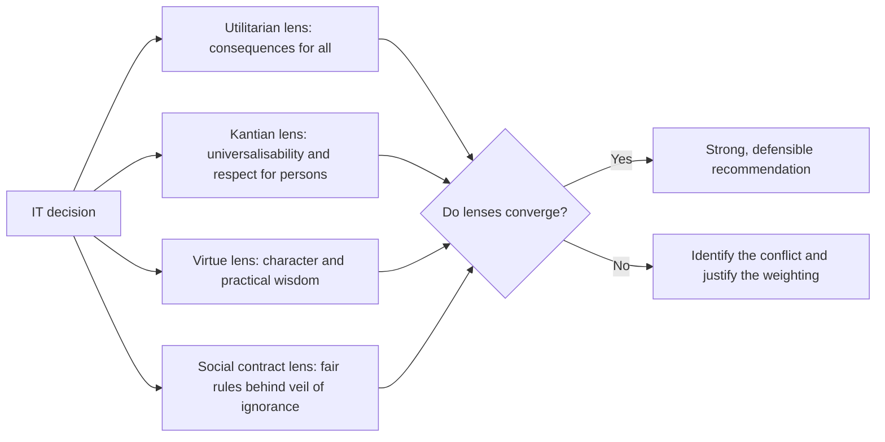

## Introduction

When a bank decides whether to deploy facial recognition at its branches, or a telecommunications company decides whether to hand customer location data to investigators, people disagree about what is right. Often they are disagreeing not only about facts but about *what matters morally*: overall consequences, individual rights, the character of the people involved, or the fairness of the rules everyone has agreed to. Ethical theories are systematic attempts to articulate and defend these different starting points.

This lesson introduces the three major normative theories in Western moral philosophy, namely **utilitarianism**, **Kantian deontology** and **virtue ethics**, together with a brief account of **social contract theory**. For each, you will learn the central idea, its key thinkers, how it applies to IT and its main criticisms. The aim is not to choose one theory and discard the rest, but to use them as complementary lenses. Postgraduate answers that apply several theories to the same case, and explain why they converge or diverge, are far more persuasive than answers that merely describe the theories.

## Learning Objectives

- Explain the principle of utility and distinguish act utilitarianism from rule utilitarianism, with reference to Bentham and Mill.
- Explain Kant's categorical imperative in its universal law and humanity formulations, and the idea of a kingdom of ends.
- Describe Aristotle's virtue ethics, including eudaimonia, the doctrine of the mean and practical wisdom.
- Outline social contract theory, including Hobbes and Rawls's veil of ignorance.
- Apply all four theories to an IT case and evaluate their comparative strengths and weaknesses.

## Prerequisite Knowledge

- The distinction between ethics, morality and law, and the critique of ethical relativism (previous lesson).
- No prior study of philosophy is required.

## Key Terminology

- **Consequentialism**: The family of theories holding that the rightness of an action depends solely on its consequences.
- **Principle of utility**: The principle that one should act to produce the greatest balance of happiness (or well-being) over unhappiness for all affected.
- **Act utilitarianism**: The view that each individual action should be judged by whether it maximises utility in that situation.
- **Rule utilitarianism**: The view that we should follow rules whose general adoption would maximise utility, and judge actions by whether they conform to such rules.
- **Deontology**: The family of theories holding that some actions are right or wrong in themselves, because of duties, rights or rules, regardless of consequences.
- **Categorical imperative**: Kant's supreme principle of morality, an unconditional command that applies to all rational beings regardless of their desires.
- **Virtue**: A stable trait of character, such as honesty, courage or justice, that disposes a person to act and feel well.
- **Eudaimonia**: Aristotle's term for human flourishing or living well, the ultimate goal of a good life.
- **Practical wisdom (phronesis)**: The ability to perceive what a situation requires and to act well in it.
- **Veil of ignorance**: Rawls's thought experiment in which people choose principles of justice without knowing what position they will occupy in society.

## Detailed Explanation

### Utilitarianism

**Origins.** Jeremy Bentham, in *An Introduction to the Principles of Morals and Legislation* (1789), proposed that the right action is the one that produces the greatest happiness, understood as pleasure and the absence of pain. He suggested that pleasures and pains could be compared using dimensions such as intensity, duration, certainty, nearness, fecundity (likelihood of producing further pleasure), purity (freedom from accompanying pain) and extent (number of people affected), a procedure later called the *felicific calculus*.

John Stuart Mill, in *Utilitarianism* (1863), refined the theory. He argued that pleasures differ in **quality** as well as quantity: intellectual, aesthetic and moral pleasures are higher than merely bodily ones, famously suggesting that it is better to be a human being dissatisfied than a pig satisfied. Mill also emphasised that utilitarianism requires strict **impartiality**: one's own happiness counts for no more than anyone else's.

**Act and rule utilitarianism.** Act utilitarians evaluate each action directly: in this situation, which option produces the most well-being? Rule utilitarians evaluate rules: which general rules, if widely followed, would produce the most well-being? The distinction matters. An act utilitarian might conclude that secretly reading one employee's emails is justified if it prevents a fraud. A rule utilitarian asks what would happen if employers generally read staff emails secretly whenever they suspected wrongdoing: trust might collapse and the overall consequences could be worse, so the rule "respect employee correspondence except under transparent, lawful procedures" would be preferred.

**Application to IT.** Utilitarian reasoning is natural in technology decisions: cost–benefit analysis, risk assessment and public-health uses of data all weigh aggregate consequences. It requires decision-makers to consider *everyone* affected, not only shareholders.

**Criticisms.**

- **Measurement**: well-being is hard to quantify and compare across people.
- **Prediction**: consequences of technology are uncertain and often emerge long after deployment.
- **Justice and rights**: maximising total welfare can justify sacrificing a minority, for example exposing a small group's data to benefit many.
- **Demandingness**: strict impartiality may require more than seems reasonable.
- Rule utilitarianism is often criticised for collapsing back into act utilitarianism if rules are refined to allow exceptions whenever breaking them would maximise utility.

### Kantian deontology

Immanuel Kant, in *Groundwork of the Metaphysics of Morals* (1785), argued that morality cannot rest on consequences or desires, because these are contingent. The only thing good without qualification is a **good will**, a will that acts *from duty*, out of respect for the moral law. Kant distinguished **hypothetical imperatives** ("if you want X, do Y") from the **categorical imperative**, which commands unconditionally. He offered several formulations of it, three of which are especially useful:

1. **Formula of Universal Law.** Act only on a maxim (personal principle of action) that you could will to become a universal law. To test an action, state its maxim and ask whether it could be universally followed without contradiction. If every software vendor lied about security features whenever convenient, claims about security would become meaningless and the lie could not succeed; the maxim fails.
2. **Formula of Humanity.** Act so that you treat humanity, whether in yourself or in another, always at the same time as an end and never merely as a means. Using customers' data in ways they have not agreed to, purely to increase profit, treats them merely as means. Note the word "merely": we use one another as means all the time (a customer uses a developer's skills), and this is acceptable when the other person's rational agency and consent are respected.
3. **Formula of the Kingdom of Ends.** Act as a member of an ideal community in which every rational being is both a maker and a subject of the moral law. Policies should be ones that all affected people, as free and equal agents, could endorse.

**Application to IT.** Kantian ethics underpins strong commitments to honesty, informed consent, privacy and human dignity. It explains why manipulative "dark patterns" are wrong even if they increase profits and harm no one in obvious ways: they bypass users' rational agency.

**Criticisms.**

- **Rigidity**: Kant held that lying is always wrong, even to prevent serious harm, which many find implausible.
- **Conflicting duties**: the theory gives limited guidance when duties clash, such as confidentiality to a client against honesty to a regulator.
- **Neglect of consequences**: ignoring outcomes entirely seems irresponsible where technology can cause large-scale harm.
- **Maxim formulation**: the universal law test can give different answers depending on how specifically the maxim is described.

### Virtue ethics

Aristotle, in the *Nicomachean Ethics*, approached ethics through the question "what kind of person should I be?" rather than "which rule should I follow?". The goal of human life is **eudaimonia**, flourishing, achieved by living in accordance with the virtues. Virtues are acquired through practice and habituation, much as a craft is learned. Each moral virtue lies in a **mean** between two vices of excess and deficiency: courage between rashness and cowardice; honesty between boastfulness and false modesty. The mean is not a mathematical midpoint but what is appropriate to the situation, identified by **practical wisdom** (*phronesis*).

**Application to IT.** Virtue ethics asks what an honest, just, courageous and caring IT professional would do. It fits naturally with professional ethics, which is largely about character and judgement in situations rules cannot fully specify. Shannon Vallor's *Technology and the Virtues* (2016) develops "technomoral virtues" such as honesty, self-control, humility, justice, courage, empathy, care and civility for life with emerging technologies. In Ghanaian moral traditions, virtues such as respect, generosity, communal responsibility and integrity are central, and virtue ethics provides a vocabulary that resonates with them.

**Criticisms.**

- **Guidance**: "do what a virtuous person would do" may not tell a novice what to do in a hard case.
- **Cultural variation**: lists of virtues differ between traditions.
- **Conflicts between virtues**: loyalty and honesty may pull in different directions.

## Theories, Frameworks and Models

### Social contract theory

Social contract theory holds that moral and political rules are those that rational people would agree to for mutual benefit. Thomas Hobbes, in *Leviathan* (1651), argued that without agreed rules and a power to enforce them, life would be a "war of all against all"; people therefore accept constraints in exchange for security. John Locke emphasised natural rights to life, liberty and property, and Jean-Jacques Rousseau the idea of a general will.

John Rawls, in *A Theory of Justice* (1971), proposed the **veil of ignorance**: imagine choosing the principles of a society without knowing whether you will be rich or poor, able-bodied or disabled, urban or rural. Rawls argued that people would choose (1) equal basic liberties for all and (2) the **difference principle**, under which social and economic inequalities are acceptable only if they benefit the least advantaged and are attached to positions open to all under fair equality of opportunity.

**Application to IT.** The veil of ignorance is a powerful design test. A team designing a credit-scoring system should ask whether they would accept its rules if they did not know whether they would be a salaried urban professional or an informal-sector trader with no credit history.

### Comparing the theories

| Theory | Central question | Key thinkers | Strength in IT ethics | Main weakness |
|---|---|---|---|---|
| Act utilitarianism | Which act produces the best overall consequences? | Bentham, Mill | Considers everyone affected; supports risk–benefit analysis | Can justify violating rights of minorities |
| Rule utilitarianism | Which rules produce the best consequences if generally followed? | Mill (interpretations vary) | Supports stable policies and trust | May collapse into act utilitarianism |
| Kantian deontology | Could my maxim be universalised? Am I treating people merely as means? | Kant | Grounds consent, honesty, privacy and dignity | Rigid; weak guidance when duties conflict |
| Virtue ethics | What would a person of good character do? | Aristotle; Vallor | Fits professional judgement and character | Less precise guidance in hard cases |
| Social contract | What rules would rational people agree to? | Hobbes, Locke, Rousseau, Rawls | Supports fair rules and protection of the least advantaged | Those who cannot bargain (future generations, animals) may be overlooked |

## Worked Example

### Applying the theories to a data-sharing request

*Illustrative scenario.* GoldNet Telecom, a fictional Ghanaian mobile network operator, is approached by a research consortium during a disease outbreak. The researchers ask for aggregated, anonymised location data showing population movement between districts to help target vaccination. A manager proposes going further and sharing individual-level records "to be more accurate".

**Utilitarian analysis.** Aggregated data could produce substantial public-health benefits with low risk of harm to individuals. Individual-level records may slightly improve accuracy but greatly increase the risk of re-identification and misuse, which could cause harm and erode trust in mobile services generally. A rule utilitarian would favour a rule permitting aggregated sharing under safeguards and forbidding individual-level sharing without legal basis.

**Kantian analysis.** Sharing individual-level records without customers' knowledge or a lawful basis treats them merely as means to the research goal. Aggregated data that cannot identify individuals respects their autonomy more fully, especially if the company is transparent about the practice. The maxim "share identifiable customer data whenever a good cause requests it" would, if universalised, undermine the confidentiality that makes telecommunications possible.

**Virtue analysis.** A caring and just organisation would want to help in a crisis; a prudent and honest one would refuse to over-collect and would tell customers what is being done. The mean lies between callous refusal and reckless generosity with data.

**Social contract analysis.** Behind a veil of ignorance, people would likely agree to aggregated data sharing in genuine emergencies under strict safeguards, because they might be among the sick, but would not agree to individual records being shared without legal safeguards, because they might be among those harmed by exposure.

**Conclusion.** All four theories converge on sharing aggregated, anonymised data with safeguards, transparency and a lawful basis under Ghana's data protection framework, and on declining individual-level sharing. Convergence across theories strengthens the recommendation considerably.

## Ghanaian Business Application

Ghanaian managers frequently face decisions that pit aggregate benefit against individual rights: whether to install CCTV with analytics in a market, whether to share customer lists with partner firms, whether to automate jobs. Using multiple theories helps them avoid two common errors. The first is pure "business case" thinking, which is a narrow utilitarianism counting only benefits to the firm. The second is rigid rule-following that ignores real consequences. In practice, a board paper that sets out the consequences for all stakeholders, the rights and duties at stake, the character the organisation wants to display and the fairness of the arrangement to the least advantaged will be more robust and more defensible to regulators and the public.

## International Case Study

### Contact-tracing applications during COVID-19

During the COVID-19 pandemic, many governments developed smartphone contact-tracing applications. Designs differed significantly. Some used **centralised** approaches in which contact data were uploaded to government servers; others used the **decentralised** exposure notification framework jointly announced by Apple and Google in 2020, in which matching happened on users' phones. Debates about these designs were explicitly ethical. Utilitarian arguments stressed the public-health benefits of effective tracing; deontological arguments stressed consent, privacy and the risk of function creep into surveillance; virtue and trust-based arguments stressed that apps would only work if people voluntarily adopted them, which required governments to act transparently. The case shows how the same technology can be evaluated through each lens, and how design choices can reconcile them.

## Diagram

## Common Misconceptions

- **"Utilitarianism means doing what benefits the majority."** It requires maximising total well-being for everyone affected, counted impartially; sometimes the interests of a minority outweigh a small benefit to many.
- **"Kant says we must never use people as means."** The Formula of Humanity forbids treating people *merely* as means; ordinary cooperation is acceptable when consent and rational agency are respected.
- **"Virtue ethics is just about being a nice person."** It requires practical wisdom to identify the right action, and virtues such as courage may demand uncomfortable actions like whistleblowing.
- **"Rule utilitarianism is a form of deontology."** Rule utilitarians follow rules because of their consequences, whereas deontologists hold that duties bind independently of consequences.
- **"One theory must be correct and the others wrong."** In applied ethics, theories are best used as complementary lenses; convergence strengthens a conclusion.

## Common Examination Mistakes

- Describing theories at length without applying them to the case in the question.
- Confusing act and rule utilitarianism, or attributing rule utilitarianism to Bentham.
- Stating Kant's principle as "do unto others" (the Golden Rule), which is a different idea.
- Omitting the word "merely" when stating the Formula of Humanity.
- Failing to evaluate theories by noting their weaknesses in the specific context.
- Reaching a conclusion without explaining how conflicts between theories were resolved.

## Critical Thinking Questions

1. Can the harms of a data breach be meaningfully measured in utilitarian terms? What gets lost when harm is converted into costs?
2. Apply the universal law formulation to the maxim "I will use unlicensed software when I cannot afford a licence". Does the result change if the maxim is stated more specifically?
3. Which technomoral virtues are most needed by IT professionals in Ghana today, and why?
4. Use Rawls's veil of ignorance to evaluate a mobile app that is available only in English. What would people choose if they did not know their language or literacy level?
5. When utilitarian and Kantian analyses of an IT case diverge, how should a professional decide which to prioritise?

## Practical Exercises

1. **Four-lens analysis.** Choose a real or illustrative IT decision (for example installing keystroke monitoring software for remote staff). *Expected output:* a 600-word analysis applying utilitarian, Kantian, virtue and social contract reasoning, with a final recommendation that explains any conflicts.
2. **Maxim testing.** Write three maxims relating to software development practices, such as copying code from online forums without checking its licence. *Expected output:* for each maxim, a universalisation test and a humanity test with a conclusion.
3. **Theory comparison table.** Extend the comparison table in this lesson by adding a column on "typical IT application" and a column on "question to ask in a case". *Expected output:* a completed table suitable for revision.

## Key Takeaways

- Utilitarianism (Bentham, Mill) judges actions by consequences for all, impartially; act and rule versions differ in what is evaluated.
- Kant's categorical imperative requires universalisable maxims and respect for persons as ends, never merely as means.
- Aristotle's virtue ethics focuses on character, flourishing, the mean and practical wisdom; Vallor adapts it to technology.
- Social contract theory, especially Rawls's veil of ignorance, tests the fairness of rules from the standpoint of the least advantaged.
- Strong case analysis applies several theories, notes convergence and justifies the resolution of conflicts.

## Further Reading

- Aristotle. (2009). *The Nicomachean ethics* (D. Ross, Trans.; L. Brown, Ed.). Oxford University Press.
- Kant, I. (1998). *Groundwork of the metaphysics of morals* (M. Gregor, Ed. & Trans.). Cambridge University Press. (Original work published 1785)
- Mill, J. S. (1863). *Utilitarianism*. Parker, Son, and Bourn.
- Rawls, J. (1971). *A theory of justice*. Harvard University Press.
- Vallor, S. (2016). *Technology and the virtues: A philosophical guide to a future worth wanting*. Oxford University Press.
- Stanford Encyclopedia of Philosophy. Kant's moral philosophy. <https://plato.stanford.edu/entries/kant-moral/>
- Stanford Encyclopedia of Philosophy. Virtue ethics. <https://plato.stanford.edu/entries/ethics-virtue/>

## Video Resources

- [Justice with Michael Sandel](https://justiceharvard.org/) — Harvard University. Official course site with lectures on utilitarianism, Kant, Rawls and Aristotle.
- [Crash Course](https://www.youtube.com/@crashcourse) — Crash Course. Official channel whose Philosophy series covers utilitarianism, Kantian ethics, virtue ethics and contractarianism.
- [Markkula Center for Applied Ethics](https://www.scu.edu/ethics/) — Santa Clara University. Official portal explaining ethical lenses used in decision-making.

## Revision Summary

Utilitarianism judges acts or rules by their consequences for everyone affected; Bentham focused on quantity of pleasure and Mill added quality. Kant's deontology grounds morality in duty and the categorical imperative: universalisable maxims and respect for persons as ends. Aristotle's virtue ethics asks what a person of good character with practical wisdom would do. Social contract theory, especially Rawls, asks what fair rules rational people would accept behind a veil of ignorance.

- Act utilitarianism: judge each act; rule utilitarianism: judge rules.
- Kant: Universal Law, Humanity (not merely as means), Kingdom of Ends.
- Aristotle: eudaimonia, virtue as a mean, phronesis.
- Rawls: veil of ignorance, equal liberties, difference principle.
- Each theory has characteristic weaknesses; state them.
- Apply several lenses and justify your resolution of conflicts.
