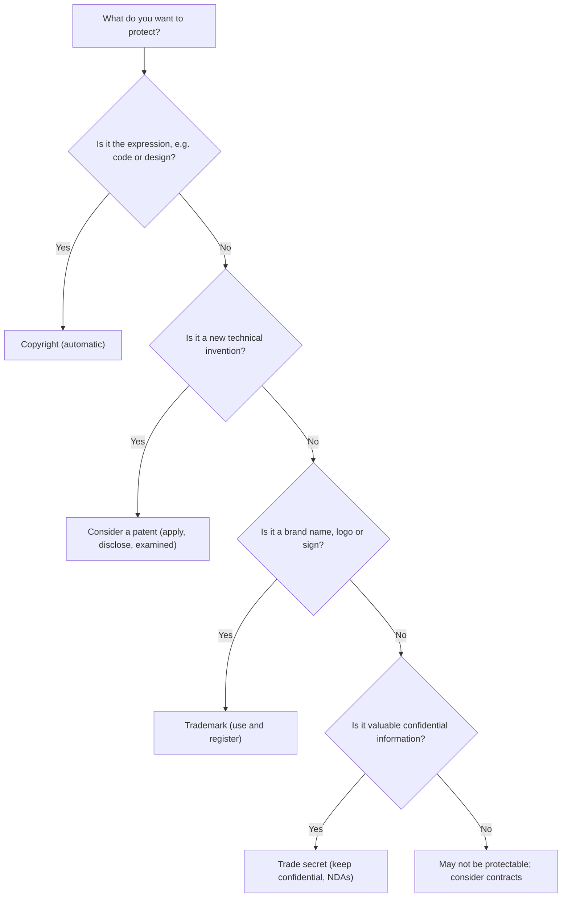

## Introduction

Information technology businesses are, to a large extent, businesses built on intangible assets. A fintech start-up in Accra may own few physical assets, yet its source code, user-interface designs, brand name, customer database and algorithms may be worth far more than its furniture and laptops. Intellectual property (IP) law is the set of legal tools that determines who may control, copy, sell and build upon such intangible creations. For IT professionals, a working understanding of IP is not optional: developers copy code snippets, designers reuse images, product managers choose brand names and organisations commission software from contractors. Each of these routine activities can create or infringe IP rights.

This lesson compares the four principal forms of IP protection relevant to IT — copyright, patents, trademarks and trade secrets — and examines the ethical arguments for and against strong IP protection. It pays particular attention to the long-running debate over software patents and to the general framework of Ghana's Copyright Act, 2005 (Act 690). The legal content is educational and simplified; it is not legal advice, and specific situations should be checked against the current statute and with a qualified lawyer.

## Learning Objectives

- Explain the purpose of intellectual property law and the main ethical justifications offered for it.
- Compare copyright, patents, trademarks and trade secrets in terms of subject matter, requirements, duration and enforcement.
- Apply the idea–expression distinction to decide what aspects of software copyright can and cannot protect.
- Evaluate the arguments for and against software patents using at least two ethical perspectives.
- Describe, in general terms, how Ghana's Copyright Act, 2005 (Act 690) treats computer software and the role of the Copyright Office.

## Prerequisite Knowledge

- Familiarity with utilitarian, deontological and virtue-based reasoning from the Ethical Foundations module.
- A general understanding of how software is written, compiled and distributed.

## Key Terminology

- **Intellectual property**: Legal rights over creations of the mind, such as works, inventions, signs and confidential information, that allow the holder to control certain uses by others.
- **Copyright**: A right that arises automatically in original works of authorship, including computer programs, protecting their expression rather than the underlying ideas.
- **Patent**: A time-limited exclusive right granted by the state over an invention that is new, involves an inventive step and is capable of industrial application, in exchange for public disclosure.
- **Trademark**: A sign, such as a name, logo or slogan, that distinguishes the goods or services of one trader from those of others.
- **Trade secret**: Commercially valuable information that is kept confidential through reasonable steps and is protected against misappropriation.
- **Idea–expression distinction**: The principle that copyright protects the particular way an idea is expressed but not the idea, method or functional concept itself.
- **Fair use / fair dealing**: Statutory exceptions that permit limited use of protected works for purposes such as criticism, research, teaching or news reporting without permission.
- **Moral rights**: Personal rights of an author, such as the right to be named as author and to object to distortion of the work, which are distinct from economic rights.

## Detailed Explanation

### Why intellectual property exists

Information goods have an unusual economic character. A physical object can be used by only one person at a time, but a piece of software can be copied an unlimited number of times at almost no cost and without depriving the original owner of anything. Economists describe such goods as *non-rival*. Because copying is cheap and creation is expensive, a creator who cannot prevent copying may be unable to recover the investment required to produce the work. IP law responds by creating artificial, limited exclusivity: it gives creators a temporary right to control certain uses so that they have an incentive to create and disclose.

Crucially, every IP regime is a **bargain** between private reward and public benefit. Copyright expires and works enter the public domain; patents require full disclosure of the invention so that others can learn from it and use it freely when the term ends; exceptions such as fair dealing preserve space for education, criticism and research. Most ethical controversy about IP concerns where this balance should be struck.

### Copyright

Copyright protects original works of authorship: literary, artistic, musical and dramatic works, sound recordings, films and — importantly for IT — computer programs. Internationally, the TRIPS Agreement of the World Trade Organization requires member states to protect computer programs, whether in source or object code, as literary works under the Berne Convention. Copyright normally arises **automatically** when an original work is fixed in some material form; registration is not required for protection to exist, although some countries offer voluntary registration as evidence.

Copyright grants economic rights such as reproduction, distribution, adaptation, public performance and communication to the public. In software terms, copying a program, distributing it, translating it into another language or creating a modified version can all engage these rights.

The **idea–expression distinction** is central. Copyright protects the literal code and, to some extent, its structure and organisation, but not the algorithm, the business method, the functionality or the programming idea. Two developers who independently write programs that perform the same function do not infringe each other's copyright, provided neither copied the other's expression. This is why copyright alone cannot stop a competitor from reimplementing a successful app's features from scratch.

### Patents

A patent is granted by a national or regional patent office after examination. To be patentable an invention must generally be **novel** (not previously disclosed to the public), involve an **inventive step** (not obvious to a skilled person in the field) and be **industrially applicable**. Under the TRIPS Agreement, patent protection must be available for at least twenty years from the filing date. In return, the applicant must disclose the invention clearly enough that a skilled person could reproduce it.

Patents are much stronger than copyright in one respect: they protect the **inventive idea as claimed**, so even independent creation infringes. However, they are expensive to obtain and enforce, take time to be granted and must be applied for in each jurisdiction where protection is wanted.

### Trademarks

Trademarks protect signs that identify the commercial origin of goods and services — names, logos, colours, slogans and sometimes sounds or shapes. Their purpose is primarily consumer protection: they prevent confusion and allow customers to rely on a brand's reputation. A trademark can, in principle, last indefinitely if it continues to be used and renewed. For IT businesses, trademark issues arise in product naming, domain names, app-store listings and social media handles. Registering a domain name that deliberately imitates a well-known brand in order to profit from confusion (cybersquatting) is a classic misuse.

### Trade secrets

Trade secrets protect confidential business information — source code that is never published, recommendation algorithms, customer lists, pricing models — for as long as the information remains secret and reasonable steps are taken to protect it. There is no registration and no fixed term, but protection is lost once the information becomes public or is independently discovered or lawfully reverse-engineered. Non-disclosure agreements, access controls and confidentiality clauses in employment contracts are the main practical tools.

## Theories, Frameworks and Models

### Comparing the four regimes

| Feature | Copyright | Patent | Trademark | Trade secret |
|---|---|---|---|---|
| What is protected | Original expression (code, text, images, designs) | Inventions: new technical solutions as claimed | Signs that identify commercial origin | Confidential, commercially valuable information |
| How protection arises | Automatically on creation and fixation | Application and examination by a patent office | Use and/or registration (registration strongly advisable) | Keeping the information secret with reasonable measures |
| Key requirements | Originality | Novelty, inventive step, industrial application, disclosure | Distinctiveness; not deceptive or confusingly similar | Secrecy, commercial value, reasonable protective steps |
| Typical duration | Long; for individual authors, generally the author's life plus a fixed period set by statute | Typically 20 years from filing | Potentially indefinite with renewal and use | As long as secrecy is maintained |
| Independent creation a defence? | Yes | No | Not relevant (focus is confusion) | Yes, as is lawful reverse engineering |
| Software example | Source code of a mobile banking app | A claimed novel technical method for compressing data | The app's name and logo | Unpublished fraud-detection rules |

### Ethical justifications for IP

Three families of argument are commonly used, and each implies a different view of how strong IP should be.

1. **Labour (Lockean) theory.** Drawing on John Locke, this view holds that people who mix their labour with unowned resources acquire a property right in the result. Critics note that Locke's own proviso — that "enough and as good" must be left for others — sits uneasily with monopolies over ideas that others might have developed independently.
2. **Personality theory.** Associated with Hegel, it treats creative works as extensions of the creator's personality. It underpins **moral rights**, such as the right to be credited and the right to object to distortion.
3. **Utilitarian (incentive) theory.** IP is justified only to the extent that it increases overall welfare by encouraging creation and disclosure. On this view, IP rights should be no stronger or longer than necessary, because excessive protection reduces access, raises prices and blocks follow-on innovation.

A fourth perspective, associated with the free software movement, challenges the framing altogether, arguing that software users should have the freedom to run, study, modify and share programs, and that restricting these freedoms is itself an ethical harm. This is explored in the next lesson.

### The software patent debate

Software sits awkwardly between copyright and patents. In Europe, the European Patent Convention excludes "programs for computers" from patentability "as such", though inventions with a technical character that are implemented in software can still be patented. In the United States, the Supreme Court's decision in *Alice Corp. v. CLS Bank International* (2014) held that implementing an abstract idea on a generic computer does not by itself make it patentable, which narrowed many software and business-method patents.

Arguments **for** software patents:

- Some software innovations involve substantial research investment that copyright, which protects only expression, cannot secure.
- Disclosure in a patent can add to public technical knowledge.
- Smaller firms may use patents to attract investment or to defend themselves against larger competitors.

Arguments **against** software patents:

- Software develops quickly and incrementally; a twenty-year monopoly is very long relative to product cycles.
- Patent offices have often granted broad or obvious software patents, creating uncertainty.
- Non-practising entities (sometimes called "patent trolls") acquire patents mainly to demand licence fees, imposing costs without contributing products.
- A single program may implement thousands of techniques, making it difficult for developers — especially open-source contributors and small firms — to check for infringement.

From a utilitarian perspective, the question is empirical: do software patents, on balance, increase or decrease innovation and welfare? From a deontological perspective, one may ask whether it is fair to punish a developer who independently creates a solution, and whether granting monopolies over mathematical methods respects others' freedom to think and build.

## Ghanaian Business Application

### Ghana's Copyright Act, 2005 (Act 690)

Ghana's principal copyright statute is the Copyright Act, 2005 (Act 690). In general terms, the Act:

- protects literary, artistic, musical and audiovisual works, sound recordings and related categories, and treats **computer software or programs** as protected works;
- grants authors economic rights (such as reproduction, distribution, adaptation and communication to the public) and moral rights (such as the right to be identified as author);
- recognises limitations and exceptions for certain uses, including some uses for private study, research, education and reporting;
- addresses folklore, reflecting the importance of Ghana's cultural heritage; and
- establishes institutional arrangements, including the **Copyright Office**, for administration, registration and enforcement support.

Students should consult the current text of the Act for durations, specific exceptions, ownership rules for works made in employment and offences, rather than relying on summaries. Ghana also has separate legislation on patents and on trade marks, and is a member of the World Trade Organization and of the African Regional Intellectual Property Organization (ARIPO).

### Illustrative scenario: commissioning software in Kumasi

*Illustrative scenario.* A Kumasi-based logistics company, "Ashanti Freight Hub", hires a freelance developer to build a dispatch app. The contract says nothing about IP. A year later, the developer sells a slightly modified version of the same app to a competitor. Who owns the code? Under many copyright regimes, a freelancer who is not an employee may remain the copyright owner unless the contract assigns the rights or the law provides otherwise. The ethical and practical lesson is clear: IT managers commissioning software should agree in writing who owns the code, what licence the client receives, whether the developer may reuse generic components and how confidential business logic will be protected. The developer, for their part, faces a professional question beyond the law: does selling work built around the first client's confidential processes respect the duty of confidentiality in principle 1.7 of the ACM Code of Ethics?

### Practical steps for Ghanaian SMEs

1. Identify your IP assets: code, designs, brand names, data sets, confidential processes.
2. Use written contracts that allocate IP ownership with employees, contractors and partners.
3. Consider registering trade marks for key brands before launch and securing matching domain names.
4. Protect trade secrets through access controls, confidentiality agreements and need-to-know policies.
5. Audit third-party content — images, fonts, libraries — to confirm you hold appropriate licences.

## International Case Study

### Oracle v. Google

A widely discussed dispute concerned Google's use of the declaring code of certain Java application programming interfaces (APIs) when building the Android platform. Oracle, which acquired Java's original developer Sun Microsystems, sued for copyright infringement. After years of litigation, the US Supreme Court decided in *Google LLC v. Oracle America, Inc.* (2021) that Google's copying of the API declaring code, assuming it was copyrightable, was a **fair use**. The Court did not decide whether APIs are copyrightable at all.

The case illustrates several points. First, the boundary between functional interfaces and protectable expression is genuinely contested. Second, interoperability — allowing programmers to reuse familiar interfaces — carries significant social value, which weighed in the fair use analysis. Third, because the outcome turned on US fair use doctrine, it is not automatically transferable to other jurisdictions, including Ghana, which have their own exceptions.

## Diagram

## Common Misconceptions

- "If code is on GitHub or the internet, it is free to use." — Publicly visible code is still protected by copyright unless a licence grants permission; absence of a licence usually means no permission to reuse.
- "Copyright protects my idea for an app." — Copyright protects expression, not ideas or functionality; a competitor can lawfully build similar features with independently written code.
- "Registering a business name gives full trademark protection." — Business-name registration and trademark registration are different processes with different effects.
- "Patents last forever if you renew them." — Patents are time-limited (typically twenty years from filing) and cannot be renewed indefinitely; trademarks, by contrast, can be renewed.
- "Trade secrets need to be registered." — Trade secrets are protected by keeping the information confidential and taking reasonable steps, not by registration.

## Common Examination Mistakes

- Treating copyright, patents and trademarks as interchangeable, instead of comparing their subject matter, requirements and duration.
- Stating precise durations or section numbers from memory without certainty; in an examination it is safer to explain the principle.
- Discussing software patents only legally, without evaluating them through an ethical framework such as utilitarianism or rights-based reasoning.
- Ignoring trade secrets, which are often the most practical protection for unpublished algorithms.
- Forgetting that the outcome of a US case such as *Google v. Oracle* depends on US law and may not apply in Ghana.

## Critical Thinking Questions

1. If copying software costs almost nothing, is unauthorised copying morally equivalent to theft of a physical object? Justify your answer using at least two ethical theories.
2. Should algorithms that produce significant social benefits, such as medical diagnostic models, receive weaker IP protection? What would be the consequences?
3. How should IP law balance protecting Ghanaian folklore and traditional designs against the freedom of digital creators to remix culture?
4. Is a twenty-year patent term appropriate for software innovations? Propose and defend an alternative.

## Practical Exercises

1. **IP audit.** Choose a real or illustrative Ghanaian app. List at least six assets (code, logo, name, database, UI design, algorithm) and, for each, identify the most appropriate form of IP protection and one practical step to secure it. Expected output: a table of assets, protection type and action.
2. **Contract clause drafting.** Draft a short plain-English clause for a freelance software development contract that allocates copyright ownership and grants any licence needed. Expected output: a 100–150 word clause with a one-paragraph explanation of its ethical rationale.
3. **Debate brief.** Prepare a one-page brief arguing either for or against software patents, using one consequentialist and one deontological argument and anticipating two counter-arguments. Expected output: a structured argument map.

## Key Takeaways

- IP law creates limited exclusive rights over intangible creations as a bargain between private incentive and public benefit.
- Copyright protects expression automatically; patents protect examined inventions for a limited term; trademarks protect brand identifiers; trade secrets protect confidential information.
- The idea–expression distinction means copyright does not protect software functionality or algorithms as such.
- Software patents are ethically and economically contested, and different jurisdictions draw the line differently.
- Ghana's Copyright Act, 2005 (Act 690) protects computer software and recognises economic and moral rights, with administration supported by the Copyright Office.

## Further Reading

- Quinn, M. J. (2020). *Ethics for the information age* (8th ed.). Pearson.
- Tavani, H. T. (2016). *Ethics and technology: Controversies, questions, and strategies for ethical computing* (5th ed.). Wiley.
- Lessig, L. (2004). *Free culture: How big media uses technology and the law to lock down culture and control creativity*. Penguin Press.
- World Intellectual Property Organization. (n.d.). *What is intellectual property?* <https://www.wipo.int/about-ip/en/>
- Republic of Ghana. (2005). *Copyright Act, 2005 (Act 690)*.

## Video Resources

- [WIPO Academy](https://www.wipo.int/academy/en/) — World Intellectual Property Organization. Official learning portal offering introductory courses on intellectual property, including the free general course on IP.
- [WIPO – About Intellectual Property](https://www.wipo.int/about-ip/en/) — World Intellectual Property Organization. Official overview pages explaining copyright, patents, trademarks and trade secrets.

## Revision Summary

Intellectual property law grants limited, exclusive rights over intangible creations to encourage creation and disclosure while preserving public access. Copyright protects original expression, including code, automatically; patents protect examined, novel and inventive technical inventions for a limited term; trademarks protect signs of commercial origin and can be renewed; trade secrets protect confidential information for as long as it remains secret. Software patents remain contested on utilitarian and fairness grounds. Ghana's Copyright Act, 2005 (Act 690) protects computer software and moral rights.

- Copyright = expression, automatic; not ideas or algorithms.
- Patent = novelty, inventive step, industrial application, disclosure; typically 20 years.
- Trademark = distinguishing sign; renewable; prevents confusion.
- Trade secret = secrecy plus reasonable protective steps; no registration.
- Software patents: incentive and disclosure versus overbreadth, trolls and incremental innovation.
- Always clarify IP ownership in software development contracts.
