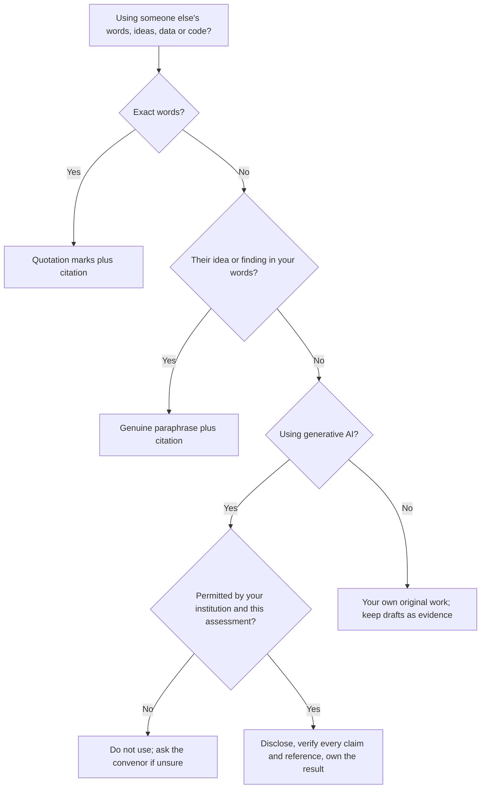

## Introduction

Plagiarism sits at the meeting point of intellectual property, professional ethics and personal integrity. For a postgraduate student it is also an immediate, practical concern: dissertations, assignments and project reports are judged on the assumption that the ideas, words, data and code presented are either the student's own or clearly attributed to their sources. When that assumption fails, the credibility of the work, and of the qualification it leads to, is undermined.

Generative artificial intelligence has made the subject more complex. Tools that can draft paragraphs, summarise articles, write code and suggest references are now widely available. They can support learning, but they also create new risks: undisclosed machine-generated text, fabricated citations and confusion about who the "author" of a piece of work really is. This lesson explains plagiarism and academic integrity, analyses why they matter ethically, and sets out principles for the responsible use of generative AI. It does **not** state the rules of any particular university. Every student must read and follow the academic integrity and AI-use policies of their own institution and the instructions given for each assessment.

## Learning Objectives

- Define plagiarism and distinguish it from related forms of academic misconduct such as collusion, fabrication and contract cheating.
- Explain the fundamental values of academic integrity and why they matter for professional practice in IT.
- Apply correct attribution practices to text, ideas, data, images and source code.
- Evaluate the authorship, accountability and disclosure issues raised by generative AI tools.
- Recommend personal practices that reduce the risk of unintentional plagiarism.

## Prerequisite Knowledge

- The lesson on copyright, patents and trademarks, particularly the difference between ideas and expression.
- Basic familiarity with academic referencing, such as the APA 7 style.

## Key Terminology

- **Plagiarism**: Presenting another person's words, ideas, data, code or other work as one's own without appropriate acknowledgement.
- **Academic integrity**: A commitment to honesty, trust, fairness, respect, responsibility and courage in learning, teaching and research.
- **Self-plagiarism**: Reusing one's own previously submitted or published work without acknowledgement or permission where originality is expected.
- **Collusion**: Unauthorised collaboration in which work presented as individual is produced jointly with others.
- **Contract cheating**: Arranging for a third party, paid or unpaid, to complete assessed work that is then submitted as one's own.
- **Fabrication**: Inventing data, results, quotations or references.
- **Paraphrasing**: Restating a source's ideas in substantially new wording and structure, still with a citation to the source.
- **Generative AI**: Systems that produce new text, images, code or other content in response to prompts, based on patterns learned from training data.

## Detailed Explanation

### What plagiarism is, and is not

Plagiarism is about **misrepresentation**: it creates a false impression about the origin of work. It can take several forms:

- **Verbatim copying** without quotation marks and citation.
- **Mosaic or "patchwriting" plagiarism**: stitching together phrases from sources with a few words changed.
- **Inadequate paraphrase**: keeping the source's structure and much of its wording while citing it, but presenting it as your own expression.
- **Idea plagiarism**: presenting someone else's argument, framework or finding as your own, even in entirely new words.
- **Source-code plagiarism**: copying code from repositories, forums or classmates without attribution, or with superficial changes such as renamed variables.
- **Self-plagiarism**: resubmitting earlier work for new credit without permission.

Plagiarism differs from copyright infringement, although the two can overlap. Copyright infringement concerns unauthorised copying of protected expression and is a legal matter; plagiarism concerns a failure of attribution and is an ethical and academic matter. You can plagiarise a public-domain text that has no copyright, and you can infringe copyright while correctly crediting the author. Citation does not grant permission to reproduce large amounts of a protected work, and permission does not remove the duty to cite.

### Intention and negligence

Some plagiarism is deliberate. Much, however, results from poor note-taking, rushed writing, unfamiliarity with academic conventions or misunderstanding of how to paraphrase. Institutions typically consider intention and seriousness when deciding outcomes, but students should not assume that "I did not mean to" is a defence. Academic integrity, like professional competence, includes the duty to learn the conventions and to apply them carefully.

### Related forms of misconduct

Plagiarism is one of several behaviours that undermine academic integrity:

| Behaviour | What it involves | Why it is wrong |
|---|---|---|
| Plagiarism | Presenting others' work as one's own | Misrepresents authorship; unfair to sources and peers |
| Collusion | Unauthorised joint work presented as individual | Misrepresents individual achievement |
| Contract cheating | Outsourcing assessed work to a third party | Complete misrepresentation of competence |
| Fabrication / falsification | Inventing or manipulating data or references | Corrupts the knowledge base; can cause real harm |
| Duplicate submission | Resubmitting work for new credit | Misrepresents new effort |
| Impersonation | Another person sitting an assessment | Fundamental deception about identity |

### Why integrity matters for IT professionals

Academic integrity is not merely a university rule; it rehearses habits that matter professionally. Software engineers must document where code came from to manage licence obligations. Consultants must distinguish their own analysis from vendor claims. Data analysts must report results honestly, including inconvenient ones. The ACM Code of Ethics asks computing professionals to be honest and trustworthy (principle 1.3) and to respect the work required to produce new ideas and computing artefacts, crediting creators (principle 1.5). A graduate whose degree rests on misrepresentation also places employers and the public at risk, because the qualification signals competence that may not exist.

## Theories, Frameworks and Models

### The fundamental values of academic integrity

The International Center for Academic Integrity describes six fundamental values: **honesty, trust, fairness, respect, responsibility and courage**. They provide a useful framework for analysing any integrity decision:

- **Honesty**: Does my submission truthfully represent what I did and what others contributed?
- **Trust**: Will readers be able to rely on my citations, data and claims?
- **Fairness**: Am I gaining an advantage over classmates who followed the rules?
- **Respect**: Am I acknowledging the intellectual labour of others?
- **Responsibility**: Have I learned and applied the conventions expected of me?
- **Courage**: Will I act with integrity when it is inconvenient, for example by refusing to share my work for copying?

### Ethical analysis of plagiarism

- **Deontology.** Plagiarism involves deception, which Kant's categorical imperative condemns: a maxim of misrepresenting authorship whenever convenient could not be universalised without destroying the very practice of credit on which it depends. It also treats the original author merely as a means.
- **Utilitarianism.** Plagiarism may appear to benefit the individual, but it devalues qualifications for everyone, wastes assessment resources, and, in research, spreads unverified claims. The aggregate consequences are harmful.
- **Virtue ethics.** Plagiarism reflects and reinforces vices such as dishonesty and intellectual laziness, whereas careful attribution expresses honesty and intellectual humility.

### Generative AI and authorship

Generative AI raises four distinct questions that should not be confused.

1. **Is AI use permitted for this task?** This is determined by your institution's policy and the assessment instructions, which vary widely: from prohibition, to permitted use for specific purposes, to required use with reflection. Where instructions are unclear, the responsible course is to ask the module convenor before using a tool.
2. **Can an AI system be an author?** Authorship carries accountability: an author can answer for the work, correct errors and take responsibility for its integrity. The Committee on Publication Ethics (COPE) and many major publishers have taken the position that AI tools cannot meet authorship criteria and cannot be listed as authors, and that human authors who use such tools should disclose that use.
3. **Is undisclosed AI-generated content plagiarism or misconduct?** Even if no human author is being copied, submitting machine-generated text or code as one's own unaided work can misrepresent the origin of the work. Many institutions therefore treat undisclosed or unauthorised AI use as a form of academic misconduct.
4. **Is the output reliable?** Large language models can produce fluent but false statements and **fabricated references** that look plausible but do not exist. Submitting such references is fabrication, regardless of whether it was intended.

A practical model for responsible use is **permit, disclose, verify, own**:

- *Permit*: confirm that the use is allowed for this assessment.
- *Disclose*: state which tool was used, for what purpose and how its output was used, in the form your institution requires.
- *Verify*: check every factual claim, quotation and reference against the original source.
- *Own*: take full responsibility for the final work, which should reflect your own understanding and judgement.

## Ghanaian Business Application

### Illustrative scenario: a consultancy report in Accra

*Illustrative scenario.* "Volta Insight Consulting", a small Accra firm, is commissioned by a district assembly to assess options for digitising its property-rate collection. A junior analyst, under deadline pressure, copies several pages from an international development agency report and from a vendor's white paper into the draft, with light edits and no citation, and uses a generative AI tool to write the literature section, which includes three references that do not exist.

The partner who reviews the draft detects the problem. The ethical issues include:

- misrepresentation to the client, which is paying for original analysis;
- potential copyright infringement in the reuse of substantial passages;
- presenting a vendor's marketing claims as independent analysis, which could bias a public procurement decision;
- fabricated references, which undermine the credibility of the whole report and could mislead public decision-making.

The professional response is to withdraw and rewrite the affected sections, cite all sources, verify every reference, disclose any AI assistance in line with the firm's policy and contract, and introduce a quality-assurance step for source checking. The firm should also consider whether its deadlines and supervision created the pressure that led to the shortcut: integrity is an organisational as well as individual responsibility.

### Building integrity habits as a working student

Many MSc IT for Business students combine study with employment. Habits that protect against plagiarism include keeping a reference manager from the first day of the programme, recording page numbers for direct quotations, separating notes of others' ideas from your own reflections, keeping version histories of drafts as evidence of your process, and attributing code snippets in comments with their source and licence.

## International Case Study

### Fabricated AI citations in a court filing

In 2023, in the case of *Mata v. Avianca, Inc.* before a US federal district court in New York, lawyers submitted a legal brief that cited court decisions which did not exist; the citations had been produced using ChatGPT and were not verified. The court found that the lawyers had acted in bad faith in continuing to stand by the fake citations and imposed sanctions.

Although the case arose in legal practice, the lessons transfer directly to academic and professional IT work. First, generative AI can fabricate plausible-looking sources. Second, responsibility remains with the human professional who submits the work; "the tool produced it" is not an excuse. Third, verification is a non-negotiable professional duty. A student who submits AI-generated references without checking them takes exactly the same risk.

## Diagram

## Common Misconceptions

- "If I change every few words, it is not plagiarism." Patchwriting that preserves the source's structure and phrasing is still plagiarism; genuine paraphrase requires new expression plus a citation.
- "Citing a source means I can copy as much as I like." Citation addresses attribution, not copyright; large verbatim copying may infringe and is poor scholarship even when cited.
- "AI-generated text cannot be plagiarism because no person wrote it." Submitting undisclosed AI output as your own unaided work misrepresents authorship and may breach your institution's rules.
- "Similarity-checking software decides whether plagiarism occurred." Similarity scores are indicators that require human judgement; a high score may reflect properly quoted material, and a low score does not prove originality.
- "Reusing my own previous assignment is always fine." Without permission, resubmitting your own work for new credit is generally treated as misconduct.

## Common Examination Mistakes

- Defining plagiarism only as copying words, ignoring ideas, data, images and code.
- Confusing plagiarism with copyright infringement instead of explaining their relationship.
- Inventing specific university rules or penalties instead of stating that institutional policy governs.
- Discussing generative AI only as a cheating tool, without analysing authorship, accountability and verification.
- Failing to apply an ethical theory when asked to evaluate why plagiarism is wrong.

## Critical Thinking Questions

1. Is using a generative AI tool to improve the grammar of your own essay ethically different from using it to generate the argument? Where would you draw the line, and why?
2. Should collaboration norms in software development, where reuse is encouraged, change how universities assess programming assignments?
3. Who bears responsibility when an organisation's culture of tight deadlines encourages staff to plagiarise?
4. Can a person be an author of work that was substantially generated by AI? What conditions would need to be met?

## Practical Exercises

1. **Paraphrase practice.** Select a paragraph from a textbook you own. Write (a) a patchwritten version and (b) a genuine paraphrase with an APA 7 citation, then explain the differences. Expected output: two versions and a 150-word commentary.
2. **AI disclosure statement.** Assuming your institution permits AI use for brainstorming only, draft a disclosure statement for an assignment that states the tool, purpose, prompts used and how outputs were checked. Expected output: a 100-150 word statement.
3. **Reference verification.** Ask a generative AI tool (where permitted) for five references on a topic in this course, then try to locate each one in a library database or publisher website. Expected output: a table recording whether each reference exists and whether its details are accurate.

## Key Takeaways

- Plagiarism is misrepresentation of the origin of work and covers words, ideas, data, images and code.
- Plagiarism and copyright infringement are related but distinct.
- Academic integrity rests on honesty, trust, fairness, respect, responsibility and courage, which are also professional values.
- AI tools are not accepted as authors by major publication-ethics bodies because they cannot take responsibility; users must disclose, verify and own their work.
- Your own institution's policy and assessment instructions determine whether and how AI may be used.

## Further Reading

- International Center for Academic Integrity. (2021). *The fundamental values of academic integrity* (3rd ed.).
- Committee on Publication Ethics. (2023). *Authorship and AI tools: COPE position statement*.
- Quinn, M. J. (2020). *Ethics for the information age* (8th ed.). Pearson.
- Association for Computing Machinery. (2018). *ACM code of ethics and professional conduct*. <https://www.acm.org/code-of-ethics>

## Video Resources

- [ACM Code of Ethics and Professional Conduct](https://www.acm.org/code-of-ethics): Association for Computing Machinery. Official page with the full Code, including principles on honesty and crediting the work of others.
- [Committee on Publication Ethics](https://publicationethics.org/): COPE. Official site with guidance and position statements on authorship, AI tools and research integrity.

## Revision Summary

Plagiarism is presenting another's words, ideas, data, images or code as one's own; it is an ethical and academic failure of attribution, distinct from but overlapping with copyright infringement. Related misconduct includes collusion, contract cheating, fabrication and duplicate submission. Academic integrity rests on honesty, trust, fairness, respect, responsibility and courage. Generative AI cannot be an accountable author; where its use is permitted by your institution, disclose it, verify everything and own the final work.

- Plagiarism = misrepresented origin; intention is not required for it to occur.
- Citation ≠ permission; permission ≠ attribution.
- Six values: honesty, trust, fairness, respect, responsibility, courage.
- AI: permit, disclose, verify, own.
- Fabricated references are fabrication, even if a tool produced them.
- Always follow your own institution's policy.
