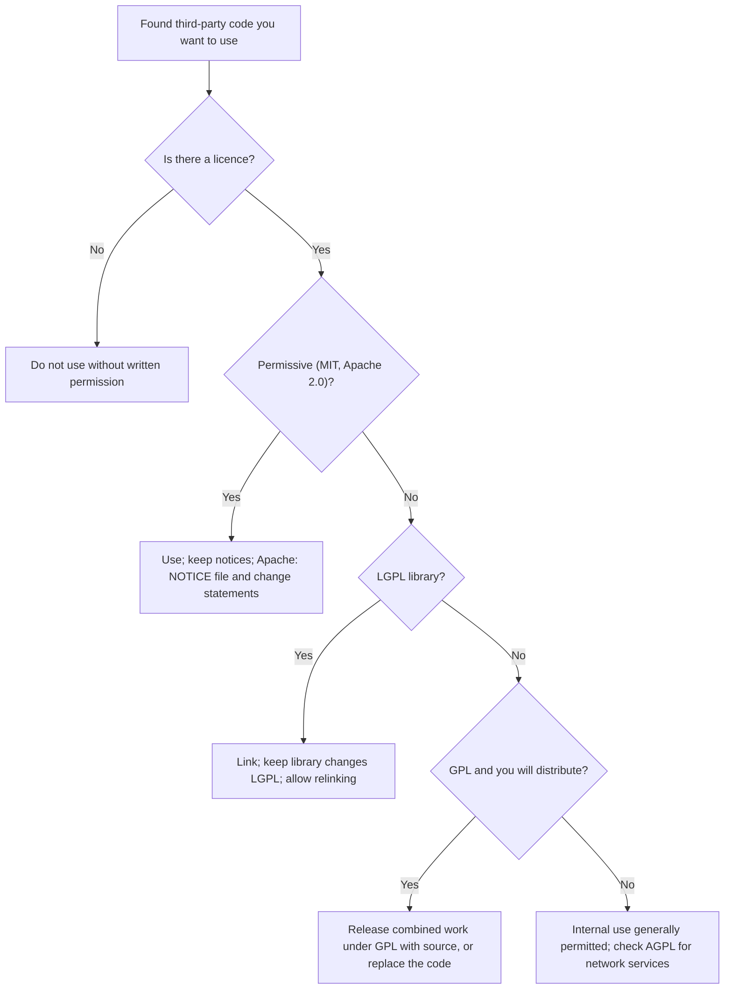

## Introduction

Almost no modern software is written from scratch. A typical web or mobile application depends on dozens or hundreds of third-party libraries, frameworks and tools, many of them open source. Every one of those components comes with a **licence** — a legal permission from the copyright holder that sets out what users may and may not do. Developers who ignore licences can expose their employers to legal claims, forced disclosure of source code, product withdrawals and reputational damage. Conversely, organisations that understand licences can benefit enormously from the shared work of global developer communities.

Licensing is also an ethical subject. The free software movement, launched by Richard Stallman in the 1980s, argued that software freedom is a moral matter, not merely a technical or commercial one. The open-source movement later reframed similar practices in terms of development efficiency and business value. This lesson explains how software licences work, compares proprietary and open-source models, sets out the obligations of the most common licences, and considers the ethical responsibilities of IT professionals who use and contribute to shared code. It is educational, not legal advice.

## Learning Objectives

- Explain why software licences are needed and how they relate to copyright.
- Compare proprietary, permissive open-source and copyleft licensing models.
- Identify the principal obligations of the MIT, Apache 2.0, GPL and LGPL licences.
- Apply licence obligations to decide whether a given use of open-source code is compliant.
- Evaluate the ethical arguments of the free software and open-source movements.

## Prerequisite Knowledge

- The previous lesson on copyright, patents and trademarks, especially the idea that software is protected by copyright.
- Basic understanding of source code, compiled binaries, libraries and software distribution.

## Key Terminology

- **Software licence**: A legal permission granted by a copyright holder that defines the conditions under which software may be used, copied, modified and distributed.
- **End-user licence agreement (EULA)**: A proprietary licence that grants a user limited rights to use software, usually prohibiting copying, modification and reverse engineering.
- **Open-source software**: Software distributed under a licence that permits users to view, use, modify and redistribute the source code, consistent with the Open Source Definition.
- **Free software**: Software that respects the four freedoms defined by the Free Software Foundation — to run, study and change, redistribute, and distribute modified versions.
- **Permissive licence**: An open-source licence, such as MIT or Apache 2.0, that allows reuse in proprietary products with minimal conditions such as preserving notices.
- **Copyleft**: A licensing technique that uses copyright to require that distributed modified versions remain under the same free licence.
- **Derivative work**: A work based on an existing work, such as modified source code, which may be subject to the original licence's conditions.
- **Licence compatibility**: Whether code under two different licences can lawfully be combined and distributed together.

## Detailed Explanation

### Why licences exist

Because software is protected by copyright, the default legal position is that nobody may copy, modify or distribute it without the owner's permission. A licence is that permission. It does not usually transfer ownership; it grants defined rights under defined conditions. If a user breaches the conditions, the permission may terminate, and continued use may then be copyright infringement. Courts have treated open-source licence terms as enforceable conditions — for example, the US Court of Appeals for the Federal Circuit in *Jacobsen v. Katzer* (2008) treated the conditions of an open-source licence (the Artistic License) as enforceable through copyright law.

### Proprietary licensing

Proprietary software is distributed under licences that retain most rights for the vendor. Typical features include:

- the user receives only the right to *use* the software, often for a limited number of devices or users;
- source code is not provided;
- copying, modification, redistribution and reverse engineering are prohibited, subject to any rights the law preserves;
- licences may be perpetual or subscription-based, as with many software-as-a-service products;
- warranties are limited and liability is capped.

Proprietary licensing is not inherently unethical. It allows vendors to fund development, support and security updates. Ethical problems arise when vendors use opaque terms, lock customers into formats, collect excessive data under click-through agreements, or when customers use software beyond what they have paid for.

### Free software and open source

In 1985 Richard Stallman published the *GNU Manifesto*, announcing the GNU project to create a complete free operating system. The Free Software Foundation defines four essential freedoms:

- **Freedom 0**: to run the program for any purpose;
- **Freedom 1**: to study how the program works and change it, which requires access to source code;
- **Freedom 2**: to redistribute copies;
- **Freedom 3**: to distribute copies of modified versions.

"Free" here refers to liberty ("free as in free speech"), not price. In 1998 the term **open source** was promoted, and the Open Source Initiative (OSI) maintains the Open Source Definition and approves licences that meet it. The two movements largely overlap in the licences they accept but differ in emphasis: free software frames sharing as an ethical obligation, while open source emphasises the practical benefits of collaborative development, such as quality, security review and innovation. Eric Raymond's essay *The Cathedral and the Bazaar* popularised the argument that open, distributed development can produce robust software.

### Permissive licences

**MIT License.** One of the shortest and most widely used licences. It permits anyone to use, copy, modify, merge, publish, distribute, sublicense and sell the software. The principal obligation is to **include the original copyright notice and the licence text** in all copies or substantial portions. It disclaims warranties. MIT code can be incorporated into proprietary, closed-source products.

**Apache License 2.0.** Also permissive, but more detailed. Its main obligations are to:

- include a copy of the licence;
- retain copyright, patent, trademark and attribution notices;
- include the contents of any **NOTICE** file provided with the work;
- state prominently that you have changed modified files.

Apache 2.0 includes an **express patent licence** from contributors to users, and a **patent retaliation** clause: if a user sues alleging that the work infringes a patent, the patent licences granted to that user terminate. It does not grant rights to use the licensor's trademarks.

### Copyleft licences

**GNU General Public License (GPL).** The GPL is the best-known copyleft licence; version 2 dates from 1991 and version 3 from 2007. Anyone may use, study and modify GPL software. The copyleft obligation is triggered mainly by **distribution**: if you distribute the program or a work based on it, you must:

- license the whole combined work under the GPL;
- make the corresponding **source code** available to recipients;
- preserve notices and provide a copy of the licence;
- not impose further restrictions on recipients' rights.

GPLv3 added provisions on patents, on "anti-tivoisation" (requiring installation information for certain consumer devices so that users can run modified versions) and on compatibility. Purely internal use without distribution generally does not trigger the obligation to release source code, which is why the GNU Affero GPL (AGPL) was created to extend source-sharing obligations to software offered to users over a network.

**GNU Lesser General Public License (LGPL).** The LGPL is a weaker copyleft licence designed mainly for libraries. A proprietary program may **link** to an LGPL library without itself becoming subject to the LGPL, provided certain conditions are met — notably that modifications to the library itself are released under the LGPL and that users are able to replace or relink the library with a modified version. This makes LGPL libraries usable in closed-source products while keeping improvements to the library open.

## Theories, Frameworks and Models

### Licence obligations compared

| Licence | Type | Can be used in proprietary products? | Key obligations on distribution | Patent provisions |
|---|---|---|---|---|
| Proprietary EULA | Proprietary | Use only as licensed | Usually no redistribution permitted | Varies by vendor |
| MIT | Permissive | Yes | Keep copyright notice and licence text | None express |
| Apache 2.0 | Permissive | Yes | Keep licence and notices, include NOTICE file, mark changed files | Express patent grant; retaliation clause |
| LGPL | Weak copyleft | Yes, when linking under conditions | Modifications to the library stay LGPL; allow relinking; provide library source | Version 3 includes patent terms |
| GPL (v2/v3) | Strong copyleft | Not if the combined work is distributed as proprietary | Release the whole work under GPL with source code | Version 3 includes express patent terms |
| AGPL | Network copyleft | Not if modified and offered over a network as proprietary | Provide source to network users of modified versions | Includes GPLv3 patent terms |

### A compliance procedure

1. **Inventory dependencies.** Generate a software bill of materials (SBOM) listing every component and its licence.
2. **Classify licences.** Group them as permissive, weak copyleft, strong copyleft, proprietary or unknown.
3. **Map to the distribution model.** Ask: Is the product distributed to customers (app, installer, device firmware), or only run as an internal or hosted service?
4. **Check compatibility.** Some combinations — for example, certain licences with GPLv2 — are incompatible and cannot be distributed together.
5. **Fulfil obligations.** Bundle notices, publish source where required, and document changes.
6. **Treat "no licence" as "no permission".** Code without a licence should not be reused without explicit permission.
7. **Record decisions** in a policy and review new dependencies before adoption.

### Ethical lenses

- **Deontology and fairness.** Using someone's code while ignoring the only conditions they set — attribution or reciprocity — treats the author merely as a means. Principle 1.5 of the ACM Code of Ethics asks professionals to respect the work required to produce new ideas and computing artefacts and to credit creators.
- **Utilitarianism.** Open-source ecosystems produce large social value: shared infrastructure, lower costs and faster innovation. Compliance sustains the trust that keeps contributors contributing.
- **Virtue ethics.** Honesty and reciprocity are virtues of a good professional; contributing fixes upstream and acknowledging sources reflect them.
- **The sustainability problem.** Many critical projects are maintained by small groups of volunteers. Organisations that profit heavily from such projects without supporting them raise questions of justice even when they comply with the licence.

## Ghanaian Business Application

### Illustrative scenario: a Ghanaian fintech's mobile app

*Illustrative scenario.* "SikaPay", a start-up in Accra, is preparing to release a mobile wallet app. Its development team used an MIT-licensed charting library, an Apache 2.0 networking library, an LGPL image-processing library dynamically linked into the app, and — copied by one developer — a GPL-licensed encryption utility pasted directly into the app's source.

Analysis:

- The **MIT** and **Apache 2.0** components are compatible with a proprietary app, provided the team includes the required notices (and the Apache NOTICE file and change statements, if applicable). An "Open-source licences" screen in the app's settings is a common way to meet attribution obligations.
- The **LGPL** library can be used if the team complies with the relinking and source obligations for the library itself.
- The **GPL** code is the problem. Because the app is distributed to customers, incorporating GPL code into the app would generally require releasing the combined work under the GPL. Options are to remove and replace the code with a permissively licensed or proprietary alternative, to obtain a separate commercial licence from the copyright holder (if available), or to release the app as GPL software.

The ethical issue is not only legal risk. The developer who pasted the GPL code without disclosure exposed the company and failed in the duty to be honest about the provenance of work (ACM Code 1.3). A mature response combines remediation with process change: dependency scanning, a licence policy and developer training.

### Open source and public-sector value in Ghana

Open-source software can reduce licensing costs for universities, public agencies and small businesses, support local skills development through access to source code, and reduce dependence on single vendors. However, open source is not cost-free: organisations still need skilled staff, support arrangements, security patching and governance. A balanced IT strategy evaluates total cost of ownership, not only licence fees.

## International Case Study

### The left-pad incident (2016)

In March 2016 a developer removed his packages from the npm registry after a dispute over a package name that a company claimed as its trademark. One of the removed packages, "left-pad", was a tiny utility of only a few lines, but it was a dependency of many widely used packages. Its removal temporarily broke the builds of large numbers of JavaScript projects worldwide until npm restored the package.

The incident illustrates three lessons for IT professionals. First, trademark and naming disputes can cascade into technical failures. Second, modern software supply chains depend on small components maintained by individuals, so dependency management is a professional responsibility. Third, it prompted npm to change its policies on unpublishing packages, showing how platform governance shapes the reliability of the commons. It also revived debate about whether developers should depend on trivial external packages at all.

## Diagram

## Common Misconceptions

- "Open source means no conditions." — Most open-source licences impose conditions, such as preserving notices (MIT, Apache 2.0) or releasing source code of distributed derivatives (GPL).
- "Using any GPL software forces my whole company to publish its code." — Copyleft obligations attach mainly to distributing works based on GPL code; merely using GPL tools such as compilers or running GPL software internally generally does not.
- "Free software means software that costs nothing." — "Free" refers to users' freedoms; free software can be sold, and gratis software can be proprietary.
- "MIT and Apache 2.0 are identical." — Apache 2.0 adds an express patent licence, a patent retaliation clause, NOTICE-file and change-marking obligations.
- "Code without a licence is in the public domain." — Without a licence, default copyright applies, so reuse is generally not permitted.

## Common Examination Mistakes

- Describing licence types vaguely instead of naming specific obligations attached to each licence.
- Confusing use with distribution when explaining when GPL obligations are triggered.
- Failing to distinguish the free software (ethical freedom) and open-source (practical benefit) philosophies.
- Recommending "just use open source" for cost reasons without considering support, security and compliance costs.
- Omitting the ethical dimension, such as attribution, honesty about provenance and reciprocity.

## Critical Thinking Questions

1. Is copyleft a restriction on freedom or a protection of freedom? Defend your view with reference to the GNU Manifesto and utilitarian reasoning.
2. Should large companies that rely on volunteer-maintained open-source projects have an ethical duty to fund them, beyond legal compliance?
3. How might generative AI coding assistants, trained on public code, complicate licence compliance and attribution?
4. Should governments in developing economies prefer open-source software in public procurement? Under what conditions?

## Practical Exercises

1. **Licence scan.** Take a small open-source project you own or have permission to examine and list its direct dependencies and their licences (for example, from the package manifest). Classify each as permissive, weak copyleft or strong copyleft. Expected output: a dependency–licence table with a compliance note for each.
2. **Obligation checklist.** For a proprietary Android app that uses one MIT, one Apache 2.0 and one LGPL component, write a checklist of every obligation the release team must fulfil. Expected output: a checklist of at least eight specific items.
3. **Policy memo.** Write a one-page open-source usage policy for an illustrative Ghanaian software house, covering approval, prohibited licence types for distributed products, attribution and contribution back. Expected output: a policy memo with clear rules and rationale.

## Key Takeaways

- Software licences are permissions grounded in copyright; breaching their conditions can make use infringing.
- Proprietary licences retain most rights; permissive licences allow almost any use with notice obligations; copyleft licences require distributed derivatives to stay free.
- MIT requires preserving the notice and licence; Apache 2.0 adds NOTICE, change-marking and patent terms; GPL requires source release of distributed derivative works; LGPL permits proprietary linking under conditions.
- Good practice includes SBOMs, licence policies, dependency review and attribution screens.
- Licensing is an ethical as well as legal matter: honesty about provenance, respect for creators' conditions and reciprocity matter.

## Further Reading

- Stallman, R. (1985). *The GNU manifesto*. GNU Project. <https://www.gnu.org/gnu/manifesto.html>
- Raymond, E. S. (1999). *The cathedral and the bazaar: Musings on Linux and open source by an accidental revolutionary*. O'Reilly Media.
- Free Software Foundation. (n.d.). *What is free software?* GNU Project. <https://www.gnu.org/philosophy/free-sw.html>
- Open Source Initiative. (n.d.). *The open source definition*. <https://opensource.org/osd>
- Quinn, M. J. (2020). *Ethics for the information age* (8th ed.). Pearson.

## Video Resources

- [Choose an Open Source License](https://choosealicense.com/) — GitHub. Official guide comparing common licences such as MIT, Apache 2.0 and GPL, with plain-language summaries of permissions, conditions and limitations.
- [Open Source Initiative – Licenses](https://opensource.org/licenses) — Open Source Initiative. Official list of OSI-approved licences with their full texts.

## Revision Summary

Software licences are copyright-based permissions. Proprietary licences grant limited use rights and withhold source code; open-source licences grant broad rights to use, study, modify and share. Permissive licences (MIT, Apache 2.0) allow proprietary reuse with notice obligations, and Apache 2.0 adds explicit patent terms. Copyleft licences (GPL) require distributed derivative works to be released under the same licence with source code; the LGPL allows proprietary programs to link to a library under conditions. Compliance requires inventories, policies and honest attribution.

- Licence = permission; no licence = no permission.
- MIT: keep notice and licence text.
- Apache 2.0: notices, NOTICE file, mark changes, patent grant and retaliation.
- GPL: distribution triggers source release under GPL.
- LGPL: link from proprietary code; library changes stay LGPL; allow relinking.
- Free software = freedom; open source = practical collaborative benefits.
