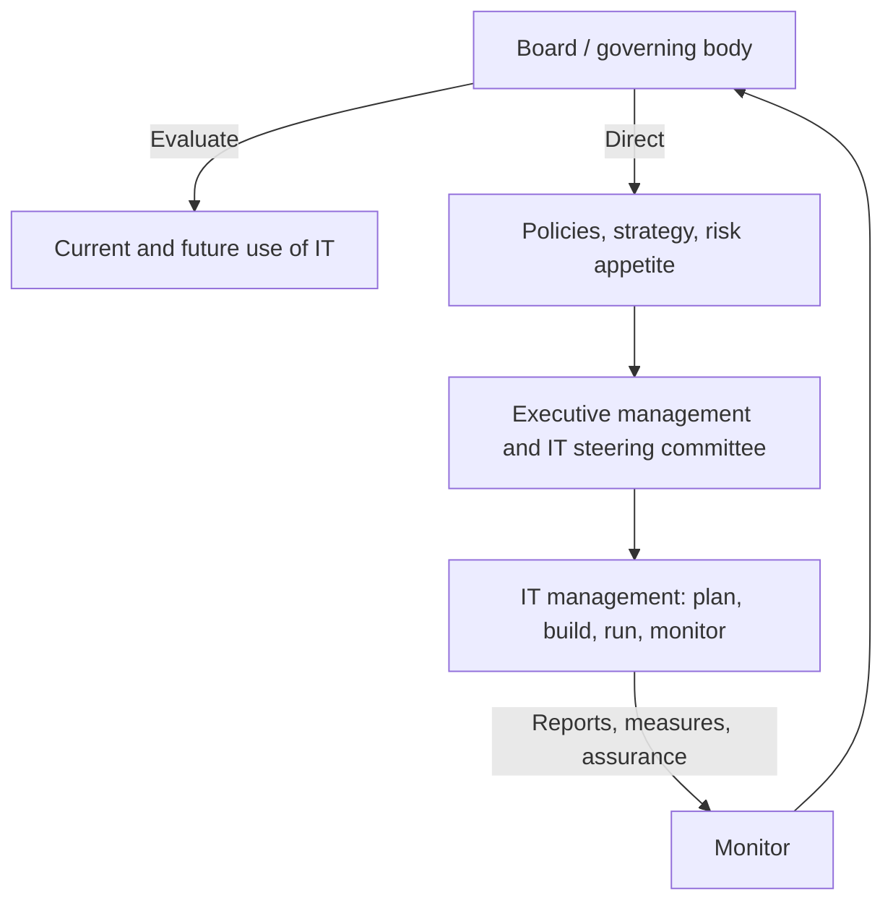

## Introduction

Information technology is no longer a back-office support function. Banks, telecommunications companies, hospitals, universities and government agencies in Ghana depend on their systems to serve customers, move money and keep records. When those systems fail, are breached, or consume large budgets without delivering benefits, the consequences reach the whole organisation. The question that follows is who decides how technology is used, who answers when it goes wrong, and how anyone can know that it is delivering what was promised. That question is the subject of IT governance.

This lesson separates governance from management, introduces two widely used reference points (ISO/IEC 38500 and COBIT), and examines decision rights, steering committees, value delivery, risk and performance measurement. It then links governance to the professional ethics studied earlier in the course: a governance framework is, in part, an organised way of making accountability visible. The lesson is educational and does not reproduce the standards; students should consult the published documents through their library for authoritative detail.

## Learning Objectives

- Distinguish governance from management and explain why the distinction matters for accountability.
- Explain the six principles of ISO/IEC 38500 and its Evaluate, Direct, Monitor model.
- Describe, at a conceptual level, how COBIT organises governance and management objectives and how it is tailored to an organisation.
- Evaluate how an IT steering committee and a decision-rights matrix support or weaken accountability.
- Apply governance concepts to assess value delivery, risk and performance measurement in a realistic scenario.
- Connect governance failures to professional ethical duties such as honesty, competence and the avoidance of harm.

## Prerequisite Knowledge

- The IT Professionalism module, especially professional responsibility and codes of conduct.
- The Professional Practice module, especially conflicts of interest, negligence and the misuse of information systems.

## Key Terminology

- **IT governance**: The system by which the current and future use of information technology is directed and controlled, so that it supports the organisation's objectives, within acceptable risk.
- **IT management**: The planning, building, running and monitoring of IT activities within the direction set by governance.
- **Governing body**: The person or group, usually the board of directors or an equivalent, ultimately accountable for the organisation, including its use of IT.
- **Decision rights**: The allocation of authority to make, approve or veto particular IT decisions, such as investments, architecture and security policy.
- **IT steering committee**: A cross-functional group that prioritises IT investments, monitors major projects and resolves conflicts between business units and IT.
- **Value delivery**: Realising the benefits a technology investment was meant to produce, at an acceptable cost and risk, rather than merely completing a project.
- **Risk appetite**: The amount and type of risk an organisation is prepared to accept in pursuit of its objectives.
- **Control objective**: A statement of what a control or process must achieve, such as ensuring that changes to production systems are authorised and tested.
- **Conformance**: Compliance with applicable laws, regulations, standards and internal policies, as distinct from performance against business goals.
- **Assurance**: Independent evidence, often from internal or external audit, that controls and processes operate as claimed.

## Detailed Explanation

### Governance and management are different activities

A useful way to separate the two is to ask who sets direction and who delivers it. Governance is about **evaluating** options, **directing** the organisation to adopt a chosen course and **monitoring** whether results match intentions. Management is about **planning, building, running and monitoring** the activities needed to follow that direction. The board does not configure servers or approve every software purchase; managers do. But the board is accountable for ensuring that the organisation has sensible policies, that investments are tied to strategy, that risks are within appetite and that someone checks.

Confusing the two causes recurring problems. If the board treats IT as purely a technical matter and leaves it entirely to the IT department, strategic decisions are made without strategic oversight. If the board involves itself in operational detail, it duplicates management and dilutes accountability. Good governance is not more control for its own sake. It is clarity about who is answerable for what.

### Why boards and executives are accountable

In most legal systems, directors owe duties to the organisation, commonly described in terms of acting in its interests, exercising care and skill, and avoiding conflicts. Those duties do not stop at the server room door. Where IT underpins revenue, customer data or regulatory compliance, a director who ignores a known and serious technology risk may find it difficult to claim that reasonable care was exercised. The details differ by jurisdiction and by the form of the organisation, so students should treat this as a general principle and not as a statement of any particular Ghanaian provision.

Accountability is layered. The board sets direction and risk appetite. The chief executive is answerable for execution. The chief information officer (CIO) or equivalent leads IT management. The chief information security officer (CISO), where one exists, advises on and runs the security programme. Business unit heads own the benefits and the process changes that technology enables. Internal audit offers independent assurance. A governance framework makes these layers explicit so that responsibility is neither duplicated nor left unowned.

### Value delivery, risk and performance

Three themes recur in governance practice.

**Value delivery.** Many technology projects are completed on time and still fail to deliver business benefits, because processes were not redesigned, users were not trained or the original benefit case was optimistic. Governance therefore asks for a business case, named benefit owners and a review after implementation that compares promised and realised benefits.

**Risk.** Technology risks include security breaches, outages, vendor failure, project failure, regulatory non-compliance and the misuse of data. Governance sets the risk appetite and makes sure that risks are identified, assessed, treated and reported to the right level. A bank may accept very little risk of payment-system downtime but more risk on an experimental mobile feature.

**Performance measurement.** What is not measured is rarely managed. Measures should cover service performance (availability, incident resolution), project performance (schedule, cost, scope), security performance (incidents, patching) and, above all, outcomes (benefits realised). A common failure is measuring activity, such as the number of tickets closed, rather than whether the business is better served.

### Decision rights and the steering committee

Governance literature stresses that IT decisions fall into categories, such as IT principles, architecture, infrastructure, business application needs and investment, and that someone must be explicitly empowered for each. A decision-rights matrix records who provides input, who decides and who must be informed or approves. Without it, shadow IT grows as departments buy their own systems, security standards are applied inconsistently and integration costs rise.

An **IT steering committee** is a common mechanism. Typically it includes senior business and IT leaders, meets regularly, prioritises the project portfolio against strategy and budget, reviews progress on major initiatives and escalates problems to the executive or board. It works when it has authority, when members attend personally and when it examines evidence. It fails when it becomes a status-report ritual, when IT dominates it or when business executives treat it as an IT forum and send delegates without power to decide.

## Theories, Frameworks and Models

### ISO/IEC 38500: governance of IT for the organisation

ISO/IEC 38500 is an international standard that provides principles and a model for the governance of IT. It is addressed to those who govern, including board members and senior executives, rather than to technicians. Its six principles, in general terms, are:

| Principle | Core idea |
|---|---|
| Responsibility | Individuals and groups understand and accept their responsibilities for IT supply and demand, and have the authority to meet them |
| Strategy | The organisation's business strategy takes account of the current and future capabilities of IT, and IT plans support that strategy |
| Acquisition | IT acquisitions are made for valid reasons, on the basis of ongoing analysis, with clear and transparent decision making, balancing benefits, opportunities, costs and risks |
| Performance | IT is fit for purpose in supporting the organisation, providing services at the required levels and quality |
| Conformance | IT complies with all mandatory legislation and regulations, and policies and practices are clearly defined, implemented and enforced |
| Human behaviour | IT policies, practices and decisions demonstrate respect for human behaviour, including the current and evolving needs of all people in the process |

The standard also describes a cycle of three governance tasks: **Evaluate** the current and future use of IT, **Direct** the preparation and implementation of plans and policies, and **Monitor** conformance and performance. Management carries out the plans and reports back, and the cycle repeats. The principle of human behaviour is particularly relevant to ethics, because it recognises that systems affect the people who use them, work beside them or are subject to their outputs.

### COBIT: a framework for governance and management of enterprise IT

COBIT, developed by ISACA, is a framework for the governance and management of enterprise information and technology. Earlier versions were known mainly as a set of control practices used by auditors. The current generation, COBIT 2019, presents a broader system. At a conceptual level, its key ideas are as follows.

1. **Governance is distinguished from management.** COBIT organises its content into governance and management objectives. The governance domain is Evaluate, Direct and Monitor (EDM), which mirrors the ISO/IEC 38500 cycle. The management domains cover aligning, planning and organising (APO), building, acquiring and implementing (BAI), delivering, servicing and supporting (DSS) and monitoring, evaluating and assessing (MEA).
2. **Objectives are the unit of the framework.** Each objective states what must be achieved, supported by practices, activities, roles and information flows. Examples of subjects include managed risk, managed security, managed change and managed service requests and incidents.
3. **Stakeholder needs cascade into goals.** Enterprise goals (for instance, customer satisfaction or regulatory compliance) are linked to alignment goals for IT, and then to the objectives that matter most. This keeps the framework from becoming a checklist applied uniformly.
4. **Tailoring is expected.** Design factors such as organisation size, risk profile, compliance requirements and sourcing model should shape which objectives receive attention and how mature they need to be. A small Ghanaian microfinance institution does not need the same governance machinery as a universal bank.
5. **Performance is assessed through capability and maturity.** Organisations rate how well each process performs and decide where improvement is justified.

COBIT is not a law and not a compliance certificate. It is a reference structure that organisations may adopt wholly, partly or alongside others, such as ITIL for service management and ISO/IEC 27001 for information security management. It is best understood as a bridge between board-level concerns and the operational detail managed by IT.

## Ghanaian Business Application

Ghanaian organisations operate in a setting where technology governance is shaped by sector regulators, data protection law and public-sector financial rules. Banks and other regulated financial institutions are subject to supervisory expectations from the Bank of Ghana, which include expectations on risk management, outsourcing and business continuity. Telecommunications operators answer to the National Communications Authority. Organisations processing personal data must meet the obligations of the Data Protection Act, 2012 (Act 843), and operators of critical information infrastructure face duties under the Cybersecurity Act, 2020 (Act 1038). These obligations feed the Conformance principle: governance must make sure someone knows which laws apply and verifies compliance.

Good practice includes naming a board member or committee responsible for technology and cyber risk, keeping a vendor register, testing continuity plans and reporting incidents upward promptly. Students should consult the relevant regulator's current guidance for specific requirements.

## International Case Study

### Knight Capital Group and the 2012 trading incident

On 1 August 2012, the US brokerage Knight Capital Group deployed new trading software to its servers. A deployment error left old code active on one server, and when the market opened, the system sent a large volume of unintended orders. The firm accumulated a very large unwanted position within roughly three-quarters of an hour and reported trading losses of around 440 million US dollars, which threatened its survival and led to a rescue investment and later acquisition by another firm.

The US Securities and Exchange Commission subsequently reported its findings and imposed a penalty on Knight, citing deficiencies in its risk controls for market access. The public record describes failures in change management, deployment verification, testing and the monitoring of unexpected activity.

Governance lessons, framed carefully because they are interpretations of public facts and not findings about every detail of the firm:

- **Acquisition and change control** are governance concerns, not only technical ones: a release process that depends on manual steps without verification is a risk the governing body should ask about.
- **Performance and risk monitoring** failed to stop the incident quickly: controls that cannot interrupt abnormal activity early offer little assurance.
- **Conformance**: regulations on risk controls existed, and the regulator judged that the firm's controls fell short.
- **Accountability** rested at the top: the loss was a business event, not just an IT event.

The case illustrates the central point of the lesson: technology risk is enterprise risk.

## Diagram

| Governance task | Typical question the board asks |
|---|---|
| Evaluate | Are our IT plans aligned with strategy and within risk appetite? |
| Direct | Have we approved clear policies, owners and investment priorities? |
| Monitor | Do reports and independent assurance show that benefits are delivered and controls work? |

## Common Misconceptions

- **"IT governance is the IT department's job."** Governance is a board and executive responsibility; the IT department manages within the direction set.
- **"Governance and management are the same thing."** Governance evaluates, directs and monitors; management plans, builds, runs and monitors. Both are needed, by different people.
- **"Adopting COBIT makes an organisation well governed."** COBIT is a reference framework. Value comes from tailoring and using it, not from owning the manuals.
- **"A steering committee guarantees accountability."** A committee without authority, evidence or engaged members can diffuse responsibility.

## Common Examination Mistakes

- Describing governance as a list of IT policies without distinguishing it from management.
- Listing the six ISO/IEC 38500 principles by name without applying them to the scenario given.
- Presenting COBIT as a legal requirement or as a certification.
- Ignoring value delivery and discussing only security risk.

## Critical Thinking Questions

1. A university's council asks the vice-chancellor to "make sure the student portal is secure." Which parts of that task are governance and which are management? Who should report what to whom?
2. Is it realistic to expect non-technical board members to oversee technology risk? What would make such oversight meaningful rather than symbolic?
3. A steering committee consistently approves every project the IT department proposes. What might that indicate, and how would you test it?
4. How can the ISO/IEC 38500 principle of human behaviour be used to challenge a decision to automate customer service without consulting staff or customers?

## Practical Exercises

1. **Governance versus management sort.** List ten activities from a typical organisation (for example, approving a cybersecurity policy, patching servers, setting risk appetite, restoring a backup). Label each as governance or management and justify any borderline cases. Expected output: a table with a one-sentence justification per row.
2. **Decision-rights matrix.** For a fictitious retail company, draw a matrix for five IT decisions (security policy, cloud provider, new application, data retention, vendor contracts) showing who provides input, who decides and who is informed. Expected output: one matrix and a paragraph on weaknesses you tried to avoid.
3. **Principle application.** Choose a publicly reported technology failure and analyse it against the six ISO/IEC 38500 principles using only documented facts. Expected output: a 500-word analysis that distinguishes fact from interpretation.
4. **Ethics link.** Pick one ACM Code principle and show how a specific governance mechanism (for example, an incident reporting line) helps professionals follow it. Expected output: a short written argument of 250 words.

## Key Takeaways

- Governance evaluates, directs and monitors; management plans, builds, runs and monitors.
- The board and executives are accountable for the use of IT because technology risk is enterprise risk.
- ISO/IEC 38500 offers six principles (responsibility, strategy, acquisition, performance, conformance, human behaviour) and an Evaluate, Direct, Monitor cycle.
- COBIT supplies governance and management objectives that should be tailored to the organisation, not applied as a checklist.
- Steering committees and decision-rights matrices help only if they have authority, evidence and engaged members.
- Value, risk and performance must be measured against outcomes, not just activity.

## Further Reading

- International Organization for Standardization & International Electrotechnical Commission. (2015). *ISO/IEC 38500:2015 Information technology: Governance of IT for the organization*. ISO.
- ISACA. (2018). *COBIT 2019 framework: Introduction and methodology*. ISACA.
- Weill, P., & Ross, J. W. (2004). *IT governance: How top performers manage IT decision rights for superior results*. Harvard Business School Press.
- Association for Computing Machinery. (2018). *ACM code of ethics and professional conduct*. <https://www.acm.org/code-of-ethics>

## Video Resources

- [ISACA COBIT resources](https://www.isaca.org/resources/cobit): ISACA. Official page with overviews and learning resources on the COBIT framework.
- [ISO/IEC 38500 on the ISO website](https://www.iso.org/): International Organization for Standardization. Official site where the ISO/IEC 38500 standard can be found through the catalogue.

## Revision Summary

IT governance is how an organisation directs and controls its use of technology so that it supports the business within acceptable risk. Governance (evaluate, direct, monitor) belongs to the board and executives; management (plan, build, run, monitor) belongs to IT and business managers. ISO/IEC 38500 supplies six principles and a short model, and COBIT supplies detailed governance and management objectives that should be tailored. Steering committees and decision-rights matrices make accountability explicit, provided they have authority and evidence. Failures such as the Knight Capital incident show that technology risk is enterprise risk. This lesson is educational and does not substitute for the published standards.

- Governance versus management: who sets direction, who delivers it.
- ISO/IEC 38500 principles: responsibility, strategy, acquisition, performance, conformance, human behaviour.
- COBIT: governance (EDM) and management domains, tailored by design factors.
- Decision rights and steering committees need authority and evidence.
- Measure outcomes and benefits, not only activity.
- Technology risk is enterprise risk; the board remains accountable.
