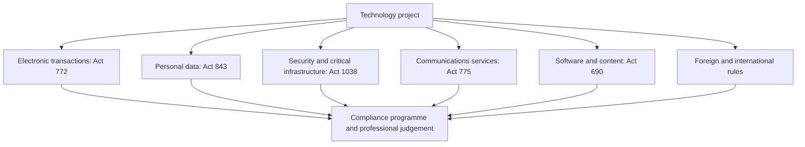

## Introduction

IT professionals rarely think of themselves as working in a legal environment, yet almost every technical decision has a legal dimension. A developer who stores customer records is handling personal data. An engineer who signs a contract electronically is relying on rules about the validity of electronic signatures. A network administrator who intercepts traffic, a freelancer who reuses code, and a manager who moves data to a foreign cloud provider are each acting within a body of law, whether or not they have read it.

This lesson maps the legal framework in which Ghanaian IT professionals work: the law on electronic transactions and signatures, data protection, cybersecurity and cybercrime, electronic communications, and copyright and software. It then looks at how legislation interacts with professional codes of ethics, at cross-border issues, and at practical compliance responsibilities. The lesson is educational and is not legal advice. Statutes are amended and interpreted by courts and regulators, so anyone facing a real legal question should consult the current text and a qualified lawyer. The summaries below are deliberately general and do not state section numbers or penalties.

## Learning Objectives

- Describe the purpose and general scope of the principal Ghanaian technology statutes: Acts 772, 843, 1038, 775 and 690.
- Explain how legal rules and professional codes of ethics differ, overlap and reinforce each other.
- Analyse a cross-border scenario to identify which legal regimes may apply and why.
- Apply a structured compliance approach to a realistic technology project.
- Evaluate the limits of legal compliance as a guide to ethical conduct.

## Prerequisite Knowledge

- The Data and Privacy module, especially the lesson on privacy, consent and data protection.
- The Intellectual Property module, especially copyright and software licensing.
- The lesson on cybercrime and the misuse of information systems.

## Key Terminology

- **Statute (Act of Parliament)**: Written law enacted by a legislature, such as the Data Protection Act, 2012 (Act 843).
- **Regulator**: A public body empowered to supervise compliance with a law and to issue guidance, for example the Data Protection Commission or the Cyber Security Authority.
- **Electronic signature**: Data in electronic form attached to or logically associated with a record, used to indicate the signer's intention to be bound or to approve the content.
- **Data controller**: The person or organisation that determines the purposes and means of processing personal data.
- **Data processor**: A person or organisation that processes personal data on behalf of a controller.
- **Jurisdiction**: The authority of a court or regulator to hear a matter or apply a law, usually linked to territory, persons or effects.
- **Extraterritorial effect**: The application of a law to conduct outside the territory of the state that enacted it, as with the EU General Data Protection Regulation (GDPR) in some circumstances.
- **Licence (communications)**: Permission from a regulator to provide specified electronic communications services or operate in a regulated sector.
- **Compliance programme**: The policies, roles, training, monitoring and records an organisation uses to meet its legal obligations.
- **Duty of care**: A legal obligation to take reasonable care to avoid causing foreseeable harm to others.

## Detailed Explanation

### Law, ethics and professional codes

Law, ethics and professional codes overlap but are not the same. **Law** is backed by state enforcement and sets minimum standards. It can be slow to adapt, and it varies between countries. **Ethics** asks what we ought to do, including where the law is silent or permissive. **Professional codes**, such as the ACM Code of Ethics, are statements of the standards a professional community expects of its members, enforced mainly through membership processes, employer policy and reputation.

The relationship runs in several directions. First, codes often tell members to obey the law (ACM principle 2.3 asks computing professionals to know and respect existing rules pertaining to professional work). Second, the codes ask for more than the law requires: a professional may be legally entitled to collect a data field but ethically obliged to ask whether it is necessary. Third, the law sometimes borrows professional norms: courts and regulators asking what a reasonably competent professional would have done may look to codes and standards as evidence. Fourth, the code also recognises that rules can be unjust or inadequate, and that professionals may need to question them through legitimate channels. Legal compliance is therefore a floor, not a ceiling.

### Electronic transactions and electronic signatures

The **Electronic Transactions Act, 2008 (Act 772)** is Ghana's principal statute on the legal status of electronic communications. In general terms, it recognises electronic records, electronic signatures and electronic contracts, so that a transaction does not lose legal effect simply because it is in electronic form. It also addresses electronic commerce and consumer matters, and contains provisions on certain computer-related offences. For IT professionals, this matters in practical ways: systems that capture consent, approve payments, record contracts or archive evidence should be designed so that the resulting records are reliable, attributable to the right person, protected from alteration and retrievable.

Legal recognition does not mean every electronic signature is equally trustworthy. A typed name in an email, a click on an "I agree" button and a signature based on a cryptographic certificate provide different levels of assurance. Good design therefore asks: how will we show who signed, when, and that the record was not changed afterwards? Audit trails, timestamps, strong authentication and secure retention policies are the technical answers. Some categories of document may be subject to special formalities under other laws, so a professional should confirm requirements for the specific transaction type.

### Data protection

The **Data Protection Act, 2012 (Act 843)** governs the processing of personal data in Ghana. It established the **Data Protection Commission**, requires registration of data controllers, sets out principles for lawful processing and gives individuals rights over their data. The previous module examined it in detail. In daily IT work it means collecting only needed data, securing it, being able to answer data-subject requests, checking vendor contracts and preparing for breaches. The lawyer may draft the privacy notice, but the engineer decides whether the database can honour a deletion request.

### Cybersecurity and cybercrime

The **Cybersecurity Act, 2020 (Act 1038)** regulates cybersecurity activities and promotes the development of cybersecurity in Ghana. In general terms, it establishes the **Cyber Security Authority**, provides for the protection of critical information infrastructure, creates arrangements for licensing or accreditation of cybersecurity service providers and professionals, sets up incident reporting and response structures, and supports international cooperation. Offences concerning unauthorised access, interference and computer-related fraud have been addressed in Ghanaian law through the Electronic Transactions Act and related legislation, and the Cybersecurity Act also deals with certain online harms. The previous module covered classification of cybercrime and the ethics of security testing.

Professionals should test security only with written authority, follow incident reporting channels and check licensing requirements if they sell security services.

### Electronic communications

The **Electronic Communications Act, 2008 (Act 775)** provides the framework for the regulation of electronic communications in Ghana, including matters such as licensing of operators and networks. The National Communications Authority is the sector regulator. For IT professionals, this regime matters wherever services depend on telecommunications networks, such as mobile money platforms, bulk messaging, Internet service provision and value-added services. Providers of such services should check whether a licence is required, and any monitoring or interception of communications, even of staff, must be checked against communications law, data protection law and employment practice.

### Copyright and software

The **Copyright Act, 2005 (Act 690)** protects original literary, artistic and other works, and computer programs are treated as protected works in Ghanaian copyright law. For developers, the core points are consistent with the previous module on intellectual property. Employer ownership of employee-written software is common but depends on the contract and the statute, and freelancers should have a written agreement on ownership. Third-party code and datasets are governed by their licences, and unlicensed copying exposes an organisation to legal and reputational risk.

## Theories, Frameworks and Models

### International frameworks in outline

Ghana's businesses and professionals often deal with foreign law because customers, partners and cloud services are international.

- **EU General Data Protection Regulation (GDPR).** A regulation setting rules for processing personal data of people in the European Union. It can apply to organisations outside the EU in certain situations, such as offering goods or services to people in the EU or monitoring their behaviour. It also sets conditions for transfers of personal data to countries outside the EU.
- **EU Artificial Intelligence Act.** A regulation that takes a risk-based approach to AI systems, with stricter obligations for those classed as high risk and prohibitions on certain practices. It is relevant to Ghanaian developers whose AI products are placed on the EU market or whose outputs are used there. Because its provisions are being phased in and are detailed, students should read the current official text for any specific application.
- **Council of Europe Convention on Cybercrime (Budapest Convention).** An international treaty that encourages states to criminalise core computer offences, to adopt procedural powers for evidence and to cooperate across borders. Ghana has acceded to it.

### A compliance method

1. **Map the activity.** What data, systems, users, locations and partners are involved?
2. **Identify the laws.** Which statutes, regulator rules, sector requirements, contracts and foreign laws apply?
3. **Translate duties into requirements.** For example, "keep personal data secure" becomes encryption, access control and logging requirements.
4. **Assign owners.** Each obligation needs a named responsible person.
5. **Build controls and evidence.** Implement them and keep records that show they operate.
6. **Train and communicate.** Staff cannot comply with rules they do not know.
7. **Monitor and review.** Laws, systems and risks change; so must the programme.
8. **Escalate doubt.** When the legal position is unclear, involve counsel or the compliance function and do not guess.

## Ghanaian Business Application

Compliance in Ghana is typically practical rather than theoretical. A bank, a telecom, a university and a start-up will all face different mixes of the statutes above. Examples of how the framework shows up in work:

- **Registration and records.** Controllers that process personal data should confirm their obligations to register with the Data Protection Commission and to keep their registration current.
- **Incident response.** Organisations should know in advance whom to notify within the organisation, and which regulators, such as the Data Protection Commission or the Cyber Security Authority, may need to be informed. Rehearsing the plan is more valuable than owning it.

Where the law is silent, or where enforcement is uneven, the professional code still applies. A responsible professional documents the decision, can explain it to a regulator, and would be comfortable if the practice were publicly known.

## International Case Study

### Schrems II and international data transfers (2020)

In July 2020, the Court of Justice of the European Union decided the case commonly known as Schrems II (Data Protection Commissioner v Facebook Ireland and Maximillian Schrems). The case arose from a complaint about the transfer of personal data from the EU to the United States. The Court invalidated the EU-US Privacy Shield, an arrangement that had allowed organisations to transfer data to participating US companies, finding that it did not adequately protect EU individuals against access by US public authorities. The Court did not strike down standard contractual clauses, a widely used transfer tool, but held that organisations relying on them must verify, case by case, whether the law of the destination country allows the clauses to deliver an essentially equivalent level of protection, and must add safeguards or suspend transfers where it does not.

Lessons for technology professionals:

- **Data location is a legal fact.** Choosing a cloud region or a vendor is also choosing which laws and public authorities may reach the data.
- **Contracts are not enough on their own.** Assessments of the destination country's legal environment and technical safeguards such as strong encryption with keys controlled by the data exporter may be needed.
- **Legal positions change.** A transfer mechanism that was lawful one year can be invalidated the next, so architecture should allow for change, such as the ability to relocate or segregate data.
- **Laws bind outside their borders in practice.** A Ghanaian company serving EU customers may find that EU rules affect its design even though it has no European office.

The case does not set rules for Ghana. Its value for students is as a documented example of how legal, technical and contractual questions combine in cross-border data decisions.

## Diagram

| Statute | Main subject | Typical implication for an IT professional |
|---|---|---|
| Electronic Transactions Act, 2008 (Act 772) | Electronic records, signatures, contracts, certain offences | Design reliable, attributable and retrievable electronic records |
| Data Protection Act, 2012 (Act 843) | Processing of personal data | Minimise, secure and be able to respond to data-subject requests |
| Cybersecurity Act, 2020 (Act 1038) | Cybersecurity regulation and critical infrastructure | Follow reporting channels, test only with authority, check licensing |
| Electronic Communications Act, 2008 (Act 775) | Electronic communications licensing and regulation | Check licences and rules before building on telecom services |
| Copyright Act, 2005 (Act 690) | Protection of works including software | Respect licences, document ownership, avoid unauthorised copying |

## Common Misconceptions

- **"If it is legal, it is ethical."** Law sets a minimum. Practices such as excessive data collection may be lawful yet harmful or disrespectful of users.
- **"Foreign laws do not matter to a Ghanaian company."** Foreign rules such as the GDPR may apply when an organisation serves or monitors people abroad or exchanges data with foreign partners.
- **"An electronic signature is always as good as a handwritten one."** Legal recognition is not the same as evidential strength, and some document types carry special requirements.
- **"Hosting data abroad removes Ghanaian obligations."** The organisation that controls the data usually remains responsible for it, whatever the location of its servers.

## Common Examination Mistakes

- Citing statutes inaccurately, for example confusing the Data Protection Act with the Cybersecurity Act, or inventing section numbers and penalties.
- Giving a list of laws without applying them to the facts of the scenario.

## Critical Thinking Questions

1. A client asks you to build a system that is legal but, in your view, treats customers unfairly. What factors would guide your response, and which ACM principles are relevant?
2. How should an organisation decide which foreign laws to follow when serving customers in many countries? Is it fair to apply the strictest standard everywhere?
3. A software contractor assumes that code written for a client belongs to the contractor because the contract is silent. Evaluate this assumption and explain how to avoid the dispute.
4. Should individual IT professionals be personally liable for the legal consequences of design decisions, or should liability rest with the organisation? Justify your view.

## Practical Exercises

1. **Statute map.** Prepare a one-page table of the five Ghanaian statutes in this lesson showing the subject, the regulator (where one exists) and one example of how it affects a software project. Expected output: a completed table checked against the official texts.
2. **Compliance mapping.** Choose a real or fictitious system, such as an online school-fees portal, and apply the eight-step compliance method. Expected output: a two-page report listing data, laws, requirements, owners and evidence.
3. **Cross-border analysis.** A Ghanaian e-commerce firm stores customer data on a cloud platform in Europe and sells to customers in several countries. Identify the legal questions it should ask. Expected output: a list of at least six questions with the reason for each.
4. **Law versus ethics debate.** Prepare a three-minute argument on whether a lawful but intrusive staff monitoring system can still be unethical. Expected output: a written outline using two ethical theories.

## Key Takeaways

- Technology law is a set of overlapping layers: general law, technology statutes, regulator guidance, sector rules, contracts and foreign law.
- Act 772 gives legal recognition to electronic records and signatures; reliability depends on good system design.
- Act 843 governs personal data, Act 1038 cybersecurity, Act 775 electronic communications and Act 690 copyright including software.
- Professional codes require respect for the law and ask for more than the law requires.
- Cross-border services can trigger foreign law; Schrems II shows how data location, contracts and technical safeguards interact.
- This lesson is educational; specific questions require the current legal texts and qualified advice.

## Further Reading

- Association for Computing Machinery. (2018). *ACM code of ethics and professional conduct*. <https://www.acm.org/code-of-ethics>
- Regulation (EU) 2016/679 of the European Parliament and of the Council (General Data Protection Regulation). (2016). <https://eur-lex.europa.eu/eli/reg/2016/679/oj>
- Council of Europe. (2001). *Convention on Cybercrime* (ETS No. 185). <https://www.coe.int/en/web/cybercrime/the-budapest-convention>
- Court of Justice of the European Union. (2020). *Data Protection Commissioner v Facebook Ireland Ltd and Maximillian Schrems* (Case C-311/18).
- Data Protection Commission, Ghana. (n.d.). *Data Protection Commission*. <https://dataprotection.org.gh/>
- Cyber Security Authority, Ghana. (n.d.). *Cyber Security Authority*. <https://www.csa.gov.gh/>

## Video Resources

- [Data Protection Commission, Ghana](https://dataprotection.org.gh/): Data Protection Commission. Official site with guidance on registration and data subject rights under Act 843.
- [Cyber Security Authority, Ghana](https://www.csa.gov.gh/): Cyber Security Authority. Official site with information on cybersecurity regulation, incident reporting and public awareness resources.

## Revision Summary

IT professionals work within layered law: Act 772 on electronic records and signatures, Act 843 on personal data, Act 1038 on cybersecurity, Act 775 on electronic communications and Act 690 on copyright and software, together with regulator guidance, sector rules, contracts and, where relevant, foreign law such as the GDPR and the EU AI Act. Professional codes require respect for the law but also go beyond it, so compliance is a floor and not the whole of ethics. Cross-border services raise questions of jurisdiction and data transfer, illustrated by Schrems II. A practical compliance method maps the activity, identifies the laws, translates duties into requirements, assigns owners, builds evidence and reviews continually. This summary is educational and not legal advice.

- Know the five statutes and their regulators.
- Law is a floor; the code asks for more.
- Data location and vendor choice are legal decisions.
- Electronic signatures need reliability and evidence.
- Map, assign, evidence, review.
- Escalate legal doubt; do not guess.
