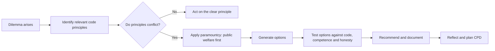

## Introduction

When an IT professional faces a difficult choice, such as whether to ship software with a known weakness or whether to accept a project beyond their expertise, they rarely have time to reconstruct moral philosophy from first principles. Professional codes of ethics exist to help. They condense the collective experience of a profession into a set of commitments that members can use to guide their judgement, justify their decisions to employers and hold one another to account.

Codes are often misunderstood, however. Some students treat them as legal rulebooks, others as public-relations documents with no practical force. This lesson examines what codes are for, summarises the structure and core commitments of the two most widely referenced computing codes, the ACM Code of Ethics and Professional Conduct (2018) and the IEEE Code of Ethics, and then explores professional competence and continuing professional development (CPD), the commitment that underpins all others. Throughout, the codes are summarised in original words; you should read the full official texts, which are freely available online.

## Learning Objectives

- Explain the functions and limitations of professional codes of ethics.
- Describe the structure and principal commitments of the ACM Code (2018) and the IEEE Code of Ethics.
- Compare the ACM and IEEE codes and identify where they converge and differ in emphasis.
- Apply relevant code principles to justify a recommendation in an IT dilemma.
- Evaluate professional competence and CPD as ethical obligations rather than merely career strategies.

## Prerequisite Knowledge

- The characteristics of a profession and the distinction between responsibility, accountability and liability (previous lesson).
- General familiarity with software development and IT operations roles.

## Key Terminology

- **Code of ethics**: A statement of the values and principles a profession expects its members to uphold, usually framed as aspirations and obligations.
- **Code of conduct**: A more specific set of rules of behaviour, often enforceable through a disciplinary process; the terms are frequently used interchangeably.
- **Public interest**: The welfare of the public as a whole, which professional codes typically place above the interests of employers, clients or the practitioner.
- **Professional competence**: The combination of knowledge, skill, judgement and awareness of one's limits required to perform professional work to an acceptable standard.
- **Continuing professional development (CPD)**: Planned, ongoing learning that maintains and extends a professional's competence throughout their career.
- **Conflict of interest**: A situation in which a professional's personal interests could improperly influence their professional judgement.
- **Paramountcy clause**: A provision stating that one value, usually public safety and welfare, overrides others when they conflict.

## Detailed Explanation

### What codes are for

Professional codes serve several functions at once:

1. **Guidance.** They identify the considerations a competent professional should weigh, especially in unfamiliar situations.
2. **Support.** A practitioner who refuses an unethical instruction can point to the code: "my professional obligations do not permit this". This gives individuals leverage against organisational pressure.
3. **Education.** Codes introduce new members to the values of the profession.
4. **Discipline.** Professional bodies can use codes as the basis for sanctioning members who breach them.
5. **Public trust.** A published code tells the public what it may expect from members.

Codes also have limitations. They are often **abstract**, so applying them requires judgement. Principles can **conflict**, for example confidentiality to an employer against honesty to the public. Enforcement is **weak** where membership is voluntary. And a code can never anticipate every technology; in James Moor's terms, new technologies create *policy vacuums* that codes may not yet address. A code is therefore a starting point for ethical reasoning, not a substitute for it.

### The ACM Code of Ethics and Professional Conduct (2018)

The ACM, the world's largest computing society, updated its code in 2018 to address issues such as ubiquitous computing, data and security. The 2018 code is organised into four parts. The summary below paraphrases the commitments; consult the official text for exact wording and the explanatory guidance attached to each principle.

**Part 1: General ethical principles.** Computing professionals should:

- contribute to society and human well-being, recognising that all people are stakeholders in computing;
- avoid harm, including unintended harm, and take care to minimise negative consequences;
- be honest and trustworthy, including being transparent about capabilities and limitations of systems;
- be fair and act to avoid discrimination;
- respect the effort that goes into new ideas, inventions, creative works and computing artefacts;
- respect privacy;
- honour confidentiality.

**Part 2: Professional responsibilities.** Computing professionals should strive for high quality in both process and product; maintain high standards of competence, conduct and ethical practice; know and respect the rules that apply to their work; give and accept professional review; carry out thorough evaluations of systems and their impacts, including risks; work only in areas where they are competent; foster public understanding of computing; access computing resources only when authorised or when compelled by the public good; and design and implement systems that are robustly and usably secure.

**Part 3: Professional leadership principles.** People in leadership roles carry additional obligations: keeping the public good central to computing work, articulating and supporting the social responsibilities of their organisations, managing people and resources to enhance the quality of working life, creating opportunities for others to grow professionally, taking care when modifying or retiring systems that people depend on, and giving special attention to systems that become part of the infrastructure of society.

**Part 4: Compliance with the code.** Members commit to uphold, promote and respect the code and recognise that serious violation is inconsistent with membership.

A notable feature of the 2018 code is its explicit statement that the public good is the paramount consideration, and its recognition that harm can arise from systems that work exactly as designed if the design itself is harmful.

### The IEEE Code of Ethics

The IEEE, a global association for electrical, electronic and computing engineers, maintains a shorter code within its governing policies. In its current form, the code groups its commitments into three broad parts. Paraphrased, members commit:

- **To uphold high standards of integrity, responsible behaviour and ethical conduct**: placing the safety, health and welfare of the public first; striving to comply with ethical design and sustainable development practices; protecting the privacy of others; promptly disclosing factors that might endanger the public or the environment; improving public understanding of technology and its consequences; avoiding real or perceived conflicts of interest and disclosing them when unavoidable; avoiding unlawful conduct and rejecting bribery; seeking, accepting and offering honest criticism of technical work and correcting errors; being honest and realistic in claims and estimates; maintaining and improving technical competence and undertaking technological tasks only when qualified by training or experience, or after full disclosure of limitations; and properly crediting the contributions of others.
- **To treat all persons fairly and with respect**: not engaging in harassment or discrimination on grounds such as race, religion, gender, disability, age or national origin.
- **To strive to ensure the code is upheld by colleagues**: supporting colleagues in following the code and not retaliating against those who report violations.

### Comparing the two codes

| Dimension | ACM Code (2018) | IEEE Code of Ethics |
|---|---|---|
| Length and style | Longer, with explanatory guidance for each principle | Short list of commitments |
| Paramount value | Public good and well-being of all stakeholders | Safety, health and welfare of the public |
| Privacy and confidentiality | Separate principles for privacy and for confidentiality | Protection of others' privacy |
| Security | Explicit duty to build robustly and usably secure systems | Implied through public safety and disclosure of dangers |
| Leadership | Dedicated section on leadership obligations | Not separately addressed |
| Competence | Work only within competence; maintain high standards | Maintain competence; undertake tasks only when qualified or after disclosure |
| Colleagues and reporting | Professional review; compliance section | Support colleagues; no retaliation against reporters |

The codes converge strongly: both put the public first, both require honesty and competence, both address discrimination and privacy. The ACM code is more detailed about computing-specific issues such as security and the retirement of systems, while the IEEE code is broader, reflecting its engineering membership, and gives explicit attention to sustainable development and the environment.

Other codes are worth knowing. The BCS Code of Conduct, used by the British Computer Society, organises obligations around the public interest, professional competence and integrity, duty to relevant authority (the employer or client) and duty to the profession. Many organisations also publish internal codes, which typically emphasise compliance and confidentiality more than public welfare.

## Theories, Frameworks and Models

### Competence as an ethical obligation

Competence is sometimes treated as a purely technical matter, but every major code frames it as an ethical duty. The reasoning is straightforward: clients and the public rely on professionals precisely because they cannot evaluate the work themselves. A practitioner who accepts work they are not competent to perform exploits that trust, even if they mean well.

Professional competence has several dimensions:

1. **Knowledge**: understanding of relevant theory, technologies, standards and law.
2. **Skill**: the ability to apply knowledge reliably in practice.
3. **Judgement**: the capacity to decide what to do in situations that rules do not cover.
4. **Awareness of limits**: knowing what one does *not* know, and being honest about it.
5. **Currency**: keeping all of the above up to date as technology changes.

The fourth dimension is the most ethically significant. Incompetence is not itself a moral failing, since everyone begins as a novice, but concealing one's limitations is. Both codes allow a professional to undertake unfamiliar work *after full disclosure* and with appropriate support; what they prohibit is pretending.

### Continuing professional development

Because IT changes quickly, competence decays unless renewed. CPD is the structured response. A practical CPD cycle has four stages:

1. **Reflect** on current role, emerging technologies and gaps in competence.
2. **Plan** learning activities: courses, certifications, reading, conferences, mentoring or project rotation.
3. **Act** by completing the activities.
4. **Evaluate** the impact on practice and record it, then repeat.

Professional bodies such as the BCS and the IEEE encourage members to keep CPD records, and some certifications require evidence of continuing education for renewal. For an MSc student, the programme itself is a significant CPD activity, but competence also requires deliberate practice in the workplace.

## Worked Example

### Applying the codes to a dilemma

*Illustrative scenario.* Abena is a database developer at Coastline Microfinance, a fictional lender in Takoradi. Her manager asks her to set up the company's first cloud data warehouse within two weeks for a board demonstration. Abena has never configured cloud security controls. She suspects that if she rushes, customer data, including national ID numbers and loan histories, could be exposed.

**Step 1: Identify the relevant principles.**

- ACM: avoid harm; work only in areas of competence; design robustly and usably secure systems; respect privacy; be honest about limitations.
- IEEE: hold public welfare first; protect privacy; undertake tasks only when qualified or after full disclosure of limitations; be realistic in estimates.

**Step 2: Identify the conflict.** Loyalty to her employer and career interest push towards accepting the deadline; competence, privacy and honesty push towards caution.

**Step 3: Consider options.**

| Option | Assessment against the codes |
|---|---|
| Accept silently and do her best | Breaches competence and honesty obligations; risks harm to customers |
| Refuse outright | Protects customers but fails to help the employer find a solution |
| Disclose limitations and propose a plan | Satisfies honesty and competence; offers a constructive path |

**Step 4: Recommend.** Abena should disclose her lack of cloud security experience in writing, propose either a demonstration using synthetic or anonymised data, or bringing in a qualified security specialist, and set a realistic timeline for the production build. This is the option the codes most clearly support because it combines honesty, competence and service to the employer.

**Step 5: Plan CPD.** Abena should also plan targeted learning, such as a recognised cloud security course, so that she can take on such work competently in future.

## Ghanaian Business Application

In Ghana, adherence to international codes is voluntary unless an employer or certification body requires it, but the codes align closely with obligations that do exist in law and regulation. For example, the duty to respect privacy and confidentiality aligns with the Data Protection Act, 2012 (Act 843); the duty to build secure systems aligns with expectations under the Cybersecurity Act, 2020 (Act 1038) and sector regulators' directives. Ghanaian employers increasingly ask for internationally recognised certifications, which often carry their own codes of conduct and CPD requirements.

A practical recommendation for Ghanaian organisations is to **adopt an internal IT code of conduct** that references the ACM or IEEE principles, to build CPD into performance appraisal and to create a safe channel through which staff can raise concerns that a task exceeds their competence or creates risk to customers. These measures turn abstract codes into everyday organisational practice.

## International Case Study

### The Volkswagen emissions software case

In 2015, the United States Environmental Protection Agency announced that Volkswagen had installed software in certain diesel vehicles that detected when the car was undergoing emissions testing and altered engine performance to pass, while emitting far more nitrogen oxides on the road. The company admitted the use of the "defeat device", paid very large penalties and faced prosecutions in several countries. An engineer involved in developing the software pleaded guilty in the United States and was sentenced to prison in 2017.

For codes of ethics the case is instructive. The engineers' technical competence was not in doubt; the failure was one of integrity, honesty and public welfare. Every principle about placing the public first, avoiding harm and being honest was breached. The case also shows that "I was following instructions" does not discharge a professional's obligations, and that organisational culture can make breaches routine unless individuals and leaders actively resist.

## Diagram

## Common Misconceptions

- **"A code of ethics is a legal document."** Codes are professional commitments; breaching one may lead to expulsion from a body but is not in itself a legal offence, although many code duties overlap with legal duties.
- **"If my employer instructs me, the code no longer applies."** Both codes place public welfare above employer interests; following instructions does not remove professional responsibility.
- **"Competence just means technical skill."** Competence includes judgement, currency and awareness of one's limits, and honesty about those limits is an ethical duty.
- **"Codes give a single correct answer to every dilemma."** Codes identify considerations; principles can conflict and must be weighed with judgement.
- **"CPD is only about passing certifications."** CPD is any structured learning that maintains competence, including mentoring, reflective practice and project experience.

## Common Examination Mistakes

- Quoting or listing code principles without applying them to the facts of the case.
- Claiming that the codes are identical, or failing to note differences in emphasis.
- Inventing clause numbers or wording; paraphrase accurately instead.
- Ignoring the paramountcy of public welfare when principles conflict.
- Treating competence purely as a career matter and missing its ethical dimension.
- Recommending refusal without offering a constructive alternative.

## Critical Thinking Questions

1. If membership of the ACM or IEEE is voluntary and enforcement is weak, why should a Ghanaian IT professional take these codes seriously?
2. Should an organisation's internal code of conduct ever override a professional code? Give an example where they might conflict.
3. Is it ethical to accept a project that is slightly beyond your competence if you disclose this and commit to learning quickly? Where is the line?
4. The ACM code includes duties for leaders. Why might leadership obligations be more important than individual obligations in preventing cases like Volkswagen?
5. How could CPD requirements be made meaningful rather than a box-ticking exercise?

## Practical Exercises

1. **Code comparison.** Read the full ACM and IEEE codes on their official websites. *Expected output:* a table comparing at least eight themes (for example public welfare, privacy, competence, honesty, discrimination, security, environment, reporting) with a paraphrase from each code and a comment on differences.
2. **Personal CPD plan.** Using the reflect-plan-act-evaluate cycle, produce a 12-month CPD plan for your current or intended role. *Expected output:* a one-page plan with three competence gaps, matching learning activities, target dates and evidence you will keep.
3. **Code-based recommendation.** Write a 300-word memo from Abena to her manager in the worked example. *Expected output:* a professional memo that discloses limitations, cites relevant principles in paraphrase and proposes at least two alternatives.

## Key Takeaways

- Codes guide, support, educate, discipline and build public trust, but they are abstract, can conflict and are weakly enforced.
- The ACM Code (2018) has four parts: general principles, professional responsibilities, leadership principles and compliance.
- The IEEE Code groups commitments under integrity and public welfare, fair treatment of persons, and upholding the code among colleagues.
- Both codes place public welfare first and treat competence and honesty as ethical duties.
- Competence includes knowledge, skill, judgement, awareness of limits and currency; CPD keeps it current.

## Further Reading

- Association for Computing Machinery. (2018). *ACM code of ethics and professional conduct*. <https://www.acm.org/code-of-ethics>
- Davis, M. (1991). Thinking like an engineer: The place of a code of ethics in the practice of a profession. *Philosophy & Public Affairs, 20*(2), 150-167.
- IEEE. (n.d.). *IEEE code of ethics*. <https://www.ieee.org/about/corporate/governance/p7-8.html>
- Moor, J. H. (1985). What is computer ethics? *Metaphilosophy, 16*(4), 266-275.
- Quinn, M. J. (2020). *Ethics for the information age* (8th ed.). Pearson.
- Tavani, H. T. (2016). *Ethics and technology: Controversies, questions, and strategies for ethical computing* (5th ed.). Wiley.

## Video Resources

- [ACM Code of Ethics and Professional Conduct](https://www.acm.org/code-of-ethics): Association for Computing Machinery. Official home of the 2018 code with supporting guidance and case material.
- [IEEE Code of Ethics](https://www.ieee.org/about/corporate/governance/p7-8.html): IEEE. Official page presenting the current IEEE Code of Ethics within IEEE policies.
- [Markkula Center for Applied Ethics](https://www.scu.edu/ethics/): Santa Clara University. Official portal with resources on technology ethics and professional practice.

## Revision Summary

Professional codes condense a profession's values into commitments that guide, support and discipline members and signal trustworthiness to the public, although they are abstract and weakly enforced. The ACM Code (2018) is organised into general principles, professional responsibilities, leadership principles and compliance; the IEEE Code groups commitments around integrity and public welfare, fair treatment and upholding the code. Both put the public first and treat competence and honesty as ethical duties.

- Five functions of codes: guidance, support, education, discipline, public trust.
- ACM 2018: four parts; distinctive duties on security, leadership and system retirement.
- IEEE: public safety first; sustainability; conflicts of interest; no retaliation against reporters.
- Competence = knowledge, skill, judgement, awareness of limits, currency.
- Undertake unfamiliar work only after full disclosure and with support.
- CPD cycle: reflect, plan, act, evaluate.
