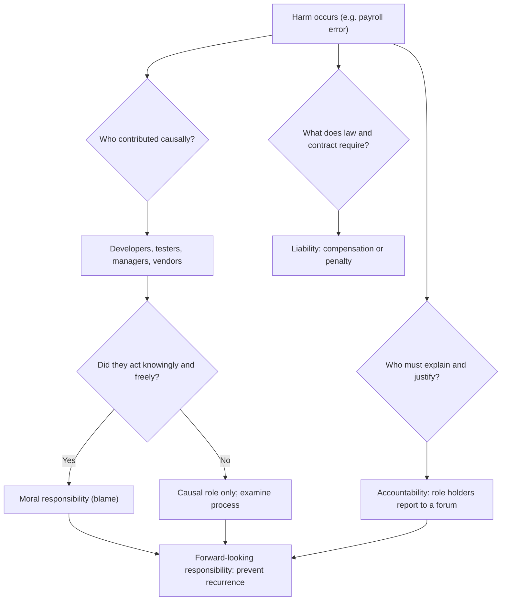

## Introduction

Information technology now sits inside almost every consequential decision an organisation makes: who receives a loan, which patient is prioritised, how a salary is calculated, whether a mobile money transfer succeeds. The people who design, build, configure and operate these systems therefore exercise real power over other people's lives, often without those people ever knowing who was involved. That power raises a simple but demanding question: *what does it mean to be a professional in IT, and what do IT professionals owe to the people affected by their work?*

This lesson examines the idea of a profession, asks whether computing satisfies the traditional criteria, and then develops three concepts that are frequently confused in both everyday speech and examination answers: **responsibility**, **accountability** and **liability**. You will learn why computerised systems make it unusually easy for nobody to answer for harm, and how professionals and organisations can design accountability back in. These ideas underpin every later module of the course, from privacy and intellectual property to AI and whistleblowing.

## Learning Objectives

- Explain the characteristics traditionally used to distinguish a profession from an occupation.
- Evaluate the extent to which IT work in Ghana and internationally satisfies those characteristics.
- Distinguish role responsibility, causal responsibility, moral responsibility, accountability and legal liability.
- Analyse Nissenbaum's barriers to accountability in computerised systems using a realistic case.
- Apply the concepts to recommend practical accountability mechanisms for an IT project.

## Prerequisite Knowledge

- None beyond general familiarity with how organisations develop and operate information systems.
- Helpful but not essential: some experience of working in, or with, an IT department or software project.

## Key Terminology

- **Profession**: An occupation whose members apply specialised, theory-based knowledge in the service of clients and the public, typically governed by a professional body, a code of ethics and recognised standards of entry.
- **Professional identity**: A practitioner's sense of themselves as a member of a profession, including the values, obligations and standards they accept as part of that role.
- **Role responsibility**: The duties attached to a particular position, such as a database administrator's duty to maintain backups.
- **Causal responsibility**: Being part of the chain of events that brought about an outcome, whether or not one is blameworthy.
- **Moral responsibility**: Being properly subject to praise or blame for an outcome because one acted (or failed to act) knowingly and freely.
- **Accountability**: The obligation to explain and justify one's conduct to a legitimate forum and to accept the consequences of that forum's judgement.
- **Liability**: A legal concept: the obligation, imposed by law, to compensate for harm or to bear a penalty, which may exist with or without moral fault (strict liability).
- **Problem of many hands**: The difficulty of attributing responsibility when an outcome results from the contributions of many people, none of whom individually caused it.

## Detailed Explanation

### What is a profession?

Sociologists and philosophers have long tried to identify what separates professions such as medicine, law and engineering from other occupations. No single definition is universally accepted, but most accounts converge on a cluster of characteristics:

1. **A specialised body of knowledge** grounded in theory rather than only routine skill, acquired through extended formal education.
2. **Controlled entry**, through examinations, accredited degrees, certification or licensing.
3. **A professional association** that sets standards, represents members and can discipline them.
4. **A code of ethics** that commits members to standards beyond what the law or the market alone would require.
5. **Autonomy and judgement**: practitioners exercise discretion that clients cannot easily evaluate for themselves.
6. **A public-service orientation**: the profession claims to serve a social good, such as health, justice or safety, and in return society grants it trust and a degree of self-regulation.

The last two points are central to the ethics of professions. Because clients cannot readily judge whether a surgeon or an engineer has done good work, they must *trust* the practitioner. Professional ethics exists largely to make that trust reasonable. The philosopher Michael Davis argued that a code of ethics is best understood as a convention among members of a profession, an agreement that each will serve the public ideal even when it is personally costly, so that the profession as a whole deserves the public's trust.

### Is IT a profession?

Computing is an interesting borderline case. It clearly possesses specialised theoretical knowledge, and it has international professional associations: the Association for Computing Machinery (ACM), the IEEE Computer Society and the British Computer Society (BCS), each with a code of conduct. Many practitioners hold degrees and vendor or professional certifications.

However, several features weaken the comparison with medicine or law:

- **Entry is largely uncontrolled.** In most countries, including Ghana, anyone may call themselves a software developer, systems analyst or IT consultant without a licence. Many highly skilled practitioners are self-taught.
- **Membership of a professional body is usually voluntary**, so codes of ethics bind only those who choose to join, and expulsion rarely ends a career.
- **Practitioners are often employees**, not independent advisers, so their judgement can be overridden by managers whose priorities are commercial.
- **The field changes quickly**, making it harder to define a stable body of required knowledge.

There are signs of movement towards stronger professionalisation in specific areas. In Ghana, the Cybersecurity Act, 2020 (Act 1038) gives the Cyber Security Authority a role in licensing cybersecurity service providers and accrediting cybersecurity professionals, a step towards controlled entry in one specialism. Regulated sectors, such as banking under the Bank of Ghana or telecommunications under the National Communications Authority, also impose obligations on the organisations that employ IT staff. A balanced conclusion is that IT is an **emerging or partial profession**: it has many professional attributes, and individual practitioners can and should act as professionals, even where the law does not require it.

### Why professional identity matters

Professional identity is the internalised answer to the question "what kind of practitioner am I?" A developer who sees themselves merely as someone who converts tickets into code may feel no responsibility for how the code is used. A developer who sees themselves as a professional accepts obligations to the public, to clients and employers, to colleagues and to the profession itself. Professional identity shapes behaviour precisely in the grey areas where no rule applies and nobody is watching: whether to report a security weakness, whether to admit that an estimate was unrealistic, whether to refuse a task one is not competent to perform.

## Theories, Frameworks and Models

### Four senses of responsibility

The word "responsible" carries several meanings, and careful ethical analysis requires separating them.

| Concept | Core question | IT example |
|---|---|---|
| Role responsibility | What duties come with this position? | The release manager must ensure regression tests pass before deployment. |
| Causal responsibility | Did this person's action or omission contribute to the outcome? | A configuration change made by an engineer caused the outage. |
| Moral responsibility (blameworthiness) | Did the person act knowingly, freely and without adequate excuse? | The engineer knew the change was untested and deployed it anyway to meet a deadline. |
| Accountability | Who must explain and justify what happened, and to whom? | The head of IT must report to the board and the regulator. |
| Liability | Who must legally compensate or be penalised? | The company may be liable to customers under contract or statute. |

These concepts can come apart. A junior developer may be *causally* responsible for a bug but not *morally* blameworthy if they followed reasonable procedures and the defect was not foreseeable. A chief information officer may be *accountable* for a breach they did not personally cause, because accountability attaches to their role. A company may be *legally liable* even when no individual was negligent. Conversely, an individual can be morally blameworthy without facing any legal liability at all.

### Forward-looking and backward-looking responsibility

Backward-looking responsibility asks who is to blame for something that has already happened. Forward-looking responsibility asks who should ensure that something good happens, or something bad does not, in future. Professional ethics emphasises the forward-looking sense: a professional is not only someone who accepts blame after a failure, but someone who takes ownership of preventing foreseeable harm. Deborah Johnson's work on computer ethics stresses that responsibility in IT is often best understood as this kind of care for outcomes, rather than mere avoidance of blame.

### Nissenbaum's barriers to accountability

In an influential 1996 article, Helen Nissenbaum argued that computerised society systematically erodes accountability. She identified four barriers:

1. **The problem of many hands.** Systems are built by large teams, using third-party libraries and services, and operated by yet more people. When harm occurs, each contributor can point to someone else.
2. **Bugs.** Because software is known to contain defects, errors are often treated as an unavoidable natural hazard rather than as the result of choices about testing, design and resourcing.
3. **The computer as scapegoat.** People blame "the system" for outcomes that were in fact determined by human decisions about how the system was designed or used.
4. **Ownership without liability.** Software producers often claim strong property rights over their products while disclaiming responsibility for failures through licence terms.

Nissenbaum's argument is not that accountability is impossible, but that it must be deliberately designed into the organisations and contracts that produce software.

## International Case Study

### The Therac-25 radiation therapy accidents (1985-1987)

The Therac-25 was a computer-controlled radiation therapy machine. Between 1985 and 1987 it delivered massive radiation overdoses to several patients in North America, some of whom died or were seriously injured. The investigation by Nancy Leveson and Clark Turner, published in 1993, is one of the most studied cases in software engineering ethics.

Key documented features of the case include:

- Earlier models had **hardware safety interlocks**; the Therac-25 relied much more heavily on software for safety.
- The software contained **race conditions**: under certain sequences of fast operator input, the machine could be configured incorrectly without the software detecting it.
- Error messages were **cryptic** and frequent, so operators learned to override them.
- When early incidents were reported, the manufacturer initially **doubted that the machine could be responsible**, delaying effective action.

The case illustrates all of Nissenbaum's barriers. Many hands were involved (programmers, the manufacturer, hospitals, operators). Bugs were treated as improbable rather than investigated systematically. Staff and the company tended to look elsewhere for the cause. The lesson for IT professionals is that safety and accountability cannot be delegated to the software itself: they depend on design choices, honest incident investigation and a willingness to accept that one's own system may be at fault.

### A more recent example: the UK Post Office Horizon scandal

Between 1999 and 2015, many sub-postmasters in the United Kingdom were prosecuted for theft, fraud or false accounting on the basis of shortfalls shown by the Horizon accounting system, supplied by Fujitsu. In 2019, a High Court judgment in the group litigation *Bates v Post Office* found that Horizon contained bugs, errors and defects capable of causing shortfalls. Convictions were subsequently overturned in large numbers and a statutory public inquiry was established. The case is a powerful illustration of the "computer as scapegoat" barrier in reverse: the presumption that the computer was right was used against individuals, and the professionals who understood the system's weaknesses did not ensure that this knowledge reached the courts.

## Ghanaian Business Application

### Illustrative scenario: a payroll failure at a district assembly contractor

*Illustrative scenario.* Kumasi PayServe Ltd, a fictional software company, supplies payroll software to several public and private employers. After an update, a rounding error in the tax module under-deducts income tax for some staff for three months. When the error is discovered, employees face large recovery deductions and the client faces penalties.

Analysing the case with the concepts above:

- **Causal responsibility** lies with the developer who wrote the rounding logic, the tester who did not test boundary values, and the release manager who approved the update.
- **Moral responsibility** depends on what each knew. If the test plan was cut because the managing director insisted on an early release, a significant share of blame shifts to management.
- **Accountability** rests with PayServe's leadership, who must explain to the client what happened, and with the client's finance director, who is accountable to staff and the tax authority.
- **Liability** is a matter for the contract and Ghanaian law; the licence agreement may attempt to limit PayServe's liability, an example of "ownership without liability". This analysis is educational, not legal advice.

A professional response would include transparent disclosure to the client, a root-cause analysis that looks beyond the individual developer, compensation or remediation proposals, and process changes such as mandatory boundary-value tests for financial calculations.

## Diagram

## Common Misconceptions

- **"Accountability and responsibility mean the same thing."** Responsibility concerns a person's role or contribution to an outcome; accountability is the obligation to explain and answer for it to a forum. A manager can be accountable without being causally responsible.
- **"If something is legal, a professional has done nothing wrong."** Liability is a legal concept; moral responsibility can exist where the law imposes no liability, and professional codes deliberately set standards higher than the law.
- **"Software bugs are nobody's fault."** Some defects are unforeseeable, but decisions about testing, review and resourcing are human choices that can be evaluated morally.
- **"IT cannot be a profession because there is no licence."** Licensing is only one characteristic. Individuals can adopt professional standards, and some specialisms, such as cybersecurity in Ghana, are moving towards formal accreditation.
- **"The person who wrote the faulty line of code is the one to blame."** The problem of many hands means blame must be assessed across designers, managers, vendors and organisational processes.

## Common Examination Mistakes

- Listing characteristics of a profession without evaluating whether IT actually satisfies them.
- Using "responsible", "accountable" and "liable" interchangeably in a case analysis.
- Treating legal liability as the end of the ethical analysis.
- Describing the Therac-25 or Horizon case at length without drawing the professional lessons.
- Assigning all blame to a single individual without considering organisational and managerial factors.
- Offering vague recommendations ("be more careful") instead of concrete accountability mechanisms.

## Critical Thinking Questions

1. Should IT practitioners in Ghana be subject to compulsory licensing, as doctors and lawyers are? Identify the benefits, the risks and the specialisms where licensing would be most justified.
2. Is it fair to hold a chief information officer accountable for a breach caused by a contractor's employee they never met? What does your answer imply about the meaning of accountability?
3. Which of Nissenbaum's four barriers is most significant in modern cloud and AI systems, where organisations depend on services they do not control?
4. Can an employee who follows instructions from a manager still be morally responsible for harm? Under what conditions?
5. To what extent does a software licence that disclaims all liability conflict with the idea of professional responsibility?

## Practical Exercises

1. **Responsibility mapping.** Choose an information system failure reported in the news or one you have experienced. Produce a table listing each party involved and classify their role responsibility, causal responsibility, likely moral responsibility, accountability and possible liability. *Expected output:* a five-column table with a one-sentence justification for each cell and a paragraph identifying where responsibility was most diffused.
2. **Profession audit.** Assess IT work in Ghana against the six characteristics of a profession. *Expected output:* a 400-word evaluation that rates each characteristic as strong, partial or weak, with reasons, and a concluding judgement.
3. **Designing accountability.** For the Kumasi PayServe illustrative scenario, propose five mechanisms (for example, code review sign-off, incident reporting, contractual clauses) that would counter Nissenbaum's barriers. *Expected output:* a list mapping each mechanism to the barrier it addresses.

## Key Takeaways

- A profession combines specialised knowledge, controlled entry, a professional body, a code of ethics, autonomy and a public-service commitment; IT satisfies these only partially.
- Professional identity matters most in grey areas where no rule applies and the practitioner's own standards determine behaviour.
- Responsibility (role, causal, moral), accountability and liability are distinct concepts that must be separated in analysis.
- Computerised systems create barriers to accountability: many hands, bugs, the computer as scapegoat and ownership without liability.
- Professionals should embrace forward-looking responsibility, designing processes that prevent harm rather than only allocating blame afterwards.

## Further Reading

- Davis, M. (1991). Thinking like an engineer: The place of a code of ethics in the practice of a profession. *Philosophy & Public Affairs, 20*(2), 150-167.
- Johnson, D. G. (2009). *Computer ethics* (4th ed.). Pearson.
- Leveson, N. G., & Turner, C. S. (1993). An investigation of the Therac-25 accidents. *Computer, 26*(7), 18-41.
- Nissenbaum, H. (1996). Accountability in a computerized society. *Science and Engineering Ethics, 2*(1), 25-42.
- Quinn, M. J. (2020). *Ethics for the information age* (8th ed.). Pearson.
- Stanford Encyclopedia of Philosophy. Computer and information ethics. <https://plato.stanford.edu/entries/ethics-computer/>

## Video Resources

- [Markkula Center for Applied Ethics](https://www.scu.edu/ethics/): Santa Clara University. Official portal with articles, cases and short videos on technology and professional ethics.
- [ACM Code of Ethics and Professional Conduct](https://www.acm.org/code-of-ethics): Association for Computing Machinery. Official page for the ACM Code, including supporting material on applying it in practice.

## Revision Summary

IT is best described as a partial or emerging profession: it has specialised knowledge, professional bodies and codes of ethics, but entry is largely uncontrolled and practitioners are often employees. Professional identity governs conduct in grey areas. Keep the concepts distinct: responsibility concerns roles and contributions, accountability concerns answering to a forum, and liability is a legal obligation. Computerised systems erode accountability unless it is deliberately designed in.

- Six characteristics of a profession: knowledge, entry control, association, code, autonomy, public service.
- Role, causal and moral responsibility differ; moral responsibility requires knowledge and freedom.
- Accountability attaches to roles; liability is imposed by law and may be strict.
- Nissenbaum's barriers: many hands, bugs, computer as scapegoat, ownership without liability.
- Therac-25 and Horizon show the cost of assuming the system is right.
- Recommend concrete mechanisms, not just individual blame.
